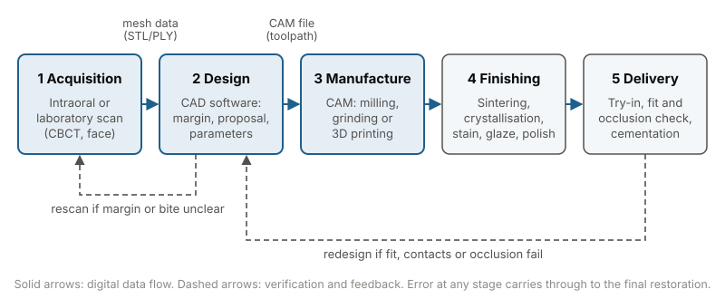
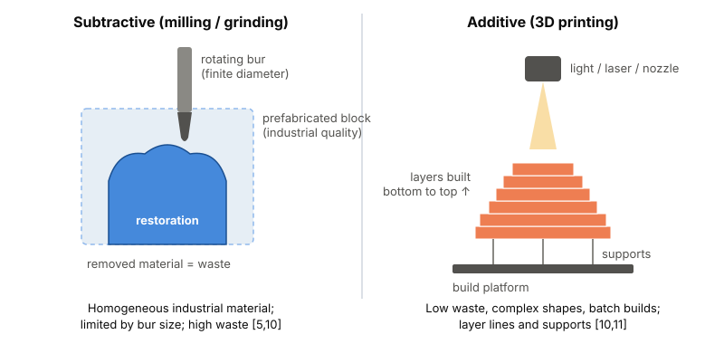
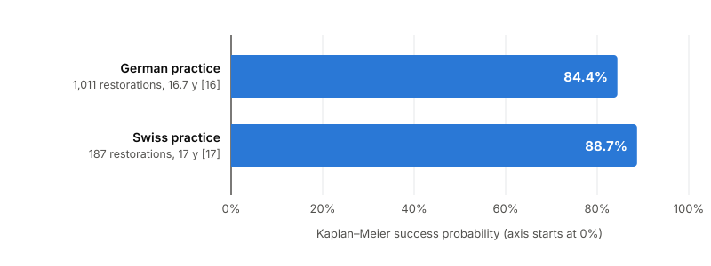

# Chapter 1. Introduction to CAD/CAM in Dentistry

## Learning Objectives

After reading this chapter, you should be able to:

1. Define CAD/CAM and place its development in dentistry in historical context.
2. Describe the three parts every dental CAD/CAM system shares: data acquisition, design and manufacture.
3. Compare subtractive and additive manufacturing and give the main indications for each.
4. Distinguish chairside, laboratory and centralised production, and open and closed systems.
5. Explain what trueness and precision mean and why they matter when reading accuracy studies.
6. Summarise the clinical evidence on the longevity, efficiency and limitations of CAD/CAM restorations.

---

## 1.1 What Is CAD/CAM?

**Computer-aided design (CAD)** means using software to create a three-dimensional (3D) model of an object. **Computer-aided manufacturing (CAM)** means using computer-controlled machines to turn that model into a physical object. Engineers had used both in the aerospace and automotive industries for decades before dentistry adopted them. In dentistry the "object" is usually a restoration, framework, appliance or surgical guide. It is designed for one patient and made once.

That last point explains why dentistry was slow to adopt CAD/CAM. Industrial CAD/CAM was built for mass production of identical parts, while dentistry needs mass customisation: every crown has a different geometry. Dental CAD/CAM only became practical once computing became cheap enough to make individual, one-off production economical [1–5].

Today the term covers a wide range of activities:

- capturing the shape of teeth, soft tissues and implants with an intraoral or laboratory scanner;
- designing restorations, frameworks, dentures, splints, aligners and guides in software;
- making those designs by milling, grinding or 3D printing;
- combining surface scans with cone-beam computed tomography (CBCT), facial scans and jaw-motion data to build a "virtual patient".

The broader term **digital dentistry** includes all of these, along with digital radiography, practice software and teledentistry. This book concentrates on the CAD/CAM chain: from data acquisition to the finished device.

---

## 1.2 A Brief History

### 1.2.1 The idea of the optical impression

The founding idea of dental CAD/CAM is usually credited to François Duret. In the early 1970s **[UNVERIFIED]** in France he proposed recording the prepared tooth optically rather than with an elastomeric impression, and then making a crown from that data by machine. By the late 1980s Duret and colleagues had shown a working system that could optically capture a preparation, design a crown on screen and mill it [1]. The system did not succeed commercially. Its importance is conceptual: it set out the scan–design–mill sequence that every later system has followed.

### 1.2.2 The first chairside system

In Zurich, Werner Mörmann was working on bonded ceramic inlays for posterior teeth. He saw that the long time needed to make ceramic restorations in the laboratory was a major barrier. His answer, developed with the electrical engineer Marco Brandestini **[UNVERIFIED]**, was a small mobile unit that combined an optoelectronic intraoral camera, a computer and a milling chamber. With it the dentist could design and mill a ceramic inlay and bond it at the same appointment. The first chairside ceramic inlay made this way was placed in 1985 **[UNVERIFIED]**. The system was later commercialised as CEREC (Chairside Economical Restoration of Esthetic Ceramics) [2]. Later generations split the system into a separate acquisition and design unit and a milling unit, and replaced the early two-dimensional design interface with full 3D software [2].

Chairside CAD/CAM matters historically because of its clinical record as well as its technology. Practice-based cohorts of early CEREC inlays and onlays have now been followed for more than 15 years (Section 1.8).

### 1.2.3 The laboratory and industrial route

Alongside chairside development, research groups in Europe, North America and Japan built systems for the dental laboratory and for industrial-scale production. A key driver was the arrival of high-strength oxide ceramics, especially alumina and later zirconia. These materials are difficult or impossible to process with traditional laboratory methods but are well suited to machining. Miyazaki and colleagues reviewed two decades of this work and concluded that CAD/CAM had become central to making ceramic crowns and FDPs, with growing roles in other fields of dentistry [3]. By the mid-2000s many commercial systems existed. They varied widely in capability, but none could yet capture data intraorally and produce the full range of restorations and materials available through traditional techniques [4].

### 1.2.4 The current era

Since about 2010, several developments have changed the field:

- **Powder-free, colour intraoral scanners** made the digital impression routine in many practices.
- **Open file formats**, especially STL, let clinicians send data to any laboratory or production centre.
- **Additive manufacturing** became accurate and affordable enough for models, guides, splints, provisional restorations and dentures.
- **New machinable materials** appeared: lithium disilicate, translucent multilayer zirconia and resin-ceramic hybrids.
- **Integration with CBCT and facial scanning** allowed prosthetically driven implant planning and facially guided aesthetic design.

**Table 1.1** Milestones in dental CAD/CAM

| Period | Development |
|---|---|
| Early 1970s **[UNVERIFIED]** | Concept of the optical impression and machined crown (Duret) |
| 1980s | First laboratory and university CAD/CAM prototypes; Duret system demonstrated [1] |
| 1985 **[UNVERIFIED]** | First chairside CAD/CAM ceramic inlay placed (Mörmann and Brandestini) [2] |
| 1990s | Laboratory systems for high-strength oxide ceramic frameworks [3] |
| 2000s | Zirconia frameworks enter routine use; 3D design software becomes standard [3,4] |
| 2010s | Powder-free colour intraoral scanners; open STL workflows; growth of 3D printing [5–8] |
| 2020s | Full-arch and implant digital workflows; virtual patient; AI-assisted design |

---

## 1.3 The Three Parts of Every CAD/CAM System

However complex, every dental CAD/CAM system has three linked parts [4,5]:

1. **Data acquisition (the scanner).** Captures the geometry of the oral situation and turns it into digital data.
2. **Design (the CAD software).** Creates the virtual restoration or device from that data.
3. **Manufacture (the CAM unit).** Turns the virtual design into a physical object.

The three parts may sit in one room or on three continents. A dentist can scan in the surgery, send the file to a laboratory for design, and have the restoration milled in a production centre elsewhere. The chain is digital throughout, and quality can be lost at any link (Figure 1.1).

**Figure 1.1** The CAD/CAM chain. Data acquisition, design and manufacture are followed by finishing and clinical delivery. Dashed arrows show verification and feedback: an unclear scan is repeated before design, and a restoration that fails at try-in is redesigned.

### 1.3.1 Data acquisition

Data can be acquired in two ways:

- **Directly**, with an *intraoral scanner (IOS)* in the patient's mouth (the digital or optical impression).
- **Indirectly**, with a *laboratory (extraoral) scanner* that digitises a conventional impression or a stone cast.

Intraoral scanners use several optical principles to measure surfaces, including confocal imaging, active triangulation and structured light. Software then stitches thousands of individual images into a continuous 3D surface [7]. The device acts both as a camera and as a reconstruction engine. As scanner hardware has become smaller, more of the work has moved into software [7]. Chapter 4 covers these technologies in detail.

A narrative review of 132 studies found that optical impressions reduce patient discomfort, save time, remove the need for plaster models and improve communication with the technician and the patient [8]. The same review lists clear limitations: deep subgingival margins and bleeding are hard to capture, there is a learning curve, and purchase and running costs are significant [8].

The usual output of a scan is a **surface mesh**: a network of small triangles describing the scanned surface. It is most often exported in the STL (Standard Tessellation Language) format. STL holds geometry only. Formats such as PLY and OBJ can also hold colour and texture. Chapter 2 discusses file formats and data handling.

### 1.3.2 Design

CAD software turns the scan into a restoration through a series of steps:

- define the preparation margin;
- set the path of insertion and block out undercuts;
- propose a restoration shape from a tooth library or from the patient's own anatomy (for example, the contralateral tooth or a pre-operative scan);
- let the operator adjust contours, contacts and occlusion;
- apply material-specific parameters such as cement space, minimum thickness and connector size.

Design software now covers far more than crowns. It is used for complete dentures, removable partial denture frameworks, implant abutments and bars, surgical guides, splints and orthodontic appliances [9]. Automated and AI-assisted design proposals are becoming common, which reduces operator time. They do not remove the need for clinical judgement about the design.

### 1.3.3 Manufacture

Manufacturing methods fall into two families, **subtractive** and **additive**. Section 1.4 compares them.

---

## 1.4 Subtractive and Additive Manufacturing

### 1.4.1 Subtractive manufacturing

In subtractive manufacturing, a restoration is milled or ground from a solid block or disc of prefabricated material. The industrially made blank is the main advantage. Ceramics, composites and metals made under controlled factory conditions are more homogeneous and contain fewer defects than the same materials processed by hand in a laboratory [5].

Milling machines are described by their number of **axes**. A 3-axis machine moves the tool along x, y and z. A 4-axis machine can also rotate the blank. A 5-axis machine adds a further rotation of the tool or the blank. More axes allow more complex geometry, such as undercuts, angled screw channels and long-span frameworks. Multi-axis milling is generally considered the best way to achieve accurate restorations [9].

The limitations of subtractive manufacturing follow from its physics:

- The bur cannot reproduce features smaller than its own diameter. This affects sharp internal angles, deep fissures and thin margins.
- Much of the blank becomes waste.
- Tools wear and must be replaced.
- Some materials, such as fully sintered zirconia and cobalt-chromium, are slow and costly to machine.

A comparative review concluded that subtractive methods tend to produce more homogeneous objects with acceptable accuracy, which suits intraoral prostheses that must withstand high occlusal loads [10].

### 1.4.2 Additive manufacturing

Additive manufacturing (3D printing) builds an object layer by layer from a digital model. The main technologies used in dentistry are vat photopolymerisation (stereolithography, digital light processing and LCD printing), material jetting, fused deposition modelling, and selective laser melting or sintering of metal powders [11,12].

Additive methods have several advantages. They waste little material, can produce complex internal geometry, and can build many parts at once. Large objects with very varied surfaces can be made with competitive accuracy [10]. Early reviews predicted that layered manufacturing would cause a "second revolution" in making dental devices, once printable materials of suitable quality were available [11]. Many of those predictions have come true for models, surgical guides, custom trays, occlusal splints, provisional restorations, denture bases and laser-melted metal frameworks [12]. When those reviews were written, printing of ceramics for definitive restorations was not yet clinically established [9]. It is still an active area of research (Chapter 11).

Figure 1.2 contrasts the two approaches.

**Figure 1.2** Subtractive and additive manufacturing. Milling removes material from an industrially made block with a bur of finite diameter; printing builds the object layer by layer on supports [5,10,11].

**Table 1.2** Subtractive and additive manufacturing compared

| Feature | Subtractive (milling/grinding) | Additive (3D printing) |
|---|---|---|
| Starting material | Prefabricated block or disc | Liquid resin, powder or filament |
| Material quality | Industrially controlled, homogeneous [5,10] | Depends on printer, resin, orientation and post-processing |
| Geometric limits | Bur diameter; undercuts need more axes | Layer thickness; supports; shrinkage on curing or sintering |
| Waste | High | Low |
| Batch production | Usually one unit at a time | Many units per build |
| Typical uses | Crowns, inlays, veneers, FDPs, abutments, zirconia and metal frameworks | Models, guides, trays, splints, provisionals, dentures, metal RPD frameworks |

The two methods complement each other. A typical modern implant case might use a printed surgical guide, a milled titanium base and zirconia crown, and a printed model to check the result.

---

## 1.5 Where Production Happens: Chairside, Laboratory and Centralised

CAD/CAM work is organised in three settings [5]:

1. **Chairside (in-office).** The dentist, often with a trained assistant, scans, designs and mills or prints the restoration in the practice. Single-visit treatment becomes possible. Chairside workflows now cover the full chain, including intraoral scanners, design software, compact mills and fast sintering furnaces. Available materials include PMMA, composite resins and many ceramics [13].
2. **Laboratory.** The dentist sends a digital or conventional impression to a laboratory, which designs and makes the restoration with its own equipment. This keeps the technician's skills in design, characterisation and aesthetic finishing.
3. **Centralised (production centre).** Laboratories or clinics send design files to an industrial centre with high-end milling machines, sintering furnaces or metal printers. This model is common for cobalt-chromium and titanium frameworks, large zirconia cases and laser-melted parts.

Most real workflows are **hybrids**. A clinician might scan chairside, a laboratory might design, and a centre might mill a titanium bar that the laboratory then finishes.

> **Clinical Tip.** Choose the production setting for each case rather than once for the whole practice. A single posterior onlay suits chairside production well. A complex anterior aesthetic case or a complete-arch implant framework usually benefits from a skilled technician and industrial equipment.

---

## 1.6 Open and Closed Systems

A **closed system** keeps acquisition, design and manufacture within one manufacturer's ecosystem, often using proprietary file formats. Its advantages are smooth integration, one point of technical support and validated combinations of material and machine. Its drawbacks are dependence on one vendor, limited choice of laboratories and materials, and sometimes licence or file-export fees.

An **open system** exports and imports standard formats (STL, PLY, OBJ), so a scan from one manufacturer's scanner can be designed in another company's software and made on a third company's mill or printer. Open workflows give clinicians and laboratories freedom, but the user takes on responsibility for checking that the parts work together. For example, cement-space settings that suit one mill may not suit another.

Many systems today are **partially open**. They export open formats but keep certain features, such as particular implant libraries or material-specific milling strategies, inside their own ecosystem. Before buying a system, ask exactly what can be exported, in which formats, and whether there are charges.

---

## 1.7 A First Look at CAD/CAM Materials

Chapters 13–15 cover materials in depth. A brief overview helps here, because materials and manufacturing technology have developed together.

- **Glass-ceramics** (feldspathic, leucite-reinforced, lithium disilicate and zirconia-reinforced lithium silicate) are etchable, aesthetic and bonded adhesively. Bonded monolithic glass-ceramic restorations have a long clinical record. They are the main choice for defect-oriented restorations such as inlays, onlays and posterior crowns [14].
- **Zirconia** (from 3Y-TZP to the more translucent 4Y- and 5Y-PSZ, including multilayer blanks) offers high strength. Monolithic, full-contour zirconia restorations are steadily gaining market share at the expense of bilayered ones [14].
- Lithium disilicate and zirconia together now dominate metal-free fixed prosthodontics. They offer good aesthetics, biocompatibility, mechanical strength, minimal thickness and favourable wear behaviour [15].
- **Resin-based and hybrid materials** (CAD/CAM composites and polymer-infiltrated ceramic networks) have high edge stability, so thin margins can be milled, and they are easy to repair. Long-term clinical evidence is still limited [14].
- **Polymers** (PMMA, PEEK) are used for provisional restorations, frameworks and dentures. **Metals** (titanium, cobalt-chromium) are milled or laser-melted for abutments, bars and frameworks.

Every material needs its own design parameters, milling or printing strategy, post-processing, and cementation protocol. Matching the material to the clinical situation and processing it correctly is the clinician's responsibility, not the machine's.

---

## 1.8 What Does the Evidence Say?

Three questions matter most to clinicians. Do CAD/CAM restorations last? Is the digital workflow accurate enough? Is it more efficient?

### 1.8.1 Longevity

The longest follow-up data come from early chairside feldspathic ceramic inlays and onlays (Figure 1.3):

- In a German practice, 1,011 CEREC restorations in 299 patients, placed between 1987 and 1990, were followed for up to 18 years. Kaplan–Meier success probability was 84.4% at 16.7 years. Ceramic and tooth fractures were the most common causes of failure. Premolars did better than molars, and vital teeth better than non-vital teeth [16].
- In a Swiss private practice, 187 Cerec 1 inlays and onlays were followed for up to 17 years, with a Kaplan–Meier success rate of 88.7%. Most failures were ceramic fractures (62% of failures) or tooth fractures (14%) [17].

**Figure 1.3** Long-term Kaplan–Meier success of early chairside feldspathic inlays and onlays in two private practices. Data from [16,17].

> **Evidence Box.** These are case series from single practices that used first-generation equipment and materials, so they carry a risk of selection and operator bias. Still, they show that adhesively bonded, machined ceramic restorations can perform well over the long term. Modern materials and software should be expected to perform at least as well, but this needs to be confirmed by long-term trials rather than assumed.

### 1.8.2 Accuracy

Accuracy in digital dentistry is described by two separate measures:

- **Trueness:** how close a measurement is to the true geometry.
- **Precision:** how close repeated measurements are to each other.

A device can be precise but not true: it repeats the same error every time. Studies that report only "accuracy" without separating these two measures are hard to interpret.

In an influential in vitro study, Ender and Mehl used a high-accuracy reference scanner to compare complete-arch impressions on a steel model. Conventional impressions achieved a trueness of about 20 µm and a precision of about 12 µm. The digital impressions tested were significantly less accurate (trueness about 59 µm, precision about 32 µm) and showed systematic deviation across the arch [18]. Scanners have improved a great deal since then. The main lesson still holds, though: **scan error increases with scan length**. A single crown is far more forgiving than a complete arch. Mangano and colleagues reached a similar conclusion. Current intraoral scanners are accurate enough for inlays, onlays, single crowns, copings and short-span FDPs on teeth and implants, but the evidence does not support their use for long-span restorations [8]. Chapter 3 covers accuracy in detail.

### 1.8.3 Efficiency and cost

Digital workflows are often assumed to be faster. The evidence is more nuanced:

- In a prospective crossover study of implant-supported single crowns, the digital workflow cost significantly less than the conventional one, with an overall cost reduction of about 18%, mainly because laboratory costs were lower [19].
- In a randomised controlled trial of complete-arch impressions for three-unit FDPs, conventional polyether impressions took significantly less time than two of the three intraoral scanners tested (658 s versus 1,091–1,702 s, including powdering and bite registration). Clinicians preferred the conventional method [20]. Most of the scanners tested needed powder and have since been replaced by faster, powder-free devices.
- A systematic review of complete digital workflows in fixed prosthodontics found only three randomised trials. The fully digital workflow for implant crowns was more than twice as fast as a mixed analogue–digital workflow. However, the authors concluded that research was not keeping pace with industrial development and that evidence-based recommendations could not yet be made [21].

The honest conclusion is that efficiency depends on the indication, the equipment, the operator's experience and how fully the workflow is digitised. Gains are clearest for single units and implant crowns. They are less certain for complete-arch work.

---

## 1.9 Advantages and Limitations

**Table 1.3** Advantages and limitations of dental CAD/CAM

| Advantages | Limitations |
|---|---|
| Industrially made, nearly defect-free materials [5] | High purchase, licence and maintenance costs [6,8,9] |
| Standardised, reproducible production [5,14] | Learning curve for scanning and design [8] |
| Single-visit restorations (chairside) [2,13] | Difficulty capturing deep subgingival margins and bleeding sites [8] |
| More comfortable for patients; no impression trays [8] | Reduced accuracy over long spans and complete arches [8,18] |
| Digital records that are easy to store, copy and transmit [5] | Milling limits (bur size, thin margins) and printing limits (layering, resin properties) |
| Better communication between clinic and laboratory, and with patients [8,22] | Data-management, compatibility and privacy issues in open workflows |
| Access to new treatment concepts, such as guided surgery, the virtual patient and monolithic restorations [12,22] | Long-term clinical evidence lags behind the release of new products [21] |

Rekow has argued that digital dentistry has been disruptive but not destructive. It has improved the patient experience, widened restorative options, increased efficiency and created new forms of collaboration between professionals [22]. That is a fair summary of where the field stands. The technology is mature enough to rely on for many everyday indications, and young enough that every new claim should be checked against evidence.

---

## 1.10 The Digital Team

CAD/CAM changes who does what:

- **The dentist** remains responsible for diagnosis, treatment planning, tooth preparation, soft-tissue management, the quality of the digital impression, checking the design and final delivery. A poor scan cannot be rescued by excellent software.
- **The dental technician** increasingly works as a digital designer and production manager, while keeping the skills in morphology, occlusion, colour and characterisation that machines cannot replace.
- **The dental assistant or nurse** often scans, manages the mill or printer and handles post-processing in chairside workflows.
- **Engineers and software developers** at manufacturers and production centres, who used to be distant from dentistry, are now part of the extended team.

Good results depend on each member understanding the whole chain, not only their own link. This book is written for all of them.

---

## Key Points

- CAD/CAM in dentistry has three parts: **acquisition, design and manufacture**. Errors at any one of them carry through to the final restoration.
- The field began with Duret's concept of the optical impression and became clinically real with Mörmann's chairside system in 1985.
- **Subtractive** manufacturing gives homogeneous, industrially controlled materials for load-bearing restorations. **Additive** manufacturing gives efficient, low-waste production of complex shapes. The two methods complement each other.
- Production can happen **chairside, in the laboratory or in a centralised facility**, and most workflows are hybrids.
- Accuracy should be reported as **trueness and precision**. Scan error grows with scan length, so long-span restorations remain the weakest link.
- Practice-based case series report Kaplan–Meier success of about 84–89% for early chairside ceramic inlays and onlays at 16–18 years.
- Digital workflows can reduce cost and time, especially for single units and implant crowns, but high-quality trials remain scarce.

---

## Review Questions

1. Name the three parts of a CAD/CAM system and give one source of error in each.
2. Why did the move from mass production to "mass customisation" matter for adopting CAD/CAM in dentistry?
3. Explain the difference between trueness and precision. Give an example of a scanner that is precise but not true.
4. A clinician needs a complete-arch implant-supported framework. Which acquisition and manufacturing methods would you recommend, and why? Use the evidence on scan length.
5. List two advantages and two disadvantages of a closed CAD/CAM system compared with an open one.
6. What do the long-term CEREC case series show, and what are their methodological limitations?
7. Why might a digital workflow be faster for an implant single crown but not for a complete-arch impression?

---

## References

1. Duret F, Blouin JL, Duret B. CAD-CAM in dentistry. J Am Dent Assoc. 1988;117(6):715–20. doi:10.14219/jada.archive.1988.0096
2. Mörmann WH. The evolution of the CEREC system. J Am Dent Assoc. 2006;137 Suppl:7S–13S. doi:10.14219/jada.archive.2006.0398
3. Miyazaki T, Hotta Y, Kunii J, Kuriyama S, Tamaki Y. A review of dental CAD/CAM: current status and future perspectives from 20 years of experience. Dent Mater J. 2009;28(1):44–56. doi:10.4012/dmj.28.44
4. Strub JR, Rekow ED, Witkowski S. Computer-aided design and fabrication of dental restorations: current systems and future possibilities. J Am Dent Assoc. 2006;137(9):1289–96. doi:10.14219/jada.archive.2006.0389
5. Beuer F, Schweiger J, Edelhoff D. Digital dentistry: an overview of recent developments for CAD/CAM generated restorations. Br Dent J. 2008;204(9):505–11. doi:10.1038/sj.bdj.2008.350
6. Davidowitz G, Kotick PG. The use of CAD/CAM in dentistry. Dent Clin North Am. 2011;55(3):559–70. doi:10.1016/j.cden.2011.02.011
7. Richert R, Goujat A, Venet L, Viguie G, Viennot S, Robinson P, et al. Intraoral scanner technologies: a review to make a successful impression. J Healthc Eng. 2017;2017:8427595. doi:10.1155/2017/8427595
8. Mangano F, Gandolfi A, Luongo G, Logozzo S. Intraoral scanners in dentistry: a review of the current literature. BMC Oral Health. 2017;17(1):149. doi:10.1186/s12903-017-0442-x
9. Alghazzawi TF. Advancements in CAD/CAM technology: options for practical implementation. J Prosthodont Res. 2016;60(2):72–84. doi:10.1016/j.jpor.2016.01.003
10. Abduo J, Lyons K, Bennamoun M. Trends in computer-aided manufacturing in prosthodontics: a review of the available streams. Int J Dent. 2014;2014:783948. doi:10.1155/2014/783948
11. van Noort R. The future of dental devices is digital. Dent Mater. 2012;28(1):3–12. doi:10.1016/j.dental.2011.10.014
12. Dawood A, Marti Marti B, Sauret-Jackson V, Darwood A. 3D printing in dentistry. Br Dent J. 2015;219(11):521–9. doi:10.1038/sj.bdj.2015.914
13. Blatz MB, Conejo J. The current state of chairside digital dentistry and materials. Dent Clin North Am. 2019;63(2):175–97. doi:10.1016/j.cden.2018.11.002
14. Spitznagel FA, Boldt J, Gierthmuehlen PC. CAD/CAM ceramic restorative materials for natural teeth. J Dent Res. 2018;97(10):1082–91. doi:10.1177/0022034518779759
15. Zarone F, Di Mauro MI, Ausiello P, Ruggiero G, Sorrentino R. Current status on lithium disilicate and zirconia: a narrative review. BMC Oral Health. 2019;19(1):134. doi:10.1186/s12903-019-0838-x
16. Reiss B. Clinical results of Cerec inlays in a dental practice over a period of 18 years. Int J Comput Dent. 2006;9(1):11–22. PMID:16608051
17. Otto T, Schneider D. Long-term clinical results of chairside Cerec CAD/CAM inlays and onlays: a case series. Int J Prosthodont. 2008;21(1):53–9. PMID:18350948
18. Ender A, Mehl A. Accuracy of complete-arch dental impressions: a new method of measuring trueness and precision. J Prosthet Dent. 2013;109(2):121–8. doi:10.1016/S0022-3913(13)60028-1
19. Joda T, Brägger U. Digital vs. conventional implant prosthetic workflows: a cost/time analysis. Clin Oral Implants Res. 2015;26(12):1430–5. doi:10.1111/clr.12476
20. Sailer I, Mühlemann S, Fehmer V, Hämmerle CHF, Benic GI. Randomized controlled clinical trial of digital and conventional workflows for the fabrication of zirconia-ceramic fixed partial dentures. Part I: time efficiency of complete-arch digital scans versus conventional impressions. J Prosthet Dent. 2019;121(1):69–75. doi:10.1016/j.prosdent.2018.04.021
21. Joda T, Zarone F, Ferrari M. The complete digital workflow in fixed prosthodontics: a systematic review. BMC Oral Health. 2017;17(1):124. doi:10.1186/s12903-017-0415-0
22. Rekow ED. Digital dentistry: the new state of the art — is it disruptive or destructive? Dent Mater. 2020;36(1):9–24. doi:10.1016/j.dental.2019.08.103
