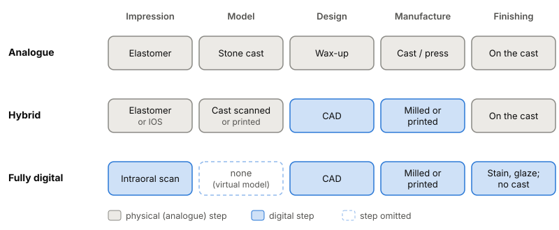
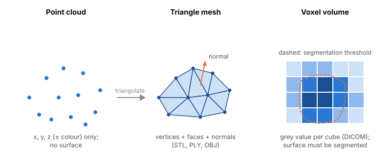
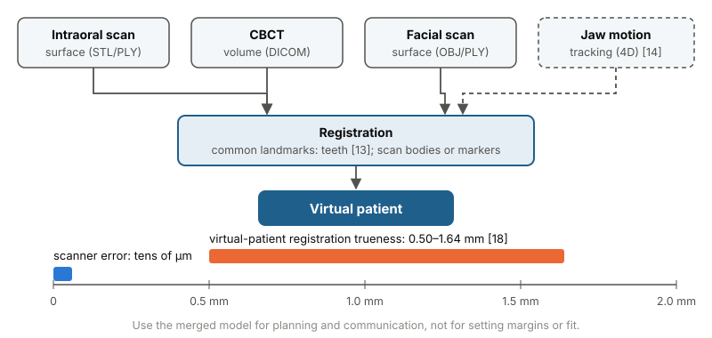

# Chapter 2. The Digital Workflow and Data Formats

## Learning Objectives

After reading this chapter, you should be able to:

1. Distinguish analogue, hybrid (mixed analogue–digital) and fully digital workflows, and summarise the evidence comparing them.
2. Explain how 3D surface and volume data are structured: point clouds, triangle meshes and voxels.
3. Identify the main file formats used in dental CAD/CAM (STL, PLY, OBJ, 3MF, DICOM) and know what each can and cannot carry.
4. Assess the practical consequences of open and closed system architectures.
5. Apply basic rules for transferring, storing and protecting digital patient data, including its legal status as personal and biometric data.
6. Describe how the "virtual patient" is built from intraoral, facial, radiographic and motion data, and how accurate it currently is.

---

## 2.1 What Is a Digital Workflow?

A **workflow** is the sequence of clinical and technical steps that turns a diagnosis into a finished treatment. In CAD/CAM dentistry it helps to sort workflows by how many of those steps are digital.

- **Analogue (conventional) workflow.** Elastomeric impression, stone cast, wax-up, investment and casting or pressing, hand layering. No step is digital.
- **Hybrid (mixed analogue–digital) workflow.** At least one step is digital and at least one is physical. The most common example is a conventional impression, poured in stone and digitised with a laboratory scanner, then designed and milled. Another is a digital impression from which a printed model is made for the technician to finish the restoration on.
- **Fully (complete) digital workflow.** Every step, from data acquisition to the finished restoration, happens without a physical model. The intraoral scan is designed directly and the restoration is milled or printed and delivered without being checked on a cast.

Figure 2.1 shows which steps are physical and which are digital in each workflow.

**Figure 2.1** Analogue, hybrid and fully digital workflows for a single crown. Grey boxes are physical steps; blue boxes are digital steps. In the hybrid row the impression is shown as elastomeric (grey); if an intraoral scan is used instead, that step is digital. In the fully digital workflow there is no physical model.

**Table 2.1** Typical steps in the three workflows for a single crown

| Step | Analogue | Hybrid | Fully digital |
|---|---|---|---|
| Impression | Elastomeric | Elastomeric *or* intraoral scan | Intraoral scan |
| Model | Stone cast | Stone cast scanned *or* printed model from scan | None (virtual model) |
| Bite and articulation | Mechanical articulator | Mechanical or virtual | Virtual articulator / buccal scan |
| Design | Wax-up | CAD | CAD |
| Manufacture | Cast, pressed or layered | Milled or printed | Milled or printed (monolithic) |
| Finishing | On the cast | On the cast | Without a cast; stain and glaze |

A systematic review of randomised controlled trials on complete digital workflows in fixed prosthodontics found only three eligible trials. Their designs varied widely and none had any follow-up [1]. In one trial, lithium disilicate crowns made in a fully digital workflow had lower marginal precision (113.8 µm) than conventionally made metal-ceramic (92.4 µm) or zirconia crowns (68.5 µm). In another, the fully digital workflow for implant crowns took less than half the time of a mixed workflow (75.3 versus 156.6 minutes) [1]. The authors concluded that clinical research was moving more slowly than industrial development [1]. That conclusion still frames how this book reads new evidence.

> **Clinical Tip.** "Fully digital" is not automatically better. For a single monolithic posterior crown it is efficient, although randomised evidence for the complete digital workflow is still scarce [1]. For a complex anterior case, a printed model often still helps the technician check contacts, emergence profile and characterisation. Choose the degree of digitisation case by case.

---

## 2.2 Evidence Comparing Digital and Conventional Workflows

Chapter 1 summarised the evidence in outline. This section adds detail relevant to choosing a workflow.

### 2.2.1 Accuracy

A systematic review comparing digital and conventional impressions in fixed prosthodontics concluded that [2]:

- digital impressions are as accurate as conventional ones for crowns and short-span FDPs;
- for implant-supported crowns and FDPs, digital impressions give clinically acceptable accuracy;
- for **complete-arch** impressions, conventional methods were more accurate, and the authors still recommended them.

Intraoral conditions matter as well as the device. In a clinical study of one patient, the full arch was scanned 10 times with an intraoral scanner. Precision was lower (mean deviation 50 µm) than when the same scanner digitised stone casts (25 µm), and lower again than a desktop laboratory scanner (10 µm) [3]. The authors suggested that saliva and limited space in the mouth contribute to the difference [3]. The physical environment of the mouth is therefore part of the measurement system.

### 2.2.2 Time, cost and patient experience

- In a randomised crossover trial of single implant impressions, patients rated convenience on a 0–100 scale. They gave intraoral scanning a mean score of 78.6, compared with 53.6 for polyether impressions. Every patient said they would choose the digital workflow in future. The scan was also faster (14.8 versus 17.9 minutes) [4].
- In a crossover study of 20 patients with implant crowns, direct treatment costs were lower in the digital workflow (1815 versus 2120 CHF), mainly because laboratory costs were lower, and a cost-minimisation analysis showed an 18% cost reduction. The digital arm used customised titanium abutments with CAD/CAM zirconia, and the conventional arm used standard abutments with PFM crowns [5].
- In a randomised trial of 10 patients, **complete-arch** scans with three earlier-generation intraoral scanners, two of which needed powder, took longer than conventional impressions (significantly so for two scanners), and clinicians preferred the conventional impression [6].

The overall picture is consistent but rests on small studies. Digital workflows benefit single implant crowns [4,5], and for complete arches earlier scanners were slower than conventional impressions [6].

### 2.2.3 Infection control and logistics

A less obvious advantage of digital workflows is that fewer physical items are transported. Conventional impressions, bite records and stone casts can carry microorganisms between clinic and laboratory, and cast models are often stored for long periods [7]. A digital file cannot carry infection. The intraoral scanner tip, however, must be reprocessed to a validated protocol, and manufacturers often give limited guidance on how to do this [7].

---

## 2.3 How 3D Data Are Structured

Clinicians do not need to be software engineers. Knowing what is inside a 3D file, however, explains many everyday problems: holes in a scan, a restoration that "does not fit" in the software, or a file too large to email.

### 2.3.1 Point clouds

An optical scanner measures the position of many points on a surface. The raw result is a **point cloud**: a list of x, y, z coordinates, sometimes with colour values. A point cloud has no surface. It is a set of dots in space.

### 2.3.2 Triangle meshes

To create a usable surface, the software connects neighbouring points into triangles, a process called **triangulation** or **tessellation**. The result is a **mesh** made up of:

- **vertices** (the points);
- **faces** (the triangles that connect them);
- **normals** (the direction each face points, which tells the software which side is "outside").

Key mesh properties include:

- **Resolution (density).** More, smaller triangles capture finer detail but produce larger files. In an in vitro study on typodonts, the same scan exported at high, moderate and low resolution gave meshes with about 790,000, 592,000 and 198,000 points on the abutment teeth respectively. The authors recommended high-resolution export for restorative work [8].
- **Decimation (mesh reduction).** Software can remove triangles to shrink a file. For CBCT-derived maxillofacial models from cadaver heads, a 50% reduction produced no 3D deviation. Deviations appeared at 75% reduction and grew larger at 90% [9]. Moderate reduction is safe for large anatomical models. It is much riskier near a preparation margin, where a few tens of micrometres matter.
- **Watertightness.** A closed ("watertight" or "manifold") mesh has no holes. This is essential for 3D printing and for many design operations. Scans often have holes in areas the scanner could not see, which the software fills by interpolation. Interpolated areas are estimates, not measurements.

> **Lab Note.** If a margin falls inside an area the software has filled or smoothed, the restoration is being designed on invented data. Ask for a rescan of that area rather than designing on top of it.

### 2.3.3 Voxels and volume data

CBCT and medical CT produce **volume** data rather than surfaces. The volume is a three-dimensional grid of small cubes (**voxels**), each holding a grey value related to radiographic density. To use CBCT data alongside surface scans, the structures of interest (bone, teeth, nerve canal, airway) must be **segmented** and converted into surface meshes. Segmentation depends on threshold settings and image artefacts, so a CBCT-derived surface is usually less true to the tooth surface than an intraoral scan of the same teeth (expert opinion; see Chapter 6).

Figure 2.2 compares the three data structures.

**Figure 2.2** How 3D data are structured. A point cloud has coordinates but no surface; a triangle mesh joins the points into faces with normals; a voxel volume stores a grey value per cube, from which a surface must be segmented.

---

## 2.4 File Formats

**Table 2.2** Common file formats in dental CAD/CAM

| Format | Type | Geometry | Colour/texture | Typical use | Notes |
|---|---|---|---|---|---|
| **STL** | Surface mesh | Yes | No | Universal exchange of scans and designs; 3D printing | De facto standard. Carries no units, colour, or patient or order information |
| **PLY** | Surface mesh or point cloud | Yes | Yes (per vertex) | Colour intraoral scans; research | Widely supported; keeps scanner colour |
| **OBJ** | Surface mesh | Yes | Yes (via linked texture images) | Colour scans; facial scans; visualisation | Texture is stored in separate image and material files, which must travel with the OBJ |
| **3MF** | Surface mesh plus build data | Yes | Yes | 3D printing | Modern printing format; can include units, materials and multiple parts |
| **DICOM** | Volume (voxels) and images | Volume | Grey values | CBCT, CT, radiographs | Medical imaging standard; stores patient metadata in the file header |
| Proprietary formats | Varies | Yes | Often | Within one manufacturer's system | Can include margin lines, preparation data, bite alignment and order details; may need conversion or a licence to export |

Three practical points:

1. **STL has no units.** Most dental software assumes millimetres, but a file opened in general-purpose software may be scaled wrongly.
2. **Colour matters clinically.** Colour helps identify the margin, gingiva, plaque and shade, and helps the technician understand the case. Exporting to STL discards it. Where the receiving software can read it, prefer PLY or OBJ.
3. **Proprietary files carry more than geometry.** A native file may contain the margin line, insertion axis, scan-body alignment and bite registration. Exporting to a neutral format can lose that information. Agree with your laboratory which format to send.

---

## 2.5 Open and Closed Architectures in Practice

Chapter 1 introduced the difference between open and closed systems. In practice, the questions that matter are:

- **Export:** Can I export native scans in STL, PLY or OBJ without extra fees? Is colour kept? Is the bite alignment kept?
- **Import:** Can the design software import scans from other scanners, and CBCT DICOM data, without loss?
- **Libraries:** Are the implant scan-body and abutment libraries I need available in the software I use?
- **Manufacturing:** Can I send designs to any mill or printer, or only to the manufacturer's own? Are validated material settings available for third-party materials?
- **Updates:** Do software updates change exported files or require new licences?

Software compatibility problems, ongoing costs for maintenance and software updates, and the need for repeat scans are all reported limitations of intraoral scanning in practice [10]. Each additional conversion between systems adds a chance of error, such as lost colour, misaligned bites, unit mismatches or smoothed margins. Before going live, test the workflow end to end with a few cases.

---

## 2.6 Transferring, Storing and Backing Up Data

### 2.6.1 Transfer

Scans are usually sent to laboratories through the manufacturer's cloud portal or a laboratory platform. General-purpose file-sharing services or email are less suitable. Wherever the data go, they must be:

- **encrypted** in transit and at rest;
- **identified** reliably, with the patient, tooth, material and shade linked to the correct file;
- **traceable**, so you know who opened the file and when.

### 2.6.2 Storage and backup

A digital record does not deteriorate with time like a stone cast, but it can be ruined by a computer virus [7] and lost through hardware failure, accidental deletion or ransomware. A practical rule from information technology is **3-2-1**:

- keep at least **three** copies,
- on **two** different types of storage,
- with **one** copy off-site or in a secure cloud.

Retention periods for dental records vary by country. Intraoral scans, like plaster models, are part of the medical record [11], and it is sensible to treat design files the same way, so keep them for at least the period your jurisdiction requires for other clinical records. Digital storage is cheap, which makes it easy to keep pre-operative scans and compare them over time. This is useful for monitoring wear, recession and tooth movement.

---

## 2.7 Data Protection and Privacy

### 2.7.1 Why a dental scan is sensitive data

It is easy to think of an intraoral scan as "just a shape". Legally, it is not. An analysis of the European **General Data Protection Regulation (GDPR)** concluded that a 3D intraoral scan is **biometric data**. Features such as the palatal rugae pattern are stable enough to identify a person regardless of age or dental treatment. A plaster model is not itself personal data, but both the model and the scan are part of the medical record [11]. Biometric data must be processed in line with GDPR [11]; under the Regulation, biometric and health data are special categories with stricter processing rules **[UNVERIFIED]**. In the United States, the HIPAA Privacy and Security Rules govern health information held by dental practices and by their business associates, which can include cloud providers **[UNVERIFIED]**.

**Verification note — Minor conflict.** The marked claims above could not be confirmed.

| Claim not confirmed | Conflict | Reason | To resolve |
|---|---|---|---|
| GDPR special categories | **Minor** | Not in the abstract of ref 11; legal point | Cite GDPR Article 9 |
| HIPAA scope | **Minor** | Uncited | Cite an HHS source |

### 2.7.2 Practical safeguards

GDPR sets the goals but does not dictate the technical means. ISO or NIST standards can help a practice or laboratory build an appropriate data-security system [11]. A minimum set of safeguards includes:

- a written data-processing agreement with every laboratory and cloud provider;
- multi-factor authentication on scanner, design and cloud accounts;
- automatic security updates on all computers connected to the scanner or mill;
- separate user accounts, with no shared passwords at the scanner;
- removing or pseudonymising identifiers when data are used for teaching, publication or research;
- a documented process for responding to data breaches.

### 2.7.3 Data and artificial intelligence

Large collections of scans are valuable for training artificial intelligence (AI) systems, for example for automatic margin detection, tooth segmentation and crown design. AI in dentistry is limited by data availability, data structure and methodological standards, and individual privacy, rights and autonomy need to be put "front and center" [12]. One proposed solution is **federated learning**, in which models are trained across many sites without the raw data leaving each site [12]. Before agreeing to software terms that allow a vendor to reuse your patients' scans, read exactly what consent you are giving on their behalf.

---

## 2.8 The Virtual Patient

### 2.8.1 Concept

The **virtual patient** is a 3D representation of the patient created by merging several datasets [13]:

- **intraoral scans** of the teeth and soft tissues (surface, STL/PLY);
- **CBCT** of bone, roots and anatomical structures (volume, DICOM);
- **facial scans** of the face (surface, OBJ/PLY).

Table 2.3 summarises what each dataset contributes.

**Table 2.3** Datasets that make up the virtual patient

| Dataset | Data type | Typical format | What it adds |
|---|---|---|---|
| Intraoral scan | Surface | STL, PLY | Teeth and soft tissue in detail [13] |
| CBCT | Volume (voxels) | DICOM | Bone, roots and anatomical structures [13] |
| Facial scan | Surface | OBJ, PLY | Facial surface and expression [13] |
| Jaw motion tracking | Movement over time | System-specific | Mandibular movement, turning the 3D model into a 4D one [14] |

The first published proof-of-principle (online in 2014) used teeth present in all three datasets as common landmarks to superimpose the images [13]. The authors described the virtual patient as a tool for treatment simulation, managing patient expectations and communication. They named a "4D virtual patient in motion" as the next step [13]. That step has now been described. Jaw motion tracking (JMT) data have been added to the intraoral, facial and CBCT data, using the virtual casts as the common link to align all four [14].

The virtual patient sits at the centre of several workflows covered later in this book:

- **facially driven aesthetic design.** Two-dimensional photographs and smartphone videos of the smile in motion are used to plan tooth position and form, and then carried into 3D design [15];
- **prosthetically driven implant planning**, where the planned restoration guides implant position (Chapter 17);
- **dynamic occlusal design**, where recorded jaw movements replace average-value articulator settings. This has been described in a clinical report of full-mouth rehabilitation for severe tooth wear [16];
- **the "digital twin"**, an evolving, longitudinal record of a patient's digital data used for monitoring and prediction [17].

### 2.8.2 How accurate is it?

Merging datasets adds a **registration error** on top of the error in each dataset. The evidence shows that this error is much larger than scanner error:

- An observational clinical study of 10 participants compared virtual patients built from facial and intraoral scans, aligned with two scan-body systems, against CBCT. Trueness ranged from **0.50 to 1.64 mm** and precision from 0.04 to 0.14 mm [18] (Figure 2.3).
- In a randomised clinical study of 150 patients, automatic AI-based registration of CBCT with intraoral scans was as accurate as manual methods in patients without restorations. When multiple restorations caused artefacts, the operator's experience mattered, and free-ended edentulous areas reduced accuracy [19].

**Figure 2.3** Building the virtual patient. Intraoral, CBCT, facial and jaw-motion data are registered through common landmarks [13,14]. The scale compares scanner error (tens of micrometres) with the registration trueness of facial–intraoral virtual patients (0.50–1.64 mm) [18].

> **Evidence Box.** Scanner accuracy is measured in tens of micrometres. Virtual patient registration is measured in tenths of millimetres to over a millimetre. A merged facial scan is excellent for aesthetic planning and communication. It is not accurate enough to set the margin of a restoration or to replace a direct clinical check of the facial midline and occlusal plane. Always check which dataset the design is actually built on.

### 2.8.3 Sources of registration error

- **Different patient positions** between datasets (head posture, lip position, mouth open or closed).
- **Artefacts** in CBCT from multiple restorations [19].
- **Free-ended edentulous areas**; in one study the absolute number of missing teeth had no effect [19].
- **Soft-tissue movement** between facial scans and changes in expression.
- **Segmentation thresholds** when converting CBCT to surfaces.

Using reference devices (scan bodies, fiducial markers), keeping patient position consistent, and checking every superimposition visually all reduce these errors.

---

## 2.9 Putting It Together: A Workflow Design Checklist

Before starting a digital case, answer these questions:

1. **Indication:** Is the evidence strong for a digital impression in this case, or is it at the limit, as for a complete arch [2]? Deep margins and multiple implants also need care (see Chapters 4 and 17).
2. **Degree of digitisation:** Analogue, hybrid or fully digital? Is a physical model needed for verification?
3. **Data:** Which datasets are needed (IOS, CBCT, facial scan, jaw motion), and how will they be registered?
4. **Format:** Which file formats will the laboratory or production centre accept? Will colour and bite alignment survive the transfer?
5. **Production:** Chairside, laboratory or centralised?
6. **Protection:** Are transfer and storage encrypted, documented and covered by agreements? Is a backup in place?
7. **Verification:** At which points will the design and the product be checked, and against what reference?

---

## Key Points

- Workflows can be **analogue, hybrid or fully digital**. The evidence supports digital impressions for crowns, short-span FDPs and implant crowns. Conventional impressions are still recommended by systematic review for complete arches [2].
- In crossover studies of 20 patients each, patients preferred intraoral scanning for single implant impressions, and the digital workflow reduced time and cost for single implant crowns [4,5].
- 3D data are stored as **point clouds, meshes or voxels**. Export resolution changes how many points describe a preparation [8], and mesh reduction beyond 50% adds deviation to CBCT-derived models [9]. Filled holes are estimates, not measurements.
- **STL** is universal but carries only geometry. **PLY/OBJ** carry colour, **3MF** carries printing data, and **DICOM** carries volume data.
- Every conversion between systems is a chance for error. Test open workflows end to end.
- An intraoral scan is **biometric personal data** under GDPR and part of the medical record [11]. Encrypt it, document its use, back it up and control who can access it.
- The **virtual patient** merges intraoral, CBCT, facial and motion data [13,14]. Registration error is measured in tenths of millimetres to millimetres [18], so it is a planning tool, not a measuring tool.

---

## Review Questions

1. Define analogue, hybrid and fully digital workflows, and give a clinical example of each.
2. According to systematic review evidence, for which indications are digital impressions as accurate as conventional ones, and for which are conventional impressions still recommended?
3. Why might the same intraoral scanner be less precise in the mouth than on a stone cast?
4. What information is lost when a colour intraoral scan is exported as STL? Which formats keep it?
5. A technician reports that the software filled a hole at the distal margin of a preparation. What should the clinician do, and why?
6. Explain why an intraoral scan counts as biometric data under GDPR. List four safeguards a practice should put in place.
7. A virtual patient built from a facial scan and an intraoral scan has a trueness of about 1 mm. For which tasks is it suitable, and for which is it unsuitable?

---

## References

1. Joda T, Zarone F, Ferrari M. The complete digital workflow in fixed prosthodontics: a systematic review. BMC Oral Health. 2017;17(1):124. doi:10.1186/s12903-017-0415-0
2. Ahlholm P, Sipilä K, Vallittu P, Jakonen M, Kotiranta U. Digital versus conventional impressions in fixed prosthodontics: a review. J Prosthodont. 2018;27(1):35–41. doi:10.1111/jopr.12527
3. Flügge TV, Schlager S, Nelson K, Nahles S, Metzger MC. Precision of intraoral digital dental impressions with iTero and extraoral digitization with the iTero and a model scanner. Am J Orthod Dentofacial Orthop. 2013;144(3):471–8. doi:10.1016/j.ajodo.2013.04.017
4. Joda T, Brägger U. Patient-centered outcomes comparing digital and conventional implant impression procedures: a randomized crossover trial. Clin Oral Implants Res. 2016;27(12):e185–9. doi:10.1111/clr.12600
5. Joda T, Brägger U. Digital vs. conventional implant prosthetic workflows: a cost/time analysis. Clin Oral Implants Res. 2015;26(12):1430–5. doi:10.1111/clr.12476
6. Sailer I, Mühlemann S, Fehmer V, Hämmerle CHF, Benic GI. Randomized controlled clinical trial of digital and conventional workflows for the fabrication of zirconia-ceramic fixed partial dentures. Part I: time efficiency of complete-arch digital scans versus conventional impressions. J Prosthet Dent. 2019;121(1):69–75. doi:10.1016/j.prosdent.2018.04.021
7. Barenghi L, Barenghi A, Cadeo C, Di Blasio A. Innovation by computer-aided design/computer-aided manufacturing technology: a look at infection prevention in dental settings. Biomed Res Int. 2019;2019:6092018. doi:10.1155/2019/6092018
8. Asar NV, Yun S, Schwartz S, Turkyilmaz I. Analysis of the relationship between the surface topography of prepared tooth surfaces and data quality of digital impressions from an intraoral scanner. J Dent Sci. 2022;17(1):545–50. doi:10.1016/j.jds.2021.07.013
9. Elbashti M, Molinero-Mourelle P, Aswehlee A, Bornstein MM, Abou-Ayash S, Schimmel M, et al. Effect of triangular mesh resolution on the geometrical trueness of segmented CBCT maxillofacial data into STL format. J Dent. 2023;138:104722. doi:10.1016/j.jdent.2023.104722
10. Muçolli G, Nikç F, Muçolli G. Intraoral scanners and conventional impressions: a literature review. Georgian Med News. 2024;(356):94–9. PMID:39855170
11. Jedlińska L, Jedliński M. 3D intraoral scan and diagnostic plaster model under General Data Protection Regulation – legal protection. J Forensic Leg Med. 2023;95:102503. doi:10.1016/j.jflm.2023.102503
12. Schwendicke F, Samek W, Krois J. Artificial intelligence in dentistry: chances and challenges. J Dent Res. 2020;99(7):769–74. doi:10.1177/0022034520915714
13. Joda T, Gallucci GO. The virtual patient in dental medicine. Clin Oral Implants Res. 2015;26(6):725–6. doi:10.1111/clr.12379
14. Haku-Mizuhara K, Tanabe G, Kadempour A, Mirafzali S, Yotsuya M, Yamaguchi S. Development of a 4-dimensional virtual patient in motion: a digital concept. J Prosthet Dent. 2026;135(1):47–53. doi:10.1016/j.prosdent.2025.02.064
15. Coachman C, Calamita MA, Sesma N. Dynamic documentation of the smile and the 2D/3D digital smile design process. Int J Periodontics Restorative Dent. 2017;37(2):183–93. doi:10.11607/prd.2911
16. Wang Y, Hao Z, Liang Y, Yang W, Ma Y. From virtual maxillomandibular relationship determination to clinical implementation for digital functional-esthetic rehabilitation in severe generalised tooth surface loss. J Esthet Restor Dent. 2025;37(11):2347–57. doi:10.1111/jerd.70014
17. Joda T, Lee J, Pala K, Poon J, Jung RE, Gallucci GO. Digital implant dentistry: the past, the present, the future. J Periodontal Res. 2026;61(8):877–93. doi:10.1111/jre.70139
18. Revilla-León M, Zandinejad A, Nair MK, Barmak AB, Feilzer AJ, Özcan M. Accuracy of a patient 3-dimensional virtual representation obtained from the superimposition of facial and intraoral scans guided by extraoral and intraoral scan body systems. J Prosthet Dent. 2022;128(5):984–93. doi:10.1016/j.prosdent.2021.02.023
19. Ntovas P, Marchand L, Finkelman M, Revilla-León M, Att W. Accuracy of manual and artificial intelligence-based superimposition of cone-beam computed tomography with digital scan data, utilizing an implant planning software: a randomized clinical study. Clin Oral Implants Res. 2024;35(10):1262–72. doi:10.1111/clr.14313
