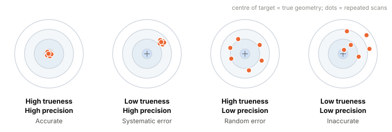
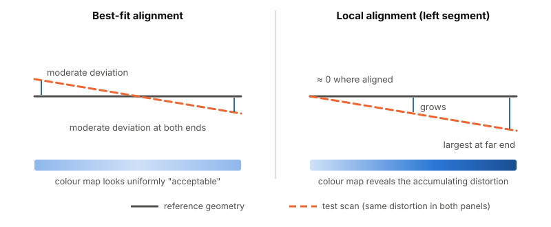
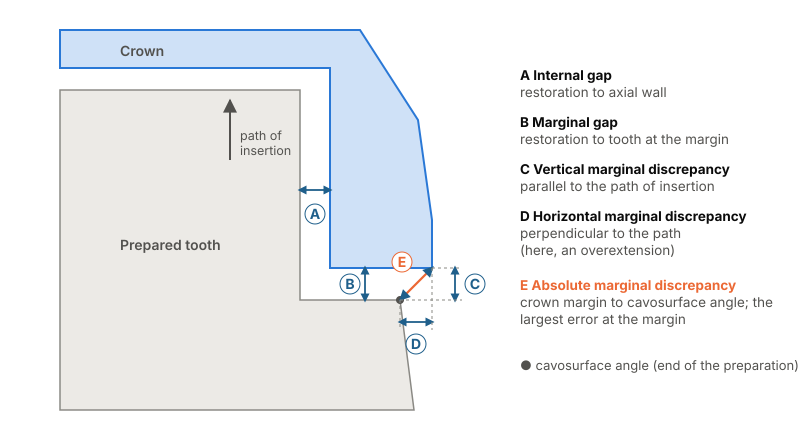

# Chapter 3. Accuracy in Digital Dentistry: Concepts and Measurement

## Learning Objectives

After reading this chapter, you should be able to:

1. Define accuracy, trueness, precision, repeatability and reproducibility, and apply them correctly to scanners and restorations.
2. Explain how the accuracy of digital data is measured: reference models, superimposition, alignment methods and deviation metrics.
3. Summarise current evidence on the accuracy of intraoral scanning for tooth-supported and implant-supported situations, including complete arches.
4. Use standard terminology to describe the marginal and internal fit of restorations, and compare the methods used to measure fit.
5. Trace how error accumulates through the CAD/CAM chain, and identify the steps the clinician and technician can control.
6. Appraise an accuracy study critically before applying its results to clinical practice.

---

## 3.1 Why Accuracy Matters

Every CAD/CAM restoration is a physical copy of a digital model, which is itself a copy of the patient. Each copy introduces some error. The clinical question is not whether error exists but whether the **total** error is small enough for the restoration to work.

Inaccuracy has different consequences for different restorations:

- **Tooth-supported crowns and onlays.** Open margins expose more luting cement to dissolution. They also collect plaque and raise the risk of secondary caries and gingival inflammation. Tight internal areas stop the restoration seating fully and raise the occlusion.
- **Implant-supported frameworks.** Implants have no periodontal ligament and cannot move to compensate for misfit. A framework that does not fit passively puts strain on the screws, components and bone, and can lead to screw loosening or fracture.
- **Removable and orthodontic appliances.** Misfit leads to poor retention, sore spots or tooth movement that differs from the plan.

To discuss accuracy usefully, we need precise words and an understanding of how accuracy is measured.

---

## 3.2 The Vocabulary of Accuracy

### 3.2.1 Trueness and precision

The international standard ISO 5725-1 defines **accuracy** as the combination of two separate properties [1] **[UNVERIFIED]**:

- **Trueness:** how closely the average of repeated measurements matches the true (reference) value. Poor trueness reflects **systematic** error, or bias.
- **Precision:** how closely repeated measurements agree with each other. Poor precision reflects **random** error.

**Verification note — Minor conflict.** The marked claim above could not be confirmed.

| Claim not confirmed | Conflict | Reason | To resolve |
|---|---|---|---|
| ISO 5725-1 definition | **Minor** | ISO standards are not on PubMed; edition and wording not checked | Check the ISO catalogue entry |

A target-shooting analogy is helpful (Table 3.1).

**Table 3.1** Trueness and precision explained with a target

| Pattern of shots | Trueness | Precision | Interpretation for a scanner |
|---|---|---|---|
| Tightly grouped at the centre | High | High | Accurate: the ideal |
| Tightly grouped away from the centre | Low | High | Repeats the same distortion every time (for example, an arch that is consistently too wide) |
| Widely scattered around the centre | High | Low | Correct on average but unpredictable for any single scan |
| Widely scattered away from the centre | Low | Low | Inaccurate |

The distinction matters clinically. A scanner with high precision and poor trueness gives reassuringly similar scans that are all wrong in the same way. Repeating the scan does not reveal the error. Figure 3.1 shows the four combinations.

**Figure 3.1** Trueness and precision. The centre of each target is the true geometry and the dots are repeated scans. Poor trueness reflects systematic error; poor precision reflects random error.

### 3.2.2 Repeatability and reproducibility

Precision has two forms:

- **Repeatability:** precision under the *same* conditions (same operator, same device, same session).
- **Reproducibility:** precision under *changed* conditions (different operators, different days, different devices).

Studies often report repeatability alone and call it "precision". Clinically, reproducibility is often more relevant: will a different member of the team get the same result?

### 3.2.3 Resolution

**Resolution** is the smallest detail a device can detect or reproduce, such as the point spacing of a scanner, the layer thickness of a printer or the bur diameter of a mill. High resolution does not guarantee accuracy. A scanner can record fine surface detail in the wrong place.

### 3.2.4 Standards for dental digitisers

ISO 12836 sets out test methods for assessing the accuracy of digitising devices used for CAD/CAM indirect restorations. It uses defined test objects (inlay, crown and multi-unit geometries) [2] **[UNVERIFIED]**. Manufacturers' accuracy claims are often based on such laboratory tests, which do not reproduce saliva, movement, limited access or soft tissue.

**Verification note — Minor conflict.** The marked claim above could not be confirmed.

| Claim not confirmed | Conflict | Reason | To resolve |
|---|---|---|---|
| Test objects in ISO 12836 | **Minor** | ISO standards are not on PubMed; edition and wording not checked | Check the ISO 12836 text |

---

## 3.3 How the Accuracy of Digital Data Is Measured

### 3.3.1 The reference

Trueness can only be measured against a known **reference**. In vitro, the reference is usually a stable model (metal, resin or ceramic) digitised with a high-accuracy industrial or reference scanner. One such reference scanner achieved a precision of 1.6 µm and a trueness of 5.3 µm over a complete arch [3]. The test scans are then compared with this reference model.

In the mouth there is no independent reference. This is why in vivo studies often report only **precision**, by comparing repeated scans of the same patient with each other; one such study made three complete-arch impressions per method in each of five participants [4]. To measure trueness in patients, Kuhr and colleagues bonded four metal spheres to the lower teeth of 50 patients. They then compared the distances and angles between the spheres in each impression with those measured by a reference method [5].

### 3.3.2 Superimposition and alignment

To compare two 3D surfaces, the software must first **align** them in the same coordinate system. The choice of alignment method strongly affects the result.

- **Best-fit alignment** moves one surface until the overall difference from the other is as small as possible. It is the most widely used method because it is automatic. Because it spreads the error across the whole surface, it tends to **hide systematic distortion**. An arch that is bent will look as if it deviates moderately everywhere, rather than being correct at one end and badly wrong at the other.
- **Reference-point or local alignment** aligns on defined features, such as a group of teeth, reference spheres or a flat surface, and measures deviation away from them. This shows how error builds up along the arch.
- **Linear and angular measurements** between defined points (sphere centres, implant scan-body axes) do not depend on whole-surface alignment. They are the preferred outcomes for implant studies.

Figure 3.2 shows how the same distorted scan looks under the first two methods.

**Figure 3.2** Best-fit versus local alignment. The test scan has the same distortion in both panels. Best-fit alignment spreads the error so that both ends deviate moderately; local alignment on one segment shows how the error accumulates towards the far end.

### 3.3.3 Deviation metrics

After alignment, the software calculates the distance from each point on one surface to the nearest point on the other. These distances are summarised in several ways:

- **Mean signed deviation:** shows whether the test surface lies mainly outside (+) or inside (–) the reference. Positive and negative values cancel out, so this measure can underestimate error.
- **Mean absolute deviation:** the average size of the deviation, ignoring direction.
- **Root mean square (RMS):** gives more weight to large deviations. It is widely used and is a good summary of overall trueness or precision.
- **Percentile ranges:** for example, half the range between the 10th and 90th percentiles of deviation, as used by Ender and colleagues [4,6]. Percentile-based values limit the influence of extreme outliers.
- **Colour-coded deviation maps:** show *where* the error is. They are essential for understanding the pattern of distortion.

> **Evidence Box.** Values from studies that use different alignment methods or metrics cannot be compared directly. An RMS of 40 µm from one study and a mean deviation of 40 µm from another do not describe the same accuracy. Check the methods section before comparing numbers.

---

## 3.4 How Accurate Is Intraoral Scanning?

### 3.4.1 Tooth-supported scans: short spans

For single teeth, quadrants and short-span FDPs, modern intraoral scanners are accurate enough for routine work. Chapter 2 summarised the systematic review evidence [7]. Local factors still matter:

- **Interproximal access.** In an in vitro study of Class II inlay preparations, trueness was significantly better when the gap to the adjacent tooth was 1.0 mm than when it was 0.6 mm. Narrow, long proximal boxes reduced precision [8].
- **Operator experience.** A systematic review with meta-analysis found that, in in vitro studies, inexperienced operators had slightly lower trueness (about 2.5 µm); in clinical trials they took longer to scan and, in one trial, gave patients a less satisfying experience. After training, trueness improved by about 19 µm (two in vitro studies) and scanning time shortened. The certainty of this evidence was low to very low [9].

### 3.4.2 Tooth-supported scans: complete arches

Complete-arch scanning is still the hardest test. Because the scanner stitches many small images together, small stitching errors **accumulate** along the arch.

- In vitro, the trueness of complete-arch impressions ranged from 11.5 µm (vinylsiloxanether) to 60.2 µm (polyether) across the conventional and digital methods tested. Vinylsiloxanether materials and one digital system (CEREC Bluecam) showed the highest trueness and precision, but the digital systems showed higher local deviations across the arch [6].
- **In vivo** (five participants, three impressions per method), precision ranged from 12.3 µm with the best conventional material to 167.2 µm with alginate. Digital systems fell in between. Conventional elastomeric impressions were most accurate across the whole arch [4].
- In the in vivo reference-sphere study, trueness after digital superimposition was 15 µm for conventional polyether impressions on gypsum casts. Three intraoral scanners gave 23 µm, 37 µm and 214 µm [5].
- In another in vitro study, the time taken for a complete-arch scan correlated strongly with both trueness and precision (r = 0.77) [10].
- A network meta-analysis of 53 studies covering 26 intraoral scanners found that accuracy differed significantly between devices and depended on the type of arch (dentate, edentulous, partially edentulous with implants, edentulous with implants). The authors concluded that different scanners suit different clinical situations [11].

Most of the devices in the earlier studies have since been replaced. What the studies show still holds, however: complete-arch error is larger than short-span error, it varies between devices [11], and its pattern differs between impression methods [4,6]. Error is often greatest at the ends of the arch and in the cross-arch dimension (expert opinion).

### 3.4.3 Implant scans

For implant-supported prostheses, the key measures are the **linear (3D position) and angular** errors of each scan body. These determine whether a framework will fit passively.

- A systematic review and meta-analysis of 100 studies on complete-arch implant scans without splinting found a mean linear trueness of 153 µm (range 41–557 µm) and a mean angular trueness of 0.65° (range 0.20–1.69°). There was marked heterogeneity and significant publication bias [12].
- **Splinting** scan bodies (connecting them with a rigid or scannable link) significantly improved linear trueness in a meta-analysis of eight studies. It did not consistently improve angular or RMS outcomes [13].
- **Extraoral photogrammetry**, which records scan-body positions with dedicated cameras and coded targets, achieved a mean linear trueness of 69 µm and a mean angular trueness of 0.23° in a systematic review and meta-analysis in which 26 studies assessed extraoral photogrammetry. The authors judged it clinically acceptable for recording implant positions [14].
- Two further meta-analyses comparing photogrammetry directly with intraoral scanners (14 studies [15]; 13 studies, 10 of them in vitro [16]) found photogrammetry significantly more true and precise; in one, the pooled analyses were of in vitro studies only [16]. One noted that intraoral scanners sometimes exceeded an angular deviation of 1°, which is often quoted as a limit for passive fit. It recommended a rigid prototype try-in until more clinical evidence is available [16].
- A systematic review of 23 studies (22 in vitro, 1 clinical) compared categories of complete-arch implant scanning with the splinted open-tray impression. Plain intraoral scans, with or without a scan aid, were more accurate than the conventional impression for **short spans** (premolar to premolar) but less accurate for **long spans**. Scans calibrated against a high-accuracy scan of an auxiliary structure appeared more accurate than the conventional technique in long spans, but only two studies tested this, and intraoral photogrammetry had not yet been compared [17].

> **Clinical Tip.** For complete-arch implant frameworks, treat an intraoral scan as a hypothesis to be tested. Splint scan bodies or use photogrammetry where available, and verify the scan with a rigid verification jig or printed prototype before making the definitive framework.

---

## 3.5 The Fit of Restorations

### 3.5.1 Terminology

The words used to describe fit vary widely in the literature. Holmes and colleagues proposed a geometric set of definitions that is still the standard reference [18] (Table 3.2).

**Table 3.2** Terms used to describe fit (after Holmes et al. [18])

| Term | Definition |
|---|---|
| **Internal gap** | Perpendicular distance from the inner surface of the restoration to the axial or occlusal wall of the preparation |
| **Marginal gap** | Perpendicular distance from the inner surface of the restoration to the preparation *at the margin* |
| **Vertical marginal discrepancy** | Marginal misfit measured parallel to the path of insertion |
| **Horizontal marginal discrepancy** | Marginal misfit measured perpendicular to the path of insertion |
| **Overextended / underextended margin** | Restoration margin extends beyond, or stops short of, the finish line |
| **Absolute marginal discrepancy** | Angular combination of vertical discrepancy and over- or underextension: the distance from the restoration margin to the preparation cavosurface angle |
| **Seating discrepancy** | Vertical distance from the occlusal surface of the preparation to the restoration, reflecting incomplete seating |

Holmes and colleagues considered the **absolute marginal discrepancy** perhaps the best single measure, because it is always the largest value at the margin and reflects the total misfit at that point [18] (Figure 3.3).

**Figure 3.3** Fit terminology at a crown margin, after Holmes et al. [18]. The crown is shown incompletely seated and overextended so that the main terms (A–E) can be drawn; seating discrepancy is not shown. Schematic, not to scale.

### 3.5.2 What is clinically acceptable?

No threshold for marginal fit is supported by strong clinical evidence. The figure most often cited is **120 µm**, which comes from McLean and von Fraunhofer's in vivo study of cement film thickness [19] **[UNVERIFIED]**. It is still used as the limit of acceptability in recent studies, for example [20]. Treat it as a convention, not a biological threshold.

**Verification note — Major conflict.** The marked claim above could not be confirmed.

| Claim not confirmed | Conflict | Reason | To resolve |
|---|---|---|---|
| 120 µm marginal-gap threshold comes from ref 19 | **Major** | Ref 19 (1971) has no abstract on PubMed | Full text of McLean & von Fraunhofer 1971 |

Within that convention, ceramic and CAD/CAM restorations generally perform well:

- A systematic review of 54 studies (48 in vitro, 6 in vivo) covering 17 ceramic crown systems found that 94.9% of all reported marginal gaps were clinically acceptable. The studies were too heterogeneous for meta-analysis. Four factors influenced marginal fit: finish-line design, the cement-space setting, veneering and cementation [21].
- A systematic review summarised the literature on the fitting quality of fixed prostheses made with CAD/CAM technology [22].
- A meta-analysis of single-unit ceramic restorations made from digital or conventional impressions found **no significant difference** in marginal fit. In vitro, mean marginal gaps were 63.3 µm (digital) and 58.9 µm (conventional). In vivo they were 56.1 µm (digital) and 79.2 µm (conventional) [23].

---

## 3.6 Measuring Fit

The method used to measure fit strongly affects the result.

**Table 3.3** Methods for measuring the fit of restorations

| Method | Principle | Strengths | Limitations |
|---|---|---|---|
| **Direct view** | Microscope measurement of the marginal gap on the die | Simple, non-destructive, reproducible | Margin only; no internal data |
| **Cross-sectioning** | Restoration cemented on die, embedded and sectioned | Direct view of marginal and internal gaps | Destructive; few sections; in vitro only |
| **Silicone replica** | Light-body silicone fills the gap; replica is sectioned and measured | Usable clinically; widely used | Silicone may tear or distort; limited number of sections |
| **Micro-CT** | X-ray microtomography of the restoration on the die | Non-destructive; 3D; thousands of measurement points | Expensive; in vitro; metal artefacts |
| **Digital (triple-scan) methods** | Scan the die, the intaglio surface and the seated restoration; calculate the gap digitally | 3D; non-destructive; can be done chairside | Depends on scanner accuracy and alignment |

A review of 183 studies found that direct view (47.5%), cross-sectioning (23.5%) and the replica technique (20.2%) were the most common methods. Reported gaps varied widely because of differences in study design, sample size, finish line and the stage at which fit was measured. The authors recommended at least **30 specimens with 50 measurements per specimen**, and using two methods together to confirm results [24]. Micro-CT has been recommended for future research on marginal adaptation [21].

Two studies compared measurement methods directly, with different results:

- A clinical trial compared an intraoral scanner–based chairside method with a digital laboratory method and the conventional silicone replica technique for measuring the internal fit of CAD/CAM crowns. It found no significant difference between the three methods [25].
- In an in vitro study of laser-melted cobalt-chromium RPD frameworks, the same frameworks showed a mean gap of 13.9 µm with the clinical replica method and an RMS gap of 70.7 µm with digital registration. Both values were below the 300 µm clinically acceptable standard used in that study, and the authors attributed the difference to the measurement methods themselves [26].

---

## 3.7 The Error Chain: From Scan to Seated Restoration

The fit of the final restoration is the combined result of errors at every stage (Table 3.4).

**Table 3.4** Sources of error in the CAD/CAM chain and how to control them

| Stage | Main sources of error | Control measures |
|---|---|---|
| **Preparation** | Undercuts, sharp internal angles, unclear margins, narrow proximal access [8] | Smooth, rounded geometry suited to the material; clear finish line; adequate proximal clearance |
| **Soft tissue and moisture** | Blood, saliva, gingiva covering the margin | Retraction, haemostasis, isolation; scan the margin first |
| **Acquisition** | Stitching error over long spans; reflective surfaces; operator technique [4,5,9,10] | Shortest suitable scan; recommended scan path; training; splinting or photogrammetry for implants [13–16] |
| **Data processing** | Hole filling, smoothing, mesh reduction (Chapter 2) | Check margins on the raw scan; rescan gaps |
| **Design** | Wrong margin line; cement-space setting; minimum thickness | Check the margin on the colour scan; use material-specific cement-space settings [20,27,28] |
| **Manufacture** | Bur size and wear, mill calibration; printing system [29], printer orientation, layer thickness, curing | Calibrate and maintain machines; validated material settings; replace burs on schedule |
| **Post-processing** | Sintering shrinkage (zirconia), crystallisation (lithium disilicate) [30], post-curing (resins) | Follow validated firing programmes; check fit after final processing |
| **Clinical seating** | Contaminated intaglio surface, cement viscosity, seating force | Clean, try in, check fit; correct cementation protocol |

### 3.7.1 The cement-space setting

The **cement space** (die spacer) set in the CAD software is one of the most influential design parameters, and the optimal value depends on the material.

- In an in vitro micro-CT study of milled endocrowns, a 30 µm setting produced the largest marginal discrepancies (about 145–174 µm). The measured marginal gap agreed best with the designed value at 60 µm for the glass-ceramics and at 120 µm for the resin composites. The authors concluded that different settings should be used for ceramic and composite materials [27].
- In an in vitro micro-CT study of milled occlusal veneers, a 50 µm setting gave better marginal fit and absolute marginal discrepancy than 30 or 40 µm [28].
- In an in vitro study of 3D-printed definitive resin crowns, a 70 µm setting gave the smallest marginal, axio-occlusal and occlusal gaps [20].
- In a clinical study with an 80 µm target cement space, the measured gap matched the target only at the margin. Occlusal gaps were consistently larger [25].

The number entered in the software is therefore a **request**, not a guarantee. The real gap depends on the mill or printer, the material and post-processing. Each laboratory or chairside unit should calibrate its own settings.

### 3.7.2 Milling versus printing

- For zirconia crowns, a meta-analysis of in vitro studies found that trueness and margin quality of printed and milled crowns were comparable. Milling gave better results at the margin, printing in the axial areas [29].
- A more recent meta-analysis of nine in vitro studies, most of single crowns, found that milled zirconia prostheses had significantly smaller marginal gaps (mean difference about 13 µm). There was no difference in internal adaptation, and both methods were clinically acceptable [31].

### 3.7.3 Post-processing

Firing changes fit. In an in vitro micro-CT study of milled lithium disilicate crowns on polyurethane teeth, crystallisation reduced the axial gap and increased the vertical marginal gap [30]. Restorations should be tried in and adjusted **after** their final heat treatment, not before.

---

## 3.8 Reading Accuracy Studies Critically

Before applying an accuracy study to your practice, ask:

1. **In vitro or in vivo?** In vitro studies isolate the device from saliva, movement, limited access and soft tissue (Section 3.2.4), so their results may not transfer to the mouth.
2. **What was the reference?** How accurate was the reference scanner or method?
3. **Trueness, precision or both?** Is "accuracy" used loosely?
4. **Which alignment method?** Best-fit alignment can hide systematic distortion.
5. **Which metric?** Mean signed, mean absolute, RMS or percentile? Are linear and angular errors reported for implants?
6. **Which scan span and scenario?** Single tooth, quadrant, complete arch, implants? Results do not transfer between them.
7. **Which device and software version?** Hardware and software change quickly, so results can be out of date by the time they are published.
8. **Who scanned?** One expert, or several operators with different levels of experience?
9. **Sample size and number of measurements?** Are there enough to be reliable [24]?
10. **Is the difference clinically relevant?** A statistically significant difference of 10 µm may not matter. An angular error of 1° across an implant arch might.

---

## Key Points

- **Accuracy = trueness + precision** (ISO 5725). Trueness reflects systematic error and precision reflects random error. A precise scanner can still be consistently wrong.
- In vivo studies usually measure only precision. Measuring trueness in the mouth needs a reference such as bonded spheres [4,5].
- **Best-fit alignment** can hide systematic distortion. Compare results only between studies that use the same alignment method and metric.
- Intraoral scanning is accurate enough for single units and short spans. **Complete-arch and multi-implant scans** remain the weakest link [12]. Splinting scan bodies improves linear but not angular trueness [13]; photogrammetry is clinically acceptable [14] and more true and precise than intraoral scanning [15,16].
- Fit should be described in standard terms [18]. The 120 µm threshold for marginal gaps [19] **[UNVERIFIED]** is a convention. Most ceramic restorations in fit studies fall within it [21], and digital and conventional impressions give similar marginal fit for single-unit ceramic restorations [23].

**Verification note — Major conflict.** The marked claim above could not be confirmed.

| Claim not confirmed | Conflict | Reason | To resolve |
|---|---|---|---|
| 120 µm marginal-gap threshold comes from ref 19 | **Major** | Ref 19 (1971) has no abstract on PubMed | Full text of McLean & von Fraunhofer 1971 |

- Measured fit depends heavily on the **measurement method** [24,26].
- **Cement-space settings are material- and machine-specific** and must be calibrated locally [20,25,27,28].
- In vitro, milled zirconia fits slightly better at the margin than printed zirconia, and both are within clinically acceptable limits [29,31]. Always check fit **after** final heat treatment [30].

---

## Review Questions

1. Define trueness and precision. Why can a scanner with excellent precision still produce ill-fitting restorations?
2. Why do most in vivo accuracy studies report precision but not trueness? Describe one method that allows trueness to be measured in patients.
3. Explain how best-fit alignment can hide a systematic distortion in a complete-arch scan.
4. A study reports a mean signed deviation of 5 µm for a scanner. Why might this underestimate the true error? Which metric would you prefer?
5. List the methods available for recording complete-arch implant positions, and rank them by the evidence on trueness.
6. Draw and label the Holmes definitions of marginal gap, vertical and horizontal marginal discrepancy, and absolute marginal discrepancy.
7. Your chairside lithium disilicate crowns consistently seat with tight internal contacts and slightly open margins. Name three steps in the CAD/CAM chain you would investigate, and what you would change.
8. Using the checklist in Section 3.8, critically appraise an accuracy study of your choice.

---

## References

1. International Organization for Standardization. ISO 5725-1:1994. Accuracy (trueness and precision) of measurement methods and results — Part 1: General principles and definitions. Geneva: ISO; 1994.
2. International Organization for Standardization. ISO 12836:2015. Dentistry — Digitizing devices for CAD/CAM systems for indirect dental restorations — Test methods for assessing accuracy. Geneva: ISO; 2015.
3. Ender A, Mehl A. Accuracy of complete-arch dental impressions: a new method of measuring trueness and precision. J Prosthet Dent. 2013;109(2):121–8. doi:10.1016/S0022-3913(13)60028-1
4. Ender A, Attin T, Mehl A. In vivo precision of conventional and digital methods of obtaining complete-arch dental impressions. J Prosthet Dent. 2016;115(3):313–20. doi:10.1016/j.prosdent.2015.09.011
5. Kuhr F, Schmidt A, Rehmann P, Wöstmann B. A new method for assessing the accuracy of full arch impressions in patients. J Dent. 2016;55:68–74. doi:10.1016/j.jdent.2016.10.002
6. Ender A, Mehl A. In-vitro evaluation of the accuracy of conventional and digital methods of obtaining full-arch dental impressions. Quintessence Int. 2015;46(1):9–17. doi:10.3290/j.qi.a32244
7. Ahlholm P, Sipilä K, Vallittu P, Jakonen M, Kotiranta U. Digital versus conventional impressions in fixed prosthodontics: a review. J Prosthodont. 2018;27(1):35–41. doi:10.1111/jopr.12527
8. Son SA, Kim JH, Seo DG, Park JK. Influence of different inlay configurations and distance from the adjacent tooth on the accuracy of an intraoral scan. J Prosthet Dent. 2022;128(4):680–7. doi:10.1016/j.prosdent.2020.12.044
9. Limones A, Morton D, Sallorenzo A, Lin WS, Sadid-Zadeh R, Phasuk K, et al. Impact of operator experience on intraoral digital scanning: a systematic review, meta-analysis, and meta-regression. Report of the Committee on Research in Fixed Prosthodontics of the American Academy of Fixed Prosthodontics. J Prosthet Dent. 2026;135(2):297.e1–297.e13. doi:10.1016/j.prosdent.2025.09.008
10. Renne W, Ludlow M, Fryml J, Schurch Z, Mennito A, Kessler R, et al. Evaluation of the accuracy of 7 digital scanners: an in vitro analysis based on 3-dimensional comparisons. J Prosthet Dent. 2017;118(1):36–42. doi:10.1016/j.prosdent.2016.09.024
11. Vitai V, Németh A, Sólyom E, Czumbel LM, Szabó B, Fazekas R, et al. Evaluation of the accuracy of intraoral scanners for complete-arch scanning: a systematic review and network meta-analysis. J Dent. 2023;137:104636. doi:10.1016/j.jdent.2023.104636
12. Revilla-León M, Barmak AB, Prasad S. Accuracy of complete arch implant scans using nonsplinting techniques: a systematic review and meta-analysis. Report of the Committee on Research in Fixed Prosthodontics of the American Academy of Fixed Prosthodontics. J Prosthet Dent. 2026;136(1):e102–e138. doi:10.1016/j.prosdent.2026.02.034
13. Alawawda O, Yeşil Z, Sakarya RE, Haoran MA, Yeşil Ç. Trueness of complete arch intraoral implant scans using splinted and non-splinted scan bodies: a systematic review and meta-analysis. J Prosthet Dent. 2026;136(2):e104–e114. doi:10.1016/j.prosdent.2026.04.028
14. Prasad S, Barmak AB, Revilla-León M. A systematic review and meta-analysis of the accuracy of complete arch implant scanning techniques performed extraorally: reverse impression and extraoral photogrammetry methods. Report of the Committee on Research in Fixed Prosthodontics of the American Academy of Fixed Prosthodontics. J Prosthet Dent. 2026;136(1):e79–e101. doi:10.1016/j.prosdent.2026.01.018
15. Altalla H, Alhelou H, Karaduman F, Alawawda O, Bayindir F. Comparative accuracy of photogrammetry and intraoral scanners in recordings for complete arch implant-supported prostheses: a systematic review and meta-analysis. J Prosthet Dent. 2026;135(5):e60–e70. doi:10.1016/j.prosdent.2025.10.059
16. Pozzi A, Arcuri L, Carosi P, Laureti A, Londono J, Wang HL. Photogrammetry versus intraoral scanning in complete-arch digital implant impression: a systematic review and meta-analysis. Clin Implant Dent Relat Res. 2025;27(3):e70059. doi:10.1111/cid.70059
17. Li J, Lu J, Chen Z, Kulkarni PS, Lin YC, Liu F. Accuracy of complete arch implant intraoral scans: a systematic review of different technique categories compared with the conventional splinted open tray method. J Prosthet Dent. 2026. Epub ahead of print. doi:10.1016/j.prosdent.2026.09.031
18. Holmes JR, Bayne SC, Holland GA, Sulik WD. Considerations in measurement of marginal fit. J Prosthet Dent. 1989;62(4):405–8. doi:10.1016/0022-3913(89)90170-4
19. McLean JW, von Fraunhofer JA. The estimation of cement film thickness by an in vivo technique. Br Dent J. 1971;131(3):107–11. doi:10.1038/sj.bdj.4802708
20. Shin H, Kang YJ, Kim H, Kim JH. Effect of cement space settings on the marginal and internal fit of 3D printed definitive resin crowns. J Prosthet Dent. 2025;133(3):821–6. doi:10.1016/j.prosdent.2023.03.021
21. Contrepois M, Soenen A, Bartala M, Laviole O. Marginal adaptation of ceramic crowns: a systematic review. J Prosthet Dent. 2013;110(6):447–54.e10. doi:10.1016/j.prosdent.2013.08.003
22. Boitelle P, Mawussi B, Tapie L, Fromentin O. A systematic review of CAD/CAM fit restoration evaluations. J Oral Rehabil. 2014;41(11):853–74. doi:10.1111/joor.12205
23. Tsirogiannis P, Reissmann DR, Heydecke G. Evaluation of the marginal fit of single-unit, complete-coverage ceramic restorations fabricated after digital and conventional impressions: a systematic review and meta-analysis. J Prosthet Dent. 2016;116(3):328–35.e2. doi:10.1016/j.prosdent.2016.01.028
24. Nawafleh NA, Mack F, Evans J, Mackay J, Hatamleh MM. Accuracy and reliability of methods to measure marginal adaptation of crowns and FDPs: a literature review. J Prosthodont. 2013;22(5):419–28. doi:10.1111/jopr.12006
25. Schlenz MA, Vogler J, Schmidt A, Rehmann P, Wöstmann B. New intraoral scanner-based chairside measurement method to investigate the internal fit of crowns: a clinical trial. Int J Environ Res Public Health. 2020;17(7):2182. doi:10.3390/ijerph17072182
26. Alabdullah SA, Hannam AG, Wyatt CC, McCullagh APG, Aleksejuniene J, Mostafa NZ. Comparison of digital and conventional methods of fit evaluation of partial removable dental prosthesis frameworks fabricated by selective laser melting. J Prosthet Dent. 2022;127(3):478.e1–478.e10. doi:10.1016/j.prosdent.2021.09.033
27. Zheng Z, Wang H, Mo J, Ling Z, Zeng Y, Zhang Y, et al. Effect of virtual cement space and restorative materials on the adaptation of CAD-CAM endocrowns. BMC Oral Health. 2022;22(1):580. doi:10.1186/s12903-022-02598-0
28. Elbadawy AA, Omar EA, AbdElaziz MH. MicroCT evaluation for CAD/CAM occlusal veneer fit using two materials and three cement space settings. Braz Dent J. 2022;33(4):71–8. doi:10.1590/0103-6440202204764
29. da Silva SEG, da Silva NR, Santos JVDN, Moreira FGG, Özcan M, Souza ROAE. Accuracy, adaptation and margin quality of monolithic zirconia crowns fabricated by 3D printing versus subtractive manufacturing technique: a systematic review and meta-analysis of in vitro studies. J Dent. 2024;147:105089. doi:10.1016/j.jdent.2024.105089
30. De Freitas BN, Tonin BSH, Macedo AP, Dos Santos TMP, De Mattos MDGC, Hotta TH, et al. Adaptation accuracy of milled lithium disilicate crowns: a 2D and 3D microCT analysis. J Esthet Restor Dent. 2020;32(4):403–9. doi:10.1111/jerd.12574
31. Sengottaiyan AK, Bennani V, Veerasamy A. Marginal fit and internal adaptation of zirconia complete coverage fixed dental prostheses fabricated by milling versus 3D printing: a systematic review and meta-analysis of in vitro studies. J Prosthet Dent. 2026;136(2):379–89. doi:10.1016/j.prosdent.2026.02.051
