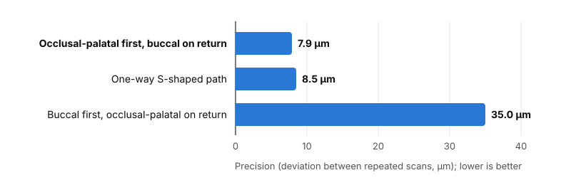
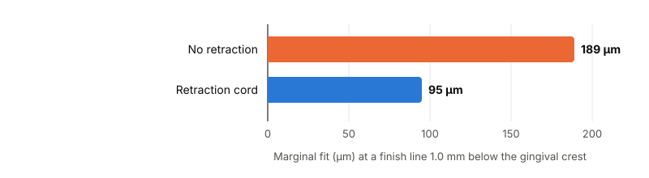
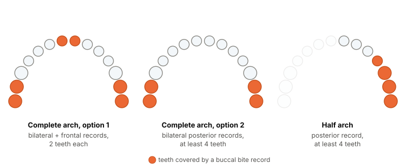

# Chapter 4. Intraoral Scanners

## Learning Objectives

After reading this chapter, you should be able to:

1. Explain the optical principles intraoral scanners use to measure surfaces, and how images are stitched into a 3D model.
2. Evaluate scanner hardware and software features when choosing a device.
3. Plan and carry out a scan using an evidence-based scanning strategy, and control ambient and intraoral conditions.
4. Manage soft tissue, moisture and subgingival margins so that the finish line is captured accurately.
5. Record the maxillomandibular relationship digitally and recognise the factors that reduce its accuracy.
6. Describe diagnostic uses of intraoral scanners beyond impressions, the learning curve and patient-reported outcomes, and how to reprocess scanners for infection control.

---

## 4.1 From Impression Tray to Optical Impression

An intraoral scanner (IOS) replaces the impression tray, the elastomer and the stone cast with a handheld optical device and a computer. The clinician moves the scanner wand over the teeth and soft tissues. Thousands of images are captured and converted into a 3D surface while the clinician watches it build on screen [1,2].

The basic idea has hardly changed since the first chairside camera of the 1980s (Chapter 1). Almost everything else has: wand size, speed, colour capture, powder-free scanning, software intelligence and the range of indications. Recent reviews describe the modern scanner as a **platform** rather than an impression device. It supports diagnosis, patient communication, monitoring and treatment planning as well as CAD/CAM [3].

> **Clinical Tip.** An intraoral scanner does not "take an impression" in one step. It builds one from many small images. Almost every scanning error comes from how those images are captured and joined.

---

## 4.2 How Intraoral Scanners Measure Surfaces

Every scanner does three things [1]:

1. **Projects light** onto the surface, either as a pattern or a beam.
2. **Measures distance** to each point on the surface using an optical principle.
3. **Reconstructs** a 3D surface by registering and merging overlapping images.

### 4.2.1 Optical principles

The main principles in use are summarised in Table 4.1 [1,4] **[UNVERIFIED]**. Many current devices combine more than one principle and rely heavily on software processing.

**Table 4.1** Optical principles used in intraoral scanners

| Principle | How depth is measured | Practical notes |
|---|---|---|
| **Confocal imaging** | Light is focused at known depths. Only points in focus at a given depth return a sharp signal, so the focal position gives the distance | Works without powder; good at capturing steep walls |
| **Active triangulation / structured light** | A known light pattern (stripes or grid) is projected. A sensor at a known angle sees the pattern deformed by the surface, and depth is calculated geometrically | Fast; the basis of many systems; early versions needed powder for an even, non-reflective surface |
| **Active wavefront sampling** | An off-axis aperture captures images from slightly different viewpoints. The displacement of features between them gives depth | Used in some scanners that required powder. In one clinical study, a powder-based system of this type gave the best complete-arch trueness of the scanners tested [5] |
| **Stereophotogrammetry** | Two or more cameras view the surface from known positions. Depth comes from matching points between views | Also used extraorally to record implant positions (Chapter 3) |
| **Optical coherence tomography (experimental)** | Interference of near-infrared light measures depth below the surface | Can image beneath soft tissue in principle; not yet in routine use |

### 4.2.2 Image capture and stitching

Scanners capture data either as a series of **single images** or as a **continuous video stream**. Each frame covers only a few millimetres of tooth, so the software **registers** (aligns) each new frame to the existing model using overlapping geometry and, in colour scanners, texture. Registration errors accumulate as the scan extends, which is why complete-arch scans are less accurate than short-span scans (Chapter 3).

Scanners also differ in how evenly they triangulate the surface and how much detail they keep at the finish line [6]. In one study that compared seven scanners, overall accuracy was similar between devices. The **distinctness** and accuracy of the finish line, however, varied considerably, especially for subgingival margins [6].

### 4.2.3 Powder

Early scanners needed a thin coat of titanium dioxide powder to create an even, matt surface. Powder added time and was unpleasant for patients. In a randomised trial, clinicians preferred a powder-free system to systems that needed powder [7]. Modern scanners are powder-free. Powder is still sometimes used on highly reflective surfaces such as polished metal, or on scan bodies when the manufacturer recommends it.

---

## 4.3 Choosing a Scanner: Hardware and Software Features

**Table 4.2** Features to consider when choosing an intraoral scanner

| Feature | Why it matters |
|---|---|
| **Tip size and weight** | Access to second molars and limited mouth opening; operator fatigue |
| **Powder-free, colour capture** | Speed and patient comfort; colour helps identify the margin [6] |
| **Scanning speed and software stitching** | Shorter scan time; complete-arch scan time correlates with accuracy [8] |
| **Accuracy for your indications** | Devices differ, and the best device depends on the clinical scenario [9] |
| **Open export** (STL, PLY, OBJ) | Freedom to choose laboratories and software (Chapter 2) [3] |
| **Implant libraries and scan-body support** | Essential for implant workflows |
| **Diagnostic tools** (near-infrared imaging, fluorescence, shade measurement, monitoring) | Adds value beyond impressions [3] |
| **Tip reprocessing** (autoclavable or disposable tips) | Infection control and running costs [10] |
| **Wired or wireless; cart or laptop** | Mobility between surgeries |
| **Licence and subscription model** | Total cost of ownership; ongoing fees for software and export |
| **Integration** with practice management and patient records | Data storage, identification and workflow [3] |

Clinicians should be sceptical of manufacturer "accuracy" claims, which are usually based on idealised in vitro tests (Chapter 3). Independent comparisons and network meta-analyses are more informative, although devices change quickly [9].

---

## 4.4 The Scanning Environment

### 4.4.1 Ambient light

Optical scanners are sensitive to ambient light:

- In vitro, trueness was best at 500 lux and a warm colour temperature (3,900 K), close to typical clinical room lighting. Very bright light (2,500 lux) lengthened scanning time [11].
- In another study, lighting conditions significantly affected the **mesh quality** of different scanners, and scanning in complete darkness gave the lowest mesh quality [12].

> **Clinical Tip.** Turn the operating light away from the mouth (or switch it off) while scanning, but keep normal room lighting. Do not scan in the dark or under the full operating light.

### 4.4.2 Moisture, saliva and blood

Saliva, blood and crevicular fluid reflect and scatter light and hide the margin. In an in vitro study, saliva contamination significantly increased vertical and horizontal discrepancies at the finish line, and the effect was larger for subgingival margins [13]. Good isolation is essential: retraction, suction, cotton rolls or dry-field devices, and air drying immediately before scanning each area.

### 4.4.3 Interproximal access

Narrow proximal spaces limit the scanner's view into the box. For Class II inlay preparations, trueness improved significantly as the distance to the adjacent tooth increased from 0.6 to 1.0 mm [14]. Prepare with adequate proximal clearance where the restoration allows it, and angle the wand to look into the box from buccal, lingual and occlusal directions.

---

## 4.5 Scanning Strategy

### 4.5.1 The principle

The software stitches new images to existing ones, so the **order** and **continuity** of the scan affect the result. A good strategy:

- starts on a geometrically distinct area, such as the occlusal surfaces of molars, that the software can register reliably;
- moves continuously, with enough overlap between frames;
- avoids large jumps and repeated "rescanning" of the same area, which can introduce mismatched data;
- captures the occlusal, buccal and lingual or palatal surfaces with the wand rolled at different angles.

### 4.5.2 Evidence

- In a complete-arch study, three strategies gave similar trueness (about 17–27 µm). Precision, however, was significantly worse when the buccal surfaces were scanned first and the occlusal-palatal surfaces on the return (35.0 µm). It was better when the occlusal-palatal surfaces were scanned first and the buccal on the return (7.9 µm), or with a one-way S-shaped path (8.5 µm). The authors recommended scanning occlusal-palatal first and then buccal [15] (Figure 4.1).

**Figure 4.1** Precision of complete-arch scans with three scanning strategies, using one scanner in vitro. Lower values mean better precision. Data from [15].
- A second study of four scanners and four strategies found that the best strategy differed between devices. For most scanners the differences were not significant, suggesting that current devices tolerate variations in strategy reasonably well [16].

The practical conclusion is to **follow the manufacturer's recommended strategy for your device**, apply it consistently, and adapt it only when access requires.

### 4.5.3 Scan extent

Scan only what the restoration needs, plus enough neighbouring teeth for contacts, occlusion and registration. A quadrant scan with an opposing quadrant and a buccal bite is usually enough for a single posterior crown. Avoid complete arches unless the case requires them (Chapter 3).

### 4.5.4 A practical sequence for a single crown

1. Pre-operative scan of the arch or quadrant (useful for copying anatomy, provisionals and documentation).
2. Preparation, retraction and haemostasis.
3. **Scan the preparation first** while the margin is open and dry. Then scan the neighbouring teeth and the rest of the quadrant.
4. Check the margin immediately on screen in colour and in monochrome. Rescan any gaps.
5. Scan the opposing arch.
6. Record the bite (Section 4.7).
7. Review the whole model: margins, contacts, holes and the bite alignment.

---

## 4.6 Soft Tissue and Subgingival Margins

The scanner records only what it can see. Unlike elastomeric impression materials, light cannot push the gingiva aside or flow into the sulcus.

- In an in vitro study, finish lines placed 0.5 and 1.0 mm subgingivally showed greater vertical and horizontal discrepancies than equigingival margins, even with a single-cord retraction technique. The authors concluded that subgingival finish lines were not captured accurately [13].
- In another study, internal trueness and marginal fit of crowns made from scans got worse as the finish line was placed deeper, when **no retraction** was used. At 1.0 mm depth, the marginal fit was 189 µm, beyond the usual acceptable range. With retraction cord, accuracy stayed stable at every depth, and the marginal fit at 1.0 mm was 95 µm [17] (Figure 4.2).

**Figure 4.2** Marginal fit of interim crowns made from scans of a finish line 1.0 mm below the gingival crest, with and without retraction cord (in vitro). Data from [17].
- Scanners differ considerably in how distinctly and accurately they show subgingival finish lines [6].
- Narrative reviews list difficulty with deep margins and bleeding as a main limitation of intraoral scanning [2,3].

> **Clinical Tip.** Place margins equigingivally or supragingivally whenever aesthetics and the extent of the lesion allow. When a margin must be subgingival, use retraction (single or double cord, or a retraction paste), control bleeding, and scan the margin **immediately** after removing the cord, before the tissue rebounds and fluid returns. If the margin cannot be seen clearly on screen, a conventional impression of that preparation may still be the better choice.

### 4.6.1 Mobile soft tissue and edentulous areas

Mobile mucosa, the floor of the mouth and edentulous ridges have few distinct features and can move during scanning. This makes registration harder. Edentulous areas also reduce the accuracy of the bite record (Section 4.7). Removable prosthodontics and implant scanning bring their own challenges and are covered in Chapters 9, 17 and 18.

---

## 4.7 Recording the Bite

### 4.7.1 The buccal bite scan

The digital interocclusal record is usually made by scanning the buccal surfaces of both arches with the patient biting in maximum intercuspation (MIP). The software then aligns the upper and lower arch scans to these buccal scans. No bite material is placed between the teeth, so the record is not distorted by interposed material.

### 4.7.2 Factors that affect accuracy

A systematic review of 29 studies identified seven factors that affect the accuracy of the digital MIP [18]:

1. the scanner system;
2. scan extent (half arch or complete arch);
3. edentulous areas;
4. the number, location and size of the bite records;
5. occlusal force during the record;
6. tooth mobility;
7. the alignment method used by the software.

Its main recommendations were [18]:

- Most studies found **no difference** in MIP accuracy between half-arch and complete-arch scans.
- **Two or more missing teeth** in an area reduce MIP accuracy.
- For **complete-arch** scans, use either a bilateral and frontal record including 2 teeth each, or a bilateral posterior record including at least 4 teeth.
- For **half-arch** scans, use a posterior record including at least 4 teeth.
- Greater occlusal force during the record produced a smaller average interocclusal space.

Figure 4.3 shows the recommended record locations.

**Figure 4.3** Recommended locations for digital bite records, following the systematic review in [18]. Schematic occlusal views; the shaded teeth are covered by the buccal bite scans.

> **Lab Note.** If the bite alignment looks wrong, for example with heavy penetration of the opposing teeth into each other or no contacts at all, ask for a new bite scan rather than adjusting the occlusion in the design software. Penetrations in a digital bite are usually record errors, not real contacts.

### 4.7.3 Beyond static occlusion

A buccal scan records only one static position. Recording excursive movements and jaw function requires virtual articulators with average or measured values, or jaw-tracking systems. Chapters 2, 6 and 7 cover these.

---

## 4.8 Clinical Efficiency and Patient Experience

For short-span tooth-supported restorations and single implants, the evidence consistently favours scanning for comfort and time:

- In a randomised trial of single crowns and FDPs up to six units, total procedure time was shorter with digital impressions (about 14.5 versus 20.7 minutes). Dentists found the digital technique less difficult, and patients reported far less discomfort (VAS 6.5 versus 44.9 out of 100). Occlusal contacts of the final restorations were better in the digital group [19].
- In a crossover study, patients rated digital impressions as more comfortable than polyether impressions, and the digital technique was more time-efficient [20].
- For single implant impressions, every patient in a randomised crossover trial said they would prefer the digital workflow in future [21].

For complete-arch impressions with earlier powder-based scanners, conventional impressions were faster and clinicians preferred them [7]. That difference has narrowed with faster, powder-free devices, but complete arches still need more time and skill than short spans.

---

## 4.9 The Learning Curve and Training

Scanning is a psychomotor skill. A systematic review with meta-analysis found that [22]:

- inexperienced operators achieved slightly lower trueness, took longer to scan (about 41 seconds more) and gave patients a less satisfying experience than experienced operators;
- training sessions improved trueness (by about 19 µm) and shortened scanning time (by about 76 seconds);
- inexperienced operators gained more from training than experienced ones.

The certainty of this evidence was low to very low [22]. It still supports structured training on models before clinical use, and supervised early cases, for dentists and for any assistants who scan.

---

## 4.10 Beyond the Impression: Diagnostic and Monitoring Uses

### 4.10.1 Caries detection with near-infrared imaging

Some scanners capture **near-infrared (NIR)** images alongside the 3D surface. Enamel is relatively transparent to near-infrared light, while carious lesions scatter it, so proximal lesions can show up without radiation.

- In a multicentre study of 100 patients in private practice, NIR reflection detected early enamel lesions that bitewing radiography missed. Its accuracy was comparable to bitewings for lesions reaching the dentino-enamel junction [23].
- In vivo validation in permanent teeth showed good agreement between NIR imaging and bitewings. Accuracy was higher for molars than for premolars [24].
- A comparative diagnostic study of 66 adults found moderate accuracy for detecting any proximal caries and high accuracy for deeper dentine lesions. The authors concluded that NIR imaging is a useful adjunct but does not replace bitewings when radiographic staging is needed [25].
- A narrative review concluded that NIR imaging is promising but less reliable for secondary and subgingival caries [26].

> **Evidence Box.** NIR caries detection is an **adjunct**, not a replacement for clinical examination and radiography. Its high sensitivity for early lesions can produce false positives, which could lead to overtreatment if findings are not interpreted cautiously and confirmed.

### 4.10.2 Monitoring

Because scans are cheap to repeat and easy to superimpose, scanners can **quantitatively monitor** tooth wear, gingival recession, soft-tissue volume and tooth movement over time [3]. Software can also segment teeth automatically, increasingly using deep neural networks, which supports orthodontic planning [3].

### 4.10.3 Communication and documentation

A colour 3D model shown to the patient on screen is a powerful communication tool. The scans also form part of the clinical record, with the data-protection obligations described in Chapter 2.

---

## 4.11 Infection Control and Maintenance

Digital impressions remove the need to disinfect and transport impressions and casts. The scanner itself, however, becomes a shared device that contacts mucosa, saliva and sometimes blood [10]:

- Reprocess **tips** exactly as the manufacturer instructs (autoclave, high-level disinfection or single use). Inappropriate methods can damage the optical windows and mirrors and reduce scan quality [10].
- Disinfect the **wand body, cable and touchscreen** between patients with a compatible disinfectant, and use barrier sleeves where recommended.
- Check calibration regularly with the manufacturer's calibration tool, and after any drop or impact.
- Keep the optical window clean and free of scratches.

The guidance manufacturers provide on tip reprocessing is often limited [10]. Practices should ask for validated reprocessing protocols before buying.

---

## 4.12 Indications and Limitations: A Summary

**Table 4.3** Intraoral scanning: where the evidence stands

| Situation | Suitability | Key points |
|---|---|---|
| Inlays, onlays, veneers, single crowns | **Well supported** | Accuracy equivalent to conventional impressions; faster; preferred by patients [19,27] |
| Short-span FDPs (3–4 units) | **Well supported** | Clinically acceptable fit [27] |
| Single implants and short-span implant FDPs | **Well supported** | Clinically acceptable; preferred by patients [21,27] |
| Complete-arch, tooth-supported | **Use with caution** | Error accumulates; varies by device; conventional still recommended by systematic review [9,27] |
| Complete-arch implant frameworks | **Use with verification** | Linear and angular error may exceed passive-fit limits; consider splinting, photogrammetry and a verification jig (Chapter 3) |
| Deep subgingival margins, bleeding | **Limited** | Retraction essential; consider a conventional impression [13,17] |
| Edentulous ridges, mobile mucosa | **Limited** | Few landmarks; soft-tissue displacement not recorded (Chapter 18) |
| Orthodontics, splints, monitoring | **Well suited** | Accuracy needs are lower; strong documentation value [3] |

---

## Key Points

- Intraoral scanners project light, measure distance with confocal, triangulation, wavefront or stereo principles, and **stitch** thousands of images into a 3D model [1,4]. Stitching error grows with scan length.
- Devices differ in overall accuracy and especially in how clearly they capture the **finish line** [6,9]. Choose a device using independent evidence and your own indications.
- Use **moderate room lighting**, not darkness and not the operating light [11,12]. Keep the field dry: saliva and blood degrade accuracy, especially at subgingival margins [13].
- Follow a **consistent, manufacturer-recommended scanning strategy**. Scanning occlusal-palatal first and buccal on the return has been shown to improve precision for at least one device [15,16].
- **Retraction is essential** for subgingival margins [13,17]. Place margins supragingivally where possible, and scan the preparation first.
- For the digital bite, use **bilateral records covering at least 4 posterior teeth** (or bilateral plus frontal records). Edentulous areas reduce accuracy [18].
- Patients prefer scanning, and it is faster for short spans [19–21]. **Training** improves accuracy and speed [22].
- Scanners are now diagnostic platforms. **Near-infrared caries detection** is a promising adjunct but not a replacement for radiography [23–26].
- Reprocess tips and disinfect the wand to **validated** protocols [10].

---

## Review Questions

1. Describe how a confocal scanner and a triangulation scanner each determine the depth of a surface point.
2. Why does the order in which surfaces are scanned influence precision? Which strategy did Müller and colleagues recommend, and why?
3. A patient has a 1 mm subgingival margin on a premolar crown preparation. Describe step by step how you would obtain an accurate digital impression, and when you would switch to a conventional impression.
4. Which lighting conditions are recommended for intraoral scanning, and what happens to scan quality in complete darkness?
5. List the factors that affect the accuracy of the digital maximum intercuspal position, and describe the recommended bite records for half-arch and complete-arch scans.
6. Summarise the evidence on patient comfort and procedure time for digital versus conventional impressions for (a) single crowns and (b) complete arches.
7. A scanner's near-infrared image suggests an enamel lesion on a premolar that is not visible on a bitewing. How would you manage this finding?
8. What questions would you ask a manufacturer about tip reprocessing before buying a scanner?

---

## References

1. Richert R, Goujat A, Venet L, Viguie G, Viennot S, Robinson P, et al. Intraoral scanner technologies: a review to make a successful impression. J Healthc Eng. 2017;2017:8427595. doi:10.1155/2017/8427595
2. Mangano F, Gandolfi A, Luongo G, Logozzo S. Intraoral scanners in dentistry: a review of the current literature. BMC Oral Health. 2017;17(1):149. doi:10.1186/s12903-017-0442-x
3. Eggmann F, Blatz MB. Recent advances in intraoral scanners. J Dent Res. 2024;103(13):1349–57. doi:10.1177/00220345241271937
4. Zimmermann M, Mehl A, Mörmann WH, Reich S. Intraoral scanning systems — a current overview. Int J Comput Dent. 2015;18(2):101–29. PMID:26110925
5. Kuhr F, Schmidt A, Rehmann P, Wöstmann B. A new method for assessing the accuracy of full arch impressions in patients. J Dent. 2016;55:68–74. doi:10.1016/j.jdent.2016.10.002
6. Nedelcu R, Olsson P, Nyström I, Thor A. Finish line distinctness and accuracy in 7 intraoral scanners versus conventional impression: an in vitro descriptive comparison. BMC Oral Health. 2018;18(1):27. doi:10.1186/s12903-018-0489-3
7. Sailer I, Mühlemann S, Fehmer V, Hämmerle CHF, Benic GI. Randomized controlled clinical trial of digital and conventional workflows for the fabrication of zirconia-ceramic fixed partial dentures. Part I: time efficiency of complete-arch digital scans versus conventional impressions. J Prosthet Dent. 2019;121(1):69–75. doi:10.1016/j.prosdent.2018.04.021
8. Renne W, Ludlow M, Fryml J, Schurch Z, Mennito A, Kessler R, et al. Evaluation of the accuracy of 7 digital scanners: an in vitro analysis based on 3-dimensional comparisons. J Prosthet Dent. 2017;118(1):36–42. doi:10.1016/j.prosdent.2016.09.024
9. Vitai V, Németh A, Sólyom E, Czumbel LM, Szabó B, Fazekas R, et al. Evaluation of the accuracy of intraoral scanners for complete-arch scanning: a systematic review and network meta-analysis. J Dent. 2023;137:104636. doi:10.1016/j.jdent.2023.104636
10. Barenghi L, Barenghi A, Cadeo C, Di Blasio A. Innovation by computer-aided design/computer-aided manufacturing technology: a look at infection prevention in dental settings. Biomed Res Int. 2019;2019:6092018. doi:10.1155/2019/6092018
11. Arakida T, Kanazawa M, Iwaki M, Suzuki T, Minakuchi S. Evaluating the influence of ambient light on scanning trueness, precision, and time of intra oral scanner. J Prosthodont Res. 2018;62(3):324–9. doi:10.1016/j.jpor.2017.12.005
12. Revilla-León M, Jiang P, Sadeghpour M, Piedra-Cascón W, Zandinejad A, Özcan M, et al. Intraoral digital scans: Part 2 — influence of ambient scanning light conditions on the mesh quality of different intraoral scanners. J Prosthet Dent. 2020;124(5):575–80. doi:10.1016/j.prosdent.2019.06.004
13. An H, Mickesh GJ, Cho D, Sorensen JA. Effect of finish line location and saliva contamination on the accuracy of crown finish line scanning. J Prosthodont. 2024;33(1):86–94. doi:10.1111/jopr.13658
14. Son SA, Kim JH, Seo DG, Park JK. Influence of different inlay configurations and distance from the adjacent tooth on the accuracy of an intraoral scan. J Prosthet Dent. 2022;128(4):680–7. doi:10.1016/j.prosdent.2020.12.044
15. Müller P, Ender A, Joda T, Katsoulis J. Impact of digital intraoral scan strategies on the impression accuracy using the TRIOS Pod scanner. Quintessence Int. 2016;47(4):343–9. doi:10.3290/j.qi.a35524
16. Medina-Sotomayor P, Pascual-Moscardó A, Camps I. Accuracy of four digital scanners according to scanning strategy in complete-arch impressions. PLoS One. 2018;13(9):e0202916. doi:10.1371/journal.pone.0202916
17. Son YT, Son K, Lee JM, Lee KB. Does intraoral scanning at the subgingival finish line affect the accuracy of interim crowns? J Funct Biomater. 2025;16(9):309. doi:10.3390/jfb16090309
18. Revilla-León M, Barmak AB, Tohme H, Yilmaz B, Kois JC, Gómez-Polo M. Factors that influence the accuracy of maxillomandibular relationship at maximum intercuspation acquired by using intraoral scanners: a systematic review. J Dent. 2023;138:104718. doi:10.1016/j.jdent.2023.104718
19. Gjelvold B, Chrcanovic BR, Korduner EK, Collin-Bagewitz I, Kisch J. Intraoral digital impression technique compared to conventional impression technique: a randomized clinical trial. J Prosthodont. 2016;25(4):282–7. doi:10.1111/jopr.12410
20. Yuzbasioglu E, Kurt H, Turunc R, Bilir H. Comparison of digital and conventional impression techniques: evaluation of patients' perception, treatment comfort, effectiveness and clinical outcomes. BMC Oral Health. 2014;14:10. doi:10.1186/1472-6831-14-10
21. Joda T, Brägger U. Patient-centered outcomes comparing digital and conventional implant impression procedures: a randomized crossover trial. Clin Oral Implants Res. 2016;27(12):e185–9. doi:10.1111/clr.12600
22. Limones A, Morton D, Sallorenzo A, Lin WS, Sadid-Zadeh R, Phasuk K, et al. Impact of operator experience on intraoral digital scanning: a systematic review, meta-analysis, and meta-regression. J Prosthet Dent. 2026;135(2):297.e1–297.e13. doi:10.1016/j.prosdent.2025.09.008
23. Metzger Z, Colson DG, Bown P, Weihard T, Baresel I, Nolting T. Reflected near-infrared light versus bite-wing radiography for the detection of proximal caries: a multicenter prospective clinical study conducted in private practices. J Dent. 2022;116:103861. doi:10.1016/j.jdent.2021.103861
24. Kanar Ö, Tağtekin D, Korkut B. Accuracy of an intraoral scanner with near-infrared imaging feature in detection of interproximal caries of permanent teeth: an in vivo validation. J Esthet Restor Dent. 2024;36(6):845–57. doi:10.1111/jerd.13198
25. Bittar A, Alkan E, Kanar Ö, Korkut B, Tağtekin D. Comparison of quantitative light-induced fluorescence and near-infrared intraoral scanner imaging for proximal caries across predefined ICCMS radiographic thresholds: a diagnostic accuracy study. BMC Oral Health. 2026;26(1). doi:10.1186/s12903-026-08559-1
26. Lin WS, Alfaraj A, Lippert F, Yang CC. Performance of the caries diagnosis feature of intraoral scanners and near-infrared imaging technology — a narrative review. J Prosthodont. 2023;32(S2):114–24. doi:10.1111/jopr.13770
27. Ahlholm P, Sipilä K, Vallittu P, Jakonen M, Kotiranta U. Digital versus conventional impressions in fixed prosthodontics: a review. J Prosthodont. 2018;27(1):35–41. doi:10.1111/jopr.12527
