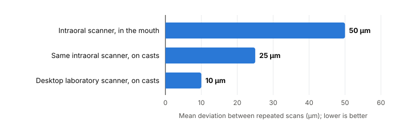
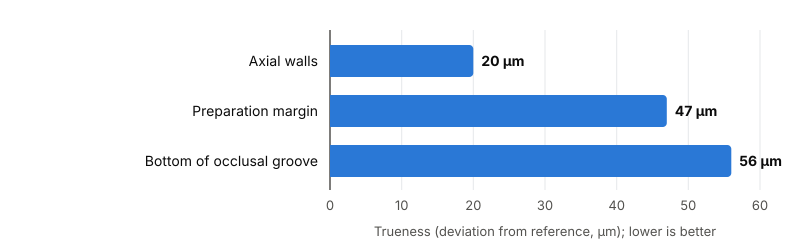
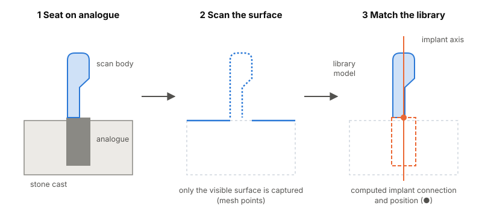

# Chapter 5. Laboratory (Extraoral) Scanners and Model Digitisation

## Learning Objectives

After reading this chapter, you should be able to:

1. Describe how laboratory scanners work and how they differ from intraoral scanners.
2. Summarise the evidence on the accuracy of laboratory scanners and the factors that affect it.
3. Compare digitising a stone cast with scanning an impression directly, and know when each is appropriate.
4. Explain how scan bodies and implant analogues are digitised in the laboratory, and the sources of error involved.
5. Transfer articulator and facebow information into the virtual environment, and understand the limitations of virtual mounting.
6. Calibrate and maintain a laboratory scanner, and recognise when the laboratory scanner is the better choice in a digital workflow.

---

## 5.1 Why Laboratory Scanners Still Matter

As intraoral scanners have spread, it is tempting to see the laboratory (extraoral, desktop or model) scanner as a relic of hybrid workflows. It is not. Laboratory scanners remain central to dental technology for several reasons:

- **Many impressions are still conventional.** Complete-arch impressions, deep subgingival margins, edentulous arches and border-moulded impressions are often better captured with elastomers (Chapters 3 and 4). These impressions or their casts must then be digitised.
- **Controlled conditions.** In the laboratory there is no saliva, blood, movement or limited mouth opening. In a study of one patient, a desktop scanner digitising stone casts was more precise than an intraoral scanner in the mouth (mean deviations between repeated scans of 10 µm and 50 µm) [1].
- **Implant work.** Implant analogues in casts, verification jigs, existing prostheses and wax-ups all need to be digitised.
- **Research and quality control.** High-accuracy laboratory or industrial scanners are often used as the **reference** against which intraoral scans, impressions and restorations are measured (Chapter 3) [2,3]. Laboratory scanners themselves are tested against coordinate-measuring machines [4].
- **Articulation.** Mounted casts carry information on the jaw relationship, facebow transfer and articulator settings that has to be brought into the design software.

---

## 5.2 How Laboratory Scanners Work

### 5.2.1 Principles

Most current laboratory scanners are **optical**:

- **Structured-light scanners** project a pattern of stripes or a grid, often in blue light, onto the object. One or more cameras record how the pattern deforms, and depth is calculated by triangulation.
- **Laser scanners** sweep a laser line or point across the object. A camera at a known angle records its position.

**Contact (touch-probe) scanners**, in which a stylus physically traces the surface, were used in early systems. They are accurate. In an in vitro comparison on ten zirconia dies, the repeatability of both a laser scanner and a touch-probe digitiser was within 10 µm, and the two devices agreed within ±6 µm (median values) [5].

### 5.2.2 How a laboratory scanner differs from an intraoral scanner

**Table 5.1** Laboratory and intraoral scanners compared

| Feature | Laboratory scanner | Intraoral scanner |
|---|---|---|
| Object | Cast, impression, die, wax-up, prosthesis, scan body on analogue | Teeth, soft tissue and scan bodies in the mouth |
| Environment | Controlled: no moisture, movement or access limits | Saliva, blood, movement, limited space, ambient light |
| Positioning | Object on a motorised platform that rotates and tilts automatically; fixed camera geometry | Handheld; operator moves the wand |
| Stitching | Fewer, larger, well-controlled views | Thousands of small frames; error accumulates |
| Precision on casts | Mean deviation of 10 µm between repeated scans of one patient's full-arch casts with one desktop scanner [1]; mean precision of 45.5 µm across six scanners on one die in vitro [4] | Mean deviation of 50 µm in the mouth and 25 µm on the same casts with the same scanner (one patient) [1] |
| Soft-tissue displacement | Shows the soft tissue as recorded by the impression | Records undisplaced tissue only |

In a clinical comparison in one patient, 10 repeated full-arch intraoral scans with one intraoral scanner had a mean deviation of 50 µm. The same scanner on stone casts achieved about 25 µm, and a desktop laboratory scanner about 10 µm [1] (Figure 5.1). Controlled conditions are one likely reason. The authors of one study attributed the lower precision in the mouth than on casts with the same scanner to intraoral conditions such as saliva and limited space [1].

**Figure 5.1** Precision of full-arch digitisation of the same patient's arch in three settings. Values are approximate mean deviations between repeated scans. Data from [1].

---

## 5.3 How Accurate Are Laboratory Scanners?

An in vitro comparison of six laboratory scanners (three structured-light, two laser and one contact), each scanning one master die 10 times, against a coordinate-measuring machine reference found [4]:

- a mean trueness of **38.8 µm** and a mean precision of **45.5 µm** across all six scanners;
- trueness that varied with location: about 20 µm on the axial walls, 47 µm at the preparation margin and 56 µm at the centre of the occlusal groove;
- that accuracy depended on the individual device's parameters, **not on the type of technology** (light, laser or contact);
- that smooth, regular surfaces were scanned more accurately than sharp or deep features.

**Figure 5.2** Mean trueness of six laboratory scanners at three locations on a crown preparation (in vitro). Data from [4].

The two areas that matter most clinically, the **margin** and the **occlusal groove**, showed the largest deviations in this study, whatever the scanning technology [4]. A likely explanation is that lines of sight are limited there (expert opinion). Good preparation and die design help the scanner as much as they help the technician (Section 5.6). Figure 5.2 shows the difference between locations.

---

## 5.4 Scanning Casts and Scanning Impressions

There are two ways to digitise a conventional impression.

### 5.4.1 Scanning the cast (indirect)

The impression is poured in type IV dental stone. The cast is trimmed and sectioned, and the dies, the full arch and the opposing cast are scanned. This is the most common hybrid workflow.

**Advantages**
- Familiar, robust and compatible with traditional laboratory work.
- Dies can be ditched to expose the margin clearly.
- Stone is matte and opaque, which suits optical scanning.

**Limitations**
- It adds the dimensional changes of the stone to those of the impression.
- Pouring and trimming can damage margins or introduce bubbles.
- Casts must be transported and stored, and can carry microorganisms [6].

### 5.4.2 Scanning the impression (direct)

Some laboratory scanners and software can digitise the **impression itself** and invert the surface to create a virtual cast. Impression materials designed to be scannable are available.

**Evidence**
- In an in vitro comparison, digitised vinyl polysiloxane impressions and stone replicas from the same impressions showed **similar** deviations from the master dies, generally within 40 µm. The exceptions were two molar impressions. How accurately the impression could be digitised depended on the shape of the preparation [7].
- An in vivo study of complete-arch impressions in 5 participants included a scannable vinylsiloxanether, both poured and digitised directly. Precision ranged from 12.3 µm (vinylsiloxanether) to 167.2 µm (alginate), with the highest precision in the poured vinylsiloxanether groups. Conventional impressions other than alginate showed the highest precision across the complete arch, and each impression method showed a distinct pattern of deviation [8].

**Limitations**
- Deep, narrow parts of the impression, such as a deep sulcus around a long preparation or an interproximal area, are difficult for the scanner to see into.
- Impression materials can be glossy or translucent. Only use materials and settings validated for your scanner.
- There is no physical cast on which to check contacts or characterise the restoration, unless one is printed later.

> **Lab Note (expert opinion).** Direct impression scanning is most reliable for short spans with open, accessible preparations. For multiple deep preparations or long spans, pour and scan a cast, or combine the two methods: scan the impression for the margins and the cast for the arch.

Table 5.2 summarises the two routes.

**Table 5.2** Digitising the cast versus the impression

| | Scanning the cast (indirect) | Scanning the impression (direct) |
|---|---|---|
| Steps | Pour, trim, section and ditch dies; scan dies, arch and opposing cast | Scan the impression; software inverts it into a virtual cast |
| Accuracy | Adds stone changes to impression changes | Similar to stone replicas in vitro, except for two molar impressions; depends on preparation shape [7] |
| Margins | Dies can be ditched to expose the margin | Deep, narrow areas are hard for the scanner to see into |
| Surface | Matte, opaque stone suits optical scanning | Glossy or translucent materials need validated settings |
| Physical model | Available for contacts and characterisation | None, unless printed later |
| Infection and logistics | Casts must be transported and stored and can carry microorganisms [6] | No cast to pour or store |
| Best suited to (expert opinion) | Long spans, multiple or deep preparations | Short spans with open, accessible preparations |

### 5.4.3 "Reverse" scanning for implants

A related technique is to scan an implant impression, or a cast made from it, in the laboratory instead of scanning the implants intraorally. For abutment-level implant impressions, an in vitro study (five scans per technique, with no independent reference, so only relative differences were measured) found that direct intraoral scanning gave the smallest relative deviations. A stone cast poured from an alginate impression came next, and a putty-only impression scanned directly showed the greatest deviations, especially in the posterior region [9].

Existing prostheses can also be digitised. In one in vitro study, a dual-function scan body scanned on the cast and in reverse through an interim prosthesis gave comparable precision for interimplant distances and angulations, with localised limitations in the trueness of vertical and horizontal angulations [10].

---

## 5.5 Implant Casts and Scan Bodies

In the laboratory, implant positions are digitised by fitting **scan bodies** to the implant analogues in the cast and scanning them. The software then matches a library model of the scan body to the scan and calculates each implant's position and orientation (Figure 5.3).

**Figure 5.3** How a scan body transfers the implant position. The scanner records only the visible surface of the scan body; the software fits the library model to it and calculates the hidden implant connection and axis. Schematic.

The fit and seating of the scan body matter as much as the scanner. In an in vitro study, repeatedly removing and refitting scan bodies gave a mean discrepancy of **11 µm on laboratory analogues**, compared with **39 µm on the original implants**. The systematic digitising error was 5 µm on the stone cast and 13 µm on the polymer model [11]. This suggests that the analogue–scan body connection in the laboratory is more reproducible than the implant–scan body connection.

Good practice when scanning implant casts:

- Use the scan body and library specified for the implant system, and replace worn or scratched scan bodies.
- Tighten scan bodies to the recommended torque, or seat them firmly by hand, in the same way every time.
- Do not cover the scan body's reference surfaces with scanning spray unless the manufacturer instructs it.
- Check the library match visually. A poor match shows up as an uneven deviation map on the scan body.
- For complete-arch implant work, verify the cast itself with a rigid verification jig before scanning (Chapter 3).

High-accuracy laboratory scans of implant casts are also the usual reference in studies that test intraoral scanners and photogrammetry systems [2,3].

---

## 5.6 Preparing Casts and Dies for Scanning

The scanner can only reproduce what it can see. Preparing the model well is often the single biggest factor in a good laboratory scan.

1. **Pour carefully.** Use type IV or V stone mixed and poured according to the manufacturer's instructions, avoiding bubbles at margins.
2. **Use the right colour.** Pale, matte, opaque stone scans best. Very dark, glossy or translucent materials may need a thin scanning spray, which adds thickness of its own.
3. **Section and ditch dies.** Expose the margin cleanly so that the scanner can see slightly beneath it. Mark the margin lightly if the software allows colour capture.
4. **Avoid pencil, varnish and die spacer** on areas that will be scanned, unless they are part of a validated protocol.
5. **Mount casts securely** in the scanner holder, with nothing obstructing the view of the area of interest.
6. **Scan dies individually** where the system allows. Single-die scans let the scanner see the margin from all sides. The software then merges them with the arch scan.
7. **Scan the opposing cast and the bite** (casts in occlusion, or a bite registration) to set the jaw relationship.

---

## 5.7 Articulation in the Virtual Environment

### 5.7.1 What needs transferring

On a mechanical articulator, the casts carry three kinds of information:

1. The **maxillomandibular relationship** (MIP, or a centric relation record at a given vertical dimension).
2. The **position of the maxillary cast relative to the hinge axis and a reference plane**, from a facebow transfer.
3. The **articulator settings**: condylar guidance, Bennett angle and incisal guidance.

A **virtual articulator** is software that reproduces the relationship between the jaws and simulates jaw movement [12]. It is most useful as an additional diagnostic and planning tool, especially in complex cases that involve a change in the vertical dimension of occlusion [12].

### 5.7.2 Transferring the mounting

Approaches include:

- **Scanning mounted casts in an articulator-compatible scanner.** Many laboratory scanners have mounting plates that match specific articulators. The casts are scanned in their mounted positions, so the facebow relationship is carried directly into the virtual articulator. **[UNVERIFIED]**
- **Virtual facebow.** The relationship of the maxillary arch to the face or skull is recorded digitally, by scanning a facebow fork or using a facial scan or CBCT, and the arch is mounted in the virtual articulator [12].
- **Average-value mounting.** The casts are placed in a standard (Bonwill or Balkwill) position. This is fast but ignores the individual patient's anatomy. **[UNVERIFIED]**

### 5.7.3 Evidence

- In a clinical study of 15 participants, a **CBCT-based virtual mounting** was more precise across repeated mountings than **conventional facebow mounting**. Conventional mounting also produced a steeper occlusal plane angle (8.1° versus 2.1°) [13].
- In a phantom model with ears 3 mm apart in height, a new occlusal-plane transfer device was more accurate in the frontal plane than a conventional ear-based facebow (about 0.2–0.5° versus 1.3–1.9°). In the sagittal plane the two did not differ [14]. Ear-based facebows can transfer asymmetries of the ears into the mounting.

> **Clinical Tip (expert opinion).** For single crowns and short spans in a stable occlusion, a buccal bite scan and an average-value virtual articulator are usually enough. For changes to the occlusal vertical dimension, full-mouth rehabilitation or significant aesthetic change, use a patient-specific transfer: a scanned facebow mounting, a virtual facebow or jaw tracking (Chapter 6).

---

## 5.8 Calibration, Maintenance and Quality Control

Laboratory scanners are measuring instruments and must be looked after as such:

- **Calibrate** with the manufacturer's calibration object at the recommended interval, after moving the scanner, and whenever results look doubtful.
- **Control the environment.** Keep the scanner in a stable position away from vibration, direct sunlight and strong lights, and keep the scanning chamber closed.
- **Keep optics clean** and free from stone dust.
- **Update software** carefully. Check that updates do not change export settings, implant libraries or alignment behaviour without your knowledge (Chapter 2).
- **Run a reference test.** Periodically scanning a reference die or cast with known dimensions, and comparing it with the original scan, is a simple quality-control check.
- **Manage infection risk.** Disinfect impressions and casts that arrive from the clinic before scanning, using methods that do not distort them. Casts can carry bacteria, including resistant strains [6].

---

## 5.9 Choosing Between Intraoral and Laboratory Digitisation

**Table 5.3** When to digitise in the laboratory rather than intraorally (expert synthesis; evidence in Chapters 3, 4 and 18)

| Situation | Preferred route | Reason |
|---|---|---|
| Single crowns, inlays, short spans with accessible margins | Intraoral scan | Comparable fit, faster, preferred by patients (Chapter 4) |
| Deep subgingival margins, bleeding risk | Conventional impression → cast → laboratory scan | Elastomer displaces tissue; margin can be ditched and checked |
| Complete-arch, tooth-supported | Either; see Chapter 3 for the systematic-review evidence | Long-span error of intraoral scans (Chapter 3) |
| Complete-arch implant frameworks | Verified conventional cast → laboratory scan, or photogrammetry, or intraoral scan with verification | Passive fit; verification is essential |
| Edentulous arches, border-moulded impressions | Conventional impression → laboratory scan | Functional tissue displacement (Chapter 18) |
| Mounted cases needing a facebow transfer | Scan casts mounted in an articulator-compatible scanner | Keeps the hinge-axis relationship |
| Existing prostheses, wax-ups, provisionals | Laboratory scan | Easy, accurate copy of approved shapes |

---

## Key Points

- In one patient, a desktop laboratory scanner digitising casts was more precise than intraoral scanning of the same arch [1]. Laboratory scans are often used as the reference in accuracy studies [2,3].
- Laboratory scanner trueness and precision depend on the device's parameters, not on the technology type [4]. Trueness is worst at **the margin and the occlusal groove** [4].
- In vitro, digitised impressions and stone replicas showed **similar deviations**, except for two molar impressions; preparation shape affected the result [7]. Deep, narrow areas favour pouring a cast (expert opinion).
- In vitro, implant scan bodies reseated more reproducibly on laboratory analogues in a stone cast than on implants in a polymer model [11]. Use the correct scan bodies and libraries, and check the library match.
- **Virtual articulators** are valuable for complex cases [12]. A CBCT-based virtual mounting was more precise than conventional facebow mounting in one clinical study [13].
- Calibrate, maintain and periodically test laboratory scanners as measuring instruments. Disinfect impressions and casts before scanning [6].

---

## Review Questions

1. Why is a desktop laboratory scanner more precise than an intraoral scanner, even when both use similar optical principles?
2. According to the comparison of six laboratory scanners, where on a crown preparation is trueness lowest, and why?
3. List two advantages and two limitations of scanning an impression directly rather than pouring and scanning a cast.
4. Why might scan bodies reseat more reproducibly on laboratory analogues than on implants? What are the implications for implant workflows?
5. Describe three ways of transferring the maxillary cast's relationship to the hinge axis into a virtual articulator.
6. A patient with markedly asymmetric ears needs a full-mouth rehabilitation. Which mounting method would you choose, and why?
7. Design a simple monthly quality-control routine for a laboratory scanner.

---

## References

1. Flügge TV, Schlager S, Nelson K, Nahles S, Metzger MC. Precision of intraoral digital dental impressions with iTero and extraoral digitization with the iTero and a model scanner. Am J Orthod Dentofacial Orthop. 2013;144(3):471–8. doi:10.1016/j.ajodo.2013.04.017
2. Ye Y, Lin M, Qu Y, Gong J, Wang C, Wang Y, et al. Comparison of accuracy in full-arch implant impressions using conventional, intraoral, and photogrammetric techniques: an in vitro study. J Dent. 2026;174:106861. doi:10.1016/j.jdent.2026.106861
3. Revilla-León M, Guinot-Barona C, Barmak AB, Drone M, Kois JC, Pérez-Barquero JA. Comparative accuracy study of three extraoral photogrammetry methods, one intraoral photogrammetry system, and a noncalibrated implant scan body technique. J Prosthet Dent. 2026;136(1):267–74. doi:10.1016/j.prosdent.2026.01.010
4. González de Villaumbrosia P, Martínez-Rus F, García-Orejas A, Salido MP, Pradíes G. In vitro comparison of the accuracy (trueness and precision) of six extraoral dental scanners with different scanning technologies. J Prosthet Dent. 2016;116(4):543–50.e1. doi:10.1016/j.prosdent.2016.01.025
5. Persson A, Andersson M, Oden A, Sandborgh-Englund G. A three-dimensional evaluation of a laser scanner and a touch-probe scanner. J Prosthet Dent. 2006;95(3):194–200. doi:10.1016/j.prosdent.2006.01.003
6. Barenghi L, Barenghi A, Cadeo C, Di Blasio A. Innovation by computer-aided design/computer-aided manufacturing technology: a look at infection prevention in dental settings. Biomed Res Int. 2019;2019:6092018. doi:10.1155/2019/6092018
7. Persson ASK, Odén A, Andersson M, Sandborgh-Englund G. Digitization of simulated clinical dental impressions: virtual three-dimensional analysis of exactness. Dent Mater. 2009;25(7):929–36. doi:10.1016/j.dental.2009.01.100
8. Ender A, Attin T, Mehl A. In vivo precision of conventional and digital methods of obtaining complete-arch dental impressions. J Prosthet Dent. 2016;115(3):313–20. doi:10.1016/j.prosdent.2015.09.011
9. Deshpande SJ, Kasnale DR, Patil K, Abubakar P, Sinnurkar S, Rokaya D. Accuracy of direct intraoral versus reverse scanning for abutment-level implant impressions: an in vitro study. Eur J Dent. 2026. doi:10.1055/s-0046-1827796
10. Veríssimo MHG, de Freitas RFCP, Dos Santos ALM, de Sá GSP, de França LBR, Batista AUD, et al. Accuracy evaluation of dual-function scan body for recording complete arch implant-supported prostheses. J Prosthet Dent. 2026;136(2):e268–e276. doi:10.1016/j.prosdent.2026.05.013
11. Stimmelmayr M, Güth JF, Erdelt K, Edelhoff D, Beuer F. Digital evaluation of the reproducibility of implant scanbody fit — an in vitro study. Clin Oral Investig. 2012;16(3):851–6. doi:10.1007/s00784-011-0564-5
12. Lepidi L, Galli M, Mastrangelo F, Venezia P, Joda T, Wang HL, et al. Virtual articulators and virtual mounting procedures: where do we stand? J Prosthodont. 2021;30(1):24–35. doi:10.1111/jopr.13240
13. Kim SJ, Kang YJ, Kim JH. Comparison of the accuracy of a cone beam computed tomography-based virtual mounting technique with that of the conventional mounting technique using a facebow. J Prosthet Dent. 2025;134(2):450–9. doi:10.1016/j.prosdent.2023.08.025
14. Kim DS, Park SH, Ahn JJ, Jeong CM, Yun MJ, Huh JB, et al. In vitro comparison of the accuracy of an occlusal plane transfer method between facebow and POP bow systems in asymmetric ear position. J Adv Prosthodont. 2023;15(5):271–80. doi:10.4047/jap.2023.15.5.271
