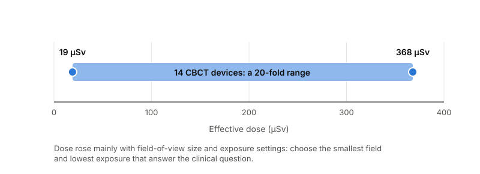
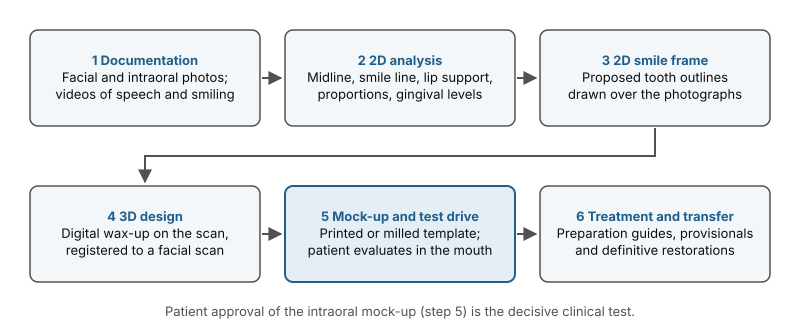
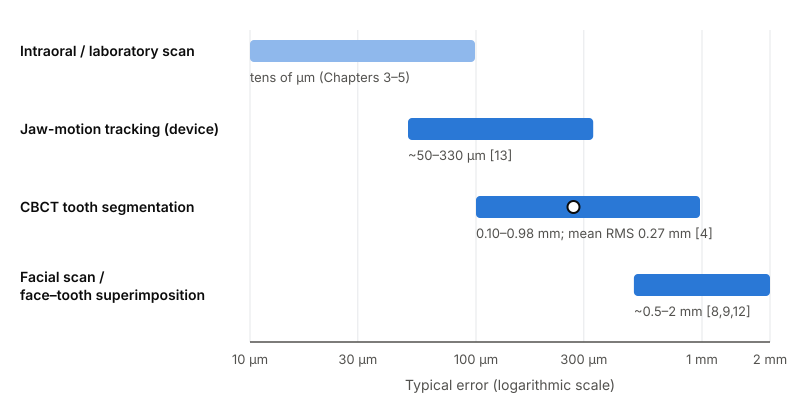

# Chapter 6. Three-Dimensional Imaging Beyond the Teeth

## Learning Objectives

After reading this chapter, you should be able to:

1. Explain what CBCT contributes to CAD/CAM workflows, and apply dose-optimisation principles when prescribing it.
2. Describe how CBCT data are segmented and registered with intraoral or laboratory scans, and the main sources of error.
3. Compare facial-scanning technologies, including smartphone-based systems, and interpret their accuracy.
4. Describe how jaw motion is recorded digitally and how it is used in design.
5. Explain the principles of digital smile design and what the evidence shows about its outcomes.
6. Combine these datasets into a coherent virtual patient, and judge which dataset should drive each design decision.

---

## 6.1 Why Look Beyond the Teeth?

Intraoral and laboratory scans describe the **surfaces** of teeth and soft tissue very accurately. They say nothing about the bone and roots beneath, the face around the teeth, or how the jaw moves. Yet these determine much of what a restoration must achieve:

- **Bone and roots** determine where implants can go and what the restoration must look like to suit them (Chapter 17).
- **The face and lips** determine the position, length, midline and display of anterior teeth.
- **Jaw movement** determines the occlusal anatomy, anterior guidance and the space available for the restoration.

This chapter covers the three data sources that extend the CAD/CAM chain beyond the dental arch: **cone-beam computed tomography (CBCT)**, **facial scanning** and **jaw-motion tracking**. It also covers how they come together in **digital smile design**. Chapter 2 introduced the virtual patient that results when these data are merged [1].

---

## 6.2 Cone-Beam Computed Tomography

### 6.2.1 What CBCT provides

CBCT produces a volume of voxels, each with a grey value related to radiographic density (Chapter 2). For CAD/CAM work it provides:

- bone volume, density and contour for implant planning and guided surgery;
- root position, angulation and proximity;
- anatomical structures to avoid, such as the inferior alveolar nerve, mental foramen, maxillary sinus and incisive canal;
- the skeletal base for orthognathic and maxillofacial planning;
- skull and condyle references for virtual articulator mounting (Chapter 5).

### 6.2.2 Radiation dose

CBCT uses ionising radiation, and doses vary widely. In a study of 14 CBCT devices, effective doses ranged from **19 to 368 µSv**, a 20-fold range. The dose depended strongly on **field-of-view size** and exposure settings [2] (Figure 6.1). The salivary and thyroid glands were among the largest contributors to effective dose [2].

**Figure 6.1** Effective dose across 14 dental CBCT devices ranged from 19 to 368 µSv, a 20-fold range that depended mainly on field-of-view size and exposure settings. Data from [2].

> **Clinical Tip.** Prescribe CBCT only when the expected benefit justifies the dose. Choose the **smallest field of view** and the lowest exposure that answer the clinical question. A single-implant site needs a small field. Facial-skeletal planning needs a large one. Never take a CBCT only to improve the fit of a surface scan or to "complete" a virtual patient for presentation.

### 6.2.3 Artefacts

CBCT images contain **artefacts**, which are differences between the reconstructed image and the real anatomy. They arise because the mathematical reconstruction does not perfectly model the physical imaging process [3]. The most important for CAD/CAM are:

- **Beam hardening and streaks** from metal restorations, posts and implants, which blur or hide nearby tooth and bone surfaces;
- **Patient movement**, which causes double contours and blurring;
- **Noise and scatter**, which reduce contrast and make thin structures hard to segment;
- **Field-of-view truncation** and **cone-beam effects** at the edges of the volume.

Every user should know these artefacts and how they affect diagnosis [3]. For CAD/CAM, artefacts matter most because they spoil **segmentation** and **registration** (Sections 6.2.4 and 6.2.5).

### 6.2.4 Segmentation

To combine CBCT data with surface scans or to design guides, the relevant structures must be **segmented**: separated from the volume and converted into surface meshes.

- **Threshold-based segmentation** selects voxels within a grey-value range. It is fast, but results depend on the chosen threshold and on artefacts.
- **Manual and semi-automatic segmentation** is more accurate but slow.
- **AI-driven segmentation** uses trained neural networks to identify teeth, bone, nerves and airway automatically.

In a validation study, teeth segmented from CBCT were compared with intraoral scans of the same teeth after extraction. Mean deviations between methods ranged from 0.10 to 0.98 mm, with a mean RMS of **0.27 mm**. Manual segmentation was slightly more accurate than two AI tools, but the AI tools were much faster. The **apical part of the root** was the least accurate region, and restoration artefacts reduced AI performance [4].

A segmented CBCT surface is therefore accurate to a few tenths of a millimetre. That is good enough for planning implant position and root relationships, but far less accurate than an intraoral scan for crown surfaces and margins. Converting CBCT segmentations to STL allows moderate mesh reduction without losing accuracy (Chapter 2) [5].

### 6.2.5 Registering CBCT with surface scans

To plan prosthetically driven implants, the CBCT volume is **registered** (superimposed) with an intraoral or laboratory scan. The scan supplies accurate tooth and soft-tissue surfaces. The CBCT supplies bone and roots.

Registration methods include:

- **Point-based registration:** the operator selects three or more matching points (such as cusp tips) on both datasets;
- **Surface-based registration:** the software minimises the distance between the segmented CBCT teeth and the scanned teeth;
- **Fiducial or marker-based registration:** radiopaque markers or scan appliances worn during both CBCT and scanning;
- **Automatic AI-based registration.**

In a randomised study of 150 patients, fully automatic AI-based registration was as accurate as conventional methods **in patients without restorations**. With multiple restoration artefacts, operator experience mattered. Free-ended edentulous areas also reduced accuracy [6]. Table 6.1 summarises the options.

**Table 6.1** Methods for registering CBCT with surface scans

| Method | How it works | Practical notes |
|---|---|---|
| **Point-based** | The operator selects three or more matching points (such as cusp tips) on both datasets | Manual; check the result visually on the CBCT slices |
| **Surface-based** | The software minimises the distance between segmented CBCT teeth and scanned teeth | Depends on segmentation; restoration artefacts reduced the performance of automated segmentation (6.2.4) [4] |
| **Fiducial / marker-based** | Radiopaque markers or a scan appliance worn during both CBCT and scanning | Use when few teeth remain or metal restorations are extensive |
| **Automatic (AI-based)** | Trained software aligns the datasets without manual input | As accurate as conventional methods without restorations; with multiple restoration artefacts operator experience mattered; free-ended edentulous areas reduced accuracy [6] |

> **Clinical Tip.** After every registration, check the fit visually. Scroll through the CBCT slices and confirm that the scanned tooth surfaces lie exactly on the radiographic tooth outlines, especially away from metal restorations. In patients with few teeth or extensive metal, use radiopaque fiducial markers or a scan appliance.

---

## 6.3 Facial Scanning

### 6.3.1 Why scan the face?

Anterior restorations, complete dentures and orthodontic treatment must harmonise with the face. A **3D facial scan** lets the clinician and technician design in relation to facial references: the interpupillary line, facial midline, lip line at rest and when smiling, nasolabial angle and profile. Without it, these must be inferred from photographs or physical transfer devices.

### 6.3.2 Technologies

**Table 6.2** Facial scanning technologies

| Technology | Principle | Strengths | Limitations |
|---|---|---|---|
| **Stereophotogrammetry (static, multi-camera)** | Several synchronised cameras capture the face at once | Instant capture (no movement artefact); high accuracy; realistic texture | Expensive; large footprint |
| **Portable stereophotogrammetry** | Handheld multi-camera device moved around the face | Good accuracy; mobile | Longer capture; operator-dependent |
| **Structured light (portable)** | Projected light pattern, triangulation | High precision | Capture time; possible movement artefact |
| **Smartphone apps** (depth sensor or photogrammetry from video) | Near-infrared depth camera or multiple images | Inexpensive; accessible | Lower resolution; accuracy varies by app and camera |

### 6.3.3 Accuracy

- In a study of five facial-scanning methods with CBCT-derived soft tissue as the reference, stereophotogrammetry and structured-light scanners showed good trueness and precision. **All** methods, including smartphone apps, achieved clinically acceptable accuracy. The apps differed in speed, retake rate and realism [7].
- A smartphone depth-sensor system had a mean RMS difference of **0.86 mm** from a stereophotogrammetry reference, and 97% of landmarks lay within 2 mm. The authors cautioned against using it where fine detail is needed [8].
- A photogrammetry app on a smartphone showed mean deviations of about **2 mm** from CT-derived facial surfaces. The greatest divergence was in the lower third of the face, and the authors limited its use to monitoring facial oedema [9].
- In orthodontic patients, a smartphone facial scan combined with an intraoral scan gave linear measurements that agreed with real photographs for all but one of eight measurements [10].

The **lower third of the face**, around the lips and teeth, is where dental design needs facial data most. It is also where several smartphone systems are least accurate [9].

### 6.3.4 Combining the facial scan with the dental scan

A facial scan does not show the teeth well enough to design on. The dental scan must be registered to it:

- by scanning the face with the teeth visible (smiling or with lip retractors) and matching the anterior teeth;
- by using an **extraoral scan body** or bite fork with reference markers, scanned both in the face and with the dental scan.

Artificial extraoral markers significantly improved registration accuracy. Stereophotogrammetry with marker-based matching gave the smallest deviations, and smartphone scans with tooth-only matching the largest [11]. In a clinical study, virtual patients built from facial and intraoral scans with scan-body systems had a trueness of **0.50–1.64 mm** compared with CBCT [12].

> **Evidence Box.** Facial-scan registration is accurate to roughly 0.5–2 mm [8,9,12]. That is good enough to judge the incisal edge position, midline and smile line in relation to the face. It is not good enough to set restoration dimensions to tenths of a millimetre. Always confirm aesthetic decisions with an intraoral mock-up (Section 6.5.4).

---

## 6.4 Jaw-Motion Tracking

### 6.4.1 Why record jaw motion?

A buccal bite scan records one static jaw position (Chapter 4). A mechanical or virtual articulator with average values approximates movement. Neither reproduces the **individual** patient's border movements and chewing paths. **Jaw-motion tracking (JMT)** records real mandibular movement and transfers it to the design software. This allows:

- dynamic occlusal design that avoids interferences in the patient's own excursions;
- design of anterior guidance in full-mouth rehabilitation;
- analysis of chewing patterns and temporomandibular disorders.

### 6.4.2 Technologies

JMT systems use several principles: optoelectronic (camera-based) tracking of markers attached to the mandible and head, ultrasonic tracking, electromagnetic tracking and electronic axiography [13]. The recorded motion is linked to the dental scans through a reference attachment that is scanned with the teeth.

### 6.4.3 Evidence

- A systematic review of 20 studies found that optical tracking systems recorded mandibular movement more precisely than traditional methods. JMT showed potential to reduce chair time and improve prosthetic outcomes. The risk of bias was **high**, owing to small samples and no long-term evaluation [14].
- A systematic review of 30 studies of jaw-movement digitisation found device accuracy between **50 and 330 µm** across systems. Many physiological factors affected the recorded movements, including growth, neuromuscular dysfunction, shortened dental arches, previous orthodontic treatment, head posture and temporomandibular disorders. More than half of the studies had below-moderate certainty of evidence [13].
- Case reports describe digital workflows that use JMT for full-mouth rehabilitation in severe tooth wear, determining the jaw relationship and anterior guidance virtually [15]. A four-dimensional virtual patient combining intraoral, facial, CBCT and JMT data has been described as a proof of concept [16].

JMT is a promising tool for complex prosthodontic and occlusal cases. Evidence that it improves clinical outcomes compared with conventional articulation is still limited [13,14].

---

## 6.5 Digital Smile Design

### 6.5.1 Concept

**Digital smile design (DSD)** is a planning approach. Facial and dental photographs, videos and 3D data are analysed with reference lines and proportions to design the ideal tooth position, size and shape in relation to the face. The design is then transferred to a 3D wax-up, mock-up and final restorations.

A typical DSD workflow (Figure 6.2):

1. **Documentation.** Standardised facial and intraoral photographs, plus videos of speech and spontaneous smiling. Video captures lip dynamics that static photographs miss [17].
2. **2D analysis.** Facial midline, interpupillary line, smile line, lip support, tooth proportions, gingival levels.
3. **2D smile frame.** The proposed tooth outlines drawn over the photographs [17].
4. **3D design.** The 2D plan is transferred to a digital wax-up on the intraoral scan, ideally registered to a facial scan.
5. **Mock-up and test drive.** The design is printed or milled as a model or template, and an intraoral mock-up is made in provisional material for the patient to evaluate.
6. **Treatment and transfer.** Preparation guides, provisionals and definitive restorations are made from the approved design.

**Figure 6.2** The digital smile design workflow, from documentation to definitive restorations. The intraoral mock-up (step 5) is where the patient approves the design. Steps 1 and 3 follow [17].

### 6.5.2 Software

Many DSD programs exist, from general presentation and image-editing tools to dedicated dental applications. In a review of eight programs, general software offered the most comprehensive facial analysis. Some dedicated programs offered 3D analysis and integration with CAD/CAM [18]. The choice of software matters less than a systematic analysis and reliable transfer of the plan into 3D.

### 6.5.3 Evidence

- A systematic review of seven studies found that DSD consistently improved patient satisfaction, acceptance of treatment, communication and perceived predictability compared with conventional approaches. The evidence was limited by heterogeneity and small samples [19].
- A systematic review and meta-analysis of AI-based DSD tools reported improved aesthetic parameters. The pooled prevalence of satisfaction was 58%, with high heterogeneity, moderate risk of bias and evidence of publication bias [20].

DSD clearly improves **communication** and patient involvement. Evidence that it improves long-term clinical outcomes compared with careful conventional aesthetic planning is still weak.

### 6.5.4 The mock-up is the real test

No matter how sophisticated the digital design, the **intraoral mock-up** is where the plan meets the patient. It tests phonetics, lip support, incisal display, the smile line and the patient's perception in a way no screen can. The approved mock-up, once scanned, becomes the reference for the definitive restorations.

> **Clinical Tip.** Show patients the mock-up in their own mouth before showing a polished digital simulation. Simulations on screen can raise expectations that the biology, available space or budget cannot meet.

---

## 6.6 Integrating the Datasets

### 6.6.1 Which dataset drives which decision?

**Table 6.3** Data sources and the decisions they should drive

| Decision | Primary dataset | Typical accuracy | Supporting data |
|---|---|---|---|
| Margins, contacts, intaglio fit | Intraoral or laboratory scan | Tens of µm (Chapters 3–5) | — |
| Static occlusion | Bite scan or mounted casts | Tens to hundreds of µm (Chapter 4) | Virtual articulator |
| Dynamic occlusion, guidance | Jaw-motion tracking or articulator | ~50–330 µm (device level) [13] | Facebow / virtual facebow |
| Implant position, bone, roots | CBCT registered to surface scan | Segmentation ~0.27 mm RMS [4]; registration varies [6] | Prosthetic wax-up |
| Incisal edge, midline, smile line | Facial scan, photographs, video | ~0.5–2 mm [8,9,12] | Intraoral mock-up |
| Patient acceptance | Mock-up | Clinical judgement | DSD presentation |

The rule is simple: **use each dataset for decisions within its accuracy**, and never let a less accurate dataset override a more accurate one where they overlap. The facial scan suggests where the incisal edge should be. The intraoral scan and the mock-up decide exactly where it is. Figure 6.3 places the typical error of each dataset on a common scale.

**Figure 6.3** Typical error of each dataset in the virtual patient, on a logarithmic scale. The pale band for surface scans is indicative (tens of micrometres; Chapters 3–5). The open circle marks the mean RMS of CBCT tooth segmentation. Data from [4,8,9,12,13]; see Table 6.3.

### 6.6.2 Practical integration workflow (aesthetic implant case)

1. Intraoral scans (both arches) and bite scan.
2. Facial scan at rest and smiling, with an extraoral scan body or reference markers.
3. Photographs and video for DSD.
4. DSD analysis and 3D digital wax-up, registered to the facial scan.
5. Intraoral mock-up; scan the approved mock-up.
6. CBCT with the smallest suitable field of view; register to the intraoral scan and the wax-up.
7. Prosthetically driven implant planning and guide design (Chapter 17).
8. If needed, jaw tracking for dynamic occlusal design of the definitive restoration.

### 6.6.3 Data management

Combining datasets multiplies the volume of data and the risk of privacy breaches. Facial scans are highly identifying. Keep all of them secure, encrypted and under the same protections as other biometric health data (Chapter 2).

---

## Key Points

- CBCT adds bone, roots and anatomy, but doses vary 20-fold and depend mainly on **field of view** [2]. Use the smallest field and lowest exposure that answer the question.
- CBCT **artefacts**, especially from metal, degrade segmentation and registration [3,6].
- CBCT-segmented teeth are accurate to about **0.27 mm RMS**, worst at the root apex. AI segmentation is faster and nearly as accurate as manual segmentation [4]. Automatic CBCT–scan registration works well without restorations but needs checking when artefacts are present [6].
- Facial scanners, including smartphone apps, can achieve clinically acceptable accuracy for planning [7,8]. Accuracy is lowest in the lower third of the face for some apps [9]. **Extraoral markers** improve face–tooth registration [11].
- Jaw-motion tracking records individual movement with device accuracies of about **50–330 µm**. It is promising for complex cases but supported by limited, high-risk-of-bias evidence [13,14].
- Digital smile design improves **communication and satisfaction** [19,20]. The **mock-up** remains the decisive clinical test.
- Use each dataset only for decisions within its accuracy (Table 6.3).

---

## Review Questions

1. Which factor most strongly determines the effective dose of a CBCT scan? How would you apply this when planning a single posterior implant?
2. List three CBCT artefacts and explain how each could affect registration of the CBCT with an intraoral scan.
3. Compare the accuracy of AI-driven and manual tooth segmentation from CBCT. Which part of the tooth is least accurate, and why might that matter?
4. A colleague proposes using a smartphone facial scan to set the exact length of six anterior crowns. What is your advice, and why?
5. How do extraoral markers improve the registration of a dental scan to a facial scan?
6. Describe the main technologies used for jaw-motion tracking. What does current evidence say about their clinical benefit?
7. Outline a digital smile design workflow from documentation to definitive restorations. At which step is the patient's approval most reliably obtained?
8. Using Table 6.3, explain which dataset should decide (a) the cervical margin of an implant crown, (b) the implant's apical position, and (c) the incisal edge position of a central incisor.

---

## References

1. Joda T, Gallucci GO. The virtual patient in dental medicine. Clin Oral Implants Res. 2015;26(6):725–6. doi:10.1111/clr.12379
2. Pauwels R, Beinsberger J, Collaert B, Theodorakou C, Rogers J, Walker A, et al. Effective dose range for dental cone beam computed tomography scanners. Eur J Radiol. 2012;81(2):267–71. doi:10.1016/j.ejrad.2010.11.028
3. Schulze R, Heil U, Gross D, Bruellmann DD, Dranischnikow E, Schwanecke U, et al. Artefacts in CBCT: a review. Dentomaxillofac Radiol. 2011;40(5):265–73. doi:10.1259/dmfr/30642039
4. Ntovas P, Sirirattanagool P, Asavanamuang P, Jain S, Tavelli L, Revilla-León M, et al. Accuracy and time efficiency of artificial intelligence-driven tooth segmentation on CBCT images: a validation study using two implant planning software programs. Clin Oral Implants Res. 2025;36(10):1312–23. doi:10.1111/clr.70003
5. Elbashti M, Molinero-Mourelle P, Aswehlee A, Bornstein MM, Abou-Ayash S, Schimmel M, et al. Effect of triangular mesh resolution on the geometrical trueness of segmented CBCT maxillofacial data into STL format. J Dent. 2023;138:104722. doi:10.1016/j.jdent.2023.104722
6. Ntovas P, Marchand L, Finkelman M, Revilla-León M, Att W. Accuracy of manual and artificial intelligence-based superimposition of cone-beam computed tomography with digital scan data, utilizing an implant planning software: a randomized clinical study. Clin Oral Implants Res. 2024;35(10):1262–72. doi:10.1111/clr.14313
7. Jindanil T, Gracea RS, Claessens N, Fontenele RC, Cadenas de Llano-Pérula M, Claes P, et al. Three-dimensional facial scanning: quantitative and qualitative assessment of five different modalities with CBCT as a reference. J Dent. 2025;163:106179. doi:10.1016/j.jdent.2025.106179
8. Andrews J, Alwafi A, Bichu YM, Pliska BT, Mostafa N, Zou B. Validation of three-dimensional facial imaging captured with smartphone-based photogrammetry application in comparison to stereophotogrammetry system. Heliyon. 2023;9(5):e15834. doi:10.1016/j.heliyon.2023.e15834
9. Martins-de-Barros AV, de Lacerda AN, Dias Pionório L, Ramos LFS, Faro TF, de Moraes BC, et al. Trueness and precision of smartphone-based 3D scan in the assessment of facial edema in orthognathic surgery. J Oral Biol Craniofac Res. 2026;16(3):101467. doi:10.1016/j.jobcr.2026.101467
10. Vasoglou M, Pouliezou I, Apostolopoulos K, Vasoglou G. Accuracy of combining intraoral and facial scan in a single digital model of an orthodontic patient utilizing corresponding measurements on the model and on real photographs: a prospective cross-sectional study. Int Orthod. 2025;23(4):101015. doi:10.1016/j.ortho.2025.101015
11. Mai HN, Lee DH. Effects of artificial extraoral markers on accuracy of three-dimensional dentofacial image integration: smartphone face scan versus stereophotogrammetry. J Pers Med. 2022;12(3):490. doi:10.3390/jpm12030490
12. Revilla-León M, Zandinejad A, Nair MK, Barmak AB, Feilzer AJ, Özcan M. Accuracy of a patient 3-dimensional virtual representation obtained from the superimposition of facial and intraoral scans guided by extraoral and intraoral scan body systems. J Prosthet Dent. 2022;128(5):984–93. doi:10.1016/j.prosdent.2021.02.023
13. Farook TH, Rashid F, Alam MK, Dudley J. Variables influencing the device-dependent approaches in digitally analysing jaw movement — a systematic review. Clin Oral Investig. 2023;27(2):489–504. doi:10.1007/s00784-022-04835-w
14. Tafuri G, Santilli M, Murmura G, D'Addazio G, Traini T, Femminella B, et al. Jaw tracking system in digital dentistry: a systematic review. Int J Prosthodont. 2026;39(5):589–96. doi:10.11607/ijp.9327
15. Wang Y, Hao Z, Liang Y, Yang W, Ma Y. From virtual maxillomandibular relationship determination to clinical implementation for digital functional-esthetic rehabilitation in severe generalised tooth surface loss. J Esthet Restor Dent. 2025;37(11):2347–57. doi:10.1111/jerd.70014
16. Haku-Mizuhara K, Tanabe G, Kadempour A, Mirafzali S, Yotsuya M, Yamaguchi S. Development of a 4-dimensional virtual patient in motion: a digital concept. J Prosthet Dent. 2026;135(1):47–53. doi:10.1016/j.prosdent.2025.02.064
17. Coachman C, Calamita MA, Sesma N. Dynamic documentation of the smile and the 2D/3D digital smile design process. Int J Periodontics Restorative Dent. 2017;37(2):183–93. doi:10.11607/prd.2911
18. Omar D, Duarte C. The application of parameters for comprehensive smile esthetics by digital smile design programs: a review of literature. Saudi Dent J. 2018;30(1):7–12. doi:10.1016/j.sdentj.2017.09.001
19. Alwabel LK, Alabduljabar WM, Alawfi LK, Al Johani NK, Alharbi LE, Kharif MA, et al. Digital smile design and patient-centered outcomes in esthetic restorative dentistry: a systematic review. Cureus. 2025;17(11):e98084. doi:10.7759/cureus.98084
20. Saini RS, Kaur K, Gurumurthy V, Binduhayyim RIH, Kaushik A, Kuruniyan MS, et al. Impact of artificial intelligence-based digital smile design on patient and clinician satisfaction and facial esthetic outcomes: a systematic review and meta-analysis. Digit Health. 2025;11:20552076251388392. doi:10.1177/20552076251388392
