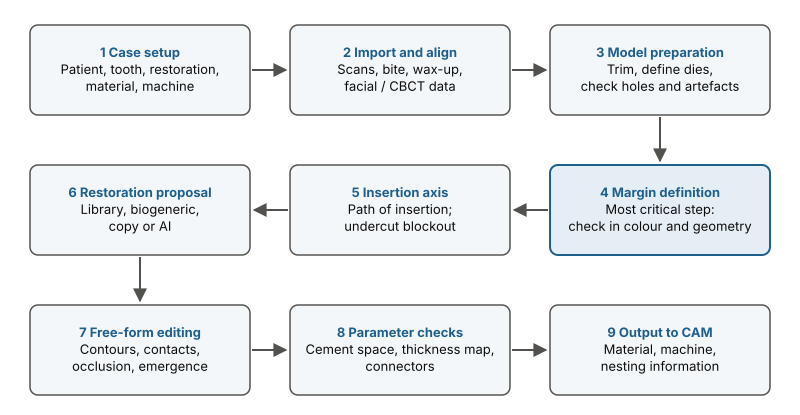
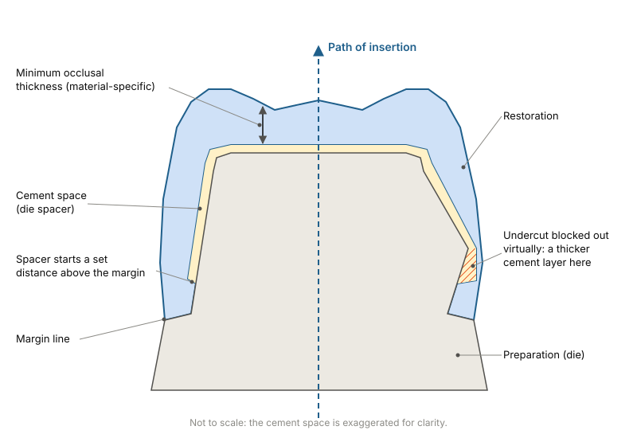

# Chapter 7. Design Software: Principles and Tools

## Learning Objectives

After reading this chapter, you should be able to:

1. Describe the general architecture of dental CAD software and the sequence of a typical design.
2. Explain how restoration shapes are proposed: tooth libraries, biogeneric models, copying anatomy and AI generation.
3. Define, check and correct the margin line, path of insertion and undercuts.
4. Set and justify the main design parameters: cement space, minimum thickness, connector size and contact strength.
5. Design static and dynamic occlusion in the software and recognise the limits of virtual articulation.
6. Evaluate the evidence on AI-based automatic design, and define the human oversight it still needs.

---

## 7.1 What Design Software Does

Design (CAD) software sits between the scan and the machine. It takes a 3D model of the patient's situation and produces a 3D model of a restoration, appliance or guide that a mill or printer can make.

Most dental CAD programs share a common structure:

1. **Order or case setup.** Patient, teeth, restoration type, material, manufacturing method and production site.
2. **Data import and alignment.** Preparation scan, arch scans, opposing arch, bite, pre-operative scan, wax-up or mock-up, and any facial or CBCT data.
3. **Model preparation.** Trimming, defining dies, and checking for holes and artefacts.
4. **Margin definition.**
5. **Insertion axis and undercut blockout.**
6. **Restoration proposal.** Library, biogeneric model, copy or AI.
7. **Free-form editing.** Contours, contacts, occlusion and emergence profile.
8. **Parameter checks.** Thickness, connectors and cement space.
9. **Output.** Export to CAM software with material, machine and nesting information.

The order varies between programs, but the logic is the same (Figure 7.1). The clinician or technician who understands each step can work in any software.

**Figure 7.1** The nine steps of a typical CAD design. The order varies between programs; margin definition (step 4) is the most critical step.

> **Clinical Tip.** Dentists who send cases to a laboratory should still learn to *read* a design. They should be able to view the margin, thickness map, contacts and occlusion on screen and approve or reject the design before it is made. Most laboratory platforms now allow this.

---

## 7.2 Defining the Margin

### 7.2.1 Why the margin is critical

Every later step depends on the margin line. A margin set too short leaves an open margin. A margin set too long creates an overhang and a restoration that will not seat. On the screen, a margin error of one triangle can mean tens of micrometres in the mouth (expert opinion).

### 7.2.2 Tools

Software offers:

- **Automatic margin detection**, based on surface curvature and, in colour scans, on colour change;
- **Manual placement** of points that the software joins along the surface;
- **Editing tools** to drag the line, add points and smooth it.

In an in vitro comparison of seven intraoral scanners, colour information improved identification of the finish line with some scanners [1]. AI is now used for margin detection. In one study, a deep-learning model trained on 1,035 prepared-tooth scans (1,113 in the whole dataset) extracted the margin within **200 µm** of technician-defined margins in 70 of 78 test cases, and within **100 µm** in 62 [2]. That is promising, but in our view 100–200 µm is too large a tolerance at a crown margin, so automated margins must always be checked.

### 7.2.3 Checking the margin

- Rotate the model and view the margin from several directions, especially from the axial wall looking down the sulcus.
- Switch between colour and monochrome views. Colour shows the gingiva and the finish line. Monochrome shows the geometry.
- Use the "die" or "cross-section" view to see the profile of the preparation at the margin.
- If the margin is unclear on the scan, **do not guess**. Ask for a rescan or a conventional impression (Chapters 3 and 4).

---

## 7.3 Insertion Axis and Undercuts

The **path of insertion** is the direction along which the restoration will be seated. The software usually proposes one based on the preparation geometry. The operator can adjust it.

- **Undercuts** relative to the chosen axis are shown in colour and filled ("blocked out") virtually, so the restoration can seat.
- Blockout creates extra internal space where the undercut was. Large undercuts mean thick cement layers, poor internal fit and reduced support for the restoration.
- For multi-unit FDPs, the axis must suit all abutments together. Divergent abutments force large blockout areas.

> **Lab Note.** Report large undercuts to the clinician rather than blocking them out silently. A small preparation correction is often better than a restoration with a thick, unsupported cement layer.

---

## 7.4 Proposing the Restoration Shape

### 7.4.1 Tooth libraries

The earliest and still most common approach is a **library**: a set of digitised natural or idealised teeth. The software places the chosen library tooth on the preparation and adapts it to the margin, neighbouring teeth and opposing arch. Libraries differ in style (young, aged, worn, idealised), and some can be scaled and morphed.

### 7.4.2 Biogeneric models

Mehl and colleagues proposed a mathematical description of tooth morphology, the **"biogeneric tooth"**. Their model was built from 170 caries-free lower first molars. It showed that an average tooth plus a few principal components describe most of the variation in shape: the first 5 components explain 52% of the variance, the first 10 explain 72% and the first 20 explain 83% [3]. In practice, biogeneric software reconstructs the missing occlusal surface from the remaining tooth structure, neighbouring teeth and antagonists, using these statistical relationships.

### 7.4.3 Copying anatomy

Where good anatomy already exists, copying is often the best option:

- **Pre-operative scan.** The tooth before preparation, or with a provisional or temporary restoration, is scanned and the restoration copies its outer form.
- **Wax-up or mock-up.** An approved diagnostic design (Chapter 6) is scanned and used as the external shape.
- **Mirroring.** The contralateral tooth is mirrored across the midline as the starting shape, which is especially useful for anterior teeth.

### 7.4.4 AI-generated proposals

AI design uses neural networks trained on large numbers of scans and technician-designed restorations to generate a restoration directly from the preparation and its surroundings.

- A narrative review of generative deep-learning approaches found that most used **generative adversarial networks (GANs)** or **transformer** architectures, working on depth maps, point clouds or voxels. Reported reconstruction errors were roughly **half** those of conventional digital methods [4].
- In one study (12 test cases), a 3D GAN designed mandibular second premolar crowns that matched natural tooth morphology more closely than either a biogeneric or a technician design. The biogeneric crowns had steeper cusps (67°) than the natural teeth (54°) or the GAN crowns (49°). In in silico finite-element simulation, the GAN crowns' stress distribution was closest to that of natural teeth [5].

Section 7.8 discusses the clinical evidence on AI design. Table 7.1 compares the four sources of a shape proposal.

**Table 7.1** Sources of the restoration shape proposal

| Source | How it works | Best suited to | Limitations |
|---|---|---|---|
| **Tooth library** | A digitised natural or idealised tooth is placed and adapted to the margin, neighbours and antagonist | Routine cases; choice of tooth style | Generic starting shape that usually needs editing |
| **Biogeneric model** | A statistical model of tooth shape (an average tooth plus a few principal components) [3], which the software fits to the remaining tooth, neighbours and antagonists | Posterior teeth with remaining structure | In one study, biogeneric crowns had steeper cusps (67°) than natural teeth (54°) [5] |
| **Copy** | Pre-operative scan, provisional, approved wax-up or mock-up, or the mirrored contralateral tooth | Good existing anatomy or an approved design; mirroring for anterior teeth | Needs a usable source shape |
| **AI generation** | Neural networks (GANs, transformers) trained on scans and technician designs [4] | Fast first drafts, especially single crowns (7.8) | Needs human checking; weaker for contacts, inlays and three-unit FDPs (7.8) |

---

## 7.5 Free-Form Editing

After the proposal comes editing. Typical tools include:

- **Morphing and scaling** of the whole restoration or of single cusps;
- **Add, remove and smooth** tools that act like virtual wax;
- **Contact tools** that adjust proximal contact strength to a target value;
- **Occlusal tools** that adjust contacts against the antagonist, statically and in movement;
- **Emergence profile tools**, especially for implant crowns (Chapter 9);
- **Anatomical detail tools** for fissures, ridges and surface texture.

Good design editing is a craft skill. It depends on knowing dental morphology, occlusion and the material's behaviour, just as wax-up does.

---

## 7.6 Design Parameters

Design parameters are the numbers that turn a shape into a restoration that can be made and will survive. They must suit the **material**, the **manufacturing method** and the **machine**. Always check the material manufacturer's current instructions. Chapters 13–15 and Appendix A give material-specific guidance. Figure 7.2 shows the main parameters on a crown cross-section.

**Figure 7.2** Design parameters on a crown cross-section (schematic, not to scale). The cement space begins a set distance above the margin; a virtually blocked-out undercut leaves a thicker cement layer, and minimum thicknesses depend on the material.

**Table 7.2** Main design parameters

| Parameter | What it controls | Key considerations |
|---|---|---|
| **Cement space (die spacer)** | Internal gap for the luting agent | Material- and machine-specific [6,7]; the actual gap often differs from the set value [6,8] |
| **Distance from margin** to start of cement space | Fit at the margin | Too small risks binding; too large opens the margin |
| **Minimum thickness** (occlusal, axial, marginal) | Strength and fracture resistance | Glass-ceramics need more thickness than zirconia; resin materials differ again |
| **Margin thickness / edge reinforcement** | Chipping during milling; marginal integrity | Thin margins chip in brittle materials; some software adds a small reinforcement that is finished later |
| **Connector size** (FDPs) | Fracture resistance of multi-unit restorations | Height matters more than width; minimum values depend on material and span |
| **Proximal contact strength** | Contact tightness | Set to slight overlap; final strength depends on milling, finishing and glazing |
| **Occlusal contact strength** | Height of the restoration | Set to light or zero contact; final adjustment in the mouth |
| **Milling tool compensation** | Fit of internal surfaces the bur cannot reach | Overmilling of sharp internal angles; affects seating (Chapter 10) |

### 7.6.1 Cement space in practice

Chapter 3 showed that:

- for CAD/CAM endocrowns in vitro, the optimal cement-space setting differed between ceramic and resin composite materials [6];
- for printed resin crowns, a 70 µm setting gave the best overall fit in one in vitro study [7];
- in a clinical study of CAD/CAM measurement copings, the internal gap almost matched an 80 µm target only at the margin, and occlusal gaps were consistently larger [8];
- the cement-space setting is one of the four factors identified by systematic review as influencing marginal fit [9].

**Calibrate** cement-space settings for each combination of material, machine and finishing protocol, and record them. Do not simply copy settings between systems.

### 7.6.2 Thickness maps

Most software can show a colour-coded **thickness map** of the restoration. Use it every time:

- Check the minimum occlusal and axial thickness for the chosen material.
- Look for thin spots over cusp tips and at the marginal ridges.
- If the restoration is too thin, the problem is usually **insufficient reduction**. Reducing the opposing tooth or reshaping the restoration to be thinner than the material allows only moves the failure elsewhere.

---

## 7.7 Occlusal Design

### 7.7.1 Static occlusion

Static occlusion is designed against the opposing arch in the recorded maximum intercuspation (MIP). Its quality depends largely on the bite record and on how the arch scans are aligned (Chapter 4) [10]. The recorded maxillomandibular relationship is affected by the scanner, the scan extension, edentulous areas, the number, location and extension of the occlusal records, occlusal force, tooth mobility and the alignment method [10]. Penetration of the opposing teeth in the bite scan usually signals a record error (expert opinion; Chapter 4).

Software tools let the operator:

- display contact intensities as a colour map;
- reduce or add contacts automatically to a target value (light contact or slight infra-occlusion);
- distribute contacts on cusp tips and marginal ridges as morphology requires.

### 7.7.2 Dynamic occlusion and virtual articulators

Excursive contacts are designed in a **virtual articulator**. It can use:

- **average values** for condylar inclination, Bennett angle and incisal guidance;
- **patient-specific settings** from a facebow, virtual facebow or protrusive and lateral records (Chapter 5);
- **recorded jaw movements** from jaw tracking (Chapter 6).

A review considers the virtual articulator an additional diagnostic and treatment-planning tool to the mechanical articulator, especially in complex cases that involve a change in the vertical dimension of occlusion [11]. It is only as good as its input. With average values, it identifies obvious interferences but cannot reproduce an individual's chewing pattern.

### 7.7.3 Does digital occlusal design work clinically?

In a randomised clinical trial of 42 patients with single crowns and FDPs of up to six units, restorations made from digital impressions had **better occlusal contacts** than those from conventional impressions [12]. The trial compared impression techniques, not methods of occlusal design, so it supports on-screen occlusal design only indirectly. Occlusion designed on a screen is a plan. It still has to be checked and refined in the mouth.

> **Clinical Tip (expert opinion).** Ask the laboratory to design single posterior crowns with **light or no occlusal contact** (for example, a target of 0 to 50 µm infra-occlusion), and adjust them to final contact in the mouth after cementation or bonding. Grinding a high glazed restoration removes the glaze and weakens some materials. Adding contacts later is much harder than removing them.

---

## 7.8 Artificial Intelligence in Design: The Evidence

AI design tools are now built into many CAD programs and offered as cloud services. The evidence is growing quickly.

### 7.8.1 Tooth-supported crowns

- In a laboratory comparison on 30 scans of prepared posterior teeth, crowns designed by two deep-learning programs, compared with crowns designed by an experienced technician, showed **no significant differences in external or occlusal morphology**. Internal fit, occlusal contacts and proximal contacts did differ. Overall performance was judged clinically comparable to the technician's for internal fit and number of occlusal contacts [13].
- In an in vitro study on typodonts, automatic crown designs varied with the occlusal scenario. A deep-learning program produced crowns of better clinical quality (FDI criteria) than a conventional automated tool, particularly posterior crowns, although its surface deviations from the pre-operative tooth were larger. The deep-learning program performed less well for anterior crowns next to diastemas [14].

### 7.8.2 Implant-supported crowns

- In a study on 20 resin partially edentulous casts, deep-learning-designed posterior implant crowns were produced significantly more efficiently and were similar to technician designs in occlusal table area, cusp angle, cusp height, proximal contact intensity and emergence profile angle; the number and intensity of occlusal contacts differed. Technician refinement reduced contour deviations, and the authors suggest it could also improve the emergence profile angle [15].
- In a proof-of-concept study (trained on 291 cases, validated on 20), a transformer-based AI model produced implant crowns closer to technician designs than two conventional software programs, with smaller overall contour deviations (about 439 µm versus 680–705 µm), fewer premature contacts and mostly concave emergence profiles similar to the technician's (the conventional programs often produced convex forms). All automated methods produced less accurate **proximal contacts** than the technician [16].

### 7.8.3 Systematic reviews

- A systematic review of 15 studies found that AI-designed single anterior and posterior crowns were generally comparable to human designs. Proximal contacts, occlusion, incisal guidance and aesthetics still needed refinement by experienced operators. **Inlays and three-unit FDPs** were less clinically acceptable than human designs. AI consistently **saved design time**, especially for novice operators [17].
- A systematic review and meta-analysis of 17 studies found clinically acceptable morphological accuracy, internal fit and occlusal-contact reproduction for AI crown design, with design time reduced by **25–50%**. The evidence was mainly in vitro and computational, with limited prospective clinical validation and insufficient long-term follow-up [18].
- A newer systematic review and meta-analysis (28 studies, 10 pooled) compared AI-assisted with conventional CAD software. Design time tended to be shorter with AI, but the pooled difference was **not statistically significant** (mean −258 s; 95% CI −543 to 26 s), and differences in morphology and fit were inconclusive. The evidence was almost entirely in vitro and highly heterogeneous. AI designs were generally clinically acceptable, but technician refinement still improved contour, emergence profile and occlusal contacts [19].
- A systematic review of nine studies of **fully automated** single-crown design found consistently shorter working time than conventional digital or wax-up workflows and generally comparable marginal and internal fit. Results for morphology were mixed, and AI was not consistently superior [20].

The reviews agree that AI designs need human checking. They differ on time: three found consistent time savings [17,18,20], whereas the meta-analysis that pooled design time found a shorter but not statistically significant difference [19].

### 7.8.4 What this means for practice

**Table 7.3** AI-based design: where it stands

| Restoration | Current evidence | Recommended use |
|---|---|---|
| Single posterior crown (tooth) | Comparable to technician [13,17–20]; usually faster [17,18,20], though not significantly in one meta-analysis [19] | AI proposal plus human check of margin, contacts and occlusion |
| Single anterior crown | Generally comparable; weaker with diastemas and complex aesthetics [14,17] | AI proposal as a starting point; aesthetic refinement by an experienced operator |
| Single implant crown (posterior) | Comparable morphology [15–17]; proximal contacts similar to the technician's in one study [15] but less accurate in another [16] | AI proposal plus refinement of contacts and emergence profile |
| Inlays, three-unit FDPs | Less acceptable than human design [17] | Human-led design; AI only for parts of the task |
| Complex rehabilitation | Little evidence | Human-led design |

AI design is best seen as a **very fast first draft**. In line with broader guidance on AI in dentistry, it needs **continuous human oversight** [21]. Responsibility for the final design stays with the professional (expert opinion).

---

## 7.9 Design Review: A Checklist

Before sending a design to manufacture, check:

1. **Data.** Correct patient, tooth, material and machine; scans complete; bite plausible.
2. **Margin.** Continuous and on the finish line all round; checked in colour and geometry.
3. **Insertion axis.** Sensible; no large blockout.
4. **Cement space.** Calibrated settings for this material and machine.
5. **Thickness.** Meets the material minimum everywhere (use the thickness map).
6. **Connectors** (FDPs). Meet material- and span-specific minimums; height preferred over width.
7. **Proximal contacts.** Present and of appropriate strength.
8. **Occlusion.** Light or no contact in MIP as planned; no excursive interferences.
9. **Emergence and contours.** Cleansable, physiological emergence; no overcontouring.
10. **Aesthetics.** Matches the approved mock-up or plan; midline, incisal edge and proportions checked against facial data where relevant.

---

## Key Points

- Most dental CAD software follows the same logic: data, model preparation, **margin**, **insertion axis**, **proposal**, **editing**, **parameter checks**, output.
- The **margin** is the most critical step. Check it in colour and geometry [1], verify automated margins [2], and never design on an unclear margin.
- Shape proposals come from **libraries**, **biogeneric models** [3], **copying** (pre-operative scan, mock-up, mirroring) or **AI** [4,5].
- **Design parameters** (cement space, thickness, connectors, contacts) must be matched to the material and machine and calibrated locally [6–9]. Use the thickness map every time.
- Occlusion designed on screen is only as good as the bite record and articulator input [10,11]. Design posterior crowns slightly out of occlusion and adjust in the mouth.
- **AI design** is comparable to technicians for single crowns and usually faster, but weaker for contacts, inlays and three-unit FDPs; the evidence is mostly in vitro [13–20]. Use it as a first draft under human oversight [21].

---

## Review Questions

1. List the main steps of a typical crown design in CAD software and explain why the margin must be defined before the proposal.
2. What does the term "biogeneric" mean? How many principal components were needed to describe 83% of the shape variation of lower first molars?
3. A design shows a large blocked-out undercut on the distal wall of a molar preparation. What are the consequences for the restoration, and what should the technician do?
4. Explain why the cement space set in the software may differ from the gap measured in the mouth.
5. A lithium disilicate crown design shows an occlusal thickness below the manufacturer's minimum over the mesiobuccal cusp. What are your options, and which is preferable?
6. What are the limits of designing dynamic occlusion on a virtual articulator with average values?
7. Summarise the evidence comparing AI-designed and technician-designed (a) posterior tooth-supported crowns, (b) implant crowns and (c) three-unit FDPs.
8. Use the checklist in Section 7.9 to review a design from your own practice or laboratory.

---

## References

1. Nedelcu R, Olsson P, Nyström I, Thor A. Finish line distinctness and accuracy in 7 intraoral scanners versus conventional impression: an in vitro descriptive comparison. BMC Oral Health. 2018;18(1):27. doi:10.1186/s12903-018-0489-3
2. Alsheghri A, Zhang Y, Keren J, Cheriet F, Guibault F. Automatic margin line extraction using 3D deep learning on digital surface models of prepared teeth for crown generation. Comput Biol Med. 2025;196(Pt C):110960. doi:10.1016/j.compbiomed.2025.110960
3. Mehl A, Blanz V, Hickel R. Biogeneric tooth: a new mathematical representation for tooth morphology in lower first molars. Eur J Oral Sci. 2005;113(4):333–40. doi:10.1111/j.1600-0722.2005.00224.x
4. Broll A, Goldhacker M, Hahnel S, Rosentritt M. Generative deep learning approaches for the design of dental restorations: a narrative review. J Dent. 2024;145:104988. doi:10.1016/j.jdent.2024.104988
5. Ding H, Cui Z, Maghami E, Chen Y, Matinlinna JP, Pow EHN, et al. Morphology and mechanical performance of dental crown designed by 3D-DCGAN. Dent Mater. 2023;39(3):320–32. doi:10.1016/j.dental.2023.02.001
6. Zheng Z, Wang H, Mo J, Ling Z, Zeng Y, Zhang Y, et al. Effect of virtual cement space and restorative materials on the adaptation of CAD-CAM endocrowns. BMC Oral Health. 2022;22(1):580. doi:10.1186/s12903-022-02598-0
7. Shin H, Kang YJ, Kim H, Kim JH. Effect of cement space settings on the marginal and internal fit of 3D printed definitive resin crowns. J Prosthet Dent. 2025;133(3):821–6. doi:10.1016/j.prosdent.2023.03.021
8. Schlenz MA, Vogler J, Schmidt A, Rehmann P, Wöstmann B. New intraoral scanner-based chairside measurement method to investigate the internal fit of crowns: a clinical trial. Int J Environ Res Public Health. 2020;17(7):2182. doi:10.3390/ijerph17072182
9. Contrepois M, Soenen A, Bartala M, Laviole O. Marginal adaptation of ceramic crowns: a systematic review. J Prosthet Dent. 2013;110(6):447–54.e10. doi:10.1016/j.prosdent.2013.08.003
10. Revilla-León M, Barmak AB, Tohme H, Yilmaz B, Kois JC, Gómez-Polo M. Factors that influence the accuracy of maxillomandibular relationship at maximum intercuspation acquired by using intraoral scanners: a systematic review. J Dent. 2023;138:104718. doi:10.1016/j.jdent.2023.104718
11. Lepidi L, Galli M, Mastrangelo F, Venezia P, Joda T, Wang HL, et al. Virtual articulators and virtual mounting procedures: where do we stand? J Prosthodont. 2021;30(1):24–35. doi:10.1111/jopr.13240
12. Gjelvold B, Chrcanovic BR, Korduner EK, Collin-Bagewitz I, Kisch J. Intraoral digital impression technique compared to conventional impression technique: a randomized clinical trial. J Prosthodont. 2016;25(4):282–7. doi:10.1111/jopr.12410
13. Cho JH, Çakmak G, Yi Y, Yoon HI, Yilmaz B, Schimmel M. Tooth morphology, internal fit, occlusion and proximal contacts of dental crowns designed by deep learning-based dental software: a comparative study. J Dent. 2024;141:104830. doi:10.1016/j.jdent.2023.104830
14. Hlaing NHMM, Çakmak G, Karasan D, Kim SJ, Sailer I, Lee JH. Artificial intelligence-driven automated design of anterior and posterior crowns under diverse occlusal scenarios. J Esthet Restor Dent. 2026;38(1):129–42. doi:10.1111/jerd.70029
15. Cho JH, Çakmak G, Choi J, Lee D, Yoon HI, Yilmaz B, et al. Deep learning-designed implant-supported posterior crowns: assessing time efficiency, tooth morphology, emergence profile, occlusion, and proximal contacts. J Dent. 2024;147:105142. doi:10.1016/j.jdent.2024.105142
16. Ren S, Wu T, Zhou D, Jiang X, Di P. A deep learning system on monolithic implant-supported crown design: evaluating AI-generated models against conventional software outputs. J Prosthodont. 2026;35(5):712–20. doi:10.1111/jopr.70067
17. Limpuangthip N, Hlaing NHMM, Lee SJ, Lee JH. Design quality and time efficiency of AI-based versus human-based design for tooth- and implant-supported fixed dental restorations: a systematic review. J Dent. 2026;170:106644. doi:10.1016/j.jdent.2026.106644
18. Holiel AA, Al Nakouzi MM, Cuevas-Suárez CE, Flores-Ledesma A, Drouri S, Bourgi R. Accuracy and functional performance of artificial intelligence-based automated crown design systems: a systematic review and meta-analysis. Biomed Eng Comput Biol. 2026;17:11795972261463709. doi:10.1177/11795972261463709
19. Husain NA, Seker H, Yoon HI, Wierichs RJ, Yilmaz B. Accuracy and efficiency of artificial intelligence-assisted dental restoration design: a systematic review and meta-analysis. J Dent. 2026. Epub ahead of print. doi:10.1016/j.jdent.2026.107168
20. Vigroux E, Mendes JM, Mendes J, Aroso C, Cardoso M, Coelho L. Fully automated artificial intelligence-based design single tooth-supported dental crowns: a systematic review of efficiency, fit, and morphological accuracy. Eur J Dent. 2026. Epub ahead of print. doi:10.1055/s-0046-1829082
21. Schwendicke F, Samek W, Krois J. Artificial intelligence in dentistry: chances and challenges. J Dent Res. 2020;99(7):769–74. doi:10.1177/0022034520915714
