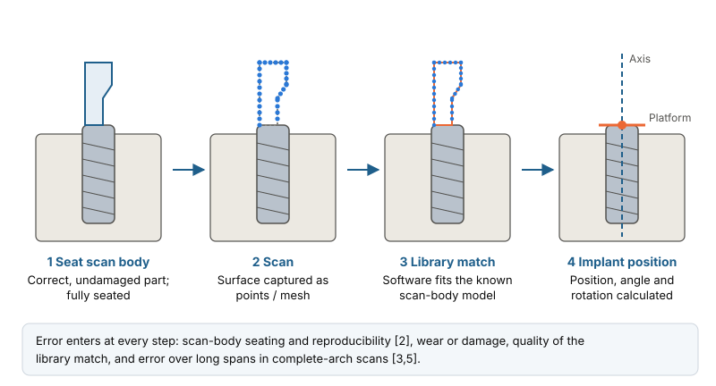
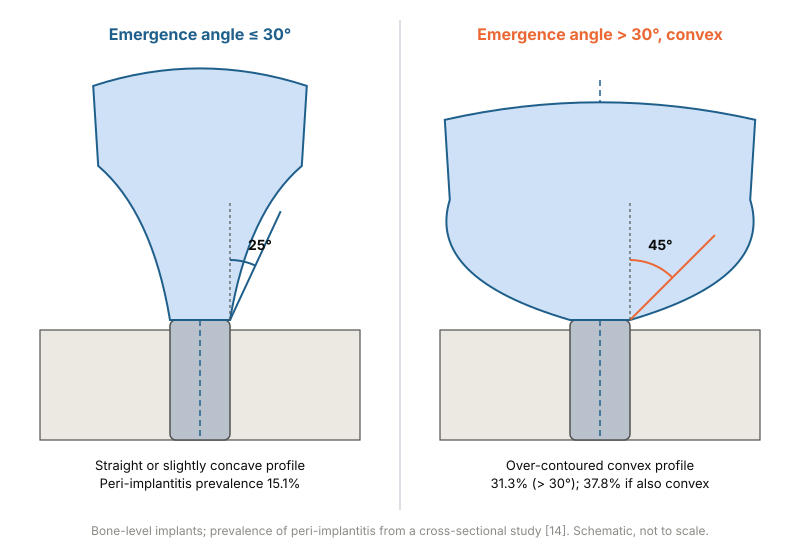
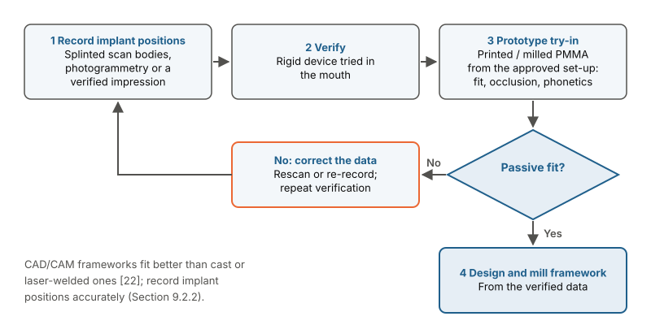

# Chapter 9. Designing Implant Restorations

## Learning Objectives

After reading this chapter, you should be able to:

1. Explain how scan bodies and implant libraries transfer the implant position into the design software, and the errors involved.
2. Choose between stock, custom and titanium-base (two-piece) abutments, and design them correctly.
3. Design implant emergence profiles that support healthy peri-implant tissues.
4. Weigh screw retention against cement retention, including the role of angled screw channels.
5. Design complete-arch implant frameworks that fit passively, and choose suitable materials.
6. Apply current evidence and guidelines when selecting materials for implant-supported restorations.

---

## 9.1 How Implant Restorations Differ

Designing on implants is not the same as designing on teeth:

- **The "preparation" is a machined connection.** It is not a tooth surface. The software does not need a margin line on the implant. Instead, it needs to know the **exact 3D position and orientation** of the implant and its connection.
- **There is no periodontal ligament.** Implants cannot move to compensate for misfit, so **passive fit** is critical for multi-unit frameworks.
- **The emergence profile is designed, not inherited.** The restoration shapes the peri-implant mucosa from the implant platform to the gingival margin.
- **Retention is a choice.** Screw-retained, cement-retained or both.
- **Components are system-specific.** Every implant system has its own connection geometry, screws and libraries.

---

## 9.2 Transferring the Implant Position: Scan Bodies and Libraries

### 9.2.1 How it works

A **scan body** is a precisely machined part screwed into the implant (intraorally) or the analogue (in the laboratory). It has a known geometry. After scanning, the design software matches a digital **library** copy of the scan body to the scan. Because the library "knows" where the implant connection lies relative to the scan body, the software can calculate the implant's position, angulation and rotational orientation.

Scan bodies are complex devices for transferring implant position, and they play an essential role in making accurately fitting implant restorations [1]. Their designs vary widely, and a systematic review found gaps in the evidence on how design features affect accuracy [1]. Figure 9.1 shows the sequence.

### 9.2.2 Sources of error

- **Seating and reproducibility.** Repeatedly reseating scan bodies gave a mean discrepancy of about 39 µm on implants, compared with 11 µm on laboratory analogues [2].
- **Scan body wear and damage.** Scratched, worn or autoclaved scan bodies may no longer match their library.
- **Library matching.** Poor scan quality around the scan body produces a poor match.
- **Scan span.** Errors accumulate between distant scan bodies in complete-arch scans. Without splinting, complete-arch implant scans had a mean linear trueness of about 153 µm and an angular trueness of about 0.65° [3]. Splinting scan bodies improved linear trueness [4]. Photogrammetry was more accurate than intraoral scanning [5,6] (Chapter 3).

**Figure 9.1** How a scan body transfers the implant position into the design software. Error can enter at each step, and accumulates between distant scan bodies in complete-arch scans [2–4].

> **Clinical Tip.** Use only the scan body specified for the implant system and the design software. Check that it is undamaged. Seat it fully (confirm with a radiograph if seating is uncertain, especially subgingivally). Scan the scan body completely before scanning the rest of the arch.

---

## 9.3 Abutment Options

### 9.3.1 Stock (prefabricated) abutments

Stock abutments are mass-produced in standard shapes, heights and angulations. They are inexpensive and have precise, factory-made connections. Their limitations are a generic emergence profile and margin position that may not suit the individual site.

### 9.3.2 Custom (CAD/CAM) abutments

Custom abutments are designed for the individual site and milled from titanium or zirconia, or as two-piece designs (see below). They allow:

- an individual emergence profile and margin position, ideally slightly submucosal and following the mucosal contour;
- correction of implant angulation;
- ideal support for the crown and its cement margin.

The evidence on whether custom abutments improve outcomes is mixed:

- In a randomised trial of premolar implants, CAD/CAM custom zirconia abutments showed **no significant differences** from stock zirconia abutments in bone level, soft-tissue parameters or patient satisfaction after one year [7].
- In a randomised trial of immediate anterior implants in extraction sockets with partial facial bone loss, custom CAD/CAM titanium abutments gave shallower probing depths, higher pink aesthetic scores, less crestal bone loss and higher patient satisfaction than stock abutments at one year [8].

Custom abutments are most clearly justified in **aesthetic, anterior and anatomically challenging** sites. In simple posterior sites, a well-chosen stock abutment may perform equally well.

### 9.3.3 Titanium-base (two-piece) abutments

The **titanium base (Ti-base)** has become the workhorse of CAD/CAM implant prosthodontics. It is a short, prefabricated titanium component with the original implant connection. A CAD/CAM part (zirconia abutment, lithium disilicate crown or other material) is bonded onto it outside the mouth.

Advantages:

- the original, factory-machined titanium connection and screw seat;
- freedom to design the coronal part in any millable material;
- the option of a **one-piece screw-retained crown** (crown bonded directly to the Ti-base), avoiding intraoral cement.

Evidence:

- In a retrospective study of 310 implants restored with zirconia abutments luted to titanium bases (mean 4.7 years, up to 10 years), the complication-free survival was 91.6% for the restorations and 97.4% for the abutments. Chipping was the commonest complication (5.5%) [9].
- In a split-mouth randomised trial in the aesthetic zone, **one-piece** zirconia abutments had a 3-year technical complication rate of 15.8%, including abutment fractures. **Two-piece** zirconia abutments on titanium bases had none [10].
- **Non-original titanium bases** (third-party components not made by the implant manufacturer) need caution. In one prospective study, zirconia restorations cemented on non-original titanium bases were associated with significant increases in bleeding on probing and probing depth and with two implant losses from peri-implantitis over 3 years. The authors did not recommend them for routine use [11]. A 5-year follow-up of the same type of restoration found that a larger **restorative angle** was associated with early marginal bone loss, and suggested keeping it below 40° [12].

Table 9.1 compares the abutment options.

**Table 9.1** Abutment options compared

| Option | Advantages | Limitations | Evidence |
|---|---|---|---|
| **Stock abutment** | Inexpensive; precise factory-made connection | Generic emergence profile and margin position | No difference from custom zirconia abutments in premolar sites at 1 year [7] |
| **Custom CAD/CAM abutment** (titanium or zirconia) | Individual emergence profile and margin position; corrects angulation; supports the crown and its cement margin | Benefit less clear in simple posterior sites [7] | Better probing depth, aesthetics, bone level and satisfaction than stock abutments for immediate anterior implants at 1 year [8] |
| **Two-piece titanium base** (original) | Original titanium connection; any millable coronal material; allows a one-piece screw-retained crown | The bonded joint needs a validated protocol (9.3.4) | Complication-free survival 91.6% (restorations) and 97.4% (abutments) [9]; no technical complications versus 15.8% for one-piece zirconia abutments at 3 years [10] |
| **Non-original titanium base** | — | More bleeding and deeper probing, and implant losses, in one study [11] | Not recommended for routine use [11] |

### 9.3.4 Bonding to the titanium base

The bond between the Ti-base and the CAD/CAM part is an engineered joint. In an in vitro study, retention of zirconia copings on titanium bases depended on the **resin cement** used and the **luting space**. A smaller luting space of about 60 µm gave higher retention than about 100 µm [13]. Follow the protocol validated for your materials:

- air-abrade both bonding surfaces as recommended (typically with fine alumina at low pressure);
- clean ultrasonically and dry;
- use a primer or cement system validated for zirconia (or glass-ceramic) and titanium;
- remove all excess cement and polish the joint, which will sit in the peri-implant sulcus.

> **Lab Note.** Design the luting space on the Ti-base in the CAD software from the **validated parameters for that Ti-base and material**. Do not use the cement space settings for crowns on teeth.

---

## 9.4 Emergence Profile Design

The emergence profile is the part of the restoration between the implant platform and the mucosal margin. It is the most important biological design decision in an implant restoration.

In a cross-sectional study of 225 implants with a mean follow-up of nearly 11 years, an **emergence angle greater than 30°** was associated with a significantly higher prevalence of peri-implantitis at bone-level implants (31.3% versus 15.1%). A **convex** profile combined with an angle above 30° raised it further, to 37.8%. No such association was found for tissue-level implants [14] (Figure 9.2).

**Figure 9.2** Emergence angle and peri-implantitis at bone-level implants (schematic). Prevalence of peri-implantitis was 15.1% with an angle of 30° or less, 31.3% above 30°, and 37.8% when the profile was also convex. Data from [14].

Design principles:

- Keep the **emergence angle ≤ 30°** at bone-level implants, especially in the deeper (transmucosal) part [14].
- Prefer a **straight or slightly concave** profile in the transmucosal zone, and avoid convex overcontouring [14].
- Shape the **subcritical** (deeper) contour to support tissue, and the **critical** (near-margin) contour to set the mucosal margin, especially in aesthetic sites.
- Make the transmucosal surface **highly polished or glazed**, and smooth enough to clean.
- Copy the emergence profile of a successful **provisional**. Scanning it, or using a custom scan body that records the shaped tissue, transfers the tissue architecture into the design.

AI tools can now generate implant crowns with emergence profiles close to those of technicians, often more concave than conventional software proposals [15,16]. Check the angle on a cross-section before approving any design.

---

## 9.5 Screw Retention or Cement Retention?

### 9.5.1 Evidence

Two systematic reviews summarise the evidence:

- A review of 59 studies found that neither method was clearly superior. **Cement-retained** reconstructions had more serious **biological** complications, including bone loss over 2 mm. **Screw-retained** reconstructions had more **technical** problems. Because screw-retained reconstructions are retrievable, so complications can be managed more easily, and because they appeared more biologically compatible, the authors considered them preferable [17].
- A second review found similar 5-year survival for cemented (96.0%) and screw-retained (95.6%) reconstructions. **Screw-retained reconstructions had fewer technical and biological complications overall** [18].

Residual cement in the peri-implant sulcus is a well-recognised risk factor for peri-implant disease, which is one reason screw retention is now widely preferred where the implant position allows it.

### 9.5.2 Angled screw channels

When the implant axis would bring the screw access through the facial or incisal surface, an **angled screw channel (ASC)** moves the access hole to the palatal or lingual surface. A special screw and driver allow tightening at an angle.

A systematic review of ASC-retained versus cement-retained crowns in non-molar sites (four studies, 167 crowns) found **comparable short-term** marginal bone levels, aesthetic scores and technical complications, with less bleeding on probing in the ASC group [19]. Superiority was not demonstrated.

Design considerations for ASCs:

- Respect the maximum angle the system allows, and check wall thickness around the angled channel.
- Use the system-specific screw and driver, and follow the specified torque.
- Remember that angled access may reduce how much torque can be applied and how reliably. Follow the manufacturer's protocol.

### 9.5.3 Practical decision

**Table 9.2** Choosing the retention method

| Situation | Preferred retention |
|---|---|
| Access emerges through the occlusal or cingulum area | Screw-retained (straight channel) |
| Access emerges facially or incisally, within ASC limits | Screw-retained with angled screw channel [19] |
| Implant angulation exceeds ASC limits | Custom abutment with cemented crown; margin placed for complete cement removal |
| Very limited interocclusal space | Screw-retained one-piece crown on Ti-base |
| Multi-unit and complete-arch | Screw-retained, for retrievability [17,18] |

---

## 9.6 Complete-Arch Implant Frameworks

### 9.6.1 Passive fit

A complete-arch framework must seat on all implants without strain. No method can measure passive fit perfectly. In vitro methods are more accurate than clinical ones, and combining several techniques is recommended [20]. Clinically, checks include the one-screw test, radiographs, screw-resistance tests and a rigid **verification jig** or printed prototype.

CAD/CAM frameworks fit better than one-piece cast or laser-welded frameworks, and the choice of CAD/CAM material has only a minimal influence on fit [21]. The remaining fit problems come mostly from **data acquisition** (Section 9.2.2), not from milling.

### 9.6.2 Workflow for a passive complete-arch framework

1. Record implant positions accurately: splinted scan bodies, photogrammetry or a verified conventional impression (Chapters 3 and 5).
2. Verify the recorded positions with a **rigid verification device** in the mouth.
3. Design a **prototype** (printed or milled PMMA) from the approved tooth set-up. Try it in for fit, occlusion, phonetics and aesthetics.
4. Correct the data if the prototype does not fit passively.
5. Design and mill the definitive framework from the verified data.

Figure 9.3 shows this workflow as a loop.

**Figure 9.3** Workflow for a passive complete-arch implant framework. If the prototype does not fit passively, the data are corrected and verified again before the definitive framework is made. CAD/CAM frameworks fit better than cast or laser-welded ones [21].

### 9.6.3 Materials and design

- A systematic review of complete-arch fixed implant prostheses with at least 5 years' follow-up found that **veneer fracture** was the main complication of metal-ceramic prostheses (22.1% at 5 years, 39.3% at 10 years). In the two all-ceramic studies, the one using mainly **monolithic zirconia** reported a success rate of 90.9%, compared with 60.4% for bilayered zirconia [22].
- An umbrella review of systematic reviews reported prosthesis survival of 89.5–96.8% over 5 to 15 years. Chipping of veneered zirconia occurred in 15–35%, which was significantly more than for monolithic zirconia. Screw loosening occurred in 5–15%. **Monolithic zirconia and screw-retained designs** had lower technical complication rates [23].
- Compared with metal-acrylic hybrid prostheses, metal-zirconia complete-arch prostheses showed less prosthetic wear and a lower risk of peri-implantitis, although the evidence was mostly non-randomised [24].

Design principles:

- Design from the **approved tooth set-up**. The framework supports the teeth, not the other way round.
- Provide **cleansable** intaglio surfaces: convex, polished and with access for interdental brushes. Avoid ridge laps.
- Keep **cantilevers** short.
- Keep **connector and framework dimensions** at or above the material manufacturer's minimum, and check them in cross-section.
- Plan **screw access** through the occlusal or cingulum surfaces, using angled channels where allowed.

---

## 9.7 Material Selection: Current Guidance

A German S3 guideline on implant-supported all-ceramic restorations, based on a systematic review, concluded that [25]:

- for **single crowns**, lithium disilicate, other silicate ceramics and all generations of zirconia showed favourable 3-year survival of about 96–97%;
- **polymer-infiltrated ceramics** performed worse and were **not recommended** for implant crowns;
- for **short-span FDPs and complete-arch restorations**, clinical evidence supported **3Y-TZP zirconia** only;
- monolithic designs and micro-veneering reduce the risk of chipping.

**Table 9.3** Implant restorations: design summary

| Restoration | Recommended approach | Key design checks |
|---|---|---|
| Single posterior crown | Screw-retained monolithic zirconia or lithium disilicate on an original Ti-base [9,10,25] | Emergence angle ≤30° [14]; contacts; occlusion |
| Single anterior crown | Screw-retained (straight or ASC) on Ti-base, or custom abutment + crown [8,19] | Critical and subcritical contour; aesthetic margin |
| Short-span FDP | Screw-retained 3Y-TZP zirconia, monolithic or micro-veneered [25] | Connectors; passive fit; cleansability |
| Complete arch | Screw-retained monolithic zirconia (with or without a metal substructure), verified data and prototype try-in [22–24] | Passive fit; cantilevers; hygiene access |

---

## Key Points

- Implant position is transferred through **scan bodies and libraries**. Use the correct, undamaged scan body, seat it fully and scan it completely [1,2].
- Complete-arch implant data need **splinting, photogrammetry or verification** before a framework is made [3–6].
- **Custom abutments** help most in aesthetic and challenging sites [7,8]. **Two-piece Ti-base** designs perform well [9,10]. Avoid non-original Ti-bases [11].
- Bond to Ti-bases with **validated protocols**. A smaller luting space improves retention [13].
- Keep the **emergence angle ≤30°** and avoid convex transmucosal contours at bone-level implants [14].
- **Screw retention** is generally preferred for retrievability and fewer complications [17,18]. **Angled screw channels** give comparable short-term results to cemented crowns [19].
- CAD/CAM frameworks fit better than cast ones [21]. **Monolithic zirconia** reduces chipping in complete-arch prostheses [22–24].
- Evidence supports glass-ceramics and zirconia for single implant crowns, and only 3Y-TZP zirconia for implant FDPs and complete arches [25].

---

## Review Questions

1. Explain how the design software determines the 3D position of an implant from a scan of a scan body. List three sources of error.
2. When does the evidence support a custom CAD/CAM abutment over a stock abutment?
3. What are the advantages of a two-piece titanium-base abutment over a one-piece zirconia abutment? What does the evidence say?
4. Why should non-original titanium bases be used with caution?
5. Describe the relationship between emergence angle, profile shape and peri-implantitis found by Katafuchi and colleagues. How would you apply it in design?
6. Compare screw-retained and cement-retained implant reconstructions in terms of survival, biological complications and technical complications.
7. Outline a workflow to achieve a passive fit for a complete-arch implant framework.
8. Which materials does current evidence support for (a) single implant crowns and (b) complete-arch implant prostheses?

---

## References

1. Mizumoto RM, Yilmaz B. Intraoral scan bodies in implant dentistry: a systematic review. J Prosthet Dent. 2018;120(3):343–52. doi:10.1016/j.prosdent.2017.10.029
2. Stimmelmayr M, Güth JF, Erdelt K, Edelhoff D, Beuer F. Digital evaluation of the reproducibility of implant scanbody fit — an in vitro study. Clin Oral Investig. 2012;16(3):851–6. doi:10.1007/s00784-011-0564-5
3. Revilla-León M, Barmak AB, Prasad S. Accuracy of complete arch implant scans using nonsplinting techniques: a systematic review and meta-analysis. J Prosthet Dent. 2026;136(1):e102–e138. doi:10.1016/j.prosdent.2026.02.034
4. Alawawda O, Yeşil Z, Sakarya RE, Haoran MA, Yeşil Ç. Trueness of complete arch intraoral implant scans using splinted and non-splinted scan bodies: a systematic review and meta-analysis. J Prosthet Dent. 2026;136(2):e104–e114. doi:10.1016/j.prosdent.2026.04.028
5. Prasad S, Barmak AB, Revilla-León M. A systematic review and meta-analysis of the accuracy of complete arch implant scanning techniques performed extraorally: reverse impression and extraoral photogrammetry methods. J Prosthet Dent. 2026;136(1):e79–e101. doi:10.1016/j.prosdent.2026.01.018
6. Pozzi A, Arcuri L, Carosi P, Laureti A, Londono J, Wang HL. Photogrammetry versus intraoral scanning in complete-arch digital implant impression: a systematic review and meta-analysis. Clin Implant Dent Relat Res. 2025;27(3):e70059. doi:10.1111/cid.70059
7. Schepke U, Meijer HJA, Kerdijk W, Raghoebar GM, Cune M. Stock versus CAD/CAM customized zirconia implant abutments — clinical and patient-based outcomes in a randomized controlled clinical trial. Clin Implant Dent Relat Res. 2017;19(1):74–84. doi:10.1111/cid.12440
8. Robaian A, Hamed MM, Ahmed Y, Hassanein FEA. Comparative evaluation of customized CAD/CAM vs. stock titanium abutments for immediate implant placement in class II extraction sockets: a randomized controlled trial. Dent J (Basel). 2025;13(8):371. doi:10.3390/dj13080371
9. Happe A, von Glasser GS, Neugebauer J, Strick K, Smeets R, Rutkowski R. Clinical performance of zirconia implant abutments luted to a titanium base — a retrospective cross-sectional study. Int J Comput Dent. 2022;25(1):37–45. PMID:35322651
10. Lv X, Pu Y, Zhang X, Jiang X, Zhang X, Shi J, et al. One-piece versus two-piece zirconia abutment supported single implant crown in the esthetic region: 3-year results from a split-mouth randomized controlled clinical trial. Clin Oral Implants Res. 2023;34(12):1330–41. doi:10.1111/clr.14173
11. Stucki L, Asgeirsson AG, Jung RE, Sailer I, Hämmerle CHF, Thoma DS. Zirconia reconstructions cemented on non-original titanium bases may result in increased bleeding on probing, probing depth values and varying mean marginal bone levels. Int J Prosthodont. 2021;34(5):560–6. doi:10.11607/ijp.6999
12. Strauss FJ, Siegenthaler M, Hämmerle CHF, Sailer I, Jung RE, Thoma DS. Restorative angle of zirconia restorations cemented on non-original titanium bases influences the initial marginal bone loss: 5-year results of a prospective cohort study. Clin Oral Implants Res. 2022;33(7):745–56. doi:10.1111/clr.13954
13. Mehl C, Zhang Q, Lehmann F, Kern M. Retention of zirconia on titanium in two-piece abutments with self-adhesive resin cements. J Prosthet Dent. 2018;120(2):214–9. doi:10.1016/j.prosdent.2017.11.020
14. Katafuchi M, Weinstein BF, Leroux BG, Chen YW, Daubert DM. Restoration contour is a risk indicator for peri-implantitis: a cross-sectional radiographic analysis. J Clin Periodontol. 2018;45(2):225–32. doi:10.1111/jcpe.12829
15. Cho JH, Çakmak G, Choi J, Lee D, Yoon HI, Yilmaz B, et al. Deep learning-designed implant-supported posterior crowns: assessing time efficiency, tooth morphology, emergence profile, occlusion, and proximal contacts. J Dent. 2024;147:105142. doi:10.1016/j.jdent.2024.105142
16. Ren S, Wu T, Zhou D, Jiang X, Di P. A deep learning system on monolithic implant-supported crown design: evaluating AI-generated models against conventional software outputs. J Prosthodont. 2026;35(5):712–20. doi:10.1111/jopr.70067
17. Sailer I, Mühlemann S, Zwahlen M, Hämmerle CHF, Schneider D. Cemented and screw-retained implant reconstructions: a systematic review of the survival and complication rates. Clin Oral Implants Res. 2012;23 Suppl 6:163–201. doi:10.1111/j.1600-0501.2012.02538.x
18. Wittneben JG, Millen C, Brägger U. Clinical performance of screw- versus cement-retained fixed implant-supported reconstructions — a systematic review. Int J Oral Maxillofac Implants. 2014;29 Suppl:84–98. doi:10.11607/jomi.2014suppl.g2.1
19. Atieh MA, Shah M, Hakam A, Albalushi A, Abdulmunim A, AlAli F, et al. Angled screw channel-retained vs. cement-retained implant crowns in nonmolar sites: a systematic review and meta-analysis. J Esthet Restor Dent. 2025;37(7):1706–20. doi:10.1111/jerd.13463
20. Abduo J, Bennani V, Waddell N, Lyons K, Swain M. Assessing the fit of implant fixed prostheses: a critical review. Int J Oral Maxillofac Implants. 2010;25(3):506–15. PMID:20556249
21. Abduo J. Fit of CAD/CAM implant frameworks: a comprehensive review. J Oral Implantol. 2014;40(6):758–66. doi:10.1563/AAID-JOI-D-12-00117
22. Wong CKK, Narvekar U, Petridis H. Prosthodontic complications of metal-ceramic and all-ceramic, complete-arch fixed implant prostheses with minimum 5 years mean follow-up period: a systematic review and meta-analysis. J Prosthodont. 2019;28(2):e722–e735. doi:10.1111/jopr.12797
23. Tomar S, Agnihotri N, Vhanmane G. Prosthetic complications of implant-supported complete arch prostheses: an umbrella review of systematic reviews. J Prosthet Dent. 2026;136(1):52–9. doi:10.1016/j.prosdent.2026.03.013
24. Marinkovic D, Gutiérrez R, Frey M, Collao F, Moreno Y, Miranda C. Prosthetic and biological complications of metal-zirconia versus metal-acrylic implant-supported screw-retained complete-arch prostheses: a systematic review and meta-analysis. J Clin Exp Dent. 2026;18(5):e704–e715. doi:10.4317/jced.63882
25. Waltenberger L, Bishti S, Wolfart S. German S3 guideline on implant-supported all-ceramic restorations. Int J Implant Dent. 2025;11(1):53. doi:10.1186/s40729-025-00641-7
