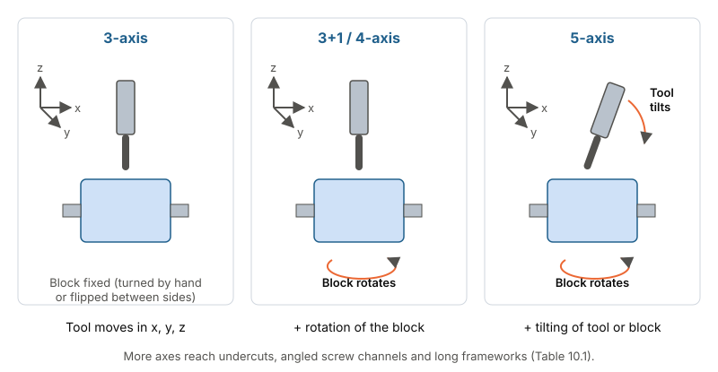
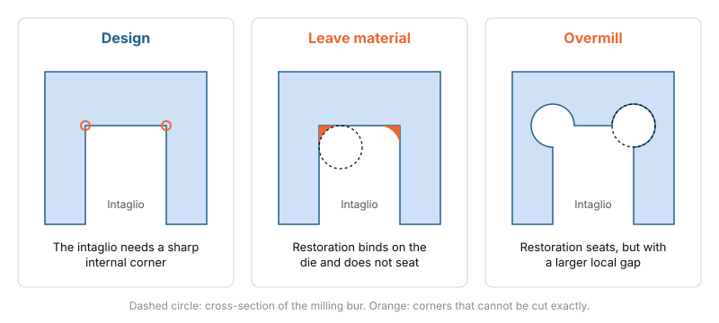

# Chapter 10. Subtractive Manufacturing: Milling and Grinding

## Learning Objectives

After reading this chapter, you should be able to:

1. Describe how dental milling and grinding machines work, including machine axes, spindles, tools and wet or dry machining.
2. Explain how CAM software turns a design into toolpaths, and how milling strategy and tool size limit what can be made.
3. Identify the causes of edge chipping and surface damage in machined restorations, and the steps that reduce them.
4. Explain the effect of tool wear on fit, and plan a tool-replacement routine.
5. Compare chairside mills with laboratory and industrial milling centres.
6. Describe how pre-sintered and pre-crystallised materials are processed after milling, and how sintering and crystallisation affect fit.

---

## 10.1 Why Subtractive Manufacturing Still Dominates

Subtractive manufacturing means cutting a restoration out of a solid block or disc. It remains the main way definitive fixed restorations are made, for good reasons (Chapter 1):

- **Industrially made blanks.** Ceramic, composite and metal blanks are industrially prefabricated under controlled conditions and are almost defect-free [1].
- **Proven materials.** Most of the long-term clinical evidence for CAD/CAM restorations comes from milled materials (Chapter 8).
- **Homogeneity.** A narrative review found that subtractive methods tend to produce more homogeneous objects that may be more suitable for intraoral prostheses under high occlusal forces [2].

There are trade-offs. Material is wasted, tools wear, geometry is limited by the size of the tool, and the cutting process damages the surface of brittle materials. This chapter explains these trade-offs and how to manage them.

> **Terminology.** Dentistry uses "milling" loosely for all subtractive machining. Strictly, **milling** removes material with rotating cutters that have defined cutting edges (carbide burs, used for zirconia, PMMA, wax and metals). **Grinding** uses abrasive tools, usually diamond-coated burs with water cooling, and is used for glass-ceramics and hybrid materials. Both are covered here.

---

## 10.2 Anatomy of a Dental Milling Machine

### 10.2.1 Main components

- **Spindle(s):** the motor that rotates the tool at high speed. Some machines have two spindles working on opposite sides of the block at once.
- **Tool changer:** a magazine of burs that the machine swaps automatically during a job.
- **Workpiece holder:** clamps a block (single restorations) or a disc (multiple units "nested" in one blank).
- **Axes:** the motors that move the tool and/or workpiece relative to each other.
- **Cooling and extraction:** a water or lubricant circuit for wet machining, or suction for dry machining.
- **Control system:** executes the toolpaths generated by the CAM software.

### 10.2.2 Number of axes

Machines are described by the number of independent movements they control (Chapter 1):

**Table 10.1** Machine axes and their practical implications

| Configuration | Movements | Typical capability | Limitations |
|---|---|---|---|
| **3-axis** | Tool moves in x, y, z; block fixed | Simple crowns and copings, milled from two sides after the block is turned | Undercuts and steep angulations cannot be reached; long paths around the occlusal anatomy |
| **3+1 / 4-axis** | As 3-axis, plus rotation of the block | Most single units and short FDPs; common in chairside units | Limited access for strongly angled features |
| **5-axis** | As 4-axis, plus tilting of the tool or block | Complex geometry: undercuts, angled screw channels, long-span frameworks, implant bars, custom abutments | Higher cost, longer CAM programming |

A narrative review stated that "the accuracy of restoration fabrication can be best attained with 5 axes milling units", but it reported no comparative trueness or precision data [3]. More axes do not automatically mean better fit for simple crowns (expert opinion; no comparative study was found), but they widen the range of geometry the machine can make (Figure 10.1).

**Figure 10.1** Three-, four- and five-axis milling (schematic). Each added axis, rotation of the block and then tilting of the tool or block, extends the geometry the machine can reach (Table 10.1).

> **Lab Note.** Before accepting a case, check that the machine can actually reach every surface of the design. Deep, narrow interproximal embrasures, angled screw channels and long frameworks with steep pontic undersides may need 5-axis machining.

---

## 10.3 From Design to Toolpath: The CAM Step

### 10.3.1 What CAM software does

CAM software takes the finished design (Chapter 7) and the chosen material and machine, then:

1. **Positions and nests** the restoration in the blank, including the sprues or connectors that hold it in place.
2. **Selects tools** (bur type and diameter) for roughing and finishing.
3. **Calculates toolpaths**: the sequence and direction of cuts, step-over between passes, depth of cut and feed rate.
4. **Applies compensations**: for tool radius, for areas the tool cannot reach, and, for pre-sintered zirconia, for **sintering shrinkage** (Section 10.7).
5. Exports machine instructions.

### 10.3.2 Milling strategy affects fit

The milling strategy directly affects the internal fit of the restoration. In an in vitro study of chairside zirconia-reinforced lithium silicate partial crowns made with a 3+1-axis unit, three different strategies gave significantly different internal fit. Axial fit ranged from about 91 µm with a two-step mode to about 123 µm with one step-bur setting. The poorest fit was occlusal, reaching about 223 µm (80th-percentile values from a digital three-dimensional difference analysis) [4].

Many chairside and laboratory systems offer **"fast"** and **"fine"** (or "extra-fine") modes. Finer modes typically use smaller tools, smaller step-overs and slower feeds (general CAM practice). All studies below are in vitro:

- In zirconia milled dry with slow, normal and fast protocols, surface roughness increased from slow to fast, but **flexural strength and reliability did not differ** between the protocols [5].
- For lithium disilicate and resin composite crowns milled in fine or extra-fine mode on a 4-axis machine, fatigue behaviour and fracture load did not differ between modes. The **extra-fine mode caused more bur wear** [6].

Slower or finer modes therefore mainly reduce surface roughness [5]. They do not necessarily improve strength [5,6], and they increase bur wear [6].

### 10.3.3 The tool-radius problem

A rotating tool cannot cut an inside corner sharper than its own radius. Where the design asks for a sharper internal angle, the CAM software can either:

- **leave material**, so the restoration binds on the die and does not seat; or
- **overmill (drill-compensate)**, removing extra material beyond the corner so the restoration seats but with a larger local gap.

Either way, the intaglio surface does not match the design exactly. This is the main reason for the preparation rules in Chapter 8: rounded internal angles, no sharp edges and no grooves smaller than the tool. Figure 10.2 shows both outcomes.

**Figure 10.2** The tool-radius problem (schematic). A round bur cannot cut a sharp internal corner. The CAM software either leaves material, so the restoration binds, or overmills beyond the corner, so it seats with a larger local gap.

---

## 10.4 Wet and Dry Machining

**Table 10.2** Wet and dry machining

| | Wet (grinding/milling with coolant) | Dry milling |
|---|---|---|
| Typical materials | Glass-ceramics (feldspathic, leucite, lithium disilicate, zirconia-reinforced lithium silicate), hybrid ceramics, composites, titanium and Co-Cr (with coolant), sometimes zirconia | Pre-sintered zirconia, PMMA, wax, some composites |
| Purpose of coolant | Prevents overheating and thermal cracking of glassy materials; removes debris; prolongs diamond tool life | — |
| Advantages | Essential for brittle glass-ceramics; better surface quality on these materials | No drying of the restoration before sintering; cleaner for porous zirconia |
| Disadvantages | Coolant maintenance (bacterial growth, debris); zirconia must be dried thoroughly before sintering | Dust extraction and protection needed; not suitable for glass-ceramics |

Many machines can do both but must be cleaned and converted between modes. Hybrid machines save space but need disciplined maintenance.

---

## 10.5 Edge Chipping and Machining Damage

### 10.5.1 The problem

Brittle materials do not cut cleanly. The tool creates small cracks and chips, especially where the restoration is thin: at margins, cusp tips and incisal edges. Chips at the margin open the marginal gap. Subsurface cracks can weaken the restoration.

### 10.5.2 What the evidence shows

The first three studies below are in vitro:

- In a comparison of five CAD/CAM materials milled into bars, edge chipping depended significantly on the **material**, the **surface being milled** and the **edge location**. The size of the chips (length and depth) on the tensile side correlated with **loss of flexural strength** [7].
- In a timed milling experiment, polymer-containing materials (a resin composite and a polymer-infiltrated ceramic) were cut faster and showed **less edge chipping** than lithium disilicate and zirconia-reinforced lithium silicate [8].
- The edge strength of CAD/CAM materials depended on the material, its thickness and the distance from the edge. At 1 mm thickness, edge forces ranged from about 64 N for one composite block to about 183 N for a lithium disilicate reference [9].
- High edge stability is one reason polymer-infiltrated ceramic network materials can be milled to thin margins [10].

### 10.5.3 After milling: firing, glazing and polishing

Post-milling processing changes the damaged surface. All studies below are in vitro:

- For lithium disilicate, the smoothest surfaces produced by milling followed by polishing and sintering resisted the highest contact stresses with the least fatigue damage. The roughest milled and sintered surfaces developed median and transverse cracks under cyclic loading [11].
- On rectangular specimens cut from lithium silicate CAD/CAM blocks, **glazing** gave the highest edge-chipping resistance compared with polishing or firing alone. Thickness between 1.5 and 3 mm had little influence in that study [12].

> **Clinical Tip.** Never leave a milled glass-ceramic surface in its "as-milled" state, especially on the intaglio margin or occlusal contact areas. Follow the manufacturer's crystallisation, glazing and polishing protocol. Inspect margins under magnification before try-in.

### 10.5.4 Design measures against chipping

- Provide adequate material thickness at margins (Chapter 8). Avoid feather edges.
- Use software margin reinforcement where available (a slight extra thickness that is finished by hand afterwards).
- Choose materials with higher edge stability for thin margins [9,10].
- Finer milling modes may be chosen for delicate areas (expert opinion), but no cited study shows that they reduce chipping; in vitro, they increased bur wear without improving fatigue behaviour or fracture load [6].

---

## 10.6 Tool Wear and Its Effect on Fit

Burs wear. Diamond burs lose grit and carbide cutters lose sharpness, and fit deteriorates as tools wear.

- In an in vitro study of lithium disilicate crowns milled sequentially for one typodont preparation, two different milling units produced crowns with similar mean marginal gaps (about 100 µm). In both units, the marginal gap showed a statistically significant trend to increase as more crowns were milled with the same burs [13].
- A study of two lithium disilicate systems milled in a chairside unit concluded that marginal misfit is affected by successive millings with a single set of diamond burs [14].

**Practical tool management:**

- Follow the manufacturer's recommended tool life. Many machines count usage automatically.
- Replace burs sooner when using finer modes, which wear tools faster [6]. Hard or abrasive materials are also likely to shorten tool life (expert opinion).
- Log bur changes. If fit deteriorates over a run of restorations, suspect the tools first.
- Inspect burs under magnification for chipped diamond coating or broken tips.

---

## 10.7 Pre-Sintered and Pre-Crystallised Materials

Many CAD/CAM materials are machined in a softer intermediate state and then heat-treated to their final properties.

### 10.7.1 Zirconia: soft machining and sintering

Most zirconia is milled in the **pre-sintered ("green" or "white") state**. It is chalky and easy to machine, and is then sintered at high temperature to full density. During sintering it **shrinks** substantially (in the order of 20–25% linearly, depending on the product **[UNVERIFIED: typical value; check manufacturer data]**). The CAM software enlarges the design by a batch-specific factor to compensate, which is why zirconia blanks typically carry a batch-specific enlargement code.

Errors in shrinkage compensation or in the sintering programme affect fit. Several in vitro studies have compared conventional and speed-sintering programmes:

- Zirconia crowns from a fast-sintering programme had **larger marginal gaps** than conventionally sintered crowns. Both groups were below the clinically acceptable limit used in that study (90 µm) [15].
- For multilayer zirconia implant crowns measured by micro-CT, the standard cycle gave the smallest marginal and internal gaps (about 47 µm and 91 µm). Speed and superspeed cycles gave larger gaps, though all were clinically acceptable [16].
- For 3- to 4-mol% yttria zirconia crowns, shortening the sintering time increased the marginal gap of **4Y-TZP** but not of 3Y-TZP crowns. The authors advised following the manufacturer's recommendations for each composition [17].
- For monolithic zirconia FDPs, a speed-sintering procedure gave significantly larger marginal and internal gaps than standard and slow procedures, but the authors judged the effect on fit and fracture load not clinically significant; colour was affected [18].
- In contrast, one study using a different measuring method found **smaller** marginal discrepancies for high-speed induction-sintered crowns than for conventionally sintered crowns, and no difference in internal fit [19].

> **Evidence Box.** Speed sintering makes single-visit zirconia possible (Chapter 16). The evidence, all in vitro, generally shows clinically acceptable fit [15–18], but results vary with the zirconia composition, the furnace and the measurement method [15–19]. Use only sintering programmes validated by the manufacturer for that specific blank. The colour of the final restoration can also change with the programme [18].

**Fully sintered ("hard") zirconia** can also be milled directly, avoiding shrinkage. It is slow and wears tools heavily, so it is used mainly in industrial settings.

### 10.7.2 Lithium disilicate: crystallisation

Lithium disilicate CAD blocks are typically milled in a **partially crystallised** state, which is softer and machines faster, and then fired to full crystallisation. Firing changes both strength and fit. Both studies below are in vitro:

- The marginal gap of lithium disilicate copings increased by an average of **62 µm** after crystallisation firing. Crystallised lithium disilicate copings had larger marginal gaps than hybrid-ceramic copings, which need no firing [20].
- In a micro-CT study, crystallisation reduced the axial internal gap but increased the vertical marginal gap of milled lithium disilicate crowns [21].

Try in and adjust lithium disilicate restorations **after** crystallisation, not before (Chapter 3).

### 10.7.3 Materials machined in their final state

Feldspathic and leucite glass-ceramics, hybrid ceramics, composites, PMMA and fully sintered metals are machined in their final state. They need no shrinkage compensation, which makes them convenient for chairside use, though glass-ceramics still need glazing or polishing.

---

## 10.8 Chairside, Laboratory and Industrial Milling

**Table 10.3** Production settings for subtractive manufacturing

| Feature | Chairside mill | Laboratory mill | Industrial / centralised |
|---|---|---|---|
| Typical axes | 3+1 to 4, some 5 | 4–5 | 5 (often with automation) |
| Materials | Blocks: glass-ceramics, hybrids, composites, PMMA, zirconia (with speed sintering) | Blocks and discs: all dental materials incl. Co-Cr and titanium (machine-dependent) | Discs and bars; hard metals, fully sintered zirconia |
| Throughput | One unit at a time | Many units per disc | High volume |
| Strengths | Single-visit treatment [10] | Flexibility; technician finishing | Suited to metals and long-span frameworks |
| Limitations | Material and geometry range; cost per unit | Investment, maintenance | Logistics, turnaround |

The chairside chain now includes intraoral scanners, design software, milling machines and sintering furnaces, with materials ranging from PMMA and composites to many ceramics [22]. A prospective clinical study of 41 chairside-milled monolithic lithium disilicate posterior crowns in 34 patients (26 crowns re-examined) reported a Kaplan–Meier survival of 83.5% and a complication-free rate of 71.0% after 10 years [23], suggesting that chairside milling can deliver durable definitive restorations.

For implant frameworks, CAD/CAM frameworks fit better than one-piece cast or laser-welded frameworks, and the choice of CAD/CAM material has minimal influence on fit [24]. Long-span titanium and cobalt-chromium frameworks are usually milled on 5-axis machines in laboratories or production centres.

---

## 10.9 Milling Compared with Printing

Chapter 3 summarised the evidence, all from meta-analyses of in vitro studies, comparing milled and printed zirconia:

- printed and milled zirconia crowns had comparable trueness and margin quality, with milling better at the margin and printing better in axial areas [25];
- milled zirconia prostheses had significantly smaller marginal gaps (by about 13 µm) than printed ones, with no difference in internal adaptation. Both were clinically acceptable [26].

Milling remains the established method for definitive ceramic restorations (expert opinion), although a meta-analysis of in vitro studies found printed zirconia crowns comparable in trueness and margin quality [25]. Chapter 11 covers additive manufacturing.

---

## 10.10 Quality Control and Maintenance

A short routine prevents most milling failures:

1. **Calibrate** the machine as the manufacturer recommends, and after any collision or tool break.
2. **Check tools** before each run, replace them on schedule and log changes, because fit deteriorates with successive millings using the same burs [13,14].
3. **Maintain coolant**: change it regularly, clean filters and prevent bacterial growth.
4. **Clean** the chamber and spindle collets after every material change, especially between wet and dry modes.
5. **Verify blank data**: correct material, shade and, for zirconia, the batch-specific enlargement factor.
6. **Inspect each restoration** under magnification for margin chipping, sprue remnants and surface damage before heat treatment.
7. **Check fit after final heat treatment** on the die or model before sending to the clinic [20,21].

---

## Key Points

- Milling uses **industrially prefabricated, almost defect-free blanks** [1] and tends to produce homogeneous objects that may be better suited to prostheses under high occlusal forces [2].
- **More axes** extend the range of geometry the machine can make. One narrative review favoured 5-axis units, but comparative fit data are lacking [3].
- **CAM strategy** influences internal fit [4]. Slower milling gave smoother zirconia surfaces without changing strength [5], and extra-fine mode increased bur wear without changing fatigue behaviour or fracture load [6].
- Tools cannot reproduce angles sharper than their radius. Rounded preparations avoid **overmilling and binding**.
- **Edge chipping** depends on material, surface and location, and chip size correlates with loss of flexural strength [7]. In one in vitro milling test, a resin composite and a polymer-infiltrated ceramic chipped less than two glass-ceramics [8], but edge strength varies widely between products, and one composite block had the lowest edge force at 1 mm [9]. In vitro, polishing gave lithium disilicate the best fatigue performance [11], and glazing gave lithium silicate ceramics the highest edge-chipping resistance [12].
- **Marginal gaps** increased in vitro as more crowns were milled with the same burs [13,14]. Manage tool life deliberately.
- **Sintering and crystallisation** change fit. Use validated programmes and check fit afterwards [15–21].
- Chairside-milled lithium disilicate crowns had 83.5% survival at 10 years in one prospective study [23], and a review found that CAD/CAM implant frameworks fit better than one-piece cast or laser-welded frameworks [24].

---

## Review Questions

1. Explain the difference between milling and grinding. Which materials are usually ground with water cooling, and why?
2. What can a 5-axis machine make that a 3-axis machine cannot? Give two clinical examples.
3. A crown preparation has a sharp internal line angle. What are the two ways CAM software can handle it, and what is the clinical consequence of each?
4. What does the evidence say about slower or finer milling modes regarding strength, surface roughness and tool wear?
5. List three factors that influence edge chipping of milled ceramics and two ways to reduce it.
6. A laboratory notices that the marginal gaps of lithium disilicate crowns from a chairside unit have gradually increased over a week. What is the most likely cause, and what should be done?
7. Why does pre-sintered zirconia need an enlargement factor? What does current evidence say about speed sintering and fit?
8. Why should lithium disilicate restorations be tried in after crystallisation rather than before?

---

## References

1. Beuer F, Schweiger J, Edelhoff D. Digital dentistry: an overview of recent developments for CAD/CAM generated restorations. Br Dent J. 2008;204(9):505–11. doi:10.1038/sj.bdj.2008.350
2. Abduo J, Lyons K, Bennamoun M. Trends in computer-aided manufacturing in prosthodontics: a review of the available streams. Int J Dent. 2014;2014:783948. doi:10.1155/2014/783948
3. Alghazzawi TF. Advancements in CAD/CAM technology: options for practical implementation. J Prosthodont Res. 2016;60(2):72–84. doi:10.1016/j.jpor.2016.01.003
4. Zimmermann M, Valcanaia A, Neiva G, Mehl A, Fasbinder D. Influence of different CAM strategies on the fit of partial crown restorations: a digital three-dimensional evaluation. Oper Dent. 2018;43(5):530–8. doi:10.2341/17-130-L
5. Kepler LC, Benetti P, Britto VT, Della Bona A, Zhang Y, Borba M. Effect of CAD/CAM milling protocols on surface topography and mechanical behavior of polycrystalline zirconia. Dent Mater. 2026;42(3):420–30. doi:10.1016/j.dental.2025.11.004
6. Pilecco RO, Packaeser MG, Tribst JPM, Serrano CM, Valandro LF, Kleverlaan CJ, et al. The influence of milling protocols on the fatigue behavior of different CAD-CAM materials. Dent Mater. 2025;41(9):1179–87. doi:10.1016/j.dental.2025.07.001
7. Redwan H, Fan Y, Giordano R. Effect of machining damage on the surface roughness and flexural strength of CAD-CAM materials. J Prosthet Dent. 2025;133(3):872–80. doi:10.1016/j.prosdent.2024.07.045
8. Chavali R, Nejat AH, Lawson NC. Machinability of CAD-CAM materials. J Prosthet Dent. 2017;118(2):194–9. doi:10.1016/j.prosdent.2016.09.022
9. Pfeilschifter M, Preis V, Behr M, Rosentritt M. Edge strength of CAD/CAM materials. J Dent. 2018;74:95–100. doi:10.1016/j.jdent.2018.05.004
10. Spitznagel FA, Boldt J, Gierthmuehlen PC. CAD/CAM ceramic restorative materials for natural teeth. J Dent Res. 2018;97(10):1082–91. doi:10.1177/0022034518779759
11. Alao AR, Stoll R, Zhang Y, Yin L. Influence of CAD/CAM milling, sintering and surface treatments on the fatigue behavior of lithium disilicate glass ceramic. J Mech Behav Biomed Mater. 2021;113:104133. doi:10.1016/j.jmbbm.2020.104133
12. Irlinger C, Stawarczyk B, Meinen J, Edelhoff D, Mayinger F. Impact of polishing, glazing and firing, restoration thickness, point of loading and aging on the edge chipping resistance of lithium silicate ceramics. J Mech Behav Biomed Mater. 2025;170:107106. doi:10.1016/j.jmbbm.2025.107106
13. Tan K, Dudley J. The marginal gaps of sequentially milled lithium disilicate crowns using two different milling units. Aust Dent J. 2022;67(3):239–48. doi:10.1111/adj.12909
14. Raposo LH, Borella PS, Ferraz DC, Pereira LM, Prudente MS, Santos-Filho PC. Influence of computer-aided design/computer-aided manufacturing diamond bur wear on marginal misfit of two lithium disilicate ceramic systems. Oper Dent. 2020;45(4):416–25. doi:10.2341/19-089-L
15. Basunbul G, Alkhallagi TS. Comparative evaluation of marginal fit in conventional versus high-speed-sintered zirconia crowns: an in vitro study. BMC Oral Health. 2025;26(1):22. doi:10.1186/s12903-025-07434-9
16. Elbanna KA, Redwan HS, Nassief SM, Elsayed SM, Yaghmoor RB, Zidan AZ. Fit assessment of different sintering speeds of multilayer zirconia using micro-CT. J Prosthet Dent. 2025;134(3):829.e1–829.e8. doi:10.1016/j.prosdent.2025.04.045
17. Ozden YE, Guncu MB, Aktas G, Canay S. Effect of sintering time on the marginal and internal fit of monolithic zirconia crowns containing 3-4 mol% Y2O3. BMC Oral Health. 2022;22(1):493. doi:10.1186/s12903-022-02563-x
18. Eraslan R, Sayin Sahin B, Albayrak H, Ayata M, Temizkanli O. Effect of different sintering procedures on marginal and internal fit, color, and fracture load of monolithic zirconia fixed partial prostheses. Int J Comput Dent. 2024;27(3):281–90. doi:10.3290/j.ijcd.b5114621
19. Lee S, Choi G, Choi J, Kim Y, Kim HK. Effect of high-speed sintering on the marginal and internal fit of CAD/CAM-fabricated monolithic zirconia crowns. Sci Rep. 2023;13(1):17215. doi:10.1038/s41598-023-44587-5
20. Azarbal A, Azarbal M, Engelmeier RL, Kunkel TC. Marginal fit comparison of CAD/CAM crowns milled from two different materials. J Prosthodont. 2018;27(5):421–8. doi:10.1111/jopr.12683
21. De Freitas BN, Tonin BSH, Macedo AP, Dos Santos TMP, De Mattos MDGC, Hotta TH, et al. Adaptation accuracy of milled lithium disilicate crowns: a 2D and 3D microCT analysis. J Esthet Restor Dent. 2020;32(4):403–9. doi:10.1111/jerd.12574
22. Blatz MB, Conejo J. The current state of chairside digital dentistry and materials. Dent Clin North Am. 2019;63(2):175–97. doi:10.1016/j.cden.2018.11.002
23. Rauch A, Reich S, Dalchau L, Schierz O. Clinical survival of chair-side generated monolithic lithium disilicate crowns: 10-year results. Clin Oral Investig. 2018;22(4):1763–9. doi:10.1007/s00784-017-2271-3
24. Abduo J. Fit of CAD/CAM implant frameworks: a comprehensive review. J Oral Implantol. 2014;40(6):758–66. doi:10.1563/AAID-JOI-D-12-00117
25. da Silva SEG, da Silva NR, Santos JVDN, Moreira FGG, Özcan M, Souza ROAE. Accuracy, adaptation and margin quality of monolithic zirconia crowns fabricated by 3D printing versus subtractive manufacturing technique: a systematic review and meta-analysis of in vitro studies. J Dent. 2024;147:105089. doi:10.1016/j.jdent.2024.105089
26. Sengottaiyan AK, Bennani V, Veerasamy A. Marginal fit and internal adaptation of zirconia complete coverage fixed dental prostheses fabricated by milling versus 3D printing: a systematic review and meta-analysis of in vitro studies. J Prosthet Dent. 2026;136(2):379–89. doi:10.1016/j.prosdent.2026.02.051
