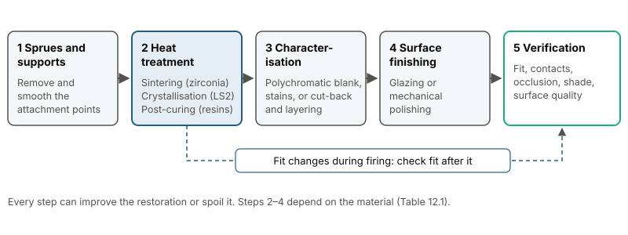
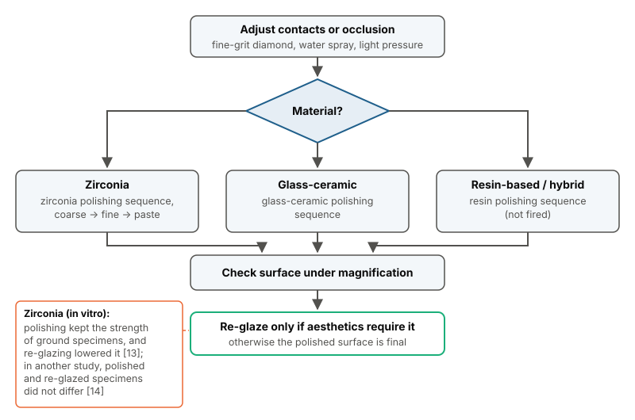
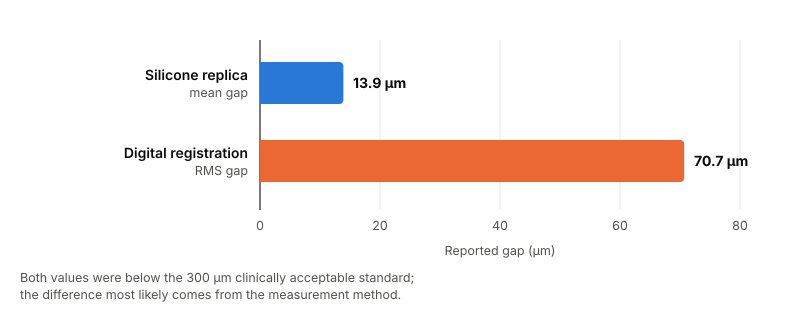

# Chapter 12. Finishing, Characterisation and Quality Control

## Learning Objectives

After reading this chapter, you should be able to:

1. Describe the post-processing each main CAD/CAM material needs after milling or printing, and the effect of fast firing and sintering protocols.
2. Plan characterisation with stains, glaze and cut-back layering, and explain how durable extrinsic stains are.
3. Choose between glazing and polishing, and refinish a restoration correctly after chairside adjustment.
4. Check the fit of a restoration on a model, digitally and in the mouth, and interpret the results in the light of the measurement method.
5. Diagnose and correct the most common manufacturing failures.
6. Set up a simple, documented quality-control routine for a laboratory or chairside unit.

---

## 12.1 Why the Last Step Matters

A milled or printed restoration is not finished when it leaves the machine. It still needs some combination of:

- **removal of sprues and supports**, and smoothing of the attachment points;
- **heat treatment**: sintering (zirconia), crystallisation (lithium disilicate) or post-curing (printed resins);
- **characterisation**: stains, glaze or layered porcelain;
- **surface finishing**: glazing or mechanical polishing;
- **verification**: fit, contacts, occlusion, shade and surface quality.

Each of these steps can improve the restoration or spoil it. Post-processing changes fit (Chapter 3). Glazing and grinding change surface roughness, strength and wear of the opposing teeth. A thin, chipped margin from milling that goes unnoticed becomes a clinical failure. This chapter covers the steps between the machine and the mouth, and how to check them (Figure 12.1).

**Figure 12.1** From machine to mouth. The five stages after milling or printing. Heat treatment changes fit, so fit is verified after the final firing (Section 12.2.2). Schematic.

---

## 12.2 Post-Processing by Material

**Table 12.1** Typical post-processing steps after CAD/CAM manufacture (follow the material manufacturer's current instructions)

| Material | State after milling or printing | Post-processing | Main risks |
|---|---|---|---|
| Zirconia (pre-sintered "white" state) | Enlarged, chalky, fragile | Sintering at high temperature; the restoration shrinks to final size; optional stain/glaze firing | Distortion of long spans; wrong programme; contamination; handling damage before sintering |
| Lithium disilicate (pre-crystallised "blue" state) | Partly crystallised, weaker | Crystallisation firing (often combined with stain/glaze) | Fit change during crystallisation [1]; firing-tray support |
| Feldspathic and leucite glass-ceramics (fully fired blocks) | Final strength | Polish, or stain and glaze firing | Edge chipping from milling [2] |
| Resin-based and hybrid blocks | Final state | Mechanical polishing (not fired) | Overheating during adjustment; loss of polish |
| Printed resins | "Green" part, uncured surface resin | Washing, support removal, post-curing (Chapter 11) | Incomplete cure; distortion; residual monomer |
| Milled or laser-melted metals | Final alloy (with supports for printed parts) | Support removal, heat treatment where specified, finishing and polishing | Residual stress; distortion of frameworks |

### 12.2.1 Fast sintering of zirconia

Conventional sintering cycles for zirconia take many hours. **Speed** and **high-speed sintering** shorten this to make same-day zirconia possible (Chapter 16).

- A systematic review of 15 in vitro studies found that fit (marginal and internal) and mechanical results were similar or better with speed or high-speed sintering for 3Y-, 4Y- and 5Y-zirconia. Translucency was usually reduced when 3Y-TZP was speed-sintered [3].
- A systematic review and meta-analysis that included 26 in vitro studies found that speed-sintering did not significantly affect flexural strength, fracture toughness or the CIEDE2000-based translucency parameter. The CIELab-based translucency parameter, however, was higher after conventional sintering [4].
- In one laboratory study, high-speed sintering was a valid alternative to conventional sintering. It did, however, reduce the Weibull modulus (a measure of how reliable the strength is) of all three zirconia materials tested after thermo-mechanical ageing [5].

All of this evidence is in vitro. Use only the fast programmes the zirconia manufacturer has validated for that specific material and furnace. The wide and growing range of zirconia types makes following manufacturers' instructions essential [6].

### 12.2.2 Crystallisation of lithium disilicate

Pre-crystallised lithium disilicate is milled in a softer state and then fired to its final strength and shade. That firing changes the restoration's fit. In an in vitro micro-CT study of 16 crowns on polyurethane teeth, crystallisation reduced the axial internal gap of milled crowns and increased the vertical marginal gap. The authors concluded that crystallisation changes the relationship between crown and tooth [1].

> **Lab Note.** Check the fit of glass-ceramic and zirconia restorations **after** their final firing, not only in the pre-fired state. A lithium disilicate crown that fits before crystallisation may not fit afterwards [1]. Zirconia reaches its final size only after sintering (Table 12.1).

---

## 12.3 Characterisation

### 12.3.1 Options

Monolithic CAD/CAM restorations are usually characterised in one of three ways:

1. **Polychromatic blanks.** Multilayer zirconia, or graded glass-ceramic blocks, provide a built-in shade gradient from cervical to incisal (Chapters 13 and 14). Positioning the restoration within the blank ("nesting") in the CAM software decides how the gradient falls.
2. **Extrinsic stains and glaze.** Thin surface colours and a glass glaze layer are fired onto the surface. This is quick and suits posterior teeth and chairside work.
3. **Cut-back and layering.** The restoration is milled with a reduced facial or incisal contour, and veneering ceramic is layered by hand in that area (Chapter 8). This gives the best depth of colour and translucency in anterior teeth, but it brings back veneering porcelain and its risk of chipping.

Some zirconia is also coloured **before sintering**, by dipping or brushing colouring liquids onto the pre-sintered restoration.

### 12.3.2 How durable are extrinsic stains?

The colour of a monolithic restoration that relies on surface stains lies in a thin surface layer, so its durability is a fair question. In an in vitro study, stained and glazed 3Y-TZP zirconia was thermocycled and brushed to simulate about one year of toothbrushing with normal and abrasive toothpastes. Some stain systems showed significant changes in colour and surface roughness. None of the changes **exceeded the thresholds for perceptibility and acceptability**. The study could not establish durability limits for the stains [7].

> **Clinical Tip.** Where you can, put the colour **inside** the restoration (polychromatic blanks, pre-sintering colouring liquids or a correctly chosen block shade), and use surface stain only for fine characterisation. After chairside adjustment, surface stain removed from the occlusal surface cannot be replaced without refiring.

### 12.3.3 Shade communication

Shade information for the laboratory should include:

- a calibrated photograph with a reference shade tab in the same frame and plane as the tooth;
- the **stump (abutment) shade** for translucent materials, because the substrate shows through glass-ceramics;
- colour scan data from the intraoral scanner, where available;
- notes on characterisation such as halo, mamelons, white spots and cervical chroma.

---

## 12.4 Glazing or Polishing?

The final surface affects plaque retention, wear of the opposing teeth, strength and appearance. There are two ways to achieve it:

- **Glazing:** a thin glass layer fired onto the surface.
- **Mechanical polishing:** a sequence of rubber, silicone or diamond-impregnated polishers (often finished with a diamond paste) that smooth the material itself.

### 12.4.1 Evidence

- On several framework–veneer ceramic combinations, chairside mechanical polishing after grinding restored surface roughness and strength **to the level of glazing**. The authors concluded that adjusted surfaces must always be polished [8].
- After removal of the glaze, only one of four polishing systems produced surfaces on monolithic zirconia and feldspathic ceramics as smooth as the original glaze; the other three gave rougher surfaces, and with one of them the surface could not be adequately polished [9]. **Polishing kits are not equivalent.**
- A polishing system designed for zirconia gave the lowest surface roughness on zirconia, lithium disilicate and feldspathic ceramic alike [10].
- An umbrella review of four systematic reviews on wear of the opposing enamel (qualitative synthesis; a meta-analysis was not possible) found that **polished** surfaces caused less enamel wear than **glazed** ones. Polished monolithic zirconia caused enamel wear equal to or less than natural enamel, and less than metal-ceramic, feldspathic and lithium disilicate crowns [11].

A commonly proposed explanation, not tested in the studies cited here, is that glaze wears away in function and exposes a rougher surface beneath, whereas a well-polished surface of the material itself remains smooth.

---

## 12.5 Adjustment and Refinishing

Almost every restoration needs some adjustment of contacts or occlusion. How it is done determines whether the restoration keeps its properties.

### 12.5.1 Zirconia

Grinding zirconia with diamond instruments creates scratches and can transform part of the surface from the tetragonal to the monoclinic phase, as the second study below shows.

- In one in vitro study, grinding increased the roughness of high-translucency zirconia. Proper polishing returned it to a smoothness comparable with glazed surfaces. There was no evidence that grinding and polishing reduced flexural strength after hydrothermal ageing [12].
- In another in vitro study, roughness increased after grinding, and polishing and glazing reduced it similarly. Ground specimens had the highest flexural strength. **Polished specimens kept this strength, whereas glazing after grinding lowered it to a level not different from the unground control.** On X-ray diffraction of one specimen per group, a monoclinic phase was found after grinding (26%) and after grinding and polishing (23–24%), but not after glazing [13].
- In a third in vitro study, ground specimens had the highest flexural strength, and the polished and re-glazed groups did not differ significantly from one another. The authors nevertheless concluded that glazing after grinding decreased flexural strength while polishing did not, and that a zirconia polishing system may be an alternative to re-glazing [14].
- After adjustment, two chairside polishing kits gave numerically lower mean roughness on monolithic zirconia (Ra 0.47 and 0.49 µm) than re-glazing (Ra 0.59 µm) in a small in vitro study (5 specimens per group) [15].
- In a pilot study, dental students, dentists with different levels of experience and dental technicians all achieved similar results when polishing zirconia crowns chairside with a two-step zirconia kit [16].

### 12.5.2 Practical protocol after chairside adjustment

1. Adjust with **fine-grit diamonds** under water spray, with light pressure.
2. Follow a validated polishing sequence, usually the one **specified for that material** (zirconia, glass-ceramic or resin-based), from coarse to fine. In one in vitro study, a zirconia kit gave the lowest roughness on all three ceramics tested [10].
3. Finish with a diamond polishing paste if the system includes one.
4. Check the surface under magnification for remaining scratches.
5. Re-glaze only if required for aesthetics. For zirconia, polishing kept the strength of ground specimens whereas re-glazing lowered it in one in vitro study [13]; in a second, polished and re-glazed specimens did not differ [14].

Figure 12.2 summarises this sequence as a decision path.

**Figure 12.2** Refinishing after chairside adjustment. A validated polishing sequence is used, usually the one specified for the material. For zirconia, polishing kept the flexural strength of ground specimens whereas glazing lowered it in one in vitro study [13]; in a second, polished and re-glazed specimens did not differ [14].

> **Evidence Box.** The evidence on adjustment and polishing comes almost entirely from **in vitro** studies on flat specimens, using single products. It consistently supports polishing after adjustment [8,12–14]. It does not support any one polishing kit over others in general, because results vary between kits [9,10].

Table 12.2 summarises the evidence from Sections 12.4 and 12.5.

**Table 12.2** Glazing, polishing and re-glazing: summary of the evidence (in vitro unless stated)

| Question | Finding | Ref. |
|---|---|---|
| Does polishing after grinding restore the surface? | Chairside polishing restored roughness and strength to the level of glazing on several ceramic combinations | [8] |
| Are polishing kits equivalent? | No: only one of four kits matched the original glaze [9]; a zirconia kit gave the lowest roughness on three ceramics [10] | [9,10] |
| Which surface wears opposing enamel less? | Polished surfaces caused less enamel wear than glazed ones (umbrella review of four systematic reviews; no meta-analysis) | [11] |
| Does grinding and polishing weaken zirconia? | No evidence of reduced flexural strength after hydrothermal ageing | [12] |
| Should ground zirconia be re-glazed? | Polishing kept the strength of ground specimens and glazing lowered it to the unground-control level [13]; in another study polished and re-glazed groups did not differ [14] | [13,14] |
| Polishing kits versus re-glazing on zirconia | Kits Ra 0.47 and 0.49 µm; re-glazing Ra 0.59 µm (means; n = 5 per group) | [15] |
| Does operator experience matter? | Students, dentists and technicians achieved similar results with a two-step zirconia kit (pilot) | [16] |

---

## 12.6 Checking Fit

### 12.6.1 On the model

For laboratory work, the first fit check is on the working model:

- **Stone casts** remain the reference in hybrid workflows.
- **Printed models** are increasingly used in fully digital workflows. How well restorations fit after adjustment on them can depend on printing layer thickness and analogue design. In one in vitro study, screw-retained zirconia implant crowns adjusted on printed casts with 50 µm layers needed less adjustment and had smaller internal gaps than those adjusted on casts with 100 µm layers. Proprietary friction-retained digital analogues gave smaller gaps than third-party screw-retained analogues [17].
- A restoration that fits a model perfectly can still fail to fit the mouth if the model or the scan is inaccurate. The model check is necessary but not sufficient.

### 12.6.2 Digital fit checks

Digital methods measure the gap three-dimensionally without destroying the restoration:

- **The triple-scan method.** Scan the die, the intaglio surface of the restoration and the restoration seated on the die. The software then calculates the gap. This approach is used in research on milled and printed restorations, for example on resin-based endocrowns [18] and implant crowns [17].
- **Chairside intraoral-scanner methods.** In a clinical trial on 30 crown preparations, an intraoral-scanner-based method of measuring the internal fit of CAD/CAM measurement copings gave results no different from those of a laboratory digital replica method or the conventional silicone replica technique [19].

### 12.6.3 Physical fit checks

- **Silicone fit-checking materials** placed inside the restoration during try-in show tight spots (burn-through) and the thickness of the cement space.
- **Explorer and magnification** at the margin, and **radiographs** for proximal and subgingival margins.
- **Disclosing media** to locate binding internal areas.

### 12.6.4 Interpreting the numbers

The method used to measure fit strongly affects the value obtained (Chapter 3). A review of 183 fit studies found that the direct-view technique (47.5%), cross-sectioning (23.5%) and impression replica (20.2%) were the most used methods, and reported gaps varied with method and protocol [20]. The same laser-melted removable partial denture (RPD) frameworks measured a 13.9 µm mean gap with the clinical replica method and a 70.7 µm RMS gap with digital registration [21]. For implant fixed prostheses, the available techniques assess different parameters, so combining several techniques is useful [22].

**Figure 12.3** One set of frameworks, two numbers. The same laser-melted RPD frameworks measured a 13.9 µm mean gap with the silicone replica method and a 70.7 µm RMS gap with digital registration in an in vitro study. Both were below the 300 µm clinically acceptable standard; the difference most likely reflects the method (and the metric, mean versus RMS). Data from [21].

When you compare your own results over time or between suppliers, use **the same method each time**.

---

## 12.7 Troubleshooting Common Failures

### 12.7.1 Edge chipping from milling

Brittle CAD/CAM materials chip at thin edges during milling. In a study of five materials milled into bars, edge chipping depended on **material type, milling surface and edge location**. Chipping on the tensile side correlated strongly with a **reduction in flexural strength** [2]. In another in vitro study, two polymer-containing materials were easier to machine and showed less edge chipping than two ceramic-based materials [23].

Prevention: adequate margin thickness in the design, edge reinforcement settings where the software offers them, sharp burs replaced on schedule, and suitable milling strategies (Chapters 7 and 10).

### 12.7.2 Troubleshooting table

**Table 12.3** Common problems after manufacture: causes and remedies

| Problem | Likely causes | Remedies |
|---|---|---|
| Restoration does not seat; tight internally | Cement space too small; sharp internal angles not reproduced by the bur; undercuts not blocked out; fit change after firing [1] | Check fit with silicone; relieve binding areas; adjust cement-space settings and preparation design for future cases |
| Open margin after seating | Margin line wrong in design; scan error at the margin; distortion during firing; incomplete seating due to tight contacts | Check contacts first; if still open, remake from a new scan; review the margin on the original scan |
| Chipped or ragged margin | Margin too thin; worn bur; brittle material; aggressive milling strategy [2,23] | Remake; increase margin thickness; replace burs; review strategy |
| Proximal contacts too tight or open | Contact setting; polishing or glazing changed the contour; model inaccuracy [17] | Adjust and repolish; add contact with glaze or ceramic correction firing if open; calibrate contact settings |
| Occlusion high | Bite record error; design in contact rather than slightly out of contact (Chapter 7) | Adjust in the mouth after bonding where the material allows; polish [8,12–14]; review bite scan |
| Shade too light, dark or opaque | Wrong block or blank shade; substrate not considered; nesting position in a multilayer blank; speed sintering effect on translucency [3,4] | Characterise with stain; choose a new blank or shade; record stump shade |
| Surface rough after adjustment | Adjustment without polishing | Polish with a validated polishing sequence; kits differ [9,10,15] |
| Distorted long-span zirconia | Inadequate sintering support; wrong programme | Use the specified sintering supports and programme; check fit on a verified model |
| Fracture before or at try-in | Thin areas; handling in the pre-sintered or pre-crystallised state; milling damage [2] | Check thickness maps; handle green-state restorations carefully; remake |
| Printed parts warped or tacky | Incomplete washing or post-curing; wrong orientation (Chapter 11) | Follow the validated post-processing protocol |

---

## 12.8 A Simple Quality-Control Routine

Quality control in a CAD/CAM unit does not need to be complicated, but it must be **systematic** and **documented**:

**For every restoration**
- Check the design against the checklist in Chapter 7 before manufacture.
- After manufacture, inspect margins, contacts and surfaces under magnification.
- Check fit and contacts on the model or die **after final heat treatment** [1].
- Confirm the shade and surface finish (glazed or polished).
- Record the material, lot number, machine, programme and any adjustments.

**Regularly**
- Calibrate scanners, mills, printers and furnaces at the manufacturer's intervals.
- Replace burs according to usage, not only when they break.
- Run a reference test part through the mill or printer and check it digitally.
- Review remakes and adjustments monthly to find recurring causes.

**When something changes**
- After software updates, new materials or new firing programmes, validate on test parts before clinical use.

---

## Key Points

- Post-processing (sintering, crystallisation, post-curing, characterisation and finishing) is part of manufacturing. It changes **fit**, **strength** and **appearance** [1,3–5].
- **Fast sintering** of zirconia gives broadly similar mechanical and fit results in vitro, but may reduce translucency of 3Y-TZP and strength reliability. Use only validated programmes [3–6].
- Put colour **inside** the restoration where possible. Extrinsic stains on 3Y-TZP stayed within perceptibility and acceptability thresholds after about one year of simulated brushing in one in vitro study [7].
- **Polishing** can match glazing for smoothness [8,9] and strength [8], but polishing kits differ [9,10]; and polished surfaces caused **less wear of opposing enamel** than glazed ones in an umbrella review of four systematic reviews [11].
- After adjusting **zirconia**, **polish** rather than re-glaze. Polishing restored smoothness [12,15,16], and in vitro it kept the strength of ground specimens, whereas re-glazing lowered it in one study [13] and did not differ from polishing in another [14].
- Check fit **after final heat treatment**, on the model and in the mouth. Interpret fit values in the light of the **method** used [17–22].
- Edge chipping from milling depends on the material, the milling surface and the edge location, and was strongly correlated with lower flexural strength in milled bars in vitro [2,23].
- Quality control should be systematic: inspect, verify, record and review.

---

## Review Questions

1. List the post-processing steps for (a) a pre-sintered zirconia crown, (b) a pre-crystallised lithium disilicate crown and (c) a printed definitive resin crown.
2. What does the evidence say about the effect of speed sintering on the strength, fit and translucency of zirconia?
3. Why should the fit of a lithium disilicate crown be checked after crystallisation rather than before?
4. Compare glazing and polishing in terms of surface roughness, strength and wear of the opposing enamel.
5. A monolithic zirconia crown has been adjusted occlusally at try-in. Describe how you would refinish it, and explain why you might avoid re-glazing.
6. Describe the triple-scan method of measuring fit. What are its advantages over cross-sectioning?
7. A milled glass-ceramic onlay arrives with a chipped margin. List possible causes and how you would prevent a recurrence.
8. Design a quality-control routine for a chairside CAD/CAM unit: checks for every restoration, regular checks, and checks after a change.

---

## References

1. De Freitas BN, Tonin BSH, Macedo AP, Dos Santos TMP, De Mattos MDGC, Hotta TH, et al. Adaptation accuracy of milled lithium disilicate crowns: a 2D and 3D microCT analysis. J Esthet Restor Dent. 2020;32(4):403–9. doi:10.1111/jerd.12574
2. Redwan H, Fan Y, Giordano R. Effect of machining damage on the surface roughness and flexural strength of CAD-CAM materials. J Prosthet Dent. 2025;133(3):872–80. doi:10.1016/j.prosdent.2024.07.045
3. Al-Haj Husain N, Özcan M, Dydyk N, Joda T. Conventional, speed sintering and high-speed sintering of zirconia: a systematic review of the current status of applications in dentistry with a focus on precision, mechanical and optical parameters. J Clin Med. 2022;11(16):4892. doi:10.3390/jcm11164892
4. Liu H, Inokoshi M, Xu K, Tonprasong W, Minakuchi S, Van Meerbeek B, et al. Does speed-sintering affect the optical and mechanical properties of yttria-stabilized zirconia? A systematic review and meta-analysis of in-vitro studies. Jpn Dent Sci Rev. 2023;59:312–28. doi:10.1016/j.jdsr.2023.08.007
5. Jerman E, Wiedenmann F, Eichberger M, Reichert A, Stawarczyk B. Effect of high-speed sintering on the flexural strength of hydrothermal and thermo-mechanically aged zirconia materials. Dent Mater. 2020;36(9):1144–50. doi:10.1016/j.dental.2020.05.013
6. Cesar PF, Miranda RBP, Santos KF, Scherrer SS, Zhang Y. Recent advances in dental zirconia: 15 years of material and processing evolution. Dent Mater. 2024;40(5):824–36. doi:10.1016/j.dental.2024.02.026
7. Bayestehtarat S, Gullard A, Morrow B, Hollis W, Ragain J. Longevity of extrinsic stains on monolithic zirconia restorations: an in vitro study. J Prosthet Dent. 2023;130(6):877.e1–877.e7. doi:10.1016/j.prosdent.2023.09.008
8. Pradíes G, Godoy-Ruiz L, Özcan M, Moreno-Hay I, Martínez-Rus F. Analysis of surface roughness, fracture toughness, and Weibull characteristics of different framework-veneer dental ceramic assemblies after grinding, polishing, and glazing. J Prosthodont. 2019;28(1):e216–e221. doi:10.1111/jopr.12653
9. Incesu E, Yanikoglu N. Evaluation of the effect of different polishing systems on the surface roughness of dental ceramics. J Prosthet Dent. 2020;124(1):100–9. doi:10.1016/j.prosdent.2019.07.003
10. Irusa KF, Albouy JP, Cook R, Amaya-Pajares S, Donovan T. The effect of finishing and polishing with proprietary vs interchanged polishing kits on the surface roughness of different ceramic materials. J Prosthodont. 2023;32(3):267–72. doi:10.1111/jopr.13533
11. Shah N, Nerkar H, Badwaik P, Ahuja B, Malu R, Bhanushali N. An evaluation of antagonist enamel wear opposing full-coverage zirconia crowns versus other ceramics full-coverage crowns and natural enamel — an umbrella review. J Indian Prosthodont Soc. 2024;24(3):217–24. doi:10.4103/jips.jips_32_24
12. Khayat W, Chebib N, Finkelman M, Khayat S, Ali A. Effect of grinding and polishing on roughness and strength of zirconia. J Prosthet Dent. 2018;119(4):626–31. doi:10.1016/j.prosdent.2017.04.003
13. Mohammadi-Bassir M, Babasafari M, Rezvani MB, Jamshidian M. Effect of coarse grinding, overglazing, and 2 polishing systems on the flexural strength, surface roughness, and phase transformation of yttrium-stabilized tetragonal zirconia. J Prosthet Dent. 2017;118(5):658–65. doi:10.1016/j.prosdent.2016.12.019
14. Ozturk I, Caglar I, Duymus ZY. The effect of adjustment and finishing procedure on roughness, strength, and phase transformation of monolithic zirconia. Clin Oral Investig. 2022;26(7):4761–8. doi:10.1007/s00784-022-04440-x
15. Gaonkar SH, Aras MA, Chitre V. An in vitro study to compare the surface roughness of glazed and chairside polished dental monolithic zirconia using two polishing systems. J Indian Prosthodont Soc. 2020;20(2):186–92. doi:10.4103/jips.jips_339_19
16. Kozmacs C, Hollmann B, Arnold WH, Naumova E, Piwowarczyk A. Polishing of monolithic zirconia crowns — results of different dental practitioner groups. Dent J (Basel). 2017;5(4):30. doi:10.3390/dj5040030
17. El Gedaily M, Donmez MB, Demirel M, Çakmak G, Kahveci Ç, Yilmaz B. Adjustment efficiency and internal fit of screw-retained zirconia crowns on additively manufactured dental casts: an in vitro study on the effect of printing layer thickness and digital implant analog design. Int J Oral Maxillofac Implants. 2026. doi:10.11607/jomi.11686
18. Altinci P, Dönmez MB, Çakmak G, Al-Johani H, Kahveci Ç, Erkal D, et al. Additively manufactured resin-based endocrowns: effect of material type, margin configuration, and pulp chamber depth on fabrication trueness and fit. J Dent. 2025;157:105731. doi:10.1016/j.jdent.2025.105731
19. Schlenz MA, Vogler J, Schmidt A, Rehmann P, Wöstmann B. New intraoral scanner-based chairside measurement method to investigate the internal fit of crowns: a clinical trial. Int J Environ Res Public Health. 2020;17(7):2182. doi:10.3390/ijerph17072182
20. Nawafleh NA, Mack F, Evans J, Mackay J, Hatamleh MM. Accuracy and reliability of methods to measure marginal adaptation of crowns and FDPs: a literature review. J Prosthodont. 2013;22(5):419–28. doi:10.1111/jopr.12006
21. Alabdullah SA, Hannam AG, Wyatt CC, McCullagh APG, Aleksejuniene J, Mostafa NZ. Comparison of digital and conventional methods of fit evaluation of partial removable dental prosthesis frameworks fabricated by selective laser melting. J Prosthet Dent. 2022;127(3):478.e1–478.e10. doi:10.1016/j.prosdent.2021.09.033
22. Abduo J, Bennani V, Waddell N, Lyons K, Swain M. Assessing the fit of implant fixed prostheses: a critical review. Int J Oral Maxillofac Implants. 2010;25(3):506–15. PMID:20556249
23. Chavali R, Nejat AH, Lawson NC. Machinability of CAD-CAM materials. J Prosthet Dent. 2017;118(2):194–9. doi:10.1016/j.prosdent.2016.09.022
