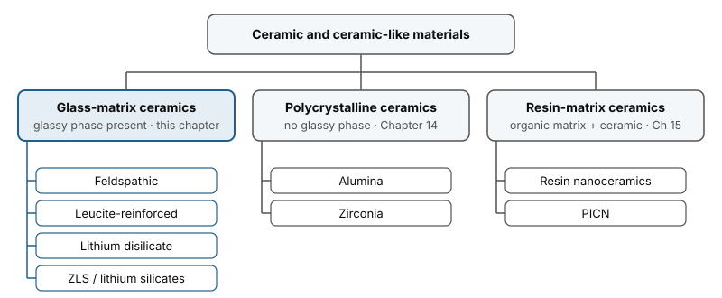
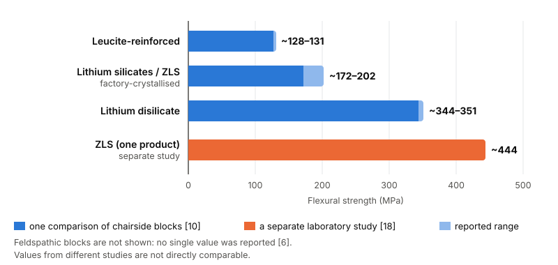
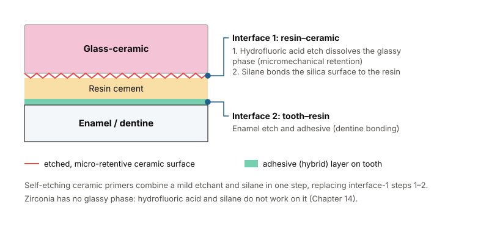

# Chapter 13. Glass-Ceramics

## Learning Objectives

After reading this chapter, you should be able to:

1. Place glass-ceramics within a modern classification of ceramic and ceramic-like restorative materials.
2. Describe the composition, microstructure and processing of feldspathic, leucite-reinforced, lithium disilicate and zirconia-reinforced lithium silicate CAD/CAM materials.
3. Compare their mechanical and optical properties, and relate them to clinical indications.
4. Explain how CAD/CAM processing (milling, crystallisation firing, finishing) affects the final properties of a glass-ceramic restoration.
5. Carry out an evidence-based adhesive cementation protocol for glass-ceramics, and judge when self-adhesive or conventional cementation is acceptable.
6. Weigh wear, colour stability and minimum thickness when choosing a glass-ceramic for a given case.

---

## 13.1 What Is a Glass-Ceramic?

### 13.1.1 Classification

Gracis and colleagues proposed a classification that divides ceramic and ceramic-like restorative materials into three families according to the phases they contain [1]:

1. **Glass-matrix ceramics:** a glassy phase is present.
2. **Polycrystalline ceramics:** no glassy phase (alumina, zirconia; Chapter 14).
3. **Resin-matrix ceramics:** an organic matrix highly filled with ceramic particles (Chapter 15).

This chapter covers the first family. Within it, the materials used in CAD/CAM dentistry are:

- **feldspathic ceramics**, mostly glass with a small crystalline content;
- **leucite-reinforced glass-ceramics**;
- **lithium disilicate** glass-ceramics;
- **zirconia-reinforced lithium silicate (ZLS)** and related lithium silicate glass-ceramics.

A recent review of chairside CAD/CAM materials uses the same groups, alongside resin nanoceramics, polymer-infiltrated ceramic networks and zirconia [2]. Figure 13.1 shows where each material sits.

**Figure 13.1** Classification of ceramic and ceramic-like restorative materials by the phases they contain, after Gracis and colleagues [1]. This chapter covers the glass-matrix family.

### 13.1.2 Why the glass matters

The glassy phase gives these materials their two defining clinical features:

- **Optical quality.** The glassy phase lets light pass through and scatter, and glass-ceramics offer excellent aesthetics [2,3].
- **Etchability.** Hydrofluoric acid dissolves the glassy phase selectively, creating a micro-retentive surface. Silane can then bond chemically to the exposed silica. This makes glass-ceramics **adhesively bondable**, which is the basis of their clinical success as thin, minimally invasive restorations [3,4]. HF etching followed by silane is the most widely accepted surface treatment for glass-ceramics [5].

The price of the glassy phase is **brittleness**. Glass-ceramics are strong in compression but sensitive to tensile stress, surface flaws and thin sections. CAD/CAM processing introduced ceramics made under industrial conditions that are more homogeneous and less flawed than hand-layered porcelain (Chapter 1). Their mechanical behaviour still depends heavily on design, thickness and bonding.

---

## 13.2 Feldspathic Ceramics

### 13.2.1 Composition and processing

Feldspathic CAD/CAM blocks are fine-grained, mostly glassy materials made industrially from feldspar-based compositions. They were the material of the first chairside CAD/CAM restorations (Chapter 1). They are milled in their final state and need no crystallisation firing, only optional staining and glazing or polishing.

### 13.2.2 Properties

Feldspathic blocks are among the weakest CAD/CAM glass-ceramics. In an in vitro comparison of five CAD/CAM materials, lithium disilicate had significantly higher flexural strength, strain at failure and hardness than a feldspathic block, a leucite-reinforced block, a polymer-infiltrated ceramic network and a resin nanoceramic; the last two were the next most resistant [6]. Their strengths are excellent aesthetics, very good colour stability and ease of milling and polishing. After artificial ultraviolet ageing, feldspar-based and leucite-reinforced CAD/CAM glass-ceramics showed the least colour change of six glass-ceramics tested [7].

### 13.2.3 Clinical use

Long-term data on chairside feldspathic inlays and onlays are encouraging: in one private practice, the success rate was 87.5% after up to 27 years, with 141 of 200 restorations re-evaluated (Chapter 8) [8]. As crowns, however, feldspathic and silica-based ceramics had significantly lower 5-year survival than other materials in a large systematic review, especially in posterior teeth. The authors advised limiting them to the anterior region [9].

**Typical indications:** bonded inlays, onlays and veneers; anterior crowns in low-stress situations.

---

## 13.3 Leucite-Reinforced Glass-Ceramics

### 13.3.1 Composition and properties

Leucite-reinforced glass-ceramics contain leucite crystals dispersed in a glassy matrix. The crystals improve strength and resistance to crack propagation compared with feldspathic porcelain, while keeping good translucency. Like feldspathic blocks, they are milled in their final state.

In a comparison of CAD/CAM blocks, a leucite-reinforced glass-ceramic had a flexural strength of about **128–131 MPa**, compared with about **344–351 MPa** for lithium disilicate [10]. It also had significantly lower flexural strength and hardness than lithium disilicate in a second comparison [6].

### 13.3.2 Clinical evidence

In a 5-year randomised clinical trial of 120 chairside onlays, **four leucite-reinforced onlays fractured** and needed replacement, compared with one resin nanoceramic onlay. Both materials had a very low overall risk of fracture. Self-etch and total-etch adhesive cementation gave similar outcomes, with no debonding [11].

**Typical indications:** veneers, inlays, onlays and anterior crowns where aesthetics are paramount and loads are moderate. Lithium disilicate, which is stronger [6,10], is now usually preferred for posterior crowns (expert opinion).

---

## 13.4 Lithium Disilicate

### 13.4.1 Composition and processing

Lithium disilicate is a widely used glass-ceramic in CAD/CAM dentistry that combines aesthetics with high mechanical resistance [4].

CAD/CAM lithium disilicate is usually supplied in a **partially crystallised** state that is easier to mill and has a characteristic bluish colour. After milling, it undergoes a **crystallisation firing** that converts it into its final microstructure: densely packed, needle-shaped lithium disilicate crystals in a glassy matrix. This is what gives it its final strength, shade and translucency. Staining and glazing can be done in the same or a separate firing. (The exact phases, temperatures and cycles are product-specific. Always follow the manufacturer's firing programme.)

> **Lab Note.** Crystallisation is part of the manufacturing process, not an optional extra. An uncrystallised restoration is weaker and the wrong shade. Firing also changes fit: crystallisation reduced the axial internal gap and increased the vertical marginal gap of milled lithium disilicate crowns in an in vitro micro-CT study (Chapter 3) [12]. Try in and adjust after the final firing.

### 13.4.2 Properties

- **Strength.** Lithium disilicate had the highest flexural strength of the chairside glass-ceramics compared by Vichi and colleagues (about 344–351 MPa), which included three factory-crystallised lithium silicates and a leucite-reinforced ceramic [10]. It had significantly better strength and hardness than feldspathic, leucite-reinforced and resin-matrix CAD/CAM materials in another comparison [6].
- **Processing route.** A meta-analysis of 22 in vitro studies comparing lithium disilicate, ZLS and an "advanced" lithium disilicate found that standard lithium disilicate had the highest fracture resistance and least wear. CAD/CAM processing gave higher flexural strength than heat-pressing, while pressing gave higher hardness and lower roughness [13]. In a laboratory study, milled and pressed crowns (made by pressing from 3D-printed patterns) had similar fatigue behaviour [14].
- **Aesthetics and versatility.** A narrative review of lithium disilicate and zirconia describes excellent optical properties, high biocompatibility, high mechanical resistance, reduced thickness and favourable wear behaviour, which make them materials of choice for minimally invasive prosthodontics [4].

### 13.4.3 Clinical performance

Chapter 8 summarised the survival data. In brief:

- Leucite- or lithium disilicate-reinforced glass-ceramic single crowns had a 5-year survival (96.6%) similar to that of metal-ceramic crowns (94.7%) [9].
- Chairside monolithic lithium disilicate posterior crowns had **83.5% survival at 10 years**. All events occurred on molars. These crowns were luted with a **self-adhesive resin cement** [15].
- Monolithic glass-ceramic fixed dental prostheses (FDPs) performed considerably worse than single units (survival 76.1% over 6.5 years) [16].

**Typical indications:** veneers, inlays, onlays, partial crowns, endocrowns, and anterior and posterior single crowns. Three-unit FDPs are limited to the anterior or premolar region within the manufacturer's connector limits, and are not a first choice (Chapter 8).

---

## 13.5 Zirconia-Reinforced Lithium Silicate and Other Lithium Silicates

### 13.5.1 Composition

**Zirconia-reinforced lithium silicate (ZLS)** is a lithium silicate glass-ceramic with zirconia dissolved in the glassy phase. A 2021 review identified two main ZLS CAD/CAM products, similar in composition, microstructure and properties [17]. Firing after milling improves strength and fatigue failure load but causes some volumetric shrinkage [17]; whether a firing is needed depends on the product (follow the manufacturer).

A wider group of **factory-crystallised lithium silicate** blocks is now available for chairside use without any heat treatment [10].

### 13.5.2 Properties

- In one laboratory study, a ZLS material had higher fracture toughness (2.31 MPa·m^0.5), flexural strength (about 444 MPa), elastic modulus and hardness than lithium disilicate. It also had a higher **brittleness index**, meaning it was harder to machine [18].
- In contrast, a comparison of factory-crystallised chairside blocks found flexural strengths of only about **172–202 MPa** for several lithium silicate and ZLS materials, compared with about **344–351 MPa** for crystallised lithium disilicate. All still met the ISO requirements for their classes [10].
- A meta-analysis of in vitro studies found that standard lithium disilicate had higher fracture resistance and less wear than ZLS and advanced lithium disilicate [13].
- A narrative review found that ZLS has **not been shown to be more translucent** than lithium disilicate, although it has acceptable colour change and stability. Its machinability and handling are more demanding. **Mechanical polishing** is the most effective way to reduce surface roughness [19].

> **Evidence Box.** Laboratory values for ZLS and lithium silicates vary widely between studies and products. The differences depend on whether the material was fired, on the test method and on the specific product. Do not assume that "zirconia-reinforced" means "stronger than lithium disilicate". Compare products using independent data and follow the manufacturer's indications.

**Figure 13.2** Reported flexural strengths of CAD/CAM glass-ceramics. Blue bars come from one comparison of chairside blocks [10]; the orange bar comes from a separate laboratory study of one ZLS product [18]. The spread illustrates why values from different studies and processing states should not be compared directly. In another comparison, lithium disilicate was strongest and a polymer-infiltrated ceramic network and a resin nanoceramic were next, ahead of feldspathic and leucite-reinforced blocks [6].

### 13.5.3 Clinical evidence

- In a 3-year practice-based study of 92 chairside ZLS partial crowns, survival was **99%** [20].
- In a 5-year randomised university study of chairside ZLS partial crowns made **thinner than the manufacturer recommended**, restorations with a minimum thickness of 0.5–0.74 mm had a survival of 83.0% because of ceramic fractures. Those of 0.75–1.0 mm had **100%** survival. Molar partial crowns had a higher risk of needing intervention than premolar ones. Four restorations luted with self-adhesive cement needed recementation [21].
- For implant-supported single crowns on titanium bases, ZLS crowns had 100% survival at 12 months in a randomised trial, compared with 84% for a polymer-infiltrated ceramic network (PICN). ZLS also showed significantly less occlusal wear. Debonding occurred in three ZLS and two PICN crowns. Only 42 of the 62 crowns were evaluated at one year, and technical complications were frequent with both materials [22].

ZLS can be used for anterior and posterior single-unit restorations on teeth and implants. A narrative review, based on in vitro studies and case reports, concluded that ZLS does not seem a viable option for posterior endocrowns or FDPs [19]. Respect the minimum thicknesses. Clinical evidence shows they matter [21].

---

## 13.6 Comparing the Glass-Ceramics

**Table 13.1** CAD/CAM glass-ceramics compared

| Property / use | Feldspathic | Leucite-reinforced | Lithium disilicate | ZLS / lithium silicates |
|---|---|---|---|---|
| Relative strength | Low; behind lithium disilicate, PICN and resin nanoceramic in one study [6] | Low (~128–131 MPa in one study) [10] | Highest in one comparison of chairside blocks (~344–351 MPa) [10]; lower than one ZLS product in another study [18] | Variable: ~172–202 MPa (factory-crystallised) [10] to ~444 MPa (one ZLS product) [18] |
| Post-milling firing | No | No | **Yes**, crystallisation | Product-dependent [17] |
| Aesthetics | Excellent | Excellent | Very good; wide range of translucencies | Good; not proven more translucent than lithium disilicate [19] |
| Colour stability after UV ageing | Highest [7] | Highest [7] | Acceptable [7] | Acceptable; polishing protocol matters [19,23] |
| Adhesive bonding required | Yes | Yes | Preferred | Preferred |
| Main indications | Inlays, onlays, veneers, anterior crowns | Veneers, inlays, onlays, anterior crowns | All single units; three-unit FDPs up to the premolar region (manufacturer limits; not a first choice) | Single units on teeth and implants [19] |
| Not recommended | Posterior crowns [9] | Posterior crowns under high load (expert opinion) | Long-span or molar FDPs; glass-ceramic FDPs had lower survival (76.1% over 6.5 years) [16] | Posterior endocrowns, FDPs [19] |

---

## 13.7 Adhesive Cementation of Glass-Ceramics

### 13.7.1 The principle

The bond between a glass-ceramic and the tooth has two interfaces: **tooth–resin** (enamel and dentine bonding) and **resin–ceramic**. On the ceramic side, the best-documented approach has two steps [3,5]:

1. **Micromechanical:** etching with **hydrofluoric acid (HF)** dissolves the glassy phase and exposes the crystals, creating micro-retention.
2. **Chemical:** **silane** forms bonds between the silica-based surface and the resin cement.

A systematic review of 83 laboratory studies concluded that HF etching followed by silane has become the most widely accepted surface treatment for glass-ceramics. It also highlighted the toxicity of HF and the need for safer alternatives [5]. Resin bonding to silica-based ceramics is well researched and predictable, unlike bonding to high-strength oxide ceramics, which needs different methods (Chapter 14) [3]. Figure 13.3 shows the two interfaces.

**Figure 13.3** The two bonding interfaces of an adhesively luted glass-ceramic restoration. On the ceramic side, hydrofluoric acid etching creates micro-retention and silane provides chemical bonding [3,5]; on the tooth side, enamel etching and an adhesive bond the resin cement. Schematic, not to scale.

### 13.7.2 Etching protocols

Etching time and acid concentration depend on the material's microstructure. In general:

- feldspathic and leucite-reinforced ceramics tolerate, and usually need, longer etching;
- lithium disilicate and lithium silicates need **shorter** etching with a lower acid concentration, because over-etching weakens the surface.

Use the protocol specified by the ceramic manufacturer. A narrative review found that conventional acid etching seems effective for ZLS, but no etching protocol has yet been established [19].

### 13.7.3 Self-etching ceramic primers

**Self-etching ceramic primers** combine a mild etchant and a silane in one product, avoiding HF in the surgery. A 2026 systematic review and meta-analysis of 46 in vitro studies found that a self-etching ceramic primer achieved bond strengths **comparable** to HF plus silane on lithium disilicate under several laboratory conditions. Some subgroups favoured HF plus silane. The authors warned that the findings do **not** demonstrate equivalent long-term clinical performance [24].

### 13.7.4 Self-adhesive or adhesive cementation?

Full adhesive cementation (tooth etching and bonding plus a resin composite cement) is essential for **thin, non-retentive restorations**: veneers, inlays, onlays, partial crowns and endocrowns. These restorations depend on the bond for both retention and strength.

For lithium disilicate crowns, one prospective study of 41 chairside posterior crowns, all luted with a self-adhesive resin cement, reported 83.5% survival at 10 years (26 crowns re-examined; one loss of retention) [15]. It had no adhesive-cementation comparison group. Results from partial-coverage restorations suggest more caution: in the ZLS partial-crown trial, all the recementations involved self-adhesive cement [21]. In the leucite and nanoceramic onlay trial, self-etch and total-etch adhesive cementation performed similarly [11].

**Table 13.2** Cementation of glass-ceramic restorations

| Restoration | Recommended cementation | Notes |
|---|---|---|
| Veneers | Adhesive (enamel etch + bond + light-cure or dual-cure resin cement) | Thin; translucency of cement affects shade |
| Inlays, onlays, partial crowns | Adhesive (total- or self-etch + resin cement) [11] | Avoid self-adhesive cement for partial coverage where possible [21] |
| Endocrowns | Adhesive | Retention depends on the bond and the pulp chamber |
| Crowns, retentive preparation | Adhesive preferred; self-adhesive resin cement gave acceptable 10-year results in one study [15] | Conventional cements (e.g., glass-ionomer) are not generally recommended for glass-ceramics |
| Crowns on Ti-base (implant) | Extraoral bonding to Ti-base with a validated protocol (Chapter 9) | — |

### 13.7.5 A standard protocol for lithium disilicate

1. **Try-in.** Check fit, contacts and shade with a try-in paste. Avoid contaminating the intaglio surface with saliva or blood, or clean it if you do.
2. **Ceramic surface.** Etch with HF at the concentration and time the manufacturer specifies (or use a validated self-etching ceramic primer [24]). Rinse thoroughly, dry, and apply silane.
3. **Tooth surface.** Isolate (preferably with rubber dam). Clean. Etch enamel and apply the adhesive according to the cement system.
4. **Cementation.** Seat with a resin cement. Remove excess at the gel stage or before final curing. Light-cure from all sides.
5. **Finish.** Remove residual cement, check occlusion, and polish any adjusted surfaces (Section 13.8).

> **Clinical Tip.** HF is highly toxic. Wherever possible, have the laboratory etch and silanate the restoration, then protect the surface during try-in. Otherwise, use HF only with full protective measures, or use a self-etching ceramic primer.

---

## 13.8 Surface Finish, Wear and Colour Stability

### 13.8.1 Glaze or polish?

After adjustments, glass-ceramic surfaces must be repolished or reglazed. A rough surface increases plaque retention and staining, and can increase wear of opposing teeth. A systematic review of six in vitro studies found that, in most of them, both mechanical polishing and glazing prevented significant colour change in CAD/CAM ceramics; the authors called the evidence limited [23]. Two studies, however, found clinically unacceptable colour change after mechanical polishing of a ZLS ceramic [23]. Coffee and red wine were the most staining beverages [23].

### 13.8.2 Wear of opposing teeth

Evidence on antagonist wear is conflicting:

- A meta-analysis of clinical studies reported the greatest antagonist wear with **feldspathic** ceramics. Lithium disilicate and zirconia caused much less [25].
- A more recent meta-analysis of single crowns found significant enamel wear opposite monolithic **zirconia** and **lithium disilicate**. Feldspathic veneering on metal-ceramic crowns did not cause significant wear in that analysis [26].

The differences reflect variations in materials, surface finish (glazed or polished), measurement methods and follow-up. The cited meta-analyses did not test surface finish; that **well-polished surfaces wear opposing teeth less** than rough or adjusted unglazed ones is expert opinion.

### 13.8.3 Biological behaviour

After ultraviolet ageing, lithium disilicate showed the least bacterial adhesion of six CAD/CAM glass-ceramics tested, while the feldspathic and leucite-reinforced materials remained the most colour-stable [7]. ZLS is reported to be biocompatible, but long-term data are limited [17].

---

## 13.9 Choosing a Glass-Ceramic

**Table 13.3** Selection guide

| Clinical situation | First choice | Alternatives |
|---|---|---|
| Thin anterior veneers, high aesthetic demand | Lithium disilicate (high translucency) or feldspathic/leucite | — |
| Posterior inlay or onlay, chairside | Lithium disilicate or ZLS | Feldspathic (long track record) [8] |
| Posterior partial crown, thin walls | Lithium disilicate; ZLS only at ≥0.75–1.0 mm thickness [21] | Resin-matrix ceramic (Chapter 15) |
| Posterior single crown | Lithium disilicate [15] | Monolithic zirconia (Chapter 14) |
| Anterior single crown, discoloured abutment | Lower-translucency lithium disilicate | Zirconia (Chapter 14) |
| Implant single crown on Ti-base | ZLS [22] or lithium disilicate | Zirconia |
| Posterior FDP | Not a first choice: glass-ceramic FDPs had lower survival (76.1% over 6.5 years) and more irreparable failures [16] | Zirconia (Chapter 14) |

---

## Key Points

- Glass-ceramics are **glass-matrix ceramics** [1]. The glassy phase gives them aesthetics and **etchability**, but also brittleness.
- **Feldspathic** and **leucite-reinforced** ceramics are the weakest glass-ceramics [6,10] and were the most colour-stable after in vitro UV ageing [7]. A systematic review advised limiting feldspathic/silica-based crowns to the anterior region; in the same review, leucite- or lithium disilicate-reinforced crowns had 5-year survival similar to metal-ceramic crowns [9]. Both are best used for bonded partial restorations, veneers and anterior crowns (expert opinion).
- **Lithium disilicate** offers the best balance of strength and aesthetics and is the most versatile [4,6,10]. It requires **crystallisation firing**, which also alters fit.
- **ZLS** and other lithium silicates vary widely between products [10,18]. Clinical results are good for single units at adequate thickness. Below about 0.75 mm, fracture risk rises [21].
- **HF etching plus silane** remains the reference ceramic surface treatment [5]. One self-etching ceramic primer gave bond strengths comparable to HF plus silane on lithium disilicate under several laboratory conditions, but long-term clinical equivalence has not been shown [24].
- Use **full adhesive cementation** for veneers, inlays, onlays, partial crowns and endocrowns. **Self-adhesive** resin cement gave acceptable 10-year results for posterior lithium disilicate crowns in one prospective study [15].
- **Polish or glaze** every adjusted surface; in most in vitro studies both limited colour change [23]. Antagonist wear data are conflicting [25,26]; that smooth surfaces are kinder to opposing teeth is expert opinion.

---

## Review Questions

1. Using the Gracis classification, explain how glass-matrix ceramics differ from polycrystalline and resin-matrix ceramics.
2. Why can glass-ceramics be etched with hydrofluoric acid, and why does this make them suitable for thin bonded restorations?
3. Compare the flexural strength and typical indications of leucite-reinforced and lithium disilicate CAD/CAM ceramics.
4. What happens during the crystallisation firing of lithium disilicate, and why should final fit be checked afterwards?
5. A colleague says ZLS is "zirconia, so it must be stronger than lithium disilicate". What does the evidence say?
6. What did the 5-year ZLS partial-crown trial show about minimum material thickness and cementation technique?
7. Describe a step-by-step cementation protocol for a lithium disilicate onlay.
8. Summarise the conflicting evidence on antagonist enamel wear by glass-ceramics, and the practical message for clinicians.

---

## References

1. Gracis S, Thompson VP, Ferencz JL, Silva NRFA, Bonfante EA. A new classification system for all-ceramic and ceramic-like restorative materials. Int J Prosthodont. 2015;28(3):227–35. doi:10.11607/ijp.4244
2. Wang YC, Zhang HW, Liu WW, Chen AD, Zhou HB. A state-of-the-art review on chairside CAD/CAM ceramic materials in restorative dentistry. Biomater Adv. 2026;185:214883. doi:10.1016/j.bioadv.2026.214883
3. Blatz MB, Sadan A, Kern M. Resin-ceramic bonding: a review of the literature. J Prosthet Dent. 2003;89(3):268–74. doi:10.1067/mpr.2003.50
4. Zarone F, Di Mauro MI, Ausiello P, Ruggiero G, Sorrentino R. Current status on lithium disilicate and zirconia: a narrative review. BMC Oral Health. 2019;19(1):134. doi:10.1186/s12903-019-0838-x
5. Tian T, Tsoi JKH, Matinlinna JP, Burrow MF. Aspects of bonding between resin luting cements and glass ceramic materials. Dent Mater. 2014;30(7):e147–62. doi:10.1016/j.dental.2014.01.017
6. Albero A, Pascual A, Camps I, Grau-Benitez M. Comparative characterization of a novel CAD-CAM polymer-infiltrated-ceramic-network. J Clin Exp Dent. 2015;7(4):e495–500. doi:10.4317/jced.52521
7. Kim HJ, Kim YJ, Lee JH, Lee HH, Lee JH, Choi YS. Alterations in color stability and anti-biofouling properties of various computer-aided design and computer-aided manufacturing glass-ceramics following ultraviolet weathering aging. J Dent. 2025;162:106035. doi:10.1016/j.jdent.2025.106035
8. Otto T. Up to 27-years clinical long-term results of chairside Cerec 1 CAD/CAM inlays and onlays. Int J Comput Dent. 2017;20(3):315–29. PMID:28852748
9. Sailer I, Makarov NA, Thoma DS, Zwahlen M, Pjetursson BE. All-ceramic or metal-ceramic tooth-supported fixed dental prostheses (FDPs)? A systematic review of the survival and complication rates. Part I: Single crowns (SCs). Dent Mater. 2015;31(6):603–23. doi:10.1016/j.dental.2015.02.011
10. Vichi A, Zhao Z, Paolone G, Scotti N, Mutahar M, Goracci C, et al. Factory crystallized silicates for monolithic metal-free restorations: a flexural strength and translucency comparison test. Materials (Basel). 2022;15(21):7834. doi:10.3390/ma15217834
11. Fasbinder DJ, Neiva GF, Heys D, Heys R. Clinical evaluation of chairside computer assisted design/computer assisted machining nano-ceramic restorations: five-year status. J Esthet Restor Dent. 2020;32(2):193–203. doi:10.1111/jerd.12516
12. De Freitas BN, Tonin BSH, Macedo AP, Dos Santos TMP, De Mattos MDGC, Hotta TH, et al. Adaptation accuracy of milled lithium disilicate crowns: a 2D and 3D microCT analysis. J Esthet Restor Dent. 2020;32(4):403–9. doi:10.1111/jerd.12574
13. Guaita-Sáez R, Montiel-Company JM, Agustín-Panadero R, Fons-Badal C, Serra-Pastor B, Solá-Ruiz MF. Analysis of different lithium disilicate ceramics according to their composition and processing technique — a systematic review and meta-analysis. Materials (Basel). 2025;18(12):2709. doi:10.3390/ma18122709
14. Ottoni R, Marocho SMS, Griggs JA, Borba M. CAD/CAM versus 3D-printing/pressed lithium disilicate monolithic crowns: adaptation and fatigue behavior. J Dent. 2022;123:104181. doi:10.1016/j.jdent.2022.104181
15. Rauch A, Reich S, Dalchau L, Schierz O. Clinical survival of chair-side generated monolithic lithium disilicate crowns: 10-year results. Clin Oral Investig. 2018;22(4):1763–9. doi:10.1007/s00784-017-2271-3
16. Ferrairo BM, de Azevedo-Silva LJ, Minim PR, Monteiro-Sousa RS, Pereira LF, Bitencourt SB, et al. Biomechanical consideration in tooth-supported glass-ceramic restorations: a systematic review and meta-analysis of survival rates and irreparable failures. J Prosthet Dent. 2024;132(5):879.e1–879.e13. doi:10.1016/j.prosdent.2024.05.007
17. Zarone F, Ruggiero G, Leone R, Breschi L, Leuci S, Sorrentino R. Zirconia-reinforced lithium silicate (ZLS) mechanical and biological properties: a literature review. J Dent. 2021;109:103661. doi:10.1016/j.jdent.2021.103661
18. Elsaka SE, Elnaghy AM. Mechanical properties of zirconia reinforced lithium silicate glass-ceramic. Dent Mater. 2016;32(7):908–14. doi:10.1016/j.dental.2016.03.013
19. Sorrentino R, Ruggiero G, Di Mauro MI, Breschi L, Leuci S, Zarone F. Optical behaviors, surface treatment, adhesion, and clinical indications of zirconia-reinforced lithium silicate (ZLS): a narrative review. J Dent. 2021;112:103722. doi:10.1016/j.jdent.2021.103722
20. Rinke S, Pfitzenreuter T, Leha A, Roediger M, Ziebolz D. Clinical evaluation of chairside-fabricated partial crowns composed of zirconia-reinforced lithium silicate ceramics: 3-year results of a prospective practice-based study. J Esthet Restor Dent. 2020;32(2):226–35. doi:10.1111/jerd.12542
21. Rinke S, Zuck T, Hausdörfer T, Leha A, Wassmann T, Ziebolz D. Prospective clinical evaluation of chairside-fabricated zirconia-reinforced lithium silicate ceramic partial crowns — 5-year results. Clin Oral Investig. 2022;26(2):1593–603. doi:10.1007/s00784-021-04132-y
22. Bagratuni M, Bruhnke M, Bohner L, Herklotz I, Beuer F, Böse MWH, et al. Clinical performance and occlusal wear of polymer-infiltrated ceramic network and zirconia-reinforced ceramic implant-supported single crowns fabricated via a digital workflow on two titanium implant systems: a 12-month prospective randomized trial. Int J Implant Dent. 2026;12(1). doi:10.1186/s40729-026-00671-9
23. Alencar CM, Zaniboni JF, Silva AM, Ortiz MIG, Lima DANL, de Campos EA. Impact of finishing protocols on color stability of CAD/CAM ceramics: a systematic review. Int J Prosthodont. 2022;35(1):109–18. doi:10.11607/ijp.7052
24. Martins NF, Nogueira IAD, Moreira ACL, Fontenele ALD, Matias Xavier LR, Pereira HAO, et al. Effectiveness of self-etching ceramic primer on the bond strength of lithium disilicate glass-ceramics: a systematic review and meta-analysis of in vitro studies. J Prosthodont Res. 2026. doi:10.2186/jpr.JPR_D_26_00165
25. León Velastegui M, Montiel-Company JM, Agustín-Panadero R, Fons-Badal C, Solá-Ruíz MF. Enamel wear of antagonist tooth caused by dental ceramics: systematic review and meta-analysis. J Clin Med. 2022;11(21):6547. doi:10.3390/jcm11216547
26. Rosa CDDRD, Bento VAA, Duarte ND, Gomes JML, Okamoto R, Buchaim RL, et al. Comparative wear of opposing natural enamel by different ceramic materials in fixed dental protheses: a systematic review and meta-analysis. Dent J (Basel). 2026;14(1):37. doi:10.3390/dj14010037
