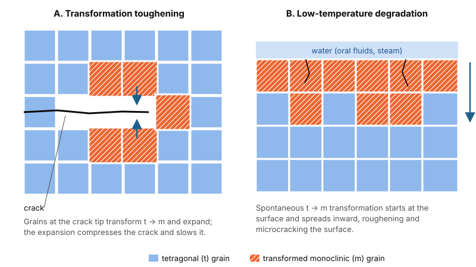
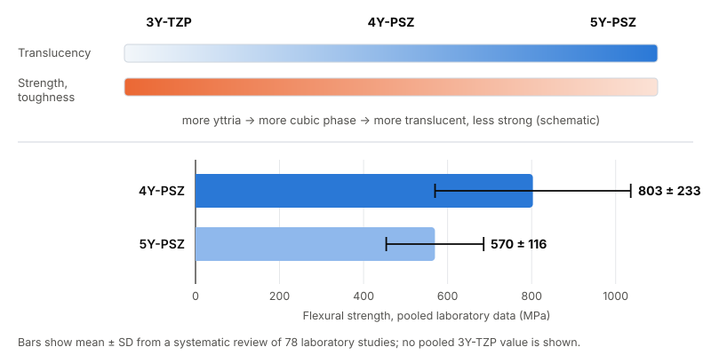
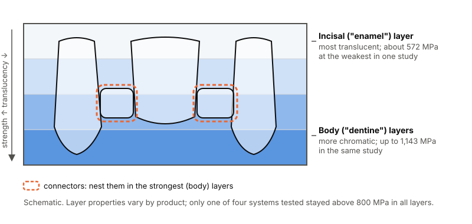

# Chapter 14. Zirconia

## Learning Objectives

After reading this chapter, you should be able to:

1. Explain the crystal phases of zirconia, transformation toughening, and how yttria content governs the balance between strength and translucency.
2. Distinguish the main generations of dental zirconia (3Y-TZP, 4Y-PSZ, 5Y-PSZ) and multilayer or gradient materials, and match each to its indications.
3. Describe how milling, sintering, adjustment and finishing affect the properties of a zirconia restoration.
4. Explain low-temperature degradation (ageing), what drives it, and how to minimise it.
5. Compare monolithic and veneered zirconia restorations, including wear of opposing teeth.
6. Apply an evidence-based protocol for cementing and bonding zirconia restorations.

---

## 14.1 Why Zirconia Matters in CAD/CAM

Zirconia is the material that made CAD/CAM indispensable. It cannot be pressed or cast like glass-ceramics or alloys. In routine practice it is **machined**; additive manufacturing of zirconia is discussed in Chapter 11. Zirconia was introduced in prosthetic dentistry for crowns and FDPs in combination with CAD/CAM techniques (Chapter 1) [1]. Today, zirconia is used for:

- monolithic and veneered single crowns and FDPs (Chapter 8);
- implant abutments, crowns, FDPs and complete-arch prostheses (Chapter 9);
- resin-bonded FDPs;
- ceramic implants (outside the scope of this book).

Zirconia is the strongest of the dental ceramics [2]. Its main drawbacks are **opacity** in its original form [2] and its lack of a glass phase, which means it **cannot be etched** like glass-ceramics (Section 14.7.1). Much of the material development in recent years has aimed to improve translucency without giving up too much strength [2].

---

## 14.2 Structure and Transformation Toughening

### 14.2.1 Crystal phases

Pure zirconium dioxide (ZrO₂) exists in three crystal forms, depending on temperature:

- **monoclinic (m)** at room temperature;
- **tetragonal (t)** at intermediate temperatures;
- **cubic (c)** at very high temperatures.

When pure zirconia cools from the tetragonal to the monoclinic phase, its volume increases by several percent **[UNVERIFIED]**, which cracks the material. To keep the tetragonal (or cubic) phase stable at room temperature, **stabilising oxides** are added. In dentistry this is almost always **yttria** (Y₂O₃); yttria-stabilised tetragonal zirconia polycrystal (Y-TZP) is the most widely used variant [2,3].

**Verification note — Minor conflict.** The marked claim above could not be confirmed.

| Claim not confirmed | Conflict | Reason | To resolve |
|---|---|---|---|
| Volume increase on t→m transformation | **Minor** | Uncited (the commonly cited value is about 3–5%) | A materials-science source |

### 14.2.2 Transformation toughening

In yttria-stabilised tetragonal zirconia, the tetragonal phase is **metastable**: it is stable at room temperature but can still change to monoclinic under stress. When a crack approaches, the stress at its tip triggers the t → m transformation in the surrounding grains. The local volume expansion compresses the crack and slows its growth. This mechanism, **transformation toughening**, explains the high fracture toughness and strength of zirconia [3] **[UNVERIFIED]**.

**Verification note — Minor conflict.** The marked claim above could not be confirmed.

| Claim not confirmed | Conflict | Reason | To resolve |
|---|---|---|---|
| Transformation-toughening mechanism | **Minor** | Ref 3 (Kelly & Denry 2008) has a one-sentence abstract; full text not checked | Full text of ref 3, or cite Zhang & Lawn (ref 2) |

The same metastability has a downside: under certain conditions the transformation can also happen **spontaneously** at the surface. This is **low-temperature degradation** (Section 14.5). Figure 14.1 contrasts the two.

**Figure 14.1** One transformation, two consequences. (A) Transformation toughening: tetragonal grains at a crack tip transform to the larger monoclinic phase, and the expansion compresses the crack [3] **[UNVERIFIED]**. (B) Low-temperature degradation: in the presence of water the same transformation starts spontaneously at the surface and spreads inward (Section 14.5). Schematic, not to scale.

**Verification note — Minor conflict.** The marked claim above could not be confirmed.

| Claim not confirmed | Conflict | Reason | To resolve |
|---|---|---|---|
| Transformation-toughening mechanism | **Minor** | Ref 3 (Kelly & Denry 2008) has a one-sentence abstract; full text not checked | Full text of ref 3, or cite Zhang & Lawn (ref 2) |

### 14.2.3 The strength–translucency trade-off

Light scattering in zirconia comes mainly from grain boundaries, pores, impurities and alumina additives, and from the optical anisotropy of tetragonal grains **[UNVERIFIED]**. Translucency can be increased by:

- reducing the **alumina** sintering aid [2];
- reducing **porosity** **[UNVERIFIED]**;
- adding **more yttria**, which introduces a proportion of optically isotropic **cubic** phase [2].

**Verification note — Minor conflict.** The marked claims above could not be confirmed.

| Claim not confirmed | Conflict | Reason | To resolve |
|---|---|---|---|
| Sources of light scattering | **Minor** | Uncited | Zhang & Lawn (ref 2) or a similar review |
| Lower porosity increases translucency | **Minor** | Uncited | Zhang & Lawn (ref 2) or a similar review |

Cubic grains scatter less light but do not undergo transformation toughening. More yttria therefore means **more translucency but less strength and toughness** [2,4,5]. In a laboratory study of additively manufactured partially stabilised zirconias, the material with more tetragonal phase and less yttria was stronger and tougher but less translucent, and more susceptible to ageing [5].

---

## 14.3 Generations of Dental Zirconia

The yttria content (in mol%) is commonly used to name the main classes (Table 14.1).

**Table 14.1** Main classes of dental zirconia

| Class | Yttria | Phase composition | Strength | Translucency | Typical indications |
|---|---|---|---|---|---|
| **3Y-TZP** (conventional, "high-strength") | ~3 mol% | Mainly tetragonal | Highest | Lowest (original); improved in later versions with less alumina | Frameworks, posterior monolithic crowns, long-span FDPs, implant frameworks, resin-bonded FDPs |
| **4Y-PSZ** (intermediate, "high-translucency") | ~4 mol% | Tetragonal + some cubic | Intermediate | Intermediate | Monolithic crowns; short-span FDPs |
| **5Y-PSZ** ("ultra-/super-translucent") | ~5 mol% | Substantial cubic content | Lowest of the three | Highest | Anterior monolithic crowns, veneers, inlays/onlays; limited FDP use |
| **Multilayer / gradient** | Varies by layer | Varies by layer | Varies by layer (Section 14.3.2) | Increasing towards incisal | "All-in-one" monolithic crowns and FDPs |

### 14.3.1 How strong are translucent zirconias?

A systematic review of 78 laboratory studies of commercial translucent zirconias found overall flexural strengths of **803 ± 233 MPa for 4Y-PSZ** and **570 ± 116 MPa for 5Y-PSZ** [4]. Specimen processing, surface treatment and test method significantly affected the 5Y-PSZ values but not the 4Y-PSZ values. The authors concluded that the data support 4Y-PSZ for three-unit FDPs, and 5Y-PSZ for three-unit FDPs only in the **anterior** region, based on the ISO 6872 classification [4].

**Figure 14.2** The strength–translucency trade-off. Top: adding yttria adds cubic phase, which raises translucency and lowers strength and toughness (schematic) [2,4,5]. Bottom: pooled flexural strength (mean ± SD) from a systematic review of 78 laboratory studies: 803 ± 233 MPa for 4Y-PSZ and 570 ± 116 MPa for 5Y-PSZ. Data from [4].

> **Evidence Box.** Laboratory strength values are not clinical survival data. They vary with specimen geometry, surface finish and test method [4]. Use them to rank materials and to understand the limits of each class, not to predict how long a restoration will last.

### 14.3.2 Multilayer and gradient zirconia

Multilayer blanks combine layers of different shade, yttria content or both, to mimic the natural gradient from a more chromatic, opaque cervical region to a more translucent incisal edge. Two main types exist:

- **Shade-gradient** blanks: the composition is uniform but the colour changes.
- **Composition-gradient** (strength-gradient) blanks: the yttria content changes between layers, for example a stronger 3Y or 4Y "dentine" body and a more translucent 5Y "enamel" layer.

The layers do not have the same properties. In a laboratory study of four commercial 4Y/5Y multilayer systems, the dentine layers reached flexural strengths of up to **1,143 MPa**, while the incisal layers fell to about **572 MPa**. Only one material stayed above 800 MPa in **all** layers. The authors stressed that strength differences between layers must be considered, especially for long-span restorations [6].

> **Lab Note.** Where the restoration sits in a multilayer blank (its **nesting** position) determines which layer ends up in the connector, the occlusal surface or the incisal edge. For FDPs, place connectors in the strongest (cervical/dentine) layers, and check the manufacturer's indications for each blank.

**Figure 14.3** Nesting an FDP in a composition-gradient multilayer blank. Incisal edges sit in the translucent top layer and connectors in the stronger body layers. In one laboratory study of four 4Y/5Y multilayer systems, body layers reached up to 1,143 MPa while incisal layers fell to about 572 MPa; only one material stayed above 800 MPa in all layers. Data from [6]. Schematic; layer arrangement varies by product.

---

## 14.4 Processing: Milling, Sintering and Finishing

### 14.4.1 Soft and hard machining

Most dental zirconia is milled in the **pre-sintered ("green" or "white") state**. In this state it is chalk-like and easy to machine. The restoration is milled oversized to allow for the roughly 20–25% linear shrinkage **[UNVERIFIED]** during sintering, which the CAM software calculates for each blank. **Hard machining** of fully sintered zirconia is also possible and avoids sintering shrinkage; the two routes differ in their possible clinical implications and consequences for long-term performance [1].

**Verification note — Major conflict.** The marked claim above could not be confirmed.

| Claim not confirmed | Conflict | Reason | To resolve |
|---|---|---|---|
| Same number as #20 | **Major** | No PubMed source found | Manufacturer data or a materials-science reference (fix both chapters together) |

### 14.4.2 Sintering programmes

Sintering densifies the material and sets its final grain size, phase composition, translucency and strength. **Speed and high-speed sintering** programmes shorten firing from hours to minutes. They are essential for chairside zirconia (Chapter 16). Evidence on their effects is mixed:

- In an in vitro study of two multilayer zirconias, speed sintering reduced biaxial flexural strength in all layers of one material and in the gradient layer of the other, and changed optical properties. The authors judged that the differences might not be clinically relevant [7].
- In a laboratory study of one composition-gradient and one shade-gradient multilayer zirconia from one manufacturer, sintering programme had no significant effect on density or flexural strength. Speed and especially high-speed programmes may have reduced the tetragonal-phase fraction in the composition-gradient material (limited sample) [8].

Use only the sintering programmes **validated by the manufacturer** for each material and furnace. Calibrate furnaces regularly (Chapter 12).

### 14.4.3 Adjustment, polishing and glazing

Grinding zirconia after sintering can introduce surface flaws and residual stresses and can trigger local phase transformation. In a laboratory study of multilayer zirconias from one manufacturer:

- **clinical adjustments** (grinding followed by polishing) reduced the flexural strength of the higher-yttria layers but not of the stronger body layer;
- **polishing** produced the lowest surface roughness for all materials and layers;
- the authors recommended **polishing** composition-gradient zirconia, and **polishing and glazing** shade-gradient zirconia with 5 mol% yttria or more. They advised caution when adjusting higher-yttria zirconia [9].

> **Clinical Tip.** Adjust monolithic zirconia as little as possible after sintering, especially translucent (4Y/5Y) materials. When you must adjust, use fine diamonds with water cooling, then polish with a zirconia-specific polishing sequence. A high-shine polish is better for the opposing teeth than a rough or worn glaze (Section 14.6.3).

---

## 14.5 Low-Temperature Degradation (Ageing)

### 14.5.1 What it is

**Low-temperature degradation (LTD)**, or ageing, is the slow, spontaneous t → m transformation at the surface of yttria-stabilised zirconia in the presence of water, at temperatures of interest for dentistry (room temperature to about 100 °C) [10,11]. It starts at the surface and progresses inwards (Figure 14.1B). It may also occur at the higher temperatures used in steam sterilisation, and can cause surface roughening, microcracking and, in severe cases, loss of strength **[UNVERIFIED]**.

**Verification note — Major conflict.** The marked claim above could not be confirmed.

| Claim not confirmed | Conflict | Reason | To resolve |
|---|---|---|---|
| Ageing during steam sterilisation and its damage | **Major** | Uncited general caution | An in vitro study of autoclaving zirconia |

LTD came to wide attention after a series of fractures of zirconia hip prostheses (femoral heads) in 2001–2002. A review of the episode found that zirconia varies strongly in its susceptibility to in vivo degradation, because **processing has a strong influence on ageing**, and that zirconias from different vendors have different process-related microstructures [10].

### 14.5.2 What drives it

A critical review identified three main factors [11]:

1. **stabiliser type and content**;
2. **residual stress**;
3. **grain size**.

The same review warned that extrapolating clinical lifetimes from accelerated ageing tests can lead to unacceptable conclusions. It proposed engineering guidelines for zirconia in dentistry [11]. In one laboratory study of two additively manufactured zirconias, the material with more tetragonal phase and less yttria was tougher but more susceptible to ageing [5].

### 14.5.3 Practical implications

- Use reputable materials with documented processing and quality control [10].
- Follow validated sintering programmes. Incorrect sintering alters grain size and phase composition.
- Minimise grinding after sintering, and polish any adjusted surfaces [9].
- Do not repeatedly steam-sterilise zirconia components unless the manufacturer permits it.
- Clinically, LTD has not emerged as a common cause of failure of dental restorations (expert opinion). The best long-term data for monolithic zirconia, however, still cover relatively short periods (Section 14.6).

---

## 14.6 Monolithic or Veneered?

### 14.6.1 The chipping problem

Early zirconia restorations were **veneered**: a zirconia framework (coping) was layered with feldspathic porcelain for aesthetics. Clinical studies showed that these restorations were prone to **chipping and fracture of the veneering porcelain** and to loss of retention (Chapters 8 and 9) [12,13]. High chipping proportions have also been reported on implants:

- In a systematic review of reconstructions on ceramic implants (eight studies, three of them on veneered zirconia), the estimated 5-year chipping proportion was **38% for veneered zirconia single crowns** and **57% for veneered zirconia FDPs**, against 2% for monolithic lithium disilicate crowns; with the limited data available, the authors could identify only tendencies [14].
- By contrast, for posterior implant crowns, a meta-analysis of four randomised trials found significantly less chipping with **monolithic** zirconia than with metal-ceramic crowns over one year (0% versus 7.6%) [15].

### 14.6.2 The move to monolithic zirconia

The answer to chipping was **monolithic** (full-contour) zirconia, made possible by more translucent zirconias, multilayer blanks and better staining techniques. Full-contour zirconia has steadily gained market share at the expense of bilayered designs [16].

The most recent systematic review of tooth-supported single crowns (64 studies; literature search 2014–2024 plus 30 studies from earlier reviews; 8,051 all-ceramic crowns) estimated 5-year survival of **96.8% for monolithic zirconia** and **97.3% for veneered zirconia**, comparable to metal-ceramic crowns (97.1%). Monolithic zirconia and monolithic lithium disilicate crowns had **significantly fewer ceramic fractures and chipping** than veneered alternatives [17].

Two 2026 meta-analyses add to this picture, and one partly conflicts with it. A meta-analysis of 17 clinical studies of tooth-supported **veneered zirconia FDPs** with at least 5 years' follow-up estimated survival of **92% at 5 years, 86% at 7 years and 83% at 10 years**; chipping of the veneering porcelain was the most frequent complication [18]. In contrast, a meta-analysis of 14 randomised trials comparing veneered zirconia with **metal-ceramic** restorations found a **lower** risk of chipping with veneered zirconia (risk ratio 0.59) and marginally higher survival (risk ratio 1.03). The certainty of that evidence was low, with substantial heterogeneity and small-study effects [19]. For single crowns, veneered zirconia therefore chips more than monolithic designs [17], but whether veneered zirconia chips more than metal-ceramic is not settled [19].

For implant FDPs and complete-arch restorations, Chapter 9 summarises evidence that monolithic zirconia reduces chipping compared with veneered designs [20].

### 14.6.3 Wear of opposing teeth

Early concerns that hard zirconia would wear opposing enamel have been eased for **polished** monolithic zirconia, although the evidence is limited:

- A systematic review of 16 studies found that zirconia caused significantly less antagonist wear than feldspathic porcelain, and that **polished surfaces caused less enamel wear than glazed surfaces** [21].
- An umbrella review of four systematic reviews (qualitative synthesis; a meta-analysis was not possible because of heterogeneity) concluded that the enamel wear caused by polished monolithic zirconia over time is equal to or less than that of natural enamel, and lower than that of metal-ceramic, feldspathic and lithium disilicate restorations [22].

Glazes wear away and can expose a rough zirconia surface beneath. This is another reason to polish carefully after any intraoral adjustment.

### 14.6.4 When to veneer

Veneering is still used where monolithic zirconia cannot reach the aesthetic standard required, for example on anterior teeth with high translucency and complex characterisation. To reduce chipping risk:

- use an **anatomically reduced framework** (cut-back design) that supports the porcelain evenly;
- keep the porcelain **thin and even**, and confine it to facial and incisal areas where possible (**micro-veneering**); for implant-supported restorations, the German S3 guideline states that micro-veneering and monolithic designs reduce chipping risks [20];
- leave **occlusal and functional contacts on zirconia**;
- follow the manufacturer's firing and slow-cooling protocols for the veneering ceramic.

---

## 14.7 Cementing and Bonding Zirconia

### 14.7.1 Why zirconia needs a different approach

Zirconia has no glass phase, so **hydrofluoric acid etching and silane do not work** as they do on glass-ceramics (Chapter 13). Retention depends on:

1. **preparation geometry** (for conventional cementation);
2. **micromechanical roughening**, usually by air-borne particle abrasion (APA);
3. **chemical adhesion** through phosphate monomers, especially **10-MDP**, which bond to zirconium oxide.

### 14.7.2 The evidence

- A systematic review and meta-analysis of 52 laboratory studies found that bond strength to zirconia depended significantly on surface conditioning, cement type, test method and ageing. Physicochemical conditioning increased adhesion, and **MDP-based resin cements** tended to give the highest bond strengths [23].
- A more recent systematic review of 15 in vitro studies of bonding protocols after artificial ageing concluded that **air-particle abrasion combined with a 10-MDP-containing primer** (or universal adhesive) gave the most durable bonding [24].
- A systematic review of anterior **single-retainer zirconia resin-bonded FDPs** found success rates over 80% over 3 to 10 years. Debonds were usually manageable by rebonding, and catastrophic fractures were rare. The authors recommended a two-step protocol of APA followed by 10-MDP [25].
- In a clinical study of 108 zirconia cantilever resin-bonded FDPs replacing incisors, the 10-year survival was **98.2%** and the success rate 92.0% [26]. A case report of three long-term single-retainer RBFDPs made of veneered alumina or zirconia ceramic, the longest followed for 26 years, used **50 µm alumina air-abrasion at 0.25 MPa** followed by a phosphate-monomer luting resin; the restorations did not debond. The authors concluded that bonding to oxide ceramics, including zirconia, is durable when adequate methods are used [27].

### 14.7.3 Contamination and cleaning

During try-in, saliva contaminates the intaglio surface. Phosphate groups in saliva bind to zirconia and block later MDP bonding. Water rinsing alone does not remove them reliably **[UNVERIFIED]**. In one laboratory study of saliva-contaminated monolithic zirconia crowns that had not been air-abraded beforehand and were luted with self-adhesive resin cements, neither the cleaning method alone nor the cement alone made a significant difference. The combination of a zirconium-oxide-containing **universal cleaning agent** and a 10-MDP-containing cement gave significantly the highest bond strength, and air–water spray gave the lowest mean of the cleaning methods [28]. Re-abrasion with alumina is an alternative where the manufacturer allows it. **Phosphoric acid** should not be used to clean zirconia before MDP bonding, because it leaves phosphate on the surface **[UNVERIFIED]**.

**Verification note — Major conflict.** The marked claims above could not be confirmed.

| Claim not confirmed | Conflict | Reason | To resolve |
|---|---|---|---|
| Saliva phosphate blocks MDP bonding; rinsing is not enough | **Major** | Widely taught but uncited (Ozkan Ata 2025 was rejected because of an implausible bond strength of 1768 MPa) | A bond-strength study on saliva contamination |
| Do not use phosphoric acid | **Major** | Widely taught but uncited (Ozkan Ata 2025 was rejected because of an implausible bond strength of 1768 MPa) | A bond-strength study on saliva contamination |

### 14.7.4 A practical protocol

**Table 14.2** Cementation and bonding of zirconia restorations

| Situation | Recommended approach |
|---|---|
| Retentive preparation (crown) | Conventional cement (glass-ionomer, resin-modified glass-ionomer) or self-adhesive resin cement; APA of intaglio recommended for self-adhesive resin cements [24] |
| Low-retention preparation, short walls, partial coverage | Adhesive bonding: APA + 10-MDP primer (or MDP-containing universal adhesive) + resin cement [23–25] |
| Resin-bonded FDP (single retainer) | APA (e.g., 50 µm alumina at low pressure) + MDP-containing luting resin [25–27]; rubber dam (expert opinion) |
| After intraoral try-in | Clean with a zirconia-specific cleaning agent [28] or re-abrade; avoid phosphoric acid **[UNVERIFIED]** |
| Ti-base bonding (implant) | Validated cement/primer system for zirconia and titanium (Chapter 9) |

**Verification note — Major conflict.** The marked claim above could not be confirmed.

| Claim not confirmed | Conflict | Reason | To resolve |
|---|---|---|---|
| Do not use phosphoric acid | **Major** | Widely taught but uncited (Ozkan Ata 2025 was rejected because of an implausible bond strength of 1768 MPa) | A bond-strength study on saliva contamination |

> **Clinical Tip.** Air-abrade zirconia with **fine alumina at low pressure** (expert opinion; one long-term case report used 50 µm alumina at 0.25 MPa [27]). Aggressive abrasion with coarse particles or high pressure can introduce surface damage, particularly in translucent 4Y/5Y materials. Follow the material manufacturer's parameters.

---

## 14.8 Zirconia Restorations: A Decision Summary

**Table 14.3** Choosing a zirconia class for common indications

| Indication | Suggested class | Comments |
|---|---|---|
| Posterior single crown, high load | 3Y-TZP or 4Y-PSZ monolithic, or composition-gradient multilayer | Polish well; minimum thickness per manufacturer |
| Anterior single crown | 4Y/5Y-PSZ monolithic or multilayer; or cut-back with micro-veneering | Consider glass-ceramics (Chapter 13) on light substrates |
| Discoloured abutment or metal post | Less translucent zirconia, or a zirconia framework with veneering | Masking ability matters more than translucency |
| Posterior three-unit FDP | 3Y-TZP or 4Y-PSZ [4] | Layer strengths differ [6]; place connectors in the strongest layers |
| Anterior three-unit FDP | 3Y/4Y; 5Y-PSZ only within manufacturer and ISO limits [4] | |
| Implant-supported FDP or complete-arch framework | 3Y-TZP | Only 3Y-TZP is supported by clinical evidence for implant-supported short-span FDPs and full-arch reconstructions [20] |
| Long-span tooth-supported FDP | 3Y-TZP | Expert opinion |
| Single-retainer resin-bonded FDP (incisor) | 3Y-TZP | APA + MDP bonding [25–27] |

---

## Key Points

- Zirconia gets its strength from **transformation toughening** of metastable tetragonal grains [3] **[UNVERIFIED]**. Higher yttria content adds **cubic** phase, which increases translucency but reduces strength and toughness [2,5].

**Verification note — Minor conflict.** The marked claim above could not be confirmed.

| Claim not confirmed | Conflict | Reason | To resolve |
|---|---|---|---|
| Transformation-toughening mechanism | **Minor** | Ref 3 (Kelly & Denry 2008) has a one-sentence abstract; full text not checked | Full text of ref 3, or cite Zhang & Lawn (ref 2) |

- In laboratory studies, mean flexural strength is about **800 MPa for 4Y-PSZ** and **570 MPa for 5Y-PSZ**. On ISO 6872 criteria, 5Y-PSZ three-unit FDPs should be limited to the anterior region [4].
- **Multilayer** blanks vary in strength between layers: in one laboratory study of four systems, dentine-layer means reached up to about 1,140 MPa and incisal layers fell to about 570 MPa, and only one system exceeded 800 MPa in all layers [6]. Nest restorations so that connectors sit in the strongest layers (expert recommendation).
- Follow **validated sintering programmes**. Speed sintering can change properties, but the effects may not be clinically relevant [7,8]. **Polish** after any adjustment, and adjust high-yttria zirconia with caution [9].
- **Low-temperature degradation** depends on stabiliser content, residual stress and grain size. It is strongly influenced by processing [10,11].
- **Monolithic** zirconia crowns have 5-year survival similar to metal-ceramic crowns, with significantly less chipping than veneered designs [17]. Polished zirconia appears to cause little wear of opposing enamel [21,22].
- Bond zirconia with **air-particle abrasion plus 10-MDP** [23–25]. After try-in, clean contaminated surfaces with a zirconia-specific cleaning agent [28]; avoid phosphoric acid **[UNVERIFIED]**.

**Verification note — Major conflict.** The marked claim above could not be confirmed.

| Claim not confirmed | Conflict | Reason | To resolve |
|---|---|---|---|
| Do not use phosphoric acid | **Major** | Widely taught but uncited (Ozkan Ata 2025 was rejected because of an implausible bond strength of 1768 MPa) | A bond-strength study on saliva contamination |

---

## Review Questions

1. Explain transformation toughening. Why does the same mechanism make zirconia susceptible to low-temperature degradation?
2. Why does increasing the yttria content of zirconia increase translucency but reduce strength?
3. According to a systematic review, what are the mean flexural strengths of 4Y-PSZ and 5Y-PSZ, and what are the implications for three-unit FDPs?
4. A technician nests a four-unit posterior FDP in a composition-gradient multilayer blank so that the connectors fall in the incisal layer. What is the risk, and how should it be corrected?
5. List three factors that drive low-temperature degradation, and three clinical or laboratory measures that limit it.
6. Summarise the evidence on chipping of veneered and monolithic zirconia restorations on teeth and on implants (Section 14.6).
7. A monolithic zirconia crown needs occlusal adjustment after cementation. Describe how to adjust and finish it to protect both the crown and the opposing tooth.
8. Describe a bonding protocol for a single-retainer zirconia resin-bonded FDP, including how to manage saliva contamination after try-in.

---

## References

1. Denry I, Kelly JR. State of the art of zirconia for dental applications. Dent Mater. 2008;24(3):299–307. doi:10.1016/j.dental.2007.05.007
2. Zhang Y, Lawn BR. Novel zirconia materials in dentistry. J Dent Res. 2018;97(2):140–7. doi:10.1177/0022034517737483
3. Kelly JR, Denry I. Stabilized zirconia as a structural ceramic: an overview. Dent Mater. 2008;24(3):289–98. doi:10.1016/j.dental.2007.05.005
4. Bernauer SA, Lirgg NM, Ioannidis A, Zitzmann NU, Rohr N. Flexural strength of translucent zirconia for single crowns and fixed dental prostheses — a systematic review. J Prosthodont Res. 2026;70(2):173–82. doi:10.2186/jpr.JPR_D_24_00277
5. Wang L, Wang K, Sheng Y, Hao Z, Tang W, Dou R. The effect of phase contents on the properties of yttria stabilized zirconia dental materials fabricated by stereolithography-based additive manufacturing. J Mech Behav Biomed Mater. 2024;150:106313. doi:10.1016/j.jmbbm.2023.106313
6. Lohbauer U, Schwarz M, Belli R. Flexural strength and clinical classification of different layers in 4/5Y-PSZ zirconia materials. J Funct Biomater. 2026;17(6):300. doi:10.3390/jfb17060300
7. Mohamed O, Kim H, Makowka S, AlMozayen A, Sawangsri K, Li R. Impact of speed sintering on the mechanical and optical properties of multilayered zirconia. J Prosthet Dent. 2025;133(1):280.e1–280.e6. doi:10.1016/j.prosdent.2024.09.030
8. Johansson C, Eqtesadi S, Fjellvåg AS, Larsson C, Papia E. Influence of sintering programs on microstructure, crystal phase composition, and optical and mechanical properties of multilayer zirconia. Dent Mater. 2026. doi:10.1016/j.dental.2026.09.012
9. Johansson C, Larsson C, Papia E. Biaxial flexural strength and surface characterization of multilayer zirconium dioxide after polishing, glazing and clinical adjustments. J Mech Behav Biomed Mater. 2025;166:106930. doi:10.1016/j.jmbbm.2025.106930
10. Chevalier J. What future for zirconia as a biomaterial? Biomaterials. 2006;27(4):535–43. doi:10.1016/j.biomaterials.2005.07.034
11. Lughi V, Sergo V. Low temperature degradation — aging — of zirconia: a critical review of the relevant aspects in dentistry. Dent Mater. 2010;26(8):807–20. doi:10.1016/j.dental.2010.04.006
12. Sailer I, Makarov NA, Thoma DS, Zwahlen M, Pjetursson BE. All-ceramic or metal-ceramic tooth-supported fixed dental prostheses (FDPs)? A systematic review of the survival and complication rates. Part I: Single crowns (SCs). Dent Mater. 2015;31(6):603–23. doi:10.1016/j.dental.2015.02.011
13. Pjetursson BE, Sailer I, Makarov NA, Zwahlen M, Thoma DS. All-ceramic or metal-ceramic tooth-supported fixed dental prostheses (FDPs)? A systematic review of the survival and complication rates. Part II: Multiple-unit FDPs. Dent Mater. 2015;31(6):624–39. doi:10.1016/j.dental.2015.02.013
14. Spitznagel FA, Balmer M, Wiedemeier DB, Jung RE, Gierthmuehlen PC. Clinical outcomes of all-ceramic single crowns and fixed dental prostheses supported by ceramic implants: a systematic review and meta-analyses. Clin Oral Implants Res. 2022;33(1):1–20. doi:10.1111/clr.13871
15. Tajti P, Solyom E, Czumbel LM, Szabó B, Fazekas R, Németh O, et al. Monolithic zirconia as a valid alternative to metal-ceramic for implant-supported single crowns in the posterior region: a systematic review and meta-analysis of randomized controlled trials. J Prosthet Dent. 2024;132(5):881–9. doi:10.1016/j.prosdent.2023.05.006
16. Spitznagel FA, Boldt J, Gierthmuehlen PC. CAD/CAM ceramic restorative materials for natural teeth. J Dent Res. 2018;97(10):1082–91. doi:10.1177/0022034518779759
17. Pjetursson BE, Pitta J, Balet A, Bjarnadottir GR, Sailer I, Romandini P. A systematic review and meta-analysis evaluating the survival, failure, and complication rates of metal-ceramic, veneered, and monolithic all-ceramic tooth-supported single crowns — Part 1. Int J Prosthodont. 2026;39(3):308–24. doi:10.11607/ijp.9633
18. Sengottaiyan AK, Bennani V, Veerasamy A. Survival and complication rates of tooth-supported veneered zirconia fixed partial dentures: a systematic review and metaanalysis. Int J Dent. 2026;2026:8282494. doi:10.1155/ijod/8282494
19. Abbasi B, Mohammadzadeh M, Rezaeiyazdi A, Farahi A, Kookhi NA, Nami M, et al. Survival and biological and technical complications of veneered zirconia-ceramic versus metal-ceramic restorations: a systematic review and meta-analysis. BMC Oral Health. 2026;26(1):2182. doi:10.1186/s12903-026-09551-5
20. Waltenberger L, Bishti S, Wolfart S. German S3 guideline on implant-supported all-ceramic restorations. Int J Implant Dent. 2025;11(1):53. doi:10.1186/s40729-025-00641-7
21. Ghaffari T, Rad FH, Goftari A, Pashazadeh F, Ataei K. Natural teeth wear opposite to glazed and polished ceramic crowns: a systematic review. Dent Res J (Isfahan). 2022;19:108. PMID:36605138
22. Shah N, Nerkar H, Badwaik P, Ahuja B, Malu R, Bhanushali N. An evaluation of antagonist enamel wear opposing full-coverage zirconia crowns versus other ceramics full-coverage crowns and natural enamel — an umbrella review. J Indian Prosthodont Soc. 2024;24(3):217–24. doi:10.4103/jips.jips_32_24
23. Özcan M, Bernasconi M. Adhesion to zirconia used for dental restorations: a systematic review and meta-analysis. J Adhes Dent. 2015;17(1):7–26. doi:10.3290/j.jad.a33525
24. Ayedi L, Riahi Z, Kalghoum I, Mejri O, Hadyaoui D. Which bonding protocol provides the most durable zirconia adhesion after in vitro artificial aging: a systematic review. J Contemp Dent Pract. 2025;26(12):1215–27. doi:10.5005/jp-journals-10024-3979
25. Al-Bermani ASA, Quigley NP, Ha WN. Do zirconia single-retainer resin-bonded fixed dental prostheses present a viable treatment option for the replacement of missing anterior teeth? A systematic review and meta-analysis. J Prosthet Dent. 2023;130(4):533–42. doi:10.1016/j.prosdent.2021.10.015
26. Kern M, Passia N, Sasse M, Yazigi C. Ten-year outcome of zirconia ceramic cantilever resin-bonded fixed dental prostheses and the influence of the reasons for missing incisors. J Dent. 2017;65:51–5. doi:10.1016/j.jdent.2017.07.003
27. Kern M, Gläser R. Single-retainer all-ceramic resin-bonded fixed dental prostheses: long-term outcomes in the esthetic zone. J Esthet Restor Dent. 2023;35(1):64–73. doi:10.1111/jerd.13001
28. Demir N, Genc O, Akkese IB, Malkoc MA, Ozcan M. Bonding effectiveness of saliva-contaminated monolithic zirconia ceramics using different decontamination protocols. Biomed Res Int. 2024;2024:6670159. doi:10.1155/2024/6670159
