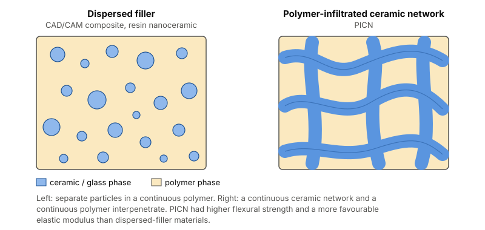
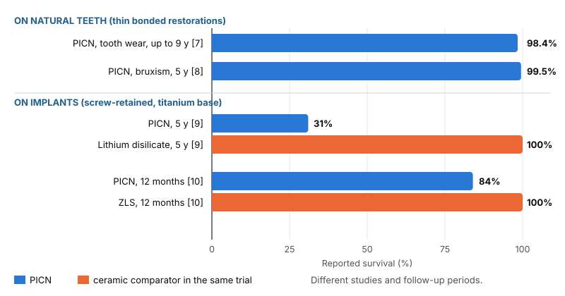
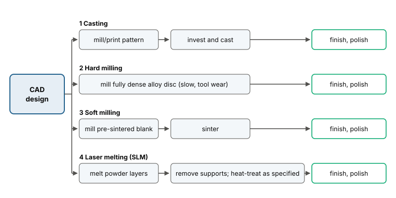

# Chapter 15. Resin-Based and Hybrid Materials; Metals

## Learning Objectives

After reading this chapter, you should be able to:

1. Describe the main families of CAD/CAM resin-based materials (CAD/CAM composites, resin nanoceramics and polymer-infiltrated ceramic networks) and explain how industrial polymerisation changes their properties.
2. Summarise the clinical evidence on resin-based and hybrid materials for tooth-supported and implant-supported restorations, and identify the indications where they perform well or poorly.
3. Select CAD/CAM PMMA and other polymers for interim and long-term provisional restorations.
4. Explain the properties, uses and limitations of high-performance polymers (PEEK and PEKK) in fixed and removable prosthodontics.
5. Compare cast, milled (hard and soft) and laser-melted or laser-sintered cobalt-chromium, and describe the use of CAD/CAM titanium.
6. Match these materials to indications using the clinical evidence rather than laboratory data alone.

---

## 15.1 Why This Group of Materials Matters

Chapters 13 and 14 deal with the two ceramic families that dominate CAD/CAM fixed prosthodontics: glass-ceramics and zirconia. This chapter covers everything else that is commonly milled or, increasingly, printed:

- **resin-based and hybrid materials** that combine a polymer matrix with ceramic fillers or a ceramic network;
- **polymers** such as PMMA for provisional restorations and dentures, and high-performance thermoplastics (PEEK and PEKK) for frameworks;
- **metals**, mainly cobalt-chromium (Co-Cr) and titanium, for frameworks, bars, abutments and removable partial denture (RPD) frameworks.

These materials have very different properties, but they share one point that runs through this chapter: **laboratory performance and clinical performance often disagree**. A material that looks excellent in a strength or fatigue test can debond, wear or fracture in particular clinical indications. Material choice must therefore be driven by **indication-specific clinical evidence** wherever it exists.

---

## 15.2 CAD/CAM Resin-Based and Hybrid Materials

### 15.2.1 What industrial processing changes

Composite resins have been used for indirect restorations for decades, first as "artisanal" laboratory composites. CAD/CAM composite blocks are different because they are polymerised industrially under controlled conditions. A critical review showed that high-temperature and, especially, **high-temperature–high-pressure** polymerisation significantly increases the degree of conversion compared with light-cured composites. Industrial processing also allows higher filler content and more homogeneous structures with fewer flaws, and some blocks release fewer monomers [1].

### 15.2.2 Two microstructures

CAD/CAM resin-based materials fall into two broad groups by microstructure [1]:

- **Dispersed-filler materials** (CAD/CAM composites and "resin nanoceramics"): ceramic or glass particles dispersed in a cross-linked polymer matrix, like a conventional composite but denser and better cured.
- **Polymer-infiltrated ceramic networks (PICN)**: a porous, pre-sintered ceramic network infiltrated with polymer, giving two interpenetrating continuous phases.

PICN materials showed higher flexural strength and a more favourable elastic modulus than dispersed-filler materials [1]. PICN blocks have high edge stability, which allows thin restoration margins to be milled [2]. Both groups can be **repaired** intraorally with composite. Figure 15.1 contrasts the two microstructures.

**Figure 15.1** Two microstructures of CAD/CAM resin-based materials. Dispersed-filler materials hold separate particles in a continuous polymer matrix; in PICN, a continuous ceramic network and a continuous polymer interpenetrate [1]. Schematic, not to scale.

**Table 15.1** CAD/CAM resin-based and hybrid materials

| Feature | Dispersed-filler CAD/CAM composite / resin nanoceramic | Polymer-infiltrated ceramic network (PICN) |
|---|---|---|
| Microstructure | Fillers dispersed in polymer matrix [1] | Ceramic network infiltrated by polymer [1] |
| Polymerisation | Industrial (high temperature, sometimes high pressure) [1] | Industrial infiltration and curing |
| Elastic modulus | Less favourable than PICN [1] | More favourable than dispersed-filler [1] |
| Milling | Thin margins possible | High edge stability; thin margins possible [2] |
| Firing needed | No | No |
| Repair | Easy with composite | Easy with composite |
| Typical bonding | Air abrasion or as instructed, adhesive cement | Hydrofluoric acid etching and silane, or as instructed |

### 15.2.3 Clinical evidence on natural teeth

The clinical record of resin-based and hybrid materials is **indication-dependent**:

- A systematic review and meta-analysis of 21 studies found that resin-matrix ceramics (PICN and resin nanoceramics) had **more complications than ceramics as full and partial crowns**. For **intracoronal restorations** (inlays and onlays), they showed complication rates similar to lithium disilicate and lower than direct composite. As **laminate and occlusal veneers**, they performed comparably to lithium disilicate [3].
- In a randomised controlled trial of posterior single crowns, 3-year survival was **100% for both lithium disilicate and PICN**, compared with 76.9% for feldspathic ceramic. PICN crowns accumulated significantly more plaque [4].
- In a clinical series of 581 PICN restorations (crowns, overlays, inlays and veneers) in 286 patients, with a mean observation period of 18.3 months, the overall success rate was 97.7%. There were 3 biological and 10 technical complications; the technical complications were debonding (7) and fracture (3) [5].
- A systematic review of chairside materials (2021–2026) found that PICN blocks resisted thermomechanical ageing comparatively well in laboratory studies. Clinical evidence was limited and did not allow definitive comparisons between material classes [6].

### 15.2.4 The "no-prep" approach to severe tooth wear

The low thickness at which PICN can be milled has enabled a minimally invasive approach to generalised tooth wear [1]. Thin bonded restorations are placed on unprepared or minimally prepared worn teeth to restore the vertical dimension:

- In a study of 580 PICN restorations in 24 patients followed for up to 9 years, Kaplan–Meier survival was **98.4%** (100% anterior, 96.7% posterior) and success was 79.7%. **Minor chipping** was the leading cause of failure. Fractures were 9.2 times more likely in the posterior region, particularly on molars or where the restoration was **thinner than 0.56 mm**. The authors recommended a minimum posterior thickness of 0.6 mm, especially at occlusal contacts [7].
- In a 5-year prospective profilometric study of 192 posterior PICN restorations in 7 patients with signs of bruxism, mean wear at occlusal contacts was about 28 µm. Survival was 99.5% and success 90.6% [8].

> **Clinical Tip.** For thin posterior restorations in hybrid materials, check the thickness map in the design software (Chapter 7) and keep **at least about 0.6 mm** at occlusal contacts [7]. Thin spots over contacts are where chipping starts.

### 15.2.5 Implant-supported crowns: a warning

On implants, without a periodontal ligament and often bonded to titanium bases, hybrid materials have performed **poorly** in several clinical trials:

- In a multicentre randomised trial of chairside screw-retained hybrid-abutment posterior crowns on titanium bases, 5-year survival was **100% for lithium disilicate but only 31% for PICN**, mainly because of non-recoverable partial debonding between years 3 and 5. The authors did not recommend that PICN set-up, while noting that the findings applied to their specific workflow [9].
- In a 12-month randomised trial of screw-retained implant crowns on titanium bases (42 of 62 crowns evaluated at one year), survival was **84% for PICN and 100% for zirconia-reinforced lithium silicate**. PICN also showed significantly greater occlusal wear (0.45 versus 0.16 mm) and more catastrophic fractures [10].
- In a 36-month randomised trial of hybrid-abutment crowns, peri-implant outcomes did not differ in a clinically relevant way between PICN and lithium disilicate. The authors drew attention to the higher technical complication rate of PICN reported separately for the same cohort [11].
- The German S3 guideline on implant-supported all-ceramic restorations concluded that polymer-infiltrated ceramics performed worse and **did not recommend** them for implant crowns [12].

> **Evidence Box.** The same PICN material that performs well as a thin bonded restoration on worn natural teeth [7,8] has performed poorly as a screw-retained crown bonded to a titanium base [9,10]. In one trial the main problem was partial debonding [9]; in the other it was fracture and wear [10]. Indication, support (tooth or implant) and bonding substrate matter as much as the material itself.

**Figure 15.2** Same material, different indication. Reported survival of PICN as thin bonded restorations on natural teeth [7,8] and as screw-retained crowns on titanium bases, beside the ceramic comparator in each implant trial [9,10]. The studies differ in design and follow-up, so the bars show the contrast, not a pooled estimate.

### 15.2.6 Summary of indications

**Table 15.2** Resin-based and hybrid materials: where the evidence stands

| Indication | Evidence | Recommendation |
|---|---|---|
| Inlays, onlays | Complications similar to lithium disilicate; fewer than direct composite [3] | Suitable |
| Laminate and occlusal veneers | Comparable to lithium disilicate [3] | Suitable |
| Thin restorations for tooth wear ("no-prep") | 98.4% survival up to 9 y; more fractures when < 0.56 mm [7]; 99.5% survival at 5 y in bruxism patients [8] | Suitable with ≥ 0.6 mm posteriorly |
| Single crowns on teeth | More complications than ceramics overall [3]; 100% 3-y survival in one RCT [4] | Second choice; may be considered where repairability matters (expert opinion) |
| Implant crowns | Poor survival in RCTs [9,10]; not recommended by S3 guideline [12] | Avoid |
| Multi-unit FDPs | Little evidence | Avoid as definitive material |

---

## 15.3 PMMA and Other Polymers for Provisional Restorations

### 15.3.1 Milled PMMA

Industrially polymerised **PMMA** blocks and discs are milled for provisional crowns, FDPs, diagnostic restorations and long-term provisionals, such as during implant healing or changes in vertical dimension. Industrial polymerisation gives them a denser, more fully cured material than chairside-mixed acrylics.

Two in vitro studies favour milled PMMA for strength:

- After thermal ageing, **milled PMMA** interim crowns had a mean fracture load of about 1,512 N. This was significantly higher than conventional direct composite (about 717 N), conventional autopolymerised PMMA (about 793 N) and a 3D-printed interim resin (about 582 N). Milled PMMA also fractured in a more favourable, less catastrophic pattern [13].
- In another in vitro study, milled PMMA crowns had the highest fracture strength (about 2,788 N), followed by stereolithography-printed bisphenol-based crowns (about 2,165 N) and PLA crowns made by fused deposition (about 2,089 N); the authors nevertheless judged PLA comparable overall [14].

These are laboratory values. They show the rank order of materials but not clinical survival, and printed resins are developing quickly (Chapter 11).

### 15.3.2 Polymers in complete-arch implant prostheses

PMMA and polyoxymethylene (POM) are also used for interim and some definitive complete-arch implant prostheses. A systematic review found that the short-term wear behaviour of PMMA and POM appeared comparable. Wear-related complications (severe wear, chipping, screw loosening and framework fracture) were more frequent with metal-acrylic complete-arch prostheses. **Bruxism and not wearing a protective occlusal device** were frequently associated with higher complication rates [15].

> **Clinical Tip.** Use milled PMMA when a provisional must last months rather than weeks, must be adjusted and re-polished repeatedly, or must test a new occlusal scheme. Scan the approved provisional; it becomes the design template for the definitive restoration (Chapter 7).

---

## 15.4 High-Performance Polymers: PEEK and PEKK

### 15.4.1 Properties

**Polyetheretherketone (PEEK)** and **polyetherketoneketone (PEKK)** belong to the polyaryletherketone (PAEK) family of thermoplastics. They are light, tough, biocompatible and much less rigid than metals or ceramics. Their elastic modulus is closer to bone and dentine, which is sometimes presented as a "shock-absorbing" advantage, though clinical proof of a benefit is limited. They are opaque and greyish or tooth-coloured, and usually need veneering for aesthetics. They are mainly milled from discs, though some can be pressed or printed.

### 15.4.2 Bonding and veneering

PAEK polymers are chemically inert and have low surface energy, so they need surface pretreatment before bonding:

- A systematic review and meta-analysis of 15 studies (in vitro evidence) on PEKK bonding to veneering materials found that surface pretreatment was **essential**. Air abrasion with alumina and sulfuric acid etching both significantly increased bond strength to composite and to lithium disilicate. Tribochemical silica coating also improved bonding. Non-thermal plasma did not significantly improve bonding to composite [16].

### 15.4.3 Colour stability

A systematic review of in vitro studies found that PEEK generally had better colour stability than PMMA, composite resins and polyamide, but was more susceptible to discoloration than zirconia. PEKK was more colour-stable than PEEK, which the authors attributed to its lower water sorption. Polishing protocols maintained colour stability, whereas glazing offered no significant advantage [17].

### 15.4.4 Fixed dental prostheses

A systematic review and meta-analysis of 14 in vitro studies found that **zirconia FDP frameworks had significantly higher fracture strength than PEEK frameworks**. Zirconia also showed a lower marginal gap, although results for marginal fit varied between studies, and PEEK showed higher shear bond strength. The certainty of evidence was low, and the authors stressed that the findings were hypothesis-generating rather than predictors of clinical performance [18].

### 15.4.5 Removable partial denture frameworks

PEEK has attracted most interest as a **metal-free alternative to Co-Cr RPD frameworks and clasps**, for patients who want to avoid metal for aesthetic reasons or because of allergy:

- A systematic review comparing PEEK with Co-Cr RPD frameworks found that studies were sparse (9 in vitro, 4 clinical). In the four in vitro studies that measured fit, PEEK frameworks showed a fit the authors judged comparable (mean gap about 43 µm versus about 131 µm for Co-Cr). Retention and patient satisfaction were similar [19].
- A second systematic review found that **retention forces and fatigue resistance were significantly lower for PEEK and titanium than for Co-Cr**, and titanium was less rigid. PEEK deformed less. Both materials showed adequate biocompatibility. The authors called for more clinical studies [20].

> **Lab Note.** In our view (expert opinion), because PEEK is much less rigid than Co-Cr, a PEEK RPD needs **bulkier major connectors and clasps** to achieve similar stiffness. Do not copy a Co-Cr framework design directly into PEEK. Removable prosthodontic design is covered in Chapter 18.

---

## 15.5 Metals in CAD/CAM

### 15.5.1 Cobalt-chromium: four manufacturing routes

Co-Cr alloys remain widely used for metal-ceramic copings and FDP frameworks, implant bars and, above all, RPD frameworks. In a CAD/CAM workflow, Co-Cr can be made in four ways:

1. **Casting** of a milled or printed wax or resin pattern (a hybrid digital–analogue route);
2. **Hard milling** of fully dense alloy discs;
3. **Soft milling** of pre-sintered ("soft") Co-Cr blanks, followed by sintering;
4. **Additive manufacturing** by selective laser melting (SLM) or selective laser sintering (SLS) of metal powder (Chapter 11).

**Figure 15.3** Four CAD/CAM routes to a cobalt-chromium restoration. All start from the same design; they differ in the material state that is machined or built and in the post-processing needed. Section 15.5.2 compares their fit. Schematic.

### 15.5.2 Fit and surface

The in vitro evidence on fit is mixed and depends on the process and alloy system:

- In an in vitro micro-CT study, **hard-milled** and **SLM** Co-Cr copings showed significantly larger marginal discrepancies than cast controls, whereas **milled-and-sintered** (soft-milled) copings showed smaller discrepancies. Results were sometimes specific to the alloy system [21].
- In another in vitro study, **laser-sintered** Co-Cr copings were rougher but had **better marginal and internal fit** than milled or milled-wax/cast copings. Retention in pull-off tests did not differ [22].
- In an in vitro study comparing five fabrication methods before and after porcelain firing, hard milling showed the largest discrepancy (about 90 µm). Casting (about 63 µm), selective laser sintering (about 62 µm) and soft milling (about 68 µm) were statistically similar. Porcelain firing *decreased* discrepancies, and all CAD/CAM techniques were judged suitable for clinical use, with selective laser sintering and soft milling recommended over SLM and hard milling because of their lower discrepancies [23].

The practical conclusion from these in vitro studies is that fit depends on the process and the alloy system, and the ranking of the routes differs between studies. One study judged all CAD/CAM techniques suitable for clinical use [23]; another judged only milled-and-sintered copings clinically acceptable [21]. In practice (expert opinion), hard milling of dense alloy is slower and wears tools, whereas soft milling and laser melting are efficient for most crowns, FDPs and RPD frameworks. Whichever route is used, results depend on the specific alloy and machine settings, so each laboratory or production centre must validate its process.

### 15.5.3 Titanium

Titanium (commercially pure or Ti-6Al-4V alloy) is used for implant abutments, titanium bases (Chapter 9), bars and complete-arch frameworks. Because titanium is difficult to cast with good fit, **milling** has become the standard route for titanium frameworks:

- In a review of 14 studies, CAD/CAM implant frameworks, whatever the material, fitted better than one-piece cast or laser-welded frameworks, and similarly to frameworks bonded to prefabricated cylinders (Chapter 9) [24].
- A narrative review of implant framework design described how milled titanium frameworks became popular with CAD/CAM. It highlighted the better fit of CAD/CAM frameworks compared with cast frameworks, the importance of cantilever length relative to anteroposterior implant spread, and I- and L-beam framework designs [25].
- In a retrospective study of 125 implant-supported fixed prostheses with milled titanium frameworks and individual all-ceramic crowns, cumulative prosthesis survival was 92.4% at 10 years and 100% at 5 years in the two groups (96% overall). **Crown fractures** were the most common mechanical complication [26].

Titanium is also printed by laser melting for some implant and maxillofacial applications (Chapters 11 and 19).

**Table 15.3** CAD/CAM metals compared

| Feature | Co-Cr | Titanium |
|---|---|---|
| Main uses | Metal-ceramic copings and FDPs; RPD frameworks; bars | Abutments; Ti-bases; bars; complete-arch frameworks |
| Manufacturing routes | Casting (digital pattern); hard milling; soft milling + sintering; SLM / SLS | Milling (standard); laser melting |
| Fit | In vitro: process- and alloy-dependent; all CAD/CAM routes judged suitable for clinical use in one study [21–23] | CAD/CAM milled better than cast [24] |
| Rigidity | High | Lower than Co-Cr [20] |
| Clinical record | Long, especially for RPDs | Good for milled implant frameworks [26] |
| Key complication | Veneer chipping (metal-ceramic) | Veneer or crown fracture on frameworks [26] |

---

## 15.6 Choosing Among These Materials

**Table 15.4** Material selection guide (this chapter's materials)

| Clinical need | First choice | Alternatives | Avoid |
|---|---|---|---|
| Posterior inlay / onlay | Glass-ceramic (Chapter 13) | CAD/CAM composite or PICN [3] | — |
| Thin restorations for generalised tooth wear | PICN, ≥ 0.6 mm posteriorly [7,8] | Lithium disilicate where space allows; CAD/CAM composite (expert opinion) | Thin posterior spots < 0.6 mm |
| Single crown on a tooth | Glass-ceramic or zirconia (Chapters 13–14) | PICN in selected cases [3,4] | — |
| Single implant crown | Lithium disilicate, ZLS or zirconia on Ti-base [9,10,12] | — | PICN [9,10,12] |
| Long-term provisional | Milled PMMA [13,14] | Printed interim resin (Chapter 11) | Chairside acrylic for long periods |
| Metal-free RPD framework | — | PEEK with adapted design [19,20] | Copying Co-Cr designs into PEEK |
| Conventional RPD framework | Co-Cr (cast, soft-milled, or laser-melted or laser-sintered; Chapter 18); fit evidence comes from in vitro crown copings only [21–23] | Titanium | — |
| Complete-arch implant framework | Milled titanium or zirconia (Chapter 9) [24–26] | Co-Cr | PEEK as definitive framework (no clinical evidence; in vitro, lower fracture strength than zirconia as an FDP framework [18]) |

---

## Key Points

- Industrial polymerisation gives CAD/CAM composites a **higher degree of conversion, higher filler content and fewer flaws** than direct or laboratory composites. **PICN** has higher flexural strength and a more favourable elastic modulus than dispersed-filler blocks [1].
- Resin-based and hybrid materials perform well for **inlays, onlays and veneers** but have more complications as **crowns** [3]. PICN allows very thin restorations for **tooth wear** [7,8], provided posterior thickness is at least about **0.6 mm** [7].
- On **implants**, PICN crowns bonded to titanium bases have shown **poor survival** in randomised trials and are **not recommended** [9,10,12].
- In two in vitro studies, **milled PMMA** interim crowns had the highest fracture strength of the materials tested [13,14]. In fixed implant-supported prostheses, bruxism and not wearing a protective occlusal device were frequently associated with higher complication rates [15].
- **PEKK** needs surface pretreatment before veneering [16]. In vitro, **PEEK** is less colour-stable than zirconia (PEKK more stable than PEEK) [17] and has lower fracture strength than zirconia as an FDP framework [18]. PEEK is a metal-free option for RPDs; reviews disagree on retention (similar [19] or lower [20] than Co-Cr), fatigue resistance was lower [20], and clinical studies are sparse [19].
- **Co-Cr** can be cast, hard-milled, soft-milled or laser-melted or laser-sintered. In vitro, fit depends on the process and alloy, and the ranking of routes differs between studies [21–23]. CAD/CAM implant frameworks fit better than one-piece cast ones [24], and one retrospective study of **milled titanium** frameworks reported 96% cumulative prosthesis survival [26].
- For all these materials, **indication-specific clinical evidence** should outweigh laboratory data.

---

## Review Questions

1. How does high-temperature–high-pressure polymerisation change the properties of CAD/CAM composite blocks compared with light-cured composites?
2. Describe the difference in microstructure between a dispersed-filler CAD/CAM composite and a polymer-infiltrated ceramic network. Which has the more favourable elastic modulus?
3. For which indications on natural teeth do resin-matrix ceramics perform comparably to lithium disilicate, and for which do they show more complications?
4. A patient with generalised tooth wear is to be restored with thin PICN restorations. What minimum posterior thickness is recommended, and why?
5. Summarise the randomised trial evidence on PICN implant crowns bonded to titanium bases. What does the German S3 guideline recommend?
6. Why might milled PMMA be preferred over chairside acrylic or a printed resin for a long-term provisional FDP?
7. Compare PEEK with Co-Cr for RPD frameworks in terms of fit, retention, fatigue and design.
8. List four ways of making a Co-Cr coping in a digital workflow, and summarise what the evidence says about their fit.

---

## References

1. Mainjot AK, Dupont NM, Oudkerk JC, Dewael TY, Sadoun MJ. From artisanal to CAD-CAM blocks: state of the art of indirect composites. J Dent Res. 2016;95(5):487–95. doi:10.1177/0022034516634286
2. Spitznagel FA, Boldt J, Gierthmuehlen PC. CAD/CAM ceramic restorative materials for natural teeth. J Dent Res. 2018;97(10):1082–91. doi:10.1177/0022034518779759
3. Alghauli MA, Al-Gabri RS, Keshk A, Mirah MA, Alqutaibi AY. Clinical complications and survival rate of resin matrix ceramic restorations: a systematic review and meta-analysis. J Esthet Restor Dent. 2025;37(7):1721–39. doi:10.1111/jerd.13471
4. Paqué PN, Saeed S, Fischer C, Ioannidis A, Jung RE, Naenni N. Three-year clinical performance of different monolithic single CAD/CAM crowns: a randomized controlled clinical trial. Int J Esthet Dent. 2025;20(4):394–409. PMID:41090893
5. Polat OD, Eyüboğlu TF, Özcan M. Survival and complication rates of polymer-infiltrated ceramic-network single-tooth restorations with an observation period of up to three years. Eur J Prosthodont Restor Dent. 2024;32(4):392–7. doi:10.1922/EJPRD_2525Polat06
6. Flueras R, Lile IE, Marian D, Popovici RA, Muntean C, Moleriu RD, et al. Advances in chairside and restorative dental materials: a systematic review of material properties, adhesive strategies, and long-term performance. J Funct Biomater. 2026;17(8):381. doi:10.3390/jfb17080381
7. Oudkerk J, Sanchez C, Grenade C, Vanheusden A, Mainjot A. The One-step No-prep technique for non-invasive full-mouth rehabilitation of worn dentition using PICN CAD-CAM restorations: up to 9-year results from a prospective and retrospective clinical study. Dent Mater. 2025;41(4):414–24. doi:10.1016/j.dental.2024.12.016
8. Oudkerk J, Herman R, Eldafrawy M, Wulfman C, Ernst M, Vanheusden A, et al. Intraoral wear of PICN CAD-CAM composite restorations used in severe tooth wear treatment: 5-year results of a prospective clinical study using 3D profilometry. Dent Mater. 2024;40(7):1056–63. doi:10.1016/j.dental.2024.05.015
9. Scherrer SS, Moráguez OD, Gavric J, Worni A, Mojon P. Multicenter RCT 5-year survival of screw-retained Cerec chairside-made hybrid abutment posterior ceramic crowns. Dent Mater. 2025;41(9):1151–66. doi:10.1016/j.dental.2025.06.024
10. Bagratuni M, Bruhnke M, Bohner L, Herklotz I, Beuer F, Böse MWH, et al. Clinical performance and occlusal wear of polymer-infiltrated ceramic network and zirconia-reinforced ceramic implant-supported single crowns fabricated via a digital workflow on two titanium implant systems: a 12-month prospective randomized trial. Int J Implant Dent. 2026;12(1):10. doi:10.1186/s40729-026-00671-9
11. Schnutenhaus S, Weinmann M, Olms C, Dreyhaupt J, Rathke A. Clinical and microbiological outcomes of implant-supported hybrid abutment crowns in the posterior region as a function of restorative material: exploratory results of a 36-month randomized clinical trial. Dent J (Basel). 2026;14(10):637. doi:10.3390/dj14100637
12. Waltenberger L, Bishti S, Wolfart S. German S3 guideline on implant-supported all-ceramic restorations. Int J Implant Dent. 2025;11(1):53. doi:10.1186/s40729-025-00641-7
13. Sarıkaya I, Koç T, Usta Kutlu İ. Fracture strength of conventional versus digital interim crowns after thermal cycling. BMC Oral Health. 2026;26(1):1773. doi:10.1186/s12903-026-09074-z
14. Doh RM, Choi WI, Kim SY, Jung BY. Mechanical properties of a polylactic 3D-printed interim crown after thermocycling. PLoS One. 2025;20(1):e0318217. doi:10.1371/journal.pone.0318217
15. Sanz E, Vasquez-Ramos S, Mosaddad SA, Revilla-León M, Gómez-Polo M. Prosthesis wear and complications in various materials used for fixed implant-supported prostheses: a systematic review. J Prosthet Dent. 2026;136(2):401–11. doi:10.1016/j.prosdent.2026.03.044
16. AlResayes SS, Sayed ME, Qadi KA, Khawaji SA, Alqarni H, Alsaeed AY, et al. The effect of surface treatment on the bonding properties of polyetherketoneketone (PEKK) polymer to veneering materials: a systematic review and meta-analysis. BMC Oral Health. 2026;26(1):2008. doi:10.1186/s12903-026-09199-1
17. Boustani P, Beyabanaki E, Taghavi-Damghani F. Evaluation of color stability of PEEK and PEKK dental materials: a systematic review. Clin Exp Dent Res. 2026;12(4):e70441. doi:10.1002/cre2.70441
18. Heboyan A, Saini RS, Binduhayyim RIH, Gurumurthy V, Vaddamanu SK, Alarcón-Sánchez MA, et al. Effectiveness of PEEK versus zirconia frameworks in fixed dental prostheses: a systematic review and meta-analysis. J Prosthet Dent. 2026;136(3):691–701. doi:10.1016/j.prosdent.2026.06.002
19. Srivastava G, Padhiary SK, Schimmel M, Schenk N, Çakmak G, Roccuzzo A, et al. Performance of polyetheretherketone (PEEK) versus cobalt chromium to fabricate removable partial denture frameworks: a systematic review. J Prosthet Dent. 2025;134(3):652.e1–652.e10. doi:10.1016/j.prosdent.2025.05.034
20. Bertotti K, Mwenge-Wambel J, Sireix C, Hüe O, Jeannin C, Grosgogeat B. Accurate analysis of titanium and PolyEtherEtherKetone materials as an alternative to cobalt-chrome framework in removable partial denture: a systematic review. Dent Mater. 2024;40(11):1854–61. doi:10.1016/j.dental.2024.07.036
21. Kim EH, Lee DH, Kwon SM, Kwon TY. A microcomputed tomography evaluation of the marginal fit of cobalt-chromium alloy copings fabricated by new manufacturing techniques and alloy systems. J Prosthet Dent. 2017;117(3):393–9. doi:10.1016/j.prosdent.2016.08.002
22. Lövgren N, Roxner R, Klemendz S, Larsson C. Effect of production method on surface roughness, marginal and internal fit, and retention of cobalt-chromium single crowns. J Prosthet Dent. 2017;118(1):95–101. doi:10.1016/j.prosdent.2016.09.025
23. Usta Kutlu İ, Hayran Y. Influence of various fabrication techniques and porcelain firing on the accuracy of metal-ceramic crowns. BMC Oral Health. 2024;24(1):845. doi:10.1186/s12903-024-04634-7
24. Abduo J. Fit of CAD/CAM implant frameworks: a comprehensive review. J Oral Implantol. 2014;40(6):758–66. doi:10.1563/AAID-JOI-D-12-00117
25. Drago C, Howell K. Concepts for designing and fabricating metal implant frameworks for hybrid implant prostheses. J Prosthodont. 2012;21(5):413–24. doi:10.1111/j.1532-849X.2012.00835.x
26. Maló P, de Araújo Nobre M, Borges J, Almeida R. Retrievable metal ceramic implant-supported fixed prostheses with milled titanium frameworks and all-ceramic crowns: retrospective clinical study with up to 10 years of follow-up. J Prosthodont. 2012;21(4):256–64. doi:10.1111/j.1532-849X.2011.00824.x
