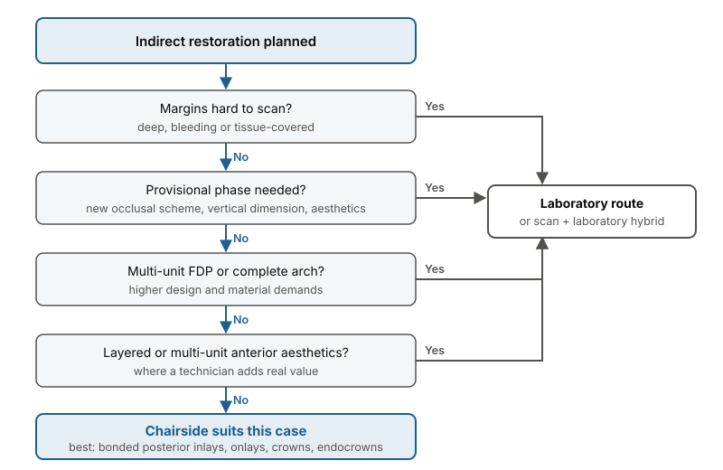
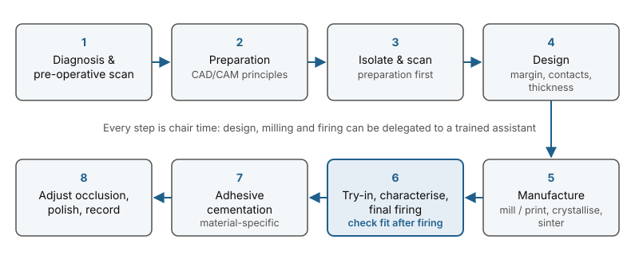
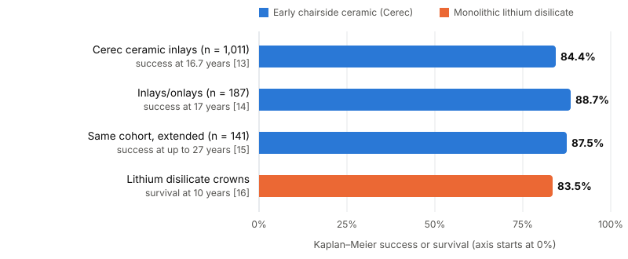

# Chapter 16. Chairside CAD/CAM in Restorative Dentistry

## Learning Objectives

After reading this chapter, you should be able to:

1. Select cases that suit single-visit chairside CAD/CAM, and recognise those better referred to a laboratory.
2. Carry out a chairside restoration step by step, from diagnosis to bonded, adjusted restoration.
3. Choose chairside materials and processing routes (milling, crystallisation, speed sintering, printing) for each indication.
4. Summarise the long-term clinical evidence for chairside restorations and the main reasons they fail.
5. Plan the integration of chairside CAD/CAM into a practice: equipment, time, cost and team training.

---

## 16.1 What "Chairside" Means

Chairside CAD/CAM has one of the longest clinical histories in dental CAD/CAM (Chapter 1). The CEREC system was conceived specifically so that a dentist could make and bond a ceramic restoration **at one appointment** [1]. Today a chairside workflow includes the full digital chain: intraoral scanning, design software, a compact mill (and increasingly a printer), and furnaces for crystallising glass-ceramics or sintering zirconia. The range of chairside materials runs from PMMA and composite resins to many ceramics [2].

The defining features of chairside work are:

- **one operator team** (dentist and assistant) controls every step;
- **one visit** for the patient, with no impression, no provisional and no second anaesthetic;
- **time pressure.** Every minute of design, milling and firing is chair time.

That last feature shapes every decision in this chapter. A chairside workflow succeeds when the case, material and process are chosen so that a high-quality restoration can be produced in the time available.

---

## 16.2 Case Selection

### 16.2.1 Good chairside cases

**Table 16.1** Case selection for chairside CAD/CAM

| Favourable | Less favourable | Usually better in a laboratory |
|---|---|---|
| Inlays, onlays, overlays, partial crowns on posterior teeth | Single anterior crowns needing modest characterisation | Multi-unit FDPs |
| Endocrowns on endodontically treated molars | Single implant crowns on Ti-bases | Complete-arch or full-mouth rehabilitation |
| Single posterior crowns | Veneers in low-demand aesthetic cases | High-demand anterior aesthetics (multiple units, layered ceramics) |
| Replacement of failed direct restorations | Cases needing a provisional phase (occlusal changes) | Changes to the vertical dimension of occlusion |
| Fractured cusps | Deep subgingival margins after elevation | Deep subgingival margins where tissue control is poor |

The best chairside cases are **bonded, defect-oriented posterior restorations**. This is also where the longest clinical evidence exists [3]. Glass-ceramics bonded adhesively are the main choice for inlays, onlays and posterior crowns [3].

### 16.2.2 Limits

Chairside CAD/CAM is less suitable when (Figure 16.1):

- **margins cannot be scanned** because they are deep, bleeding or covered by tissue. In an in vitro study, subgingival finish lines were not captured accurately even with cord retraction, and saliva reduced scanning trueness further, especially for subgingival margins (Chapter 4) [4];
- the case needs **a provisional phase**, for example to test a new occlusal scheme, vertical dimension or aesthetic change;
- the case needs **layered aesthetics** or multiple anterior units, where a technician's skills add real value;
- the case is a **multi-unit FDP or complete arch**, where design and material demands are higher (Chapters 8 and 9).

**Figure 16.1** A case-selection path for chairside CAD/CAM. A "yes" to any question favours the laboratory route (or a scan-plus-laboratory hybrid); the best chairside cases are bonded posterior restorations [3,4].

> **Clinical Tip.** Decide on chairside or laboratory production at the treatment-planning visit, not after preparation. Patients appreciate knowing whether they will leave with the final restoration that day.

---

## 16.3 The Single-Visit Workflow, Step by Step

Figure 16.2 summarises the eight steps described below.

**Figure 16.2** The single-visit chairside workflow. Step 6 is highlighted because firing changes fit, so the final fit check comes after the last firing [5].

### Step 1: Diagnosis and planning

- Confirm the indication and material, and check occlusion and space.
- Take a **pre-operative scan** of the quadrant and the opposing arch. It can be used to copy existing anatomy (Chapter 7) and as a record.
- Plan the appointment time: preparation, scanning, design, milling, firing and bonding.

### Step 2: Preparation

Follow the CAD/CAM preparation principles (Chapter 8): rounded internal angles, smooth walls, clear margins, enough reduction for the material, and supragingival margins where possible. Use deep margin elevation with composite if a proximal box would otherwise be subgingival.

### Step 3: Isolation and scanning

- Retract and control bleeding; isolate and dry.
- Scan the preparation **first**, then the neighbours, the opposing arch and the buccal bite (Chapter 4).
- Check the margin on screen in colour and monochrome, and rescan gaps before going further.

### Step 4: Design

- Define the margin; check the insertion axis and undercuts (Chapter 7).
- Use the pre-operative scan, a biogeneric proposal or an AI proposal as the starting shape.
- Check contacts, occlusion (light or no contact) and the thickness map.
- Apply the cement-space and milling settings validated for the chosen block and mill.

### Step 5: Manufacture

- **Milling or grinding** from a block sized for the restoration (Chapter 10).
- **Crystallisation** for partially crystallised glass-ceramics (for example, lithium disilicate milled in its intermediate state).
- **Speed sintering** for chairside zirconia.
- **Printing** for some resin-based definitive or interim restorations (Chapter 11).

### Step 6: Try-in, characterisation and firing

- Try in before final firing where the material allows. Check margins, contacts and occlusion (only lightly before bonding).
- Stain and glaze, or polish.
- Remember that **firing changes fit**. In an in vitro micro-CT study on polyurethane teeth, crystallisation of milled lithium disilicate crowns reduced the axial gap and increased the vertical marginal gap [5]. Make final fit checks **after** the last firing.

### Step 7: Adhesive cementation

- Condition the restoration as the material requires (Chapter 13 for glass-ceramics, Chapter 14 for zirconia, Chapter 15 for resin-based materials).
- Condition the tooth, isolate (rubber dam where possible) and bond.
- Remove excess cement carefully, especially interproximally.

A systematic review of chairside materials found that, in predominantly in vitro bonding studies, hydrofluoric-acid etching followed by silane gave the most consistent bond strengths to glass-ceramics. Air abrasion with alumina followed by an MDP-containing primer gave favourable bond strengths to zirconia. Universal adhesives showed promising laboratory performance on hybrid blocks but did not consistently match dedicated surface-conditioning protocols for glass-ceramics and zirconia [6].

### Step 8: Final adjustment and polishing

- Adjust occlusion **after** bonding. Use fine diamonds, then polish the adjusted ceramic thoroughly or re-glaze if the protocol allows.
- Take a final scan or photograph for the record.

**Table 16.2** Typical chairside time budget (illustrative; varies with device, material and operator)

| Phase | Main determinants of time |
|---|---|
| Preparation and isolation | Size of defect; need for margin elevation |
| Scanning | Quadrant extent; operator experience [7] |
| Design | Software automation; complexity of contacts and occlusion |
| Milling or printing | Material (glass-ceramic, zirconia, composite); mill speed; restoration size |
| Crystallisation or sintering | Material; furnace programme |
| Characterisation and bonding | Stain/glaze or polish; adhesive protocol |

> **Evidence Box.** Published times for complete chairside workflows vary widely and depend heavily on the equipment generation. A case report describing chairside fabrication of a monolithic multilayer zirconia crown, using superfast dry milling and speed sintering, gave a manufacturing time of about **60–75 minutes** [8]. This is a single case, and timings in other settings may differ.

---

## 16.4 Chairside Materials and Processing Routes

### 16.4.1 Glass-ceramics

- **Feldspathic ceramic blocks** were the original chairside material. They provide most of the long-term data (Section 16.5).
- **Leucite-reinforced** glass-ceramics are milled in their final state and simply polished or glazed.
- **Lithium disilicate** is commonly milled in a partially crystallised state and then crystallised in a furnace. This adds a firing cycle but gives higher strength.
- **Zirconia-reinforced lithium silicate** and newer "advanced" lithium disilicates offer similar options, some fully crystallised.

Glass-ceramics are etchable and bonded adhesively, which makes them the main choice for chairside inlays, onlays and posterior crowns [3]. Laboratory studies show favourable flexural strength for lithium disilicate and advanced lithium disilicate blocks [6]. Chapter 13 covers glass-ceramics in detail.

### 16.4.2 Zirconia

A case report showed that superfast dry milling and **speed sintering** make chairside fabrication of a monolithic zirconia crown possible within an acceptable timeframe [8]. Speed sintering is not without trade-offs:

- In an in vitro study of multilayer zirconia, a rapid sintering protocol produced colour changes above the perceptibility threshold in all layers, and above the acceptability threshold in the polished enamel layer. It also changed the crystal phase composition [9].
- Research continues into zirconia compositions designed for speed sintering, but these are not yet supported by clinical data [10].
- Clinical data on chairside, speed-sintered zirconia restorations are **still sparse**, and the manufacturer's indications, preparation and cementation instructions must be followed strictly [8].

Chapter 14 covers zirconia in detail.

### 16.4.3 Resin-based and hybrid blocks

Resin nanoceramics, polymer-infiltrated ceramic networks and CAD/CAM composites mill quickly, need no firing and are easy to repair. Polymer-infiltrated ceramic network blocks have **high edge stability**, so thin margins can be milled [3]. A systematic review found that resin-matrix ceramics (PICN and resin nanoceramics) performed well for intracoronal restorations and veneers, comparable to lithium disilicate inlays and onlays and better than direct composites. Full and partial **crowns** in these materials had more complications than ceramic crowns, so they are not a first choice for complete coverage [11]. Chapter 15 covers these materials.

### 16.4.4 Chairside printing

Printing is beginning to enter chairside practice for definitive restorations. In an in vitro comparison of single crowns, crowns **printed** chairside in a hybrid composite and **milled** in zirconia in a laboratory had significantly better marginal trueness than crowns **milled chairside** in lithium disilicate. However, two prosthodontists assessing the crowns on printed and plaster models found no significant differences in the quality of marginal closure or of interproximal and occlusal contacts between the three workflows. Time and cost trends favoured chairside printing [12]. These are in vitro results for one set of devices, and long-term clinical evidence for printed definitive crowns is still limited (Chapter 11).

---

## 16.5 Clinical Outcomes of Chairside Restorations

### 16.5.1 Long-term evidence

Some of the longest follow-up in dental CAD/CAM comes from chairside restorations (Chapter 1; Figure 16.3):

- **1,011 Cerec ceramic inlays** in a German practice had a Kaplan–Meier success probability of **84.4% at 16.7 years**. Ceramic and tooth fractures were the most common failures [13].
- **187 inlays and onlays** in a private practice had a success rate of **88.7% at 17 years** [14]. When the cohort was re-examined (141 of the 200 restorations placed), success was **87.5% after up to 27 years**. Three-surface restorations and molars had a higher risk of failure [15].
- **Chairside monolithic lithium disilicate posterior crowns** had a **10-year survival of 83.5%** (complication-free rate 71.0%; 26 of 41 crowns re-examined) in a prospective study. All failures and complications occurred on molars [16].

**Figure 16.3** Long-term outcomes of chairside restorations from single-practice and prospective studies. Success (inlays and onlays) and survival (crowns) are different end points and are not directly comparable; the Otto reports [14,15] use both terms for the same values. Data from [13–16].

### 16.5.2 Systematic reviews

- A meta-analysis of ceramic inlays, onlays and overlays (not limited to chairside) found survival of 92–95% at 5 years and 91% at 10 years. The main failures were fractures and chipping [17].
- A systematic review and meta-analysis of CAD/CAM restorations in randomised trials and prospective studies estimated 5-year survival rates of **85.6–100%** and 10-year survival of **71–100%**, with success rates lower than survival. The main contributors to failure were technical and biological complications [18].
- A systematic review of chairside materials found **high short-term survival** but could not make definitive comparisons between material classes. Longer prospective studies were needed, especially for advanced lithium disilicates and multilayer zirconias [6].
- Endocrowns, a typical chairside indication, showed clinical success of 94–100% in three clinical trials included in a systematic review [19].

### 16.5.3 Why chairside restorations fail

The chairside studies show these patterns:

- **Fracture** of ceramic or tooth, more often in **molars** [13–16]. Restoration size had no influence in one cohort [13]; in another, three-surface restorations had a higher failure risk than one-, two- and four-surface restorations [15];
- **endodontic complications** [17];
- **secondary caries and debonding**, each about 1% of failures in a meta-analysis of inlays, onlays and overlays [17].

> **Evidence Box.** Most long-term chairside data come from **single-practice case series** with first-generation equipment and feldspathic ceramics [13–15]. These studies show that machined, bonded ceramics can last for decades. They also carry operator and selection bias. Data for modern chairside materials are mostly short-term [6]; a 10-year prospective study of lithium disilicate crowns is an exception [16].

---

## 16.6 Integrating Chairside CAD/CAM into a Practice

### 16.6.1 What a chairside set-up involves

- Intraoral scanner and design software (Chapters 4 and 7).
- Mill, ideally able to handle the blocks you plan to use, and/or a printer (Chapters 10 and 11).
- Crystallisation, sintering or post-curing equipment as required.
- Staining and glazing materials and polishing systems.
- Space, power, water and extraction for the equipment.
- Software licences, service contracts, burs and other consumables.

### 16.6.2 Time and cost considerations

Chapter 20 covers general practice economics. For chairside work specifically (expert opinion; the limited evidence is summarised below):

- The main **cost** drivers are the capital equipment, licences and service, blocks, burs and furnace time.
- The main **savings** are laboratory fees, a second appointment, the provisional restoration and the second anaesthetic.
- **Chair time is the critical resource.** Design, milling and firing either occupy the dental chair or must be delegated to a trained assistant while the dentist treats another patient.
- **Case volume** determines whether the equipment pays for itself. A practice that does few indirect restorations, or mostly complex cases, may be better served by an intraoral scanner and a good laboratory.

Evidence on chairside economics is limited. In vitro, chairside printing showed favourable trends in time and cost compared with chairside milling and laboratory milling [12]. In a crossover study of 20 patients with implant crowns, a cost-minimisation analysis showed an 18% cost reduction for the digital workflow, with lower laboratory costs; the digital arm also used customised titanium abutments with CAD/CAM zirconia, against standard abutments with PFM crowns [20]. That was not a chairside study, but it illustrates where savings arise.

### 16.6.3 Patient-centred benefits

In a randomised trial of 42 patients needing crowns or FDPs, digital impressions caused far less discomfort than conventional impressions and took less time [21]. Chairside treatment adds the benefit of a single visit. Controlled studies directly comparing single-visit chairside treatment with two-visit laboratory treatment for patient-reported outcomes are scarce **[UNVERIFIED — no such trial was located in this review]**.

**Verification note — Minor conflict.** The marked claim above could not be confirmed.

| Claim not confirmed | Conflict | Reason | To resolve |
|---|---|---|---|
| Such trials are scarce | **Minor** | Says evidence is absent; the search was not exhaustive | A systematic PubMed search |

### 16.6.4 Team training

Chairside success depends on the whole team:

- **Scanning** is a learnable skill. Training was associated with better trueness (in vitro) and faster scanning, with no change in precision; the gain in scanning time was greater for inexperienced operators [7].
- **Design** skills develop with case volume. Begin with simple single-unit posterior cases.
- **Delegation** of scanning, design proposals, milling, firing and polishing to trained assistants frees the dentist's chair time, within local regulations.
- **Protocols** written for each material (block, mill settings, firing programme, conditioning and bonding) reduce variation and errors.
- **Audit.** Record remakes, adjustments and failures to identify problems early.

**Table 16.3** A staged introduction to chairside CAD/CAM

| Stage | Indications | Goals |
|---|---|---|
| 1. Familiarisation | Scans for documentation, study models, laboratory cases | Scanning skill; data handling |
| 2. Simple chairside | Posterior onlays, partial crowns, single crowns in glass-ceramic or hybrid material | Design and bonding routine; time control |
| 3. Extended chairside | Endocrowns, implant crowns on Ti-bases, selected anterior single units | Material range; characterisation |
| 4. Hybrid with laboratory | Complex and aesthetic cases designed or finished by the laboratory | Use each route for what it does best |

---

## Key Points

- Chairside CAD/CAM makes **single-visit** indirect restorations possible [1,2]. Its best indications are **bonded posterior inlays, onlays, partial crowns, endocrowns and single crowns** [3,19].
- Avoid chairside work for **unscannable margins** [4]. Cases needing a provisional phase, multi-unit FDPs and high-demand anterior aesthetics are usually better made in a laboratory (expert opinion).
- The workflow is diagnosis → preparation → scan → design → manufacture (mill/print, crystallise/sinter) → try-in, characterisation and final firing → bond → adjust. **Check fit after the final firing** [5].
- Bonding is material-specific. In mostly in vitro studies, HF etching plus silane gave the most consistent bond strengths to glass-ceramics, and air abrasion plus MDP primer favourable bond strengths to zirconia; clinical studies are still needed [6].
- Chairside **speed-sintered zirconia** is possible but has limited clinical data [8,10] and, in vitro, can show colour and phase changes [9].
- Long-term data for chairside ceramic inlays and onlays show **84–89% success at 16–27 years** [13–15], and chairside lithium disilicate crowns **83.5% survival at 10 years** [16]. In the chairside cohorts, failures occurred more often in molars and were mainly fractures [13–16]; a meta-analysis of ceramic inlays, onlays and overlays found no significant effect of tooth type [17].
- Economics depend on case volume, chair time and delegation. Training is associated with better scanning trueness and speed [7].

---

## Review Questions

1. List three ideal and three unsuitable indications for chairside CAD/CAM, with a reason for each.
2. Describe the steps of a chairside lithium disilicate onlay appointment, from pre-operative scan to final polish.
3. Why should the final fit of a lithium disilicate restoration be checked after crystallisation rather than before?
4. Compare the bonding protocols for glass-ceramic, zirconia and resin-based chairside restorations.
5. What are the advantages and limitations of chairside speed-sintered zirconia crowns?
6. Summarise the long-term survival evidence for chairside feldspathic inlays and onlays and for chairside lithium disilicate crowns. What are the main methodological limitations?
7. A practice places about two indirect posterior restorations per month. Would you recommend investing in a full chairside system? Justify your answer.
8. Design a staged training programme for a dentist and assistant who are new to chairside CAD/CAM.

---

## References

1. Mörmann WH. The evolution of the CEREC system. J Am Dent Assoc. 2006;137 Suppl:7S–13S. doi:10.14219/jada.archive.2006.0398
2. Blatz MB, Conejo J. The current state of chairside digital dentistry and materials. Dent Clin North Am. 2019;63(2):175–97. doi:10.1016/j.cden.2018.11.002
3. Spitznagel FA, Boldt J, Gierthmuehlen PC. CAD/CAM ceramic restorative materials for natural teeth. J Dent Res. 2018;97(10):1082–91. doi:10.1177/0022034518779759
4. An H, Mickesh GJ, Cho D, Sorensen JA. Effect of finish line location and saliva contamination on the accuracy of crown finish line scanning. J Prosthodont. 2024;33(1):86–94. doi:10.1111/jopr.13658
5. De Freitas BN, Tonin BSH, Macedo AP, Dos Santos TMP, De Mattos MDGC, Hotta TH, et al. Adaptation accuracy of milled lithium disilicate crowns: a 2D and 3D microCT analysis. J Esthet Restor Dent. 2020;32(4):403–9. doi:10.1111/jerd.12574
6. Flueras R, Lile IE, Marian D, Popovici RA, Muntean C, Moleriu RD, et al. Advances in chairside and restorative dental materials: a systematic review of material properties, adhesive strategies, and long-term performance. J Funct Biomater. 2026;17(8):381. doi:10.3390/jfb17080381
7. Limones A, Morton D, Sallorenzo A, Lin WS, Sadid-Zadeh R, Phasuk K, et al. Impact of operator experience on intraoral digital scanning: a systematic review, meta-analysis, and meta-regression. Report of the Committee on Research in Fixed Prosthodontics of the American Academy of Fixed Prosthodontics. J Prosthet Dent. 2026;135(2):297.e1–297.e13. doi:10.1016/j.prosdent.2025.09.008
8. Rinke S, Metzger A, Ziebolz H. Multilayer super-translucent zirconia for chairside fabrication of a monolithic posterior crown. Case Rep Dent. 2022;2022:4474227. doi:10.1155/2022/4474227
9. Miličić Lazić M, Jović Orsini N, Lazarević M, Jokanović V, Marjanović V, Grgur BN. Optical, structural, and biological characteristics of rapid-sintered multichromatic zirconia. Biomedicines. 2025;13(10):2361. doi:10.3390/biomedicines13102361
10. Vettorel A, Van Meerbeek B, Vleugels J, Zhang F. New speed-sintered CaO-zirconia for strong, tough, translucent restorations. J Dent Res. 2026;105(13):1738–46. doi:10.1177/00220345261435597
11. Alghauli MA, Al-Gabri RS, Keshk A, Mirah MA, Alqutaibi AY. Clinical complications and survival rate of resin matrix ceramic restorations: a systematic review and meta-analysis. J Esthet Restor Dent. 2025;37(7):1721–39. doi:10.1111/jerd.13471
12. Mangano FG, Cianci D, Pranno N, Lerner H, Zarone F, Admakin O. Trueness, precision, time-efficiency and cost analysis of chairside additive and subtractive versus lab-based workflows for manufacturing single crowns: an in vitro study. J Dent. 2024;141:104792. doi:10.1016/j.jdent.2023.104792
13. Reiss B. Clinical results of Cerec inlays in a dental practice over a period of 18 years. Int J Comput Dent. 2006;9(1):11–22. PMID:16608051
14. Otto T, Schneider D. Long-term clinical results of chairside Cerec CAD/CAM inlays and onlays: a case series. Int J Prosthodont. 2008;21(1):53–9. PMID:18350948
15. Otto T. Up to 27-years clinical long-term results of chairside Cerec 1 CAD/CAM inlays and onlays. Int J Comput Dent. 2017;20(3):315–29. PMID:28852748
16. Rauch A, Reich S, Dalchau L, Schierz O. Clinical survival of chair-side generated monolithic lithium disilicate crowns: 10-year results. Clin Oral Investig. 2018;22(4):1763–9. doi:10.1007/s00784-017-2271-3
17. Morimoto S, Rebello de Sampaio FBW, Braga MM, Sesma N, Özcan M. Survival rate of resin and ceramic inlays, onlays, and overlays: a systematic review and meta-analysis. J Dent Res. 2016;95(9):985–94. doi:10.1177/0022034516652848
18. Lampl S, Gurunathan D, Krithikadatta J, Mehta D, Moodley D. Reasons for failure of CAD/CAM restorations in clinical studies: a systematic review and meta-analysis. J Contemp Dent Pract. 2023;24(2):129–36. doi:10.5005/jp-journals-10024-3472
19. Sedrez-Porto JA, Rosa WLO, da Silva AF, Münchow EA, Pereira-Cenci T. Endocrown restorations: a systematic review and meta-analysis. J Dent. 2016;52:8–14. doi:10.1016/j.jdent.2016.07.005
20. Joda T, Brägger U. Digital vs. conventional implant prosthetic workflows: a cost/time analysis. Clin Oral Implants Res. 2015;26(12):1430–5. doi:10.1111/clr.12476
21. Gjelvold B, Chrcanovic BR, Korduner EK, Collin-Bagewitz I, Kisch J. Intraoral digital impression technique compared to conventional impression technique: a randomized clinical trial. J Prosthodont. 2016;25(4):282–7. doi:10.1111/jopr.12410
