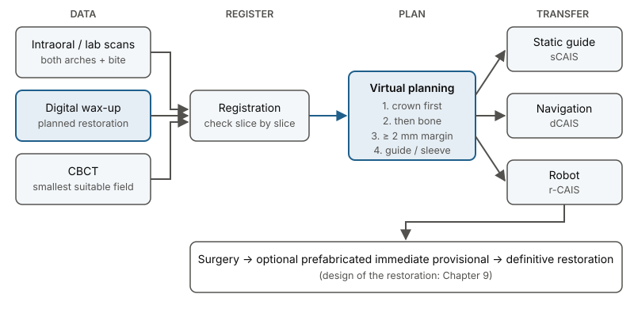
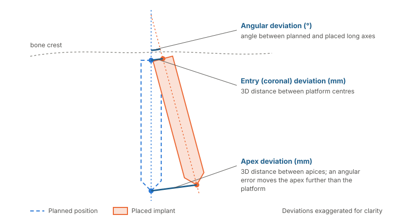
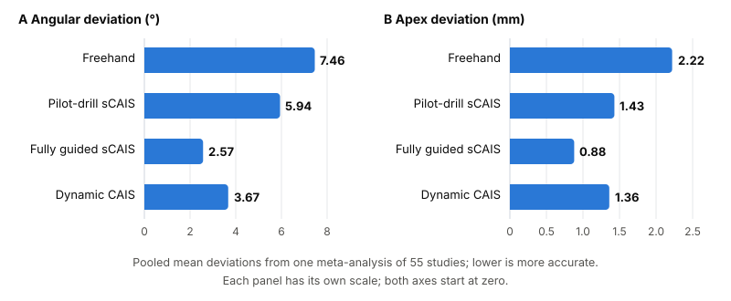

# Chapter 17. Digital Implant Dentistry

## Learning Objectives

After reading this chapter, you should be able to:

1. Describe a prosthetically driven digital implant planning workflow, from data acquisition to the surgical plan.
2. Classify static surgical guides by their support (tooth, mucosa or bone) and by their level of guidance (pilot drill or fully guided), and explain how each affects accuracy.
3. Summarise the evidence on the accuracy of static, dynamic and robotic computer-assisted implant surgery, and apply an appropriate safety margin.
4. Explain how dynamic navigation and robotic systems work, and where they currently fit in practice.
5. Plan immediate provisionalisation with prefabricated CAD/CAM restorations.
6. Outline digital workflows for the edentulous arch, including guide stabilisation and immediate fixed provisional prostheses.

---

## 17.1 From "Bone-Driven" to "Prosthetically Driven"

Early implant dentistry placed implants where bone allowed, then adapted the restoration to the result. Digital implant dentistry reverses this. The planned **restoration** determines where the implant should go, and the bone is assessed for whether it can accommodate that position or needs augmentation.

Digital implant dentistry has moved from two-dimensional radiographs, freehand placement and conventional impressions to a data-driven discipline. It combines CBCT, intraoral scanning, virtual planning, guided surgery and CAD/CAM prosthetics, and is now moving towards AI-assisted planning, robotics and a lifelong "digital twin" of the patient [1]. This chapter covers the surgical side of that chain. Chapter 6 covers CBCT and its registration with surface scans. Chapter 9 covers the design of the implant restoration itself.

The umbrella term for planning-based placement is **computer-assisted implant surgery (CAIS)**. It has three forms:

- **Static CAIS (sCAIS):** a surgical guide (template), made by printing or milling, directs the drills and sometimes the implant.
- **Dynamic CAIS (dCAIS):** real-time optical tracking shows the drill position on screen against the plan. This is "navigation".
- **Robotic CAIS (r-CAIS):** a robotic arm holds, constrains or moves the handpiece according to the plan.

---

## 17.2 The Digital Planning Workflow

### 17.2.1 Data acquisition

A typical workflow (Figure 17.1) combines:

1. **Intraoral or laboratory scans** of both arches and the bite (Chapters 4 and 5).
2. **A diagnostic wax-up** or tooth set-up of the planned restoration, designed digitally on the scan (Chapter 7) or scanned from a physical wax-up.
3. **CBCT** of the implant site. Use the smallest field of view and lowest dose that answer the clinical question. Effective doses vary about 20-fold between devices and protocols, mainly with field size (Chapter 6) [2]. In an in vitro study of anterior maxillary sites, smaller CBCT fields of view, smaller scan areas and smaller guides did not reduce the accuracy of static guided surgery [3].

**Figure 17.1** The prosthetically driven digital implant planning workflow. The wax-up of the planned restoration drives implant position; the plan is transferred by static, dynamic or robotic computer-assisted surgery [1,4].

### 17.2.2 Registration

The CBCT volume is registered with the surface scan and the wax-up. Fully automatic AI-based registration was as accurate as manual methods in patients without restorations. Artefacts from restorations and free-ended edentulous areas reduced accuracy and made operator experience more important [4]. Check every registration slice by slice before planning (Chapter 6).

### 17.2.3 Virtual planning

In the planning software, the clinician:

- places a **library implant** of the intended system, diameter and length;
- positions it relative to the **planned restoration** (screw access, emergence profile, restorative space; see Chapter 9) and to the **bone** (buccal and lingual thickness, sinus, nerve, adjacent roots);
- sets a **safety margin** to vital structures (Section 17.4.4);
- plans any augmentation needed;
- selects a **sleeve system** and guide design.

> **Clinical Tip.** Plan the implant from the crown down, not from the bone up. Start by deciding where the screw access, emergence profile and crown margin should be, then check whether the bone allows it. If it does not, decide on augmentation or a different restorative concept *before* surgery, not during it.

---

## 17.3 Static Surgical Guides

### 17.3.1 Classification by support

**Table 17.1** Static surgical guides by type of support

| Support | Typical use | Stabilisation | Accuracy relative to others [5] |
|---|---|---|---|
| **Tooth-supported** | Partially edentulous arches | Rests on remaining teeth; windows to check seating | Most accurate group, with mucosa-supported |
| **Mucosa-supported** | Edentulous arches (flapless) | Rests on mucosa; fixation pins; bite index for positioning | Similar to tooth-supported; better than bone-supported |
| **Bone-supported** | Edentulous arches after flap elevation | Rests on exposed bone; fixation screws | Significantly larger angular, entry and apex deviations |

A systematic review and meta-analysis found that **bone-supported** guides had significantly greater deviations in angle, entry point and apex than **tooth-supported** guides. **Mucosa-supported** guides were also more accurate than bone-supported guides, and did not differ significantly from tooth-supported ones [5]. The support tissue influences the accuracy of guided surgery [5].

### 17.3.2 Classification by level of guidance

- **Pilot-drill guided:** only the first drill is guided. The osteotomy is completed and the implant placed freehand.
- **Partially guided:** some drills are guided. The implant is placed freehand.
- **Fully guided:** all drills **and** the implant insertion are guided through the sleeve.

A systematic review and meta-analysis of 55 studies reported mean angular, entry and apex deviations (defined in Figure 17.2; see also Figure 17.3) of [6]:

- **7.46°, 1.56 mm and 2.22 mm** for freehand placement;
- **5.94°, 1.13 mm and 1.43 mm** for pilot-drill guided sCAIS;
- **2.57°, 0.72 mm and 0.88 mm** for fully guided sCAIS;
- **3.67°, 1.01 mm and 1.36 mm** for dynamic CAIS.

Fully guided sCAIS was the most accurate approach and was significantly more accurate than dCAIS at the entry point [6].

**Figure 17.2** How implant placement accuracy is measured: entry (coronal) deviation, apex deviation and angular deviation between the planned and the placed implant. Deviations are exaggerated for clarity.

**Figure 17.3** Mean angular (A) and apex (B) deviations by placement technique, from one meta-analysis of 55 studies. Fully guided static surgery was the most accurate. Data from [6]. Laboratory studies with novice operators confirm the advantage of full guidance:

- Undergraduate students placing implants through printed guides had a mean angular deviation of 2.24° with full guidance and 4.51° with pilot-drill guidance. Full guidance took longer (about 15 versus 10 minutes) [7].
- Novice clinicians placing implants in narrow anterior ridges were most accurate with full guidance, then pilot guidance, then freehand. In the freehand group, 23.3% of implants had apical fenestrations and 23.3% could not be restored with a screw-retained prosthesis. All fully guided implants were covered with bone and could be screw-retained [8].
- In another model study with novice clinicians, fully guided placement was more accurate than pilot-guided or freehand placement, and its accuracy was not affected by whether the implant was placed immediately or in a healed ridge [9].

### 17.3.3 Manufacturing the guide

Guides are designed in the planning software and printed (Chapter 11) or milled. In an in vitro study, guides made with three different printing technologies (stereolithography, PolyJet and MultiJet) produced similar implant accuracy. Median angular deviations were 1.1–1.3°, entry offsets about 0.2 mm and apex offsets about 0.3 mm, with no significant differences between printers [10].

> **Lab Note.** Print surgical guides with a validated, biocompatible guide resin. Post-cure fully and disinfect or sterilise according to the resin manufacturer's instructions. Check the guide on a printed model of the arch before it goes to the surgery: look for rocking, sleeve seating and inspection windows.

### 17.3.4 Sources of error in static guided surgery

Errors accumulate along the chain:

1. Data acquisition: CBCT resolution and artefacts, scan accuracy.
2. Registration of CBCT and surface scan.
3. Planning (implant library and positioning).
4. Guide manufacture: printing accuracy, post-curing, sleeve insertion.
5. Guide seating and stability during surgery, especially on mucosa or bone.
6. Tolerance between the drill and the sleeve (mechanical play).
7. Surgical technique, bone density and insertion forces.

The type of support (Section 17.3.1), the degree of guidance (Section 17.3.2) and full versus partial edentulism (Section 17.4.1) are the factors with the clearest evidence.

---

## 17.4 How Accurate Is Guided Implant Surgery?

### 17.4.1 Static CAIS

A systematic review and meta-analysis of 20 clinical studies (2,238 implants in 471 patients) reported mean errors of **1.2 mm at the entry point, 1.4 mm at the apex and 3.5° in angle**. Accuracy was significantly better in **partially edentulous** than in fully edentulous cases. The authors concluded that sCAIS accuracy is clinically acceptable in most situations, but that a **safety margin of at least 2 mm** should be respected [11].

### 17.4.2 Dynamic CAIS (navigation)

A systematic review and meta-analysis of 24 studies covering nine navigation systems found clinical mean deviations of **3.68° (angular)** and **1.03 mm (3D entry)**. In vitro deviations were lower (2.01° and 0.46 mm). dCAIS was significantly more accurate than freehand placement (mean difference −4.33°) and slightly more accurate in angle than sCAIS (−0.86°). The authors also recommended a 2 mm safety margin, because deviations greater than 1 mm occurred [12].

The comparison between static and dynamic guidance is not settled:

- A 2025 meta-analysis of eight comparative studies found **no significant differences** between dCAIS and sCAIS in platform, apex or angular deviation, especially after outliers were excluded. The authors concluded that the two are equivalent in 3D accuracy [13].
- A systematic review found that dynamic and static navigation were equally accurate and both more accurate than freehand placement. **No benefit in implant survival** over the first 5 years was shown for any method. It recommended navigation for especially complex cases [14].
- The 55-study meta-analysis above found fully guided sCAIS the most accurate overall [6].

### 17.4.3 Robotic CAIS

Robotic systems range from **haptic** (the robot constrains the surgeon's movements to the planned path) to **semi-autonomous** and **task-autonomous** (the robot carries out the drilling under supervision).

- A systematic review and meta-analysis of 39 clinical studies (2,066 implants) reported pooled deviations of **0.68 mm coronally, 0.72 mm apically and 1.60° in angle**. **Higher autonomy** levels were associated with greater accuracy than haptic-guided systems. Edentulous span and implant location did not significantly affect the results [15].
- A meta-analysis limited to **fully edentulous** patients (five studies, 35 patients) found pooled deviations of 0.73 mm (platform), 0.74 mm (apex) and 1.64° (angle). The certainty of evidence was **very low**, and evidence on survival, complications, patient-reported outcomes and cost-effectiveness was limited [16].
- A descriptive review of 43 studies found that typical global linear deviations clustered around less than 1 mm for robotic, about 1 mm for dynamic, about 1.3 mm for static and about 1.8 mm for freehand placement. Comparative clinical evidence was too limited to claim robotic superiority [17].

**Table 17.2** Accuracy of implant placement techniques (pooled clinical means; different reviews, so compare with caution)

| Technique | Angular deviation | Entry / platform deviation | Apex deviation | Source |
|---|---|---|---|---|
| Freehand | 7.46° | 1.56 mm | 2.22 mm | [6] |
| Pilot-drill sCAIS | 5.94° | 1.13 mm | 1.43 mm | [6] |
| Fully guided sCAIS | 2.57° | 0.72 mm | 0.88 mm | [6] |
| sCAIS (clinical, mixed guidance) | 3.5° | 1.2 mm | 1.4 mm | [11] |
| dCAIS (clinical) | 3.68° | 1.03 mm | — | [12] |
| r-CAIS (clinical) | 1.60° | 0.68 mm | 0.72 mm | [15] |

### 17.4.4 The safety margin

Every guided technique has residual error. Two of the major meta-analyses recommend a safety margin of **at least 2 mm** to vital structures such as the inferior alveolar nerve, adjacent roots and sinus floor [11,12]. Apex deviations of 1 to 2 mm occur even with CAIS [6].

> **Evidence Box.** Accuracy studies measure *how close the implant ends up to the plan*. They do not measure whether the plan was good, or whether the patient benefits in the long term. A systematic review found no difference in implant survival over 5 years between guided and freehand placement [14]. The main documented advantages of guidance are **predictable position**, especially for inexperienced operators and complex cases, and the ability to **prefabricate** provisional restorations (Section 17.6).

---

## 17.5 Dynamic Navigation and Robotics in Practice

### 17.5.1 Dynamic navigation workflow

1. Plan the implant on the registered CBCT and scan.
2. Attach a **tracking array** to the patient (usually on a tooth-borne clip or bone-anchored device) and another to the handpiece.
3. **Calibrate** the drill and **register** the patient to the CBCT, by tracing fiducial points or teeth.
4. Drill while watching the screen, which shows the drill tip and axis against the plan in real time.

Advantages include no guide fabrication (allowing same-day planning and surgery), full view of the surgical field, the ability to change the plan during surgery, and use in limited mouth opening. Disadvantages include equipment cost, set-up time, a learning curve, and the operator looking at the screen instead of the mouth.

### 17.5.2 Robotics

Robotic systems add physical control of the handpiece. Current evidence shows tight clusters of small deviations, particularly with higher-autonomy systems [15,17]. Clinical comparative trials, long-term outcomes, cost-effectiveness data and patient-reported outcomes are still scarce [16,17].

### 17.5.3 Patient experience

In a randomised clinical trial of 90 patients, implants placed freehand, with static guides or with dynamic navigation produced **no difference** in postoperative pain, swelling or painkiller use. Satisfaction was high in all groups (89% overall) [18]. Patients choose guided surgery for its predictability rather than for a gentler postoperative course.

---

## 17.6 Immediate Provisionalisation

### 17.6.1 The concept

Because the implant position is planned in advance, a **provisional restoration** can be designed and made **before surgery** and placed immediately after the implant. This shapes the soft tissue from day one and gives the patient a fixed tooth at the same appointment.

Options include:

- a **prefabricated screw-retained provisional** on a temporary abutment or a CAD/CAM custom abutment, designed on the planned implant position;
- a **prefabricated shell** relined intraorally onto a temporary abutment, which tolerates small differences between planned and actual implant positions.

### 17.6.2 Evidence

- In an in vitro study of fully guided single-implant placement, prefabricated screw-type provisionals deviated from their planned position by **6.94° ± 5.78°** in rotation around the implant axis, with an RMS crown-position difference of about 86 µm [19]. Rotation is the main risk for prefabricated provisionals, particularly with non-indexed or round connections.
- A case series of three patients in the maxillary aesthetic zone used fully guided placement in preserved ridges with prefabricated provisionals on patient-specific titanium abutments. Healthy peri-implant tissues, good aesthetics and high satisfaction were reported at one year [20].
- A proof-of-concept study of 12 posterior immediate implants, placed fully guided and immediately loaded in full occlusion with prefabricated screw-retained provisionals, reported 100% survival at 6 months [21]. The sample was small and follow-up short.

> **Clinical Tip.** For a prefabricated immediate provisional, plan for the error you cannot avoid. Use a fully guided protocol with indexed insertion where the system allows. Design the provisional out of occlusion in single-tooth cases unless a protocol specifically supports full occlusal loading. Keep a reline option (shell technique) ready if the implant does not reach its planned position or rotation.

---

## 17.7 Digital Workflows for the Edentulous Arch

### 17.7.1 Challenges

The edentulous arch is the hardest scenario for digital implant planning:

- few or no stable landmarks for registration (Chapter 6) [4];
- mucosa- or bone-supported guides that can move during surgery;
- lower accuracy of static guided surgery in fully edentulous than in partially edentulous patients [11];
- long-span digital data for the definitive framework (Chapters 3 and 9).

### 17.7.2 Planning and guide stabilisation

A common approach is a **"dual-scan" protocol**. The patient's existing denture, or a duplicate with radiopaque markers, is scanned in the mouth with CBCT and also on its own. The two datasets are then registered using the markers. The denture provides the tooth position for prosthetically driven planning and the mucosal surface for the guide.

The guide is positioned with a **bite index** against the opposing arch and secured with **fixation pins** or screws. An alternative is to place **transitional implants** first, to support both the surgical guide and the provisional prosthesis. In a retrospective series of 35 jaws, transitional implants successfully supported the surgical guide and a fixed complete-arch provisional in 97% of jaws. The survival of the transitional implants themselves was 74.26%, and the regular implants placed with them had 98% survival [22].

### 17.7.3 Immediate fixed provisional prostheses

Digital planning allows a fixed provisional prosthesis to be prepared before surgery and connected the same day. Clinical reports describe:

- 40 complete-arch rehabilitations on four fully guided implants each with same-day fixed provisionals. Implant survival was 96.9%, and bleeding on probing was found at only 3.7% of implants at follow-up [23];
- 12 maxillary complete-arch cases with computer-guided flapless placement and immediate loading on an intraorally welded framework. Implant survival was 98.6% at 2 years [24].

These are **case series** without control groups, with short-to-medium follow-up. They show that the workflow is feasible. They do not prove that it is superior to conventional protocols.

### 17.7.4 Robotics in the edentulous arch

Robotic placement in fully edentulous patients shows small pooled deviations [16]. The evidence comes from very few patients, so robotics should not yet be considered a standard of care for edentulous arches.

### 17.7.5 Connecting surgery to the definitive prosthesis

After healing, the definitive prosthesis needs accurate implant-level data. Use splinted scan bodies, photogrammetry or a verified conventional impression, and verify the data with a rigid jig or printed prototype before making the framework (Chapters 3 and 9).

---

## 17.8 Choosing an Approach

**Table 17.3** Choosing a guided-surgery approach

| Situation | Suggested approach | Rationale |
|---|---|---|
| Single implant, good bone, experienced operator | Freehand with a restorative template, or pilot/fully guided sCAIS | Guided placement improves position but not proven survival [6,14] |
| Aesthetic site, immediate placement or provisionalisation | Fully guided sCAIS, tooth-supported | Highest static accuracy; allows prefabricated provisional [6,19,20] |
| Inexperienced operator | Fully guided sCAIS | Largest accuracy gain over freehand and pilot guidance [7–9] |
| Close to vital structures | CAIS with ≥2 mm safety margin | Residual errors of 1–2 mm at the apex [6,11,12] |
| Same-day planning and surgery; limited mouth opening | Dynamic navigation | No guide fabrication; comparable accuracy [12,13] |
| Edentulous arch, immediate loading | Mucosa-supported guide with fixation (or transitional implants) and a prefabricated provisional | Feasible; evidence mainly from case series [22–24] |
| Research or high-volume centres | Robotics | Small deviations; limited comparative clinical evidence [15–17] |

---

## Key Points

- Digital implant dentistry is **prosthetically driven**: the planned restoration determines the implant position [1].
- Use **CBCT with the smallest suitable field of view** [2,3]. Check every CBCT-to-scan registration, especially with restorations or edentulous areas [4].
- **Bone-supported** guides are less accurate than tooth- or mucosa-supported guides [5]. **Fully guided** protocols are more accurate than pilot-drill guided and freehand placement, especially for novices [6–9].
- Static CAIS errors average about **1.2 mm at entry, 1.4 mm at the apex and 3.5°**, and are worse in fully edentulous arches [11]. Navigation is similar or slightly better in angle [12,13]. Robotics shows the smallest deviations, but on limited evidence [15–17].
- Keep a **safety margin of at least 2 mm** to vital structures with every technique [11,12].
- Guided surgery has **not** been shown to improve implant survival [14] or reduce postoperative pain [18]. Its benefits are predictability and prefabrication.
- **Prefabricated immediate provisionals** are feasible, but rotational error must be anticipated [19–21].
- Edentulous digital workflows with immediate fixed provisionals are feasible, but are supported mainly by **case series** [22–24].

---

## Review Questions

1. Explain what "prosthetically driven" implant planning means and list the data needed to achieve it.
2. Rank tooth-, mucosa- and bone-supported surgical guides by accuracy, and explain why bone-supported guides perform worst.
3. Using the meta-analysis by Werny and colleagues, compare the angular and apical deviations of freehand, pilot-drill guided, fully guided and dynamic CAIS.
4. Why do meta-analyses recommend a safety margin of at least 2 mm even with computer-assisted surgery?
5. Compare dynamic navigation and static guides in terms of workflow, accuracy, advantages and limitations.
6. What does current evidence say about robotic implant surgery, and what evidence is still missing?
7. A patient asks whether guided surgery will hurt less and last longer than conventional surgery. How do you answer, based on the evidence?
8. Describe how you would plan and deliver an immediate prefabricated provisional for a maxillary central incisor implant. Which source of error is most important?
9. Outline a digital workflow for an edentulous maxilla treated with four implants and a same-day fixed provisional prosthesis.

---

## References

1. Joda T, Lee J, Pala K, Poon J, Jung RE, Gallucci GO. Digital implant dentistry: the past, the present, the future. J Periodontal Res. 2026;61(8):877–93. doi:10.1111/jre.70139
2. Pauwels R, Beinsberger J, Collaert B, Theodorakou C, Rogers J, Walker A, et al. Effective dose range for dental cone beam computed tomography scanners. Eur J Radiol. 2012;81(2):267–71. doi:10.1016/j.ejrad.2010.11.028
3. Herber V, Mainetti G, Bornstein MM, Kühl S, Dagassan-Berndt D. Impact of digital imaging acquisition extent and surgical guide size on the accuracy of static computer-assisted implant surgery in edentulous anterior maxillary sites: an in vitro pilot study. Int J Oral Implantol (Berl). 2026;19(2):113–22. PMID:42268052
4. Ntovas P, Marchand L, Finkelman M, Revilla-León M, Att W. Accuracy of manual and artificial intelligence-based superimposition of cone-beam computed tomography with digital scan data, utilizing an implant planning software: a randomized clinical study. Clin Oral Implants Res. 2024;35(10):1262–72. doi:10.1111/clr.14313
5. Raico Gallardo YN, da Silva-Olivio IRT, Mukai E, Morimoto S, Sesma N, Cordaro L. Accuracy comparison of guided surgery for dental implants according to the tissue of support: a systematic review and meta-analysis. Clin Oral Implants Res. 2017;28(5):602–12. doi:10.1111/clr.12841
6. Werny JG, Frank K, Fan S, Sagheb K, Al-Nawas B, Narh CT, et al. Freehand vs. computer-aided implant surgery: a systematic review and meta-analysis — part 1: accuracy of planned and placed implant position. Int J Implant Dent. 2025;11(1):35. doi:10.1186/s40729-025-00622-w
7. Reil R, Krimmel M, Weismann C, Ketabi AR, Naros A, Reinert S, et al. The application of plotted surgical guides for pilot-guided and full-guided implant insertion — a prospective model study in a cohort of undergraduate dental students. Int J Implant Dent. 2025;11(1):54. doi:10.1186/s40729-025-00642-6
8. Abduo J, Hasan RH, Lau D. Accuracy of static computer-assisted implant placement in narrow ridge by novice clinicians. Eur J Dent. 2025;19(4):1184–92. doi:10.1055/s-0045-1802949
9. Lee GH, Lau D, Abduo J. Accuracy of static computer-assisted immediate and delayed anterior implant placement by novice clinicians. Eur J Dent. 2026. doi:10.1055/s-0046-1827840
10. Herschdorfer L, Negreiros WM, Gallucci GO, Hamilton A. Comparison of the accuracy of implants placed with CAD-CAM surgical templates manufactured with various 3D printers: an in vitro study. J Prosthet Dent. 2021;125(6):905–10. doi:10.1016/j.prosdent.2020.03.017
11. Tahmaseb A, Wu V, Wismeijer D, Coucke W, Evans C. The accuracy of static computer-aided implant surgery: a systematic review and meta-analysis. Clin Oral Implants Res. 2018;29 Suppl 16:416–35. doi:10.1111/clr.13346
12. Jorba-García A, González-Barnadas A, Camps-Font O, Figueiredo R, Valmaseda-Castellón E. Accuracy assessment of dynamic computer-aided implant placement: a systematic review and meta-analysis. Clin Oral Investig. 2021;25(5):2479–94. doi:10.1007/s00784-021-03833-8
13. Castro F, Cruz TDM, Pereira JG, Fernandes GVO, Falcão C, Rios JV. Comparison of precision and accuracy between navigated and total guided surgery in implantology: a systematic review and meta-analysis. Int J Oral Maxillofac Implants. 2025 (online ahead of print). doi:10.11607/jomi.11658
14. Kunzendorf B, Naujokat H, Wiltfang J. Indications for 3-D diagnostics and navigation in dental implantology with the focus on radiation exposure: a systematic review. Int J Implant Dent. 2021;7(1):52. doi:10.1186/s40729-021-00328-9
15. Linn TY, Ashry A, Abbas H, Kondo T, Chang WJ, Egusa H. Accuracy of robotic systems in dental implant placement with clinical subgroup analyses: a systematic review and meta-analysis. Jpn Dent Sci Rev. 2026;62:284–307. doi:10.1016/j.jdsr.2026.09.001
16. Zhu Y, Unkovskiy A, Chen J, Li P, Sadilina S, Atay EN, et al. Accuracy of robotic computer-assisted implant surgery in fully edentulous patients: a systematic review and meta-analysis. J Dent. 2026 (online ahead of print):107155. doi:10.1016/j.jdent.2026.107155
17. Pisla D, Bulbucan V, Hedesiu M, Vaida C, Pusca A, Mocan R, et al. Accuracy of navigation and robot-assisted systems for dental implant placement: a systematic review. Dent J (Basel). 2025;13(11):537. doi:10.3390/dj13110537
18. Engkawong S, Mattheos N, Pisarnturakit PP, Pimkhaokham A, Subbalekha K. Comparing patient-reported outcomes and experiences among static, dynamic computer-aided, and conventional freehand dental implant placement: a randomized clinical trial. Clin Implant Dent Relat Res. 2021;23(5):660–70. doi:10.1111/cid.13030
19. Oh KC, Kim JH, Woo CW, Moon HS. Accuracy of customized prefabricated screw-type immediate provisional restorations after single-implant placement. J Clin Med. 2019;8(4):490. doi:10.3390/jcm8040490
20. Donker VJJ, Meijer HJA, Vissink A, Raghoebar GM. Fully guided implant placement and immediate provisionalization in the maxillary aesthetic zone using prefabricated restorations. Case Rep Dent. 2025;2025:8990886. doi:10.1155/crid/8990886
21. Kheur M, Lakha T, Kheur S, Thoma D, Jung RE. Immediate placement and loading of hybrid-design implants in the posterior region using optimized digital protocols: a proof of concept. Int J Prosthodont. 2026;39(2):175–82. doi:10.11607/ijp.9266
22. Pedrinaci I, Ben Dor B, Rousson D, Lanis A, Sanz-Esporrin J, Pala K, et al. Transitional implants in computer-assisted implant surgery and fixed complete-arch provisionalization: a retrospective case series. Clin Implant Dent Relat Res. 2025;27(1):e13396. doi:10.1111/cid.13396
23. Carosi P, Ottria L, Lio F, Laureti A, Papi P. The health of soft tissues around four dental implants loaded immediately supporting a 4-year-old fixed screw-retained prosthesis. J Biol Regul Homeost Agents. 2021;35(3 Suppl 1):57–66. doi:10.23812/21-3supp1-8
24. Albiero AM, Benato R, Benato A, Degidi M. Guided-welded approach planning using digital scanning technology for combined screw- and conometric-retained implant-supported maxillary prosthesis. Int J Comput Dent. 2020;23(4):325–33. PMID:33491928
