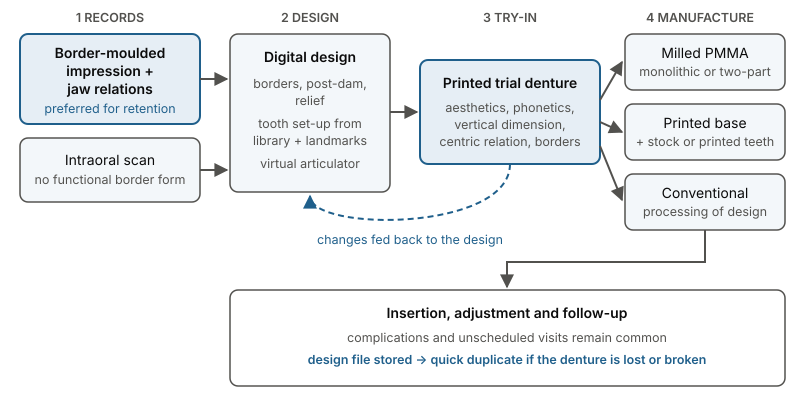
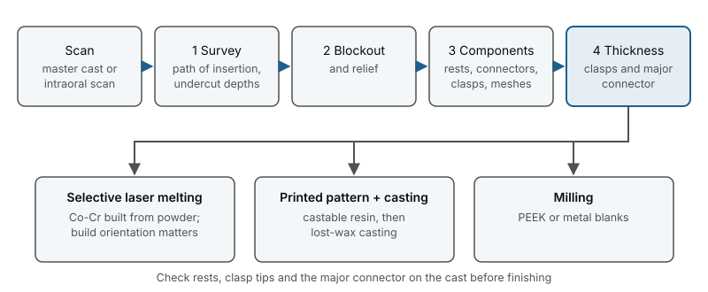
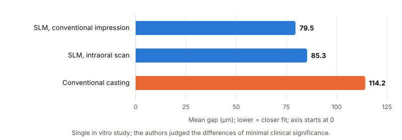

# Chapter 18. Removable Prosthodontics

## Learning Objectives

After reading this chapter, you should be able to:

1. Explain why removable prostheses are harder to digitise than fixed restorations, and which steps of the conventional workflow still matter most.
2. Describe the main digital workflows for complete dentures, including record-taking, tooth arrangement, try-in and manufacture.
3. Compare milled, printed and conventional complete dentures using current systematic review evidence.
4. Design and manufacture removable partial denture (RPD) frameworks digitally, and compare selective laser melting, printed-pattern casting and milling.
5. Describe digital workflows for obturators and other maxillofacial prostheses, and judge the strength of the evidence behind them.

---

## 18.1 Why Removable Prosthodontics Is Different

Fixed restorations sit on hard, stable surfaces that a scanner can record accurately (Chapters 3 and 4). Removable prostheses depend on things that are much harder to capture:

- **Mobile and displaceable soft tissue.** A denture base is supported by mucosa that compresses under load. Border tissues move with the lips, cheeks and tongue. An intraoral scan records the tissue at rest, not the functional shape that a border-moulded impression captures (Chapter 4).
- **Few hard landmarks.** Edentulous ridges have few distinct features for the scanner to stitch, which reduces accuracy and makes the bite record less reliable (Chapter 4).
- **Jaw relations without teeth.** The vertical dimension of occlusion and centric relation must be established and recorded, not simply copied.
- **Aesthetic and phonetic tooth arrangement.** Lip support, tooth display and speech are judged on the patient, not on a screen.

For these reasons, the digital denture is best seen as a **new manufacturing route** for well-established clinical principles. It does not replace them. A useful feature of digital dentures is that the design is stored as a file. A lost or broken denture can be remade from the record, which is a practical advantage for older adults with limited access to care [1].

---

## 18.2 Digital Complete Dentures: The Workflow

### 18.2.1 Clinical records

A systematic review of 39 studies on digital complete dentures documented a wide variety of clinical and laboratory procedures [2]:

- 24 studies used a **border-moulded impression** technique. Only 3 used a facebow record and 7 a gothic-arch tracing.
- Only 13 studies included a **trial denture** stage.
- In one included study, maxillary denture bases made from border-moulded impressions were significantly more retentive (14.5–16.1 N) than bases made from intraoral scans (6.2–6.6 N).

The authors concluded that a **border-moulded impression is still preferred for better retention**, and that a **trial denture is still recommended** before the definitive digital denture is made [2].

In practice, the main record options are as follows (Figure 18.1 shows the whole workflow):

1. **Conventional records, digitised.** Border-moulded final impressions and a jaw-relation record (often in a custom tray or record base) are scanned in the laboratory (Chapter 5).
2. **Hybrid records.** Some systems use their own trays and record bases, which capture the impression, vertical dimension and centric relation in one or two visits, and are then scanned.
3. **Intraoral scanning.** The ridges are scanned directly, sometimes with a scanned existing denture as a reference for tooth position and vertical dimension. This is convenient but does not record functional border form [2].

**Figure 18.1** The digital complete denture workflow. A border-moulded impression and a printed trial denture remain recommended steps; the stored design allows quick remakes [1,2].

### 18.2.2 Design

In the design software, the technician or clinician:

- defines the denture borders, post-dam and relief areas on the scanned impression or ridge;
- sets up teeth from a digital library, guided by landmarks such as the incisive papilla, occlusal plane and ridge crest, and by facial references where available (Chapter 6);
- designs the base thickness, contours and gingival characterisation;
- checks the occlusion in a virtual articulator (Chapter 7).

### 18.2.3 Try-in

A **printed trial denture**, as a monolithic tooth-coloured prototype or a printed base with set-up teeth, is tried in to check aesthetics, phonetics, vertical dimension, centric relation and border extension. Changes are recorded and fed back into the design [2].

### 18.2.4 Manufacture

**Table 18.1** Manufacturing routes for digital complete dentures

| Route | Process | Notes |
|---|---|---|
| **Milled, monolithic** | Base and teeth milled from a single multi-shade PMMA disc | Fast; no tooth–base bond; limited tooth aesthetics |
| **Milled, two-part** | Base milled from pink PMMA; teeth milled or prefabricated, bonded into sockets | Better aesthetics; bond is a potential weak point |
| **Printed base + prefabricated teeth** | Base printed in denture-base resin; stock teeth bonded | Low cost; relies on resin and bonding quality |
| **Printed base + printed teeth** | Base and teeth printed separately, then bonded | Fully additive; printed teeth less wear-resistant than many stock teeth (Chapter 11) |
| **Conventional processing from a digital design** | Printed trial denture flasked and processed in heat-cured acrylic | Combines a digital set-up with a familiar material |

Milling discs are limited in size. In one case of a total maxillectomy, a milled denture obturator had to be made in three pieces (obturator base, denture base and teeth) because the prosthesis was too large for a single PMMA disc [3].

---

## 18.3 Milled, Printed or Conventional? The Evidence

### 18.3.1 Material properties

- A systematic review of 11 in vitro studies found that **milled** denture bases had higher flexural strength than printed and heat-polymerised bases. Printed bases were generally weaker than heat-cured ones but improved with longer post-polymerisation [4].
- A broader systematic review and meta-analysis of 73 studies found that milled dentures had higher flexural strength, flexural modulus and toughness and better surface characteristics than printed dentures. Printed dentures showed **poorer colour stability**, but **greater trueness** than conventional dentures [1].
- For printed teeth bonded to printed bases, a meta-analysis of in vitro studies (10 studies, 4 pooled) found that surface treatment increased shear bond strength by a mean of 5.43 MPa compared with no treatment. Airborne-particle abrasion was effective; methyl methacrylate alone was not. The authors recommended airborne-particle abrasion as the minimum surface treatment [5].

Chapter 11 describes how print orientation, post-curing and resin chemistry affect printed denture bases.

### 18.3.2 Clinical and patient-reported outcomes

Systematic reviews give a consistent but nuanced picture:

- A systematic review and meta-analysis of **25 randomised trials** found that **no fabrication method had a clear advantage** in patient-important outcomes such as quality of life, satisfaction and complications. The only significant pooled difference was a small retention advantage of printed over milled dentures (mean difference 1.80 N, low certainty). Printed dentures were associated with more mechanical complications and aftercare. Milled dentures scored better for patient-rated aesthetics and had shorter processing times. The certainty of evidence was mostly **very low** [6].
- A meta-analysis of 12 studies found that **conventional** dentures were more retentive than printed dentures. No other clinical outcome differed between printed, conventional and milled dentures [7].
- Another meta-analysis found that conventional dentures were more retentive than **printed** dentures, with no significant difference between conventional and **milled** dentures. Patient satisfaction did not differ between methods [8].
- Not all reviews agree. A meta-analysis of six studies found **better retention** with CAD/CAM dentures than conventional ones, along with fewer appointments and shorter working time, but with high heterogeneity [9]. The 73-study review also found better retention with CAD/CAM dentures, as well as less chairside time and lower overall cost [1].
- A review of 15 studies of patient- and clinician-reported outcomes found that digital dentures generally saved cost and fabrication time. Patient satisfaction and denture quality were **not consistently** better. Milled dentures tended to perform better than printed ones, and clinicians faced a learning curve [10].

### 18.3.3 Time and complications

Digital workflows clearly save **clinical time**. In one review, digital complete dentures needed 205 to 233 fewer minutes of clinical time than conventional dentures [2]. Complications remain common:

- Up to **37.5%** of participants reported loss of retention, and up to **31.3%** needed a remake. At least one extra visit and one to four unscheduled follow-up visits were generally needed [2].
- A systematic review of printed dentures found that the fabrication technique influenced the number and type of complications, and that digital dentures needed a similar or greater number of post-insertion visits, depending on the method [11].

> **Evidence Box.** The evidence does not show that digital complete dentures are clinically superior to well-made conventional dentures. It shows that they are **comparable** in most patient-important outcomes, save clinical time and produce a reusable digital record. Retention findings conflict between reviews [1,6–9], and most of the evidence is of low or very low certainty [6]. The choice of method can therefore be guided by workflow, cost, material durability and patient factors [6].

### 18.3.4 Practical recommendations

> **Clinical Tip.** For a digital complete denture:
> 1. Take a **border-moulded** final impression rather than relying on an intraoral scan of the edentulous ridge, unless the system has been validated for scan-only records [2].
> 2. Record the vertical dimension and centric relation as carefully as for a conventional denture.
> 3. Always **try in** a printed trial denture before the definitive denture is made [2].
> 4. For the definitive base, prefer **milled PMMA** where strength, colour stability and aesthetics matter most [1,4,6]. Printed bases suit immediate, interim and backup dentures, and low-cost workflows.
> 5. Store the final design, so a duplicate can be made quickly if the denture is lost or broken [1].

---

## 18.4 Removable Partial Denture Frameworks

### 18.4.1 Digital design

An RPD framework is designed on a scan of the master cast or an intraoral scan of the partially dentate arch (Figure 18.2):

1. **Survey.** The software analyses undercuts relative to the chosen path of insertion, much like a mechanical surveyor.
2. **Blockout and relief.** Undesirable undercuts are blocked out. Relief is added under major connectors and over the edentulous ridges where needed.
3. **Component design.** Rests, minor connectors, major connector, clasps (with retentive arms placed into measured undercut depths), reciprocal elements and retention meshes for the denture base are placed from libraries and adjusted.
4. **Thickness checks.** Each component is given the thickness the material needs, especially clasps and the major connector.

Digital design makes the survey and undercut measurements explicit. It still requires a sound knowledge of RPD design principles.

**Figure 18.2** Digital RPD framework design and the three main manufacturing routes described in Section 18.4.2.

### 18.4.2 Manufacturing routes

- **Direct selective laser melting (SLM)** of cobalt-chromium. The framework is built layer by layer from metal powder (Chapter 11).
- **Printed resin pattern + conventional casting.** The design is printed in a castable resin, then invested and cast by the lost-wax method.
- **Milling** of high-performance polymers such as PEEK, or of metal blanks.
- **Other powder-based methods**, such as selective laser sintering and metal binder jetting [12].

### 18.4.3 Evidence on fit and properties

- A systematic review of 30 studies found that 3D-printed metal frameworks (SLM, selective laser sintering, direct metal laser sintering) had **comparable or superior** accuracy and mechanical–physical performance to conventional and partially digital frameworks. Clinically, printed frameworks could improve retention and patient satisfaction. Laboratory results showed higher density, better mechanical properties and accuracy that varied by component and method. The evidence was limited by methodological variability and a moderate risk of bias [13].
- An earlier systematic review of nine studies (six in vitro, three in vivo) found that frameworks made by CAD/CAM and rapid prototyping had clinically acceptable fit and better accuracy than conventionally made frameworks [14].
- A literature review of additive methods found that SLM gave good surface quality and mechanical strength but lower accuracy, while metal binder jetting gave lower accuracy and a rougher surface than conventional casting. All could produce frameworks within the clinically acceptable range, but more clinical studies were needed [12].

In vitro comparisons:

- Frameworks made by SLM had smaller mean gaps than conventionally cast frameworks, whether from a conventional impression (79.5 µm) or an intraoral scan (85.3 µm), compared with 114.2 µm for casting. The impression type did not affect SLM accuracy. The authors judged the differences to be of minimal clinical significance [15] (Figure 18.3).

**Figure 18.3** Mean gaps of SLM and conventionally cast cobalt-chromium RPD frameworks in one in vitro study. Data from [15].

- With a **deep palatal vault**, conventional casting gave the largest discrepancy (0.194 mm) and SLM the smallest (0.092 mm). For medium palatal vaults, all methods gave clinically acceptable fit [16].
- For mandibular major connectors, direct SLM frameworks had the smallest gaps for both lingual plates and lingual bars. All methods gave clinically acceptable adaptation [17].
- **Build orientation** matters. SLM frameworks printed at 0° showed adaptation of the palatal major connector equivalent to cast frameworks, and better than those built at 45° or 90°. In the clinical part of the same study, SLM and cast frameworks did not differ significantly [18].
- The measured fit depends heavily on the **measurement method**. The same SLM frameworks showed a mean gap of 13.9 µm with a clinical silicone replica and 70.7 µm with digital registration (Chapter 3) [19].

Clinical evidence:

- In a double-blind, randomised crossover trial of 29 cobalt-chromium frameworks, SLM and conventionally cast frameworks had **comparable** clinical fit. The mean space between occlusal rests and rest seats was 273.7 µm for SLM and 242.2 µm for cast frameworks. Fitting time did not differ significantly (7.8 versus 5.5 minutes) [20].

### 18.4.4 PEEK frameworks

PEEK frameworks are metal-free, light and aesthetically less conspicuous than cobalt-chromium. In a randomised trial of mandibular Kennedy Class I patients, CAD/CAM PEEK and CAD/CAM cobalt-chromium frameworks gave **no significant differences** in oral health-related quality of life or satisfaction over 2 years. Both improved quality of life beyond the minimal clinically important difference [21]. Long-term data on PEEK clasp retention, wear and framework durability are still limited. Chapter 15 covers the material.

Table 18.2 brings together the evidence for each framework route.

**Table 18.2** RPD framework manufacturing routes: summary of the evidence in this chapter

| Route | Evidence summarised in this chapter | Main caveats |
|---|---|---|
| **Selective laser melting (Co-Cr)** | Accuracy and mechanical performance comparable or superior to conventional frameworks [13]; smaller gaps than casting in vitro, including deep palatal vaults and mandibular connectors [15–17]; clinical fit comparable to casting in one RCT [20] | Lower accuracy than casting in one review [12]; fit depends on build orientation [18] and on the measurement method [19] |
| **Printed resin pattern + casting** | Combines digital design with a familiar alloy and casting route | No route-specific outcome data summarised here |
| **Metal binder jetting** | Frameworks within the clinically acceptable range [12] | Lower accuracy and rougher surface than casting [12] |
| **Milled PEEK** | Oral health-related quality of life and satisfaction comparable to Co-Cr over 2 years in one RCT [21] | Long-term clasp retention, wear and durability data limited |

> **Lab Note.** For SLM frameworks, follow the build orientation, support strategy and heat-treatment protocol validated for the alloy and machine [18]. Remove supports from non-fitting surfaces, and check rest seats, clasp tips and the major connector on the cast before finishing. Do not assume that a digital framework fits because the design was correct.

---

## 18.5 Obturators and Maxillofacial Prostheses

### 18.5.1 Why digital workflows help

Maxillofacial patients often have large defects, limited mouth opening after surgery or radiotherapy, and tissues that are painful or fragile. Conventional impressions of these defects are difficult and can be distressing. Digital workflows can combine CT or CBCT data with intraoral scans and plan the prosthesis before or alongside surgery.

### 18.5.2 Reported workflows

- **Fully digital obturators.** Spiral CT and intraoral scans were combined into a 3D digital cast of a maxillectomy defect. The obturator was designed with dental CAD and reverse-engineering software and either milled from PEEK or printed in polylactic acid [22].
- **Hollow surgical obturators.** Registered CT and MRI data used to outline the tumour were merged with a model of the dentition to design a **hollow** surgical obturator, which was printed before surgery. The authors reported less weight, better fit, easier clinical handling and an up-to-date digital copy of the prosthesis [23].
- **Immediate obturators.** A digitally planned, printed obturator was placed immediately after partial maxillectomy. It supported the defect during surgery and helped to prevent soft-tissue contracture and facial deformity [24]. Another workflow used preoperative CBCT and intraoral scans to transfer the patient's existing maxillary contour to an immediate obturator, restoring facial support at the time of resection [25].
- **Large milled prostheses.** For a total maxillectomy, a milled complete denture obturator was made in three pieces with a keyed assembly, because the prosthesis was larger than a single PMMA disc [3].
- **Implant-retained obturators.** In a cadaver study, virtual surgical planning was used for resection, guided zygomatic implant placement and an immediately loaded, implant-retained obturator. The mean entry-point deviation was 1.20 mm, the 3D angular deviation was 2.97°, and all five obturators could be fitted [26].

### 18.5.3 Extraoral facial prostheses

A systematic review of CAD/CAM for **nasal prostheses** and craniofacial implant placement included 21 studies covering just 23 patients. Digital planning, mostly from CT, CBCT or laser scans, was used for presurgical planning, guided craniofacial implant placement, mould fabrication, attachment design and printing silicone prostheses. The authors reported that digital technology may reduce clinical and laboratory time, but that equipment cost remained a limitation [27].

> **Evidence Box.** The maxillofacial literature consists almost entirely of **case reports, technique descriptions and small series** [3,22–25], with one cadaver study [26] and a systematic review of only 23 patients [27]. These reports show what is feasible and are valuable for specialist teams. They do not provide comparative evidence of better outcomes than conventional methods.

---

## 18.6 Summary

**Table 18.3** Digital removable prosthodontics: where the evidence stands

| Prosthesis | Digital route | Current evidence |
|---|---|---|
| Complete denture | Border-moulded impression → digital set-up → printed try-in → milled or printed denture | Comparable to conventional in patient-important outcomes; saves clinical time; retention findings conflict; mostly very low certainty [1,2,6–10] |
| Complete denture base material | Milled PMMA vs printed resin | Milled stronger and more colour-stable; printed improving [1,4] |
| RPD framework (Co-Cr) | Digital design → SLM, or printed pattern → casting | Fit comparable or better than casting in vitro; comparable in one RCT [13–18,20] |
| RPD framework (PEEK) | Digital design → milling | Comparable patient-reported outcomes to Co-Cr at 2 years in one RCT [21] |
| Obturator | CT/CBCT + IOS → design → print or mill | Feasible; case reports and technique papers only [3,22–26] |
| Facial prosthesis | CT/CBCT/laser scan → mould or direct print | Feasible; very small numbers [27] |

---

## Key Points

- Removable prostheses depend on **functional soft-tissue form and jaw relations** that scanners do not capture well. Digital dentures are a new manufacturing route for old principles [2].
- **Border-moulded impressions** give better retention than intraoral scans of edentulous ridges, and a **trial denture** is still recommended [2].
- Milled, printed and conventional complete dentures show **no clear difference in patient-important outcomes**. The certainty of evidence is mostly very low, and retention findings conflict [1,6–9].
- Digital dentures **save clinical time** and leave a **reusable digital record**, but complications and unscheduled visits remain common [1,2,11].
- **Milled PMMA** bases are stronger and more colour-stable than printed bases [1,4].
- **SLM** RPD frameworks fit at least as well as cast frameworks in vitro and comparably in a clinical RCT. Build orientation and measurement method affect results [13–20].
- **PEEK** frameworks gave patient-reported outcomes similar to cobalt-chromium over 2 years in one RCT [21].
- Digital **obturators and facial prostheses** are feasible and attractive for difficult patients, but supported only by case reports and small series [22–27].

---

## Review Questions

1. Why is an intraoral scan of an edentulous ridge a poor substitute for a border-moulded impression? What evidence supports this?
2. Describe a complete digital denture workflow from first visit to insertion. At which steps is a physical try-in still needed?
3. Compare milled and printed denture bases in terms of flexural strength, colour stability and clinical outcomes.
4. Summarise the evidence on retention of conventional, milled and printed dentures. Why might systematic reviews disagree?
5. How does digital RPD framework design reproduce the functions of a mechanical surveyor?
6. Compare SLM and conventionally cast cobalt-chromium RPD frameworks in terms of fit, the effect of palatal vault depth and clinical fitting time.
7. What advantages might a digitally designed, hollow, printed surgical obturator offer over a conventionally made one? How strong is the evidence?
8. A colleague says digital dentures are "better" than conventional ones. How would you summarise the evidence for them?

---

## References

1. Srinivasan M, Kamnoedboon P, McKenna G, Angst L, Schimmel M, Özcan M, et al. CAD-CAM removable complete dentures: a systematic review and meta-analysis of trueness of fit, biocompatibility, mechanical properties, surface characteristics, color stability, time-cost analysis, clinical and patient-reported outcomes. J Dent. 2021;113:103777. doi:10.1016/j.jdent.2021.103777
2. Thu KM, Molinero-Mourelle P, Yeung AWK, Abou-Ayash S, Lam WYH. Which clinical and laboratory procedures should be used to fabricate digital complete dentures? A systematic review. J Prosthet Dent. 2024;132(5):922–38. doi:10.1016/j.prosdent.2023.07.027
3. Prawatvatchara W, Limpuangthip N, Techapiroonthong S, Thamrongananskul N. Three-piece digital complete denture obturator with a heptagonal key assembly for a patient with a total maxillectomy: a dental technique. J Prosthet Dent. 2025;133(4):1100–3. doi:10.1016/j.prosdent.2023.06.011
4. Dos Santos KFN, de Santana IHG, da Nobrega RAMESL, Lima RBW, Dantas RVF, Dantas RVF, et al. Flexural strength of denture bases manufactured by digital techniques compared to conventional heat-polymerized: a systematic review. BMC Oral Health. 2026;26(1). doi:10.1186/s12903-026-09480-3
5. Malikhao N, Jia-Mahasap W, Khaohoen A, Rungsiyakull P. Impacts of bonding protocols on the bond strength of additively manufactured denture teeth and denture bases: a systematic review and meta-analysis. J Prosthet Dent. 2026. Epub ahead of print. doi:10.1016/j.prosdent.2026.10.002
6. Prott LS, Peričić TP, D'Alessandro C, Rivera M, Graham L, Gierthmuehlen PC, et al. Conventional, milled, and 3D-printed complete dentures: a systematic review and meta-analysis of clinical and patient-centered outcomes. J Esthet Restor Dent. 2026. Epub ahead of print. doi:10.1111/jerd.70283
7. Sivaswamy V, Cahyanto A, Varma SR, Matinlinna JP. Clinical outcomes of 3D printed complete dentures: a systematic review and meta-analysis. J Prosthet Dent. 2026;136(1):60–8. doi:10.1016/j.prosdent.2026.02.003
8. Avelino MEL, Costa RTF, Vila-Nova TEL, Vasconcelos BCDE, Pellizzer EP, Moraes SLD. Clinical performance and patient-related outcome measures of digitally fabricated complete dentures: a systematic review and meta-analysis. J Prosthet Dent. 2024;132(4):748.e1–748.e10. doi:10.1016/j.prosdent.2024.02.003
9. Zandinejad A, Floriani F, Lin WS, Naimi-Akbar A. Clinical outcomes of milled, 3D-printed, and conventional complete dentures in edentulous patients: a systematic review and meta-analysis. J Prosthodont. 2024;33(8):736–47. doi:10.1111/jopr.13859
10. Fouda A, Tonogai J, McDermott P, Wang D, Dong CS. A systematic review on patient perceptions and clinician-reported outcomes when comparing digital and analog workflows for complete dentures. J Prosthodont. 2026;35(5):636–55. doi:10.1111/jopr.13999
11. Smets K, Vandeweghe S, Ongenae L, D'haese R. Complications of 3D printed dentures: a systematic review. J Prosthet Dent. 2026;135(4):754–61. doi:10.1016/j.prosdent.2025.05.019
12. Yunizar MF, Watanabe M, Ichikawa T. Current development status of additive manufacturing technologies for fabricating removable partial denture frameworks: a literature review. Int J Comput Dent. 2022;25(1):57–70. PMID:35322653
13. Alqutaibi AY, Al-Gabri RS, Al-Zaghruri AS, Farghal AE, Alnazzawi AA, Alghauli MA. Clinical performance, accuracy, and physical-mechanical properties of 3D-printed removable partial denture metal frameworks compared with conventionally and partially digitally produced frameworks: a systematic review. J Prosthodont Res. 2026;70(2):206–23. doi:10.2186/jpr.JPR_D_25_00028
14. Ahmed N, Abbasi MS, Haider S, Ahmed N, Habib SR, Altamash S, et al. Fit accuracy of removable partial denture frameworks fabricated with CAD/CAM, rapid prototyping, and conventional techniques: a systematic review. Biomed Res Int. 2021;2021:3194433. doi:10.1155/2021/3194433
15. Korkes A, Jomaa J, Kavouris A, Lalani T, King P, Lee S, et al. Seating accuracy of removable partial denture frameworks fabricated by different digital workflows in comparison to conventional workflow. J Prosthodont. 2026;35(6):945–51. doi:10.1111/jopr.13923
16. Boontherawara P, Chaijareenont P, Angkasith P. Comparing the trueness of 3D printing and conventional casting for the fabrication of removable partial denture metal frameworks for patients with different palatal vault depths: an in vitro study. J Prosthet Dent. 2024;132(2):434.e1–434.e6. doi:10.1016/j.prosdent.2024.05.009
17. Sasithornvechakul C, Chaijareenont P, Angkasith P. Comparing the trueness of 3D printing and conventional casting for removable partial denture metal framework fabrication in different mandibular major connectors designs: an in vitro study. J Prosthet Dent. 2026;135(3):586.e1–586.e7. doi:10.1016/j.prosdent.2025.10.035
18. Elhadery SS, Alhajj MN, Yunus N, Ibrahim N, Abidin ZZ, Ahmad SF, et al. Adaptation of cobalt chromium frameworks fabricated by conventional versus selective laser melting techniques: an in vitro and clinical assessment. J Prosthet Dent. 2025;134(5):1836–42. doi:10.1016/j.prosdent.2024.03.020
19. Alabdullah SA, Hannam AG, Wyatt CC, McCullagh APG, Aleksejuniene J, Mostafa NZ. Comparison of digital and conventional methods of fit evaluation of partial removable dental prosthesis frameworks fabricated by selective laser melting. J Prosthet Dent. 2022;127(3):478.e1–478.e10. doi:10.1016/j.prosdent.2021.09.033
20. Chia VAP, See Toh YL, Quek HC, Pokharkar Y, Yap AU, Yu N. Comparative clinical evaluation of removable partial denture frameworks fabricated traditionally or with selective laser melting: a randomized controlled trial. J Prosthet Dent. 2024;131(1):42–9. doi:10.1016/j.prosdent.2021.12.021
21. Hegazi HM, Elkhadem A, Fayyad A, Elkady DM, Elkerdawy MW, Sedky A. Patient-centered outcomes of indirect CAD-CAM removable partial denture frameworks: a 2-year follow-up study. J Prosthodont. 2025;34(8):818–26. doi:10.1111/jopr.14100
22. Ye H, Wang Z, Sun Y, Zhou Y. Fully digital workflow for the design and manufacture of prostheses for maxillectomy defects. J Prosthet Dent. 2021;126(2):257–61. doi:10.1016/j.prosdent.2020.05.026
23. Kortes J, Dehnad H, Kotte ANT, Fennis WMM, Rosenberg AJWP. A novel digital workflow to manufacture personalized three-dimensional-printed hollow surgical obturators after maxillectomy. Int J Oral Maxillofac Surg. 2018;47(9):1214–8. doi:10.1016/j.ijom.2018.03.015
24. Hu Y, Liu J, Wu W, Wang Z. Immediate reconstruction of defects after a partial maxillectomy with a digitally planned, prefabricated, 3-dimensionally printed, esthetic obturator prosthesis. J Prosthet Dent. 2024;132(6):1330.e1–1330.e7. doi:10.1016/j.prosdent.2023.01.022
25. Guo Z, Song S, Li Z, Wang F, Fang H, Song J, et al. Digital fabrication of obturators with immediate optimized facial support for extensive maxillectomy using the existing maxillary contour. J Prosthodont Res. 2026;70(4):691–6. doi:10.2186/jpr.JPR_D_25_00096
26. Vosselman N, Glas HH, de Visscher SAHJ, Kraeima J, Merema BJ, Reintsema H, et al. Immediate implant-retained prosthetic obturation after maxillectomy based on zygomatic implant placement by 3D-guided surgery: a cadaver study. Int J Implant Dent. 2021;7(1):54. doi:10.1186/s40729-021-00335-w
27. Tanveer W, Ridwan-Pramana A, Molinero-Mourelle P, Koolstra JH, Forouzanfar T. Systematic review of clinical applications of CAD/CAM technology for craniofacial implants placement and manufacturing of nasal prostheses. Int J Environ Res Public Health. 2021;18(7):3756. doi:10.3390/ijerph18073756
