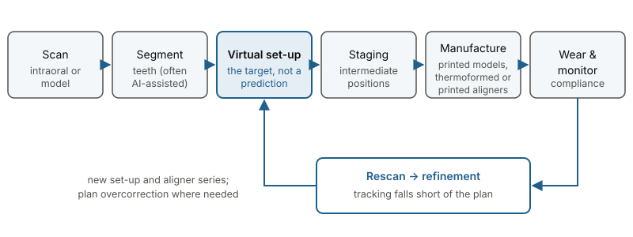
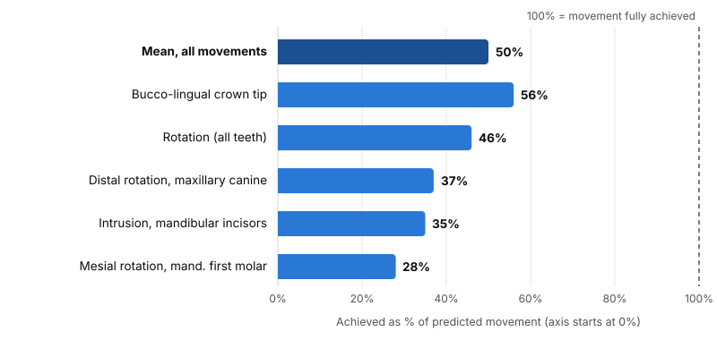
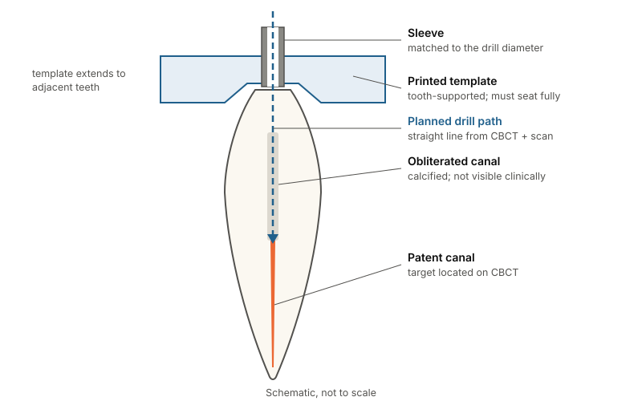

# Chapter 19. Orthodontics and Other Specialties

## Learning Objectives

After reading this chapter, you should be able to:

1. Describe the digital orthodontic workflow, from digital models and virtual set-ups to appliance manufacture.
2. Summarise the evidence on the predictability of clear aligner tooth movement and the transfer accuracy of digital indirect bonding.
3. Explain how occlusal splints and mandibular advancement devices are designed and made digitally, and the limits of current evidence.
4. Describe guided endodontic access and guided tooth autotransplantation, and their benefits and failure modes.
5. Outline digital applications in periodontal surgery.
6. Describe virtual surgical planning, cutting guides and patient-specific implants in maxillofacial surgery, and appraise the evidence for them.

---

## 19.1 The Same Toolkit, Different Goals

The CAD/CAM tools described in earlier chapters are not limited to restorations. The same chain of **acquisition, design and manufacture** (Chapter 1) supports orthodontics, sleep and occlusal therapy, endodontics, periodontics, oral surgery and maxillofacial reconstruction:

- **Acquisition:** intraoral and laboratory scans (Chapters 4 and 5), CBCT and CT, facial scans and photographs (Chapter 6).
- **Design:** orthodontic set-up software, splint and appliance design modules, guide-design tools, and medical planning software for skeletal surgery.
- **Manufacture:** mostly **additive** (Chapter 11) for models, aligner moulds, trays, splints and guides, and **subtractive** (Chapter 10) or metal printing for frameworks, plates and patient-specific implants.

Each specialty uses these tools to answer a different question. How far can teeth be moved? Where exactly is the canal? Where should the osteotomy be cut? The accuracy each application needs varies just as widely.

---

## 19.2 Orthodontics

### 19.2.1 Digital models

Digital study models have replaced plaster in many orthodontic practices for diagnosis, storage and communication. A systematic review of 17 studies found that tooth-size, arch-length, arch-width, crowding and irregularity measurements on digital models were comparable to those on plaster models. Differences were minor and clinically insignificant, although the evidence was of variable quality [1].

Orthodontic models tolerate larger deviations than a crown margin. In a study of repeated scans of one patient, even an earlier-generation intraoral scanner, less precise than a laboratory scanner, produced virtual models judged suitable for treatment planning and for making tooth-supported appliances [2]. In a prospective cross-sectional study of 30 patients, combining an intraoral scan with a smartphone facial scan produced a 3D patient model judged clinically useful for orthodontic diagnosis and planning; only one of eight linear measurements differed significantly from photographs [3] (Chapter 6).

### 19.2.2 Virtual set-ups

A **virtual set-up** segments the teeth on the digital model and moves them, individually or in groups, to a planned final position. It replaces the traditional plaster set-up. It is used to:

- test feasibility, space requirements and interproximal reduction before treatment;
- show the patient a simulated outcome;
- design aligner stages, custom brackets and archwires, and indirect bonding trays;
- coordinate with restorative and surgical colleagues in interdisciplinary cases.

AI-based tooth segmentation now automates much of the preparation (Chapter 4). The set-up is a **target**, not a prediction or a guarantee. Biology, compliance and appliance mechanics decide whether the planned movement actually happens.

### 19.2.3 Clear aligners

Clear aligners are one of the most widespread CAD/CAM applications in dentistry. From the virtual set-up, a series of intermediate tooth positions is designed. Models of each stage are 3D-printed, and thermoplastic aligners are vacuum-formed over them (or, increasingly, printed directly; see Chapter 11). Figure 19.1 shows the workflow.

**Figure 19.1** The clear aligner workflow. The virtual set-up is the target; when tooth movement falls short of the plan, a rescan and a refinement series follow.

**Predictability.** The key clinical question is how closely achieved tooth movement matches the plan:

- A systematic review found that aligners aligned and levelled arches and controlled anterior intrusion and posterior bucco-lingual inclination. **Extrusion** was the hardest movement to control (about 30% accuracy), followed by rotation. Upper molar distalisation was the most predictable movement (88%) when at least 1.5 mm of bodily movement was prescribed. Rotation of rounded teeth was poorly controlled. Study quality and heterogeneity limited the conclusions [4].
- A prospective study of 38 patients measured predicted against achieved movement on digital models. Mean accuracy across all movements was **50%** (Figure 19.2). Bucco-lingual crown tip was the most accurate (56%) and rotation the least (46%). Accuracy was particularly low for mesial rotation of mandibular first molars (28%), distal rotation of maxillary canines (37%) and intrusion of mandibular incisors (35%) [5].
- A systematic review of six studies (without meta-analysis) on factors affecting aligner outcomes found that success depended mainly on **patient compliance**, treatment planning and case complexity. Bucco-lingual tipping was the most accurate movement, while rotation, intrusion and expansion were less precise. A digital progress-monitoring tool was reported to **overestimate** tooth movement [6].

> **Evidence Box.** In one prospective study, aligners achieved on average about half of the planned movement over the course of treatment, and less for rotations and some intrusions [5]; in a systematic review, extrusion and rotation were the hardest movements to control [4]. This explains why refinements (additional aligner series) and auxiliaries (attachments, elastics) are common. A virtual set-up shows the **target**, not a prediction of what the teeth will actually do. Clinicians should plan overcorrection and refinements accordingly, and explain this to patients.

**Figure 19.2** Achieved tooth movement as a percentage of the predicted movement in one prospective study of 38 aligner patients. Data from [5].

### 19.2.4 Digital indirect bonding

In **indirect bonding**, brackets are positioned on a model, then transferred to the teeth in a tray so that they can all be bonded at once. In the digital version, brackets are placed virtually on the scan. A transfer tray or jig is designed and printed, or vacuum-formed over a printed model with the brackets in place.

- In vitro, a 3D-printed transfer jig and a conventional silicone tray both achieved median bracket-position deviations within the American Board of Orthodontics' clinically acceptable limit of 0.5 mm. The printed jig was more accurate in the mandible and the silicone tray in the maxilla, although the authors judged these differences not clinically significant [7].
- In a prospective clinical study of 818 lingual brackets, rigid-printed, flexible-printed and double vacuum-formed trays all gave median translational errors of 0.10 mm or less, well within the 0.5 mm limit. **Torque** rarely met the 2° limit with any tray. Double vacuum-formed trays gave the most precise mesial-distal positioning [8].
- In a clinical (in vivo) study of 20 patients with 498 lingual brackets, fully and partially enclosed printed trays were both clinically acceptable for linear accuracy (errors below 0.5 mm). Torque transfer remained a challenge. The fully enclosed design needed longer bonding time (84 versus 71 minutes) without an overall accuracy advantage [9].

Table 19.1 compares the three studies.

**Table 19.1** Digital indirect bonding: transfer accuracy in the studies discussed

| Study | Setting | Trays compared | Linear accuracy | Torque and other findings |
|---|---|---|---|---|
| [7] | In vitro | 3D-printed jig vs conventional silicone tray | Median deviations within the 0.5 mm limit for both | Printed jig more accurate in the mandible, silicone tray in the maxilla |
| [8] | Clinical, 818 lingual brackets | Rigid printed, flexible printed, double vacuum-formed | Median translational errors ≤ 0.10 mm | Torque rarely within 2°; double vacuum-formed most precise mesial-distally |
| [9] | Clinical, 20 patients, 498 lingual brackets | Fully vs partially enclosed printed trays | Both clinically acceptable | Torque transfer a challenge; fully enclosed design took longer to bond (84 vs 71 minutes) |

Digital indirect bonding achieves clinically acceptable **linear** accuracy with several tray designs. **Torque** transfer is the weak point [8,9].

### 19.2.5 Custom appliances

The same workflow produces customised fixed and removable appliances: custom brackets and robot-bent wires, lingual systems, retainers, expanders and functional appliances. Metal components can be laser-melted or milled (Chapters 10, 11 and 15), and resin components printed. Retainers and aligners need accurate printed models. Small errors in the model translate directly into fit and tooth-movement errors.

> **Clinical Tip.** Rescan before each new phase of treatment, such as refinements, retention or changes of appliance. Designing a new appliance on an old scan wastes the patient's time and the clinician's, because teeth that have moved will not seat in an appliance designed for their previous position.

---

## 19.3 Occlusal Splints and Sleep Appliances

### 19.3.1 Occlusal splints

Occlusal splints can be designed on intraoral scans with a bite record or a virtual articulator (Chapters 4, 5 and 7), then **milled** from PMMA blocks or **printed** in splint resins. A review of 3D printing in removable prosthodontics concluded that printed occlusal splints are **widely adopted** and offer adequate fit and comfort, but noted material-related challenges and limited long-term data [10]. Chapter 11 discusses how build orientation and post-curing affect printed splints.

Design considerations:

- Base the design on an accurate bite record and an appropriate vertical dimension. Use a virtual articulator, or jaw tracking where needed, for excursive guidance (Chapter 6).
- Specify thickness and retention to suit the material: milled PMMA tolerates thinner sections than many printed resins.
- Check the fit and occlusion in the mouth and adjust. The design is a starting point.

### 19.3.2 Mandibular advancement devices

Mandibular advancement devices (MADs) for obstructive sleep apnoea hold the mandible forward during sleep. CAD/CAM allows precise, reproducible designs with planned advancement and vertical opening.

In a practice-based study of 300 patients, using data extracted from patient files, mandibular advancement therapy reduced the apnoea–hypopnoea index by a mean of 16.4 events per hour and the oxygen desaturation index by 10.8 per hour, an average improvement of about 50%. Patients with more severe disease improved more. Interestingly, the **conventionally made** MAD (40 patients) showed greater reductions than the two CAD/CAM designs [11]. This was a non-randomised comparison and device designs differed, so it does not show that digital manufacture is inferior. It does show that digital manufacture alone does not guarantee a better result.

Sleep appliances should be provided within a medical diagnosis and follow-up pathway. The dentist provides the appliance but does not diagnose or monitor sleep apnoea alone.

---

## 19.4 Endodontics

### 19.4.1 Guided endodontic access

In teeth with **pulp canal obliteration** (calcified canals; Figure 19.3), finding the canal conventionally risks perforation and excessive loss of tooth structure. **Guided endodontics** uses the same principles as guided implant surgery (Chapter 17). CBCT and a surface scan are registered (Chapter 6), a straight access path to the canal is planned, and a tooth-supported template with a sleeve guides a drill along that path.

**Figure 19.3** Guided endodontic access. The access path is planned on registered CBCT and surface-scan data, and a sleeve in a tooth-supported template keeps the drill on that path. Schematic, not to scale.

- In an in vitro study with 3D-printed incisors containing simulated calcified canals, the canal was found in **91.7%** of guided accesses compared with **41.7%** of conventional ones. Substance loss was about five times lower (mean 9.8 versus 49.9 mm³), and treatment time was roughly halved (11.3 versus 21.8 minutes). The success of the guided approach did not depend on operator experience [12].
- In an in vitro typodont study, templates made on four low-cost desktop 3D printers gave mean deviations between planned and actual bur positions of 0.31–0.68 mm [13].
- For **posterior** teeth, where space is limited, metal templates made by selective laser melting gave smaller deviations at the entry point and apical portion of the bur than resin stereolithography templates; angular deviation and template height also differed significantly [14].

### 19.4.2 When guided access fails

Guided access is not infallible. A case report described the failure of a static guide in a severely obliterated lateral incisor. The drill repeatedly deviated palatally. Investigation showed palatal **wear of the resin template** next to the metal sleeve, and a **mismatch between the drill's active length and the sleeve dimensions** may have contributed [15]. The canal was finally found conventionally under the operating microscope [15].

> **Clinical Tip.** For guided endodontic access, use drills and sleeves specified as a matched system, verify that the template seats fully and stably before drilling, and check progress radiographically. Keep conventional microscope-assisted skills current for cases where the guide fails [15].

---

## 19.5 Oral Surgery and Periodontics

### 19.5.1 Tooth autotransplantation

Digital planning has changed how **autotransplantation** is performed. A **3D-printed replica** of the donor tooth is made from CBCT data and used to prepare and test the recipient socket **before** the donor tooth is extracted, which shortens the time the donor tooth spends outside the mouth.

- An early systematic review found that donor-tooth replicas shortened extraoral time and enabled accurate planning. Clinical studies reported success rates of 80.0–91.1% and survival of 95.5–100%, but the quality of evidence was low [16].
- A more recent systematic review of 25 studies (about 1,300 patients) found survival of 92–100% and success of 86–100% at 6 months to 5 years with digital guidance. Extra-alveolar time was **under one minute** in eleven reports, most donor teeth fitted at the first attempt, and positional deviation from the plan was about 1–2 mm. In two studies, guidance shortened surgical time by 13–15 minutes (low certainty). However, the only registered controlled trial found no significant clinical difference from the conventional technique, so **clinical superiority remains unproven** [17].

### 19.5.2 Periodontal surgery

Digital planning is increasingly used for **aesthetic crown lengthening**. The planned gingival margin and bone level are derived from the digital smile design and wax-up (Chapter 6). A technique report described a dual-layer guide: a printed resin guide for gingivectomy and a snap-fit cobalt-chromium guide for osteoplasty, linked so that soft and hard tissue can be managed in sequence [18]. Such guides are designed to transfer the restorative plan to the surgical field, but their accuracy has not been reported and comparative clinical evidence is still lacking.

### 19.5.3 Other surgical guides and models

Printed anatomical models and guides are used for apicectomy, cyst enucleation, removal of impacted teeth and bone harvesting. The guiding principles are the same as for implant guides (Chapter 17): accurate registration, rigid and stable seating, and verification during surgery.

---

## 19.6 Maxillofacial Surgery

### 19.6.1 Virtual surgical planning for orthognathic surgery

In **virtual surgical planning (VSP)**, CT or CBCT data, dental scans and facial data are merged (Chapter 6). The osteotomies and jaw movements are planned on screen, and the plan is transferred to the operation with printed **occlusal splints**, **cutting and positioning guides** and, increasingly, **patient-specific plates**.

An early protocol showed that occlusal data could be transferred entirely digitally: all splints made from the CBCT occlusal data fitted the stone models and were used in surgery [19]. Evidence on accuracy and outcomes is now available from systematic reviews:

- A meta-analysis of 11 randomised trials (240 patients) found that VSP **shortened surgery** and gave a statistically significant but modest improvement in maxillary **vertical** accuracy (mean difference about 0.46 mm). The gain was larger with **guide- and plate-based** transfer (about 0.89 mm) than with splint-based transfer (about 0.24 mm). Horizontal accuracy and patient-reported outcomes did not differ. VSP was associated with **higher costs and radiation exposure**, and the certainty of evidence was low to very low [20].
- Another systematic review (13 studies, four in the meta-analysis) found **no significant differences** between VSP and traditional planning in SNA, SNB and horizontal and vertical skeletal measurements. The authors recommended VSP for complex cases that need enhanced visualisation and interdisciplinary collaboration [21].

> **Evidence Box.** Overall, VSP gives accuracy similar to, or slightly better than, conventional planning [20,21], at higher cost [20]. Both reviews suggest reserving it for **complex** cases that need greater precision, visualisation and interdisciplinary collaboration [20,21], and the vertical accuracy gain was largest with guide- and plate-based transfer [20].

### 19.6.2 Mandibular reconstruction

Reconstruction of the mandible with a **fibula free flap** is one of the most established uses of VSP. The resection, the fibula osteotomies and the plate shape are planned virtually, and printed cutting guides transfer the plan to both the mandible and the fibula.

- A meta-analysis of six studies comparing VSP with free-hand mandibular reconstruction using osteocutaneous free flaps found significantly smaller changes in **gonion angle** with VSP (3.6° versus 7.7°). Differences in intercondylar distance, ischaemia time and total operative time were not significant [22].
- A second meta-analysis found that VSP **reduced operative time by about 45 minutes**, with no difference in major or minor complications [23].
- Computer-aided planning was associated with a significantly higher likelihood of **dental implant placement** after free-flap reconstruction (odds ratio 2.70) [24]. This matters because implant-supported prostheses have been associated with better quality of life after free-flap mandibular reconstruction, as the review's authors note [24].

Planning the reconstruction **prosthetically**, by positioning the fibula segments to support future implants and a dental prosthesis, connects maxillofacial surgery directly with the implant workflows in Chapters 9 and 17.

Table 19.2 summarises the review evidence on virtual surgical planning.

**Table 19.2** Virtual surgical planning: findings of the systematic reviews discussed

| Application | Review | Main findings | Limitations |
|---|---|---|---|
| Orthognathic surgery | [20] 11 RCTs, 240 patients | Shorter surgery; maxillary vertical accuracy improved by about 0.46 mm (about 0.89 mm with guides and plates, 0.24 mm with splints) | No difference in horizontal accuracy or patient-reported outcomes; higher cost and radiation; low to very low certainty |
| Orthognathic surgery | [21] 13 studies, 4 meta-analysed | No significant differences in key cephalometric measurements | Only four studies pooled; VSP recommended for complex cases |
| Free-flap mandibular reconstruction | [22] | Smaller change in gonion angle (3.6° vs 7.7°) | No significant difference in intercondylar distance or ischaemia time |
| Fibula mandibular reconstruction | [23] | Operative time about 45 minutes shorter | No difference in complications |
| Free-flap reconstruction | [24] | Higher likelihood of dental implant placement (odds ratio 2.70) | — |

### 19.6.3 Patient-specific implants and trauma

**Patient-specific implants (PSIs)** are designed from the patient's imaging to fill defects or reconstruct contours. They are made by milling or printing titanium or PEEK (Chapter 15).

- A systematic review and meta-analysis of patient-specific **PEEK** implants in craniomaxillofacial reconstruction (15 studies, 236 implants) found a pooled complication rate of 20.1%, mostly minor, and implant loss of 6.5%. Aesthetic outcomes were satisfactory in 87.4%. Implant loss was numerically higher in previously irradiated patients, although that subgroup was very small [25].
- In craniomaxillofacial **trauma**, a systematic review of 20 studies (170 participants; case reports, case series and clinical trials) found that printed models, PSIs and custom devices helped restore symmetry and function and **reduced surgery time**, but **increased preparation time and production costs**. In-house production could reduce both [26].

**Table 19.3** Digital applications outside restorative dentistry: summary

| Application | Typical manufacture | Evidence summary | Key limitation |
|---|---|---|---|
| Digital orthodontic models | Scan; printed models as needed | Comparable to plaster for measurements [1] | Variable study quality |
| Clear aligners | Printed models + thermoformed (or printed) aligners | ~50% of planned movement achieved on average [5]; extrusion and rotation weakest [4,5] | Compliance [6]; refinements often needed |
| Digital indirect bonding | Printed or vacuum-formed trays | Linear errors within 0.5 mm [7–9] | Torque transfer [8,9] |
| Occlusal splints | Milled PMMA or printed resin | Adequate fit and comfort [10] | Limited long-term data |
| Mandibular advancement devices | Milled or printed | ~50% AHI reduction overall [11] | No proof digital > conventional |
| Guided endodontic access | Printed (or SLM metal) template | 91.7% vs 41.7% canal location in vitro [12] | Template wear; drill–sleeve mismatch [15] |
| Guided autotransplantation | Printed donor replica ± guide | Survival 92–100%; extra-alveolar time <1 min in 11 reports [17] | Superiority over conventional unproven [17] |
| Orthognathic VSP | Printed splints, guides, PSI plates | Modest accuracy gain; shorter surgery [20] | Cost; radiation; low to very low certainty [20] |
| Fibula mandibular reconstruction | Printed cutting guides, plates | Better angle accuracy [22]; shorter surgery [23]; more implants [24] | Heterogeneous measures |
| PEEK patient-specific implants | Milled or printed PEEK | 87.4% aesthetic satisfaction; 6.5% loss [25] | Complications 20.1% [25] |

---

## Key Points

- The same **acquisition–design–manufacture** chain serves orthodontics, sleep and occlusal therapy, endodontics, oral and periodontal surgery, and maxillofacial reconstruction. Most of these applications rely on **3D printing** (Chapter 11).
- **Digital orthodontic models** give measurements comparable to plaster, although the evidence is of variable quality [1].
- **Clear aligners** achieve about half of the planned movement on average. Extrusion and rotation are least predictable, and compliance is decisive [4–6]. A virtual set-up is a target, not a prediction.
- **Digital indirect bonding** achieves clinically acceptable linear accuracy. Torque is the weak point [7–9].
- **Printed splints** are widely used with adequate fit [10]. Digitally made **MADs** reduce AHI, but in one non-randomised practice-based study the conventionally made device gave greater reductions [11].
- **Guided endodontic access** greatly improves canal location and conserves tooth structure in vitro [12]. In vitro, printed templates kept the bur within 0.31–0.68 mm of the plan [13], and laser-melted metal templates deviated less than resin ones [14]. Template wear and drill–sleeve mismatch can cause failure [15].
- **Digitally guided autotransplantation** shortens extra-alveolar time and surgery, but clinical superiority is unproven [16,17].
- In maxillofacial surgery, **VSP** shortens surgery [20,23] and modestly improves accuracy, most clearly with guides and patient-specific plates, at higher cost [20]. In free-flap reconstruction it is associated with smaller gonion-angle changes [22] and more dental implant placement [24]. **PEEK PSIs** give good aesthetic results (87.4% satisfactory) with an overall complication rate of 20.1%, mostly minor [25]. In trauma, printed devices shorten surgery but add preparation time and cost [26].

---

## Review Questions

1. How do measurements on digital orthodontic models compare with those on plaster models?
2. Which tooth movements are least predictable with clear aligners, and how should this influence treatment planning and patient communication?
3. Compare the transfer accuracy of printed and vacuum-formed indirect bonding trays. Which dimension of bracket position is hardest to transfer?
4. A patient with a severely calcified upper central incisor needs root canal treatment. Describe a guided endodontic workflow, and list two reasons a guided access might fail.
5. How does a 3D-printed donor-tooth replica change the autotransplantation procedure? What does the evidence say about outcomes?
6. Summarise the evidence comparing virtual and conventional planning in orthognathic surgery. In which cases is VSP most clearly justified?
7. Why might virtual planning of a fibula free-flap reconstruction be associated with a higher rate of dental implant placement?
8. What are the advantages and risks of patient-specific PEEK implants in craniomaxillofacial reconstruction?

---

## References

1. Fleming PS, Marinho V, Johal A. Orthodontic measurements on digital study models compared with plaster models: a systematic review. Orthod Craniofac Res. 2011;14(1):1–16. doi:10.1111/j.1601-6343.2010.01503.x
2. Flügge TV, Schlager S, Nelson K, Nahles S, Metzger MC. Precision of intraoral digital dental impressions with iTero and extraoral digitization with the iTero and a model scanner. Am J Orthod Dentofacial Orthop. 2013;144(3):471–8. doi:10.1016/j.ajodo.2013.04.017
3. Vasoglou M, Pouliezou I, Apostolopoulos K, Vasoglou G. Accuracy of combining intraoral and facial scan in a single digital model of an orthodontic patient utilizing corresponding measurements on the model and on real photographs: a prospective cross-sectional study. Int Orthod. 2025;23(4):101015. doi:10.1016/j.ortho.2025.101015
4. Rossini G, Parrini S, Castroflorio T, Deregibus A, Debernardi CL. Efficacy of clear aligners in controlling orthodontic tooth movement: a systematic review. Angle Orthod. 2015;85(5):881–9. doi:10.2319/061614-436.1
5. Haouili N, Kravitz ND, Vaid NR, Ferguson DJ, Makki L. Has Invisalign improved? A prospective follow-up study on the efficacy of tooth movement with Invisalign. Am J Orthod Dentofacial Orthop. 2020;158(3):420–5. doi:10.1016/j.ajodo.2019.12.015
6. AlBaqshi FS, Alosaimi SSS, Al Jumaiei AH, Alkahtani DA, Alghamdi AAAM, Alamri RH, et al. Factors influencing the predictability and success of Invisalign aligners: a systematic review. Cureus. 2025;17(10):e95845. doi:10.7759/cureus.95845
7. Tavakkoli MA, Jebal R, Salehi P, Ajami S. Comparison of three-dimensional scan and conventional indirect bonding methods for bracket positioning accuracy: an in vitro study. Angle Orthod. 2026. doi:10.2319/110725-924.1
8. Nguyen VA, Vuong TQT. Transfer accuracy and chairside efficiency of rigid- and flexible-printed versus double vacuum-formed lingual indirect bonding trays: a prospective cohort study. Sci Rep. 2025;15(1):29320. doi:10.1038/s41598-025-14069-x
9. Nguyen VA. Comparative analysis of lingual bracket transfer accuracy using fully versus partially enclosed 3D-printed indirect bonding trays: an in vivo study. PeerJ. 2025;13:e19612. doi:10.7717/peerj.19612
10. Schubert O, Edelhoff D, Güth JF, Schweiger J. Advances in 3D printing for removable prosthetics — insights and perspectives. J Esthet Restor Dent. 2026;38(3):520–9. doi:10.1111/jerd.70097
11. Bronwasser CS, Bronwasser PJ, Schimmel M, Abou-Ayash S, Hou MY. The effect of different mandibular advancement devices on sleep parameters in obstructive sleep apnea. J Oral Rehabil. 2026. doi:10.1111/joor.70298
12. Connert T, Krug R, Eggmann F, Emsermann I, ElAyouti A, Weiger R, et al. Guided endodontics versus conventional access cavity preparation: a comparative study on substance loss using 3-dimensional-printed teeth. J Endod. 2019;45(3):327–31. doi:10.1016/j.joen.2018.11.006
13. Koch GK, Gharib H, Liao P, Liu H. Guided access cavity preparation using cost-effective 3D printers. J Endod. 2022;48(7):909–13. doi:10.1016/j.joen.2022.04.005
14. Zhang T, Chen D, Zhang F, Xie S, Wu G, Hu Q, et al. Comparison of selective laser melting and stereolithography etching templates for guided endodontics. PeerJ. 2024;12:e17646. doi:10.7717/peerj.17646
15. Zamalloa SID, Scardini IL, Soares SMG, de Almeida Decurcio D, Dos Santos M, Caldeira CL. Failure of guided endodontic access in a severely obliterated root canal: a case report of drill deviation. Case Rep Dent. 2026;2026:5560110. doi:10.1155/crid/5560110
16. Verweij JP, Jongkees FA, Anssari Moin D, Wismeijer D, van Merkesteyn JPR. Autotransplantation of teeth using computer-aided rapid prototyping of a three-dimensional replica of the donor tooth: a systematic literature review. Int J Oral Maxillofac Surg. 2017;46(11):1466–74. doi:10.1016/j.ijom.2017.04.008
17. Almutairi AS, Alnoodaly OM, Alrasheed SM, Ansari ST, Kolarkodi SH. Digitally guided tooth autotransplantation: a systematic review of clinical, radiographic and operative outcomes. J Clin Med. 2026;15(21):8601. doi:10.3390/jcm15218601
18. Wang LY, Li ZM, Yang W, Gao L, Wang XD. A snap-fit dual-layer surgical guide for digitally guided esthetic crown lengthening: a dental technique. J Prosthet Dent. 2026;136(2):e40–e43. doi:10.1016/j.prosdent.2026.03.033
19. Bobek S, Farrell B, Choi C, Farrell B, Weimer K, Tucker M. Virtual surgical planning for orthognathic surgery using digital data transfer and an intraoral fiducial marker: the Charlotte method. J Oral Maxillofac Surg. 2015;73(6):1143–58. doi:10.1016/j.joms.2014.12.008
20. Anas M, Sultan MU, Orakzai SA. Clinical outcomes of virtual versus conventional planning in orthognathic surgery: a systematic review and meta-analysis of randomized controlled trials. J Maxillofac Oral Surg. 2026;25(5):1353–71. doi:10.1007/s12663-026-03236-w
21. Quadri SA, Alshoail HH, Saini RS, Mosaddad SA, Heboyan A. The role of 3D virtual planning in orthognathic surgery and outcome assessment: a systematic review and meta-analysis. J Maxillofac Oral Surg. 2026;25(1):164–77. doi:10.1007/s12663-025-02798-5
22. Pucci R, Weyh A, Smotherman C, Valentini V, Bunnell A, Fernandes R. Accuracy of virtual planned surgery versus conventional free-hand surgery for reconstruction of the mandible with osteocutaneous free flaps. Int J Oral Maxillofac Surg. 2020;49(9):1153–61. doi:10.1016/j.ijom.2020.02.018
23. Barr ML, Haveles CS, Rezzadeh KS, Nolan IT, Castro R, Lee JC, et al. Virtual surgical planning for mandibular reconstruction with the fibula free flap: a systematic review and meta-analysis. Ann Plast Surg. 2020;84(1):117–22. doi:10.1097/SAP.0000000000002006
24. Salinero L, Boczar D, Barrow B, Berman ZP, Diep GK, Trilles J, et al. Patient-centred outcomes and dental implant placement in computer-aided free flap mandibular reconstruction: a systematic review and meta-analysis. Br J Oral Maxillofac Surg. 2022;60(10):1283–91. doi:10.1016/j.bjoms.2022.09.006
25. Bousaidi N, Omeish N, Coradin T, Porporatti AL, Mirghani H, Gorin C. Clinical outcomes of patient-specific PEEK implants in craniomaxillofacial reconstruction: a systematic review and meta-analysis. Int J Oral Maxillofac Surg. 2026. doi:10.1016/j.ijom.2026.10.020
26. Oley MH, Oley MC, Sukarno V, Faruk M. Advances in three-dimensional printing for craniomaxillofacial trauma reconstruction: a systematic review. J Craniofac Surg. 2024;35(7):1926–33. doi:10.1097/SCS.0000000000010451
