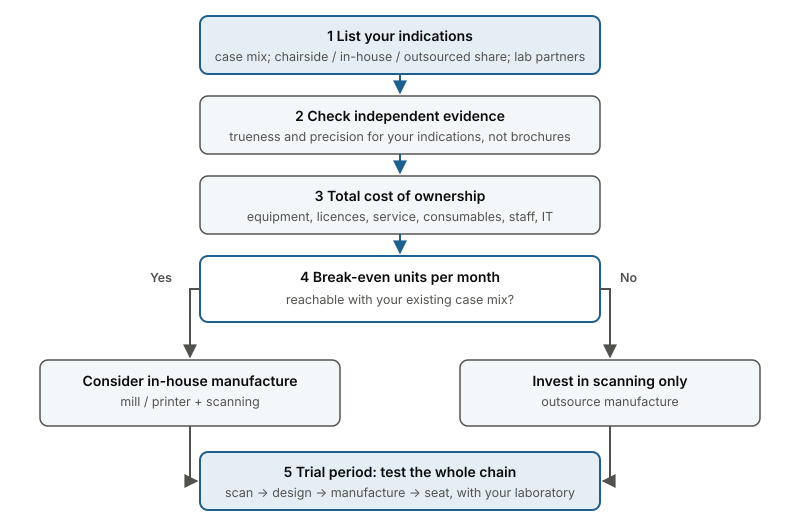
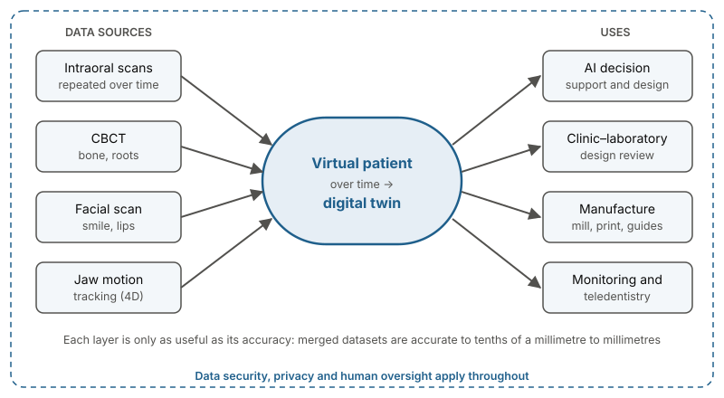

# Chapter 20. Implementation, Economics, Education and the Future

## Learning Objectives

After reading this chapter, you should be able to:

1. Choose a CAD/CAM system for a practice or laboratory using a structured, evidence-based checklist.
2. Interpret cost and time analyses of digital workflows, and estimate return on investment realistically.
3. Organise clinic–laboratory communication in a digital workflow so that errors and remakes are reduced.
4. Describe how digital dentistry is taught, including simulation, virtual reality and haptic training, and what the evidence shows.
5. Explain the regulatory and liability principles that apply to digitally designed and manufactured dental devices.
6. Discuss the likely future of the field (artificial intelligence, the virtual patient, sustainability and teledentistry) with appropriate scepticism.

---

## 20.1 From Technology to Practice

The previous nineteen chapters described what CAD/CAM can do. This chapter is about **whether, when and how** to bring it into a practice, a laboratory or a curriculum, and what is likely to change next.

Digital dentistry has been described as disruptive but not destructive: it has improved the patient experience, widened restorative options and created new ways for professionals to work together [1]. Disruption still has costs. Equipment must be bought and maintained, people must be trained, workflows must be redesigned and data must be protected. Getting these decisions right matters as much as choosing the right material or scanner.

---

## 20.2 Choosing a System

### 20.2.1 Start with the indications, not the device

The best system is the one that fits **what you actually do**. Before looking at brochures, list:

- the restorations you make most often (single crowns, inlays, implant crowns, aligners, guides, dentures);
- the proportion that could be done chairside, in your own laboratory or by an outside laboratory or production centre (Chapter 1);
- your current laboratory partners and the formats they accept;
- who in the team will scan, design and manufacture.

Scanners differ in trueness and precision, and the best device depends on the clinical situation: a network meta-analysis of complete-arch scanning found significant differences between scanners and concluded that different scanners should be used according to the arch type [2]. Evidence for single units is a separate question (Chapters 3 and 4), so a practice doing mostly complete-arch implant work needs different evidence from one doing mostly single posterior crowns. Figure 20.1 summarises the decision process developed in this section and Section 20.3.

### 20.2.2 A buyer's checklist

**Table 20.1** Buyer's checklist for a CAD/CAM system

| Area | Questions to ask | See |
|---|---|---|
| **Evidence** | Is there independent (not manufacturer) evidence on trueness and precision for *my* indications? | Ch 3, 4 |
| **Openness** | Can I export native scans as STL/PLY/OBJ without extra fees? Are colour and bite kept? | Ch 2 |
| **Interoperability** | Which laboratories, design programs, mills and printers accept the data? | Ch 2 |
| **Libraries** | Are the implant systems and scan bodies I use supported? | Ch 9 |
| **Materials** | Which blocks, discs and resins are validated? Can I use third-party materials? | Ch 10, 11, 13–15 |
| **Total cost** | Purchase, licences, subscriptions, service, updates, consumables (tips, burs, blocks, resins), furnace and post-processing equipment | 20.3 |
| **Training and support** | Initial training, local support, response time, loan equipment during repair | 20.5 |
| **Data** | Where are data stored? Is there a data-processing agreement? Can I get all my data out if I leave the system? | Ch 2 |
| **Infection control** | Validated tip reprocessing; cost per patient | Ch 4 |
| **Integration** | Compatibility with practice management software and patient records | Ch 4 |
| **Upgrade path** | How often does hardware become obsolete? Are software updates included? | 20.3 |

> **Clinical Tip.** Ask for a **trial period** and test the whole chain (scan, send, design, manufacture, seat) on a few real cases with your own laboratory before signing. Most problems appear at the interfaces between systems, not inside them.

**Figure 20.1** A decision path for choosing a CAD/CAM system. The break-even estimate (Section 20.3.2) decides between in-house manufacture and investing in scanning only; either way, test the whole chain before buying.

### 20.2.3 Institutional adoption

Large institutions such as dental schools and hospital clinics face extra hurdles. A recent review noted that integration of intraoral scanners into large dental institutions has been slow, partly because of compatibility with existing health-record systems and the management of large volumes of data [3]. Planning for data storage, identification and integration should therefore come before, not after, the purchase of equipment.

---

## 20.3 Cost, Time and Return on Investment

### 20.3.1 What the evidence shows

Economic evidence for digital dentistry is thinner than clinical evidence:

- A systematic review of time and cost in digital versus conventional workflows for fixed prostheses found only 8 eligible studies. Results on whether scanning or impression-making was faster were **contradictory** for both single crowns and three-unit FDPs. The digital pathway **shortened laboratory time**. No study compared the **cost** of tooth-supported fixed prostheses, and the authors called for cost-effectiveness studies [4].
- For implant-supported single crowns, a crossover study of 20 patients found lower direct treatment costs with the digital workflow (1815 versus 2120 CHF), mainly through lower laboratory costs, and a cost-minimisation analysis showed an **18%** cost reduction; the digital arm also used customised titanium abutments with CAD/CAM zirconia, against standard abutments with PFM crowns [5].
- A systematic review of randomised trials of complete digital workflows found only three trials. In the one on implant crowns, the complete digital workflow was more than twice as fast as a mixed analogue–digital workflow (75.3 versus 156.6 min). The authors concluded that no evidence-based recommendations could yet be given and that research lagged behind industrial development [6].

Chapter 16 reviews the more specific economics of **chairside** CAD/CAM, where evidence is limited mostly to an in vitro time-and-cost comparison [7].

> **Evidence Box.** There is still no robust, independent cost-effectiveness evidence for most digital indications in tooth-supported fixed prosthodontics [4]. In the author's experience (expert opinion), claims of large savings usually come from manufacturers or single-practice experience. Treat them as hypotheses to test with your own figures.

### 20.3.2 Building your own estimate

A simple return-on-investment estimate compares **annual net benefit** with **total annual cost of ownership**.

**Costs** (annualised):
- equipment depreciated over its realistic useful life;
- licences, subscriptions and service contracts;
- consumables: scanner tips, burs, blocks/discs, resins, glazes, furnace elements;
- staff time for scanning, design, manufacture and post-processing;
- training time and lost productivity during the learning curve;
- IT: storage, backup, cybersecurity.

**Benefits** (annualised):
- laboratory fees avoided or reduced [5];
- chair time saved (or lost) per indication [4,6];
- fewer remakes and adjustments, if achieved;
- additional treatments made feasible (for example single-visit restorations, guided surgery, aligners);
- patient comfort and practice differentiation (hard to quantify; in a randomised trial of 42 patients needing tooth-supported crowns or FDPs, digital impressions caused much less discomfort than conventional impressions) [8].

The decisive variable is usually **utilisation**: a mill that produces three restorations a week has a very different cost per unit from one producing thirty.

Table 20.2 arranges these items as a worksheet.

**Table 20.2** Return-on-investment worksheet (annual figures; fill in with your own data)

| Item | Cost or benefit | How to estimate | Evidence or note |
|---|---|---|---|
| Equipment | Cost | Purchase price ÷ realistic useful life | Check upgrade cycle (Table 20.1) |
| Licences, subscriptions, service | Cost | Annual contract values | Include export or cloud fees |
| Consumables | Cost | Units per year × (tips, burs, blocks/discs, resins, glazes) | Rises with utilisation |
| Staff time | Cost | Hours for scanning, design, manufacture, post-processing × hourly cost | Delegation changes this (Chapter 16) |
| Training and learning curve | Cost | Training hours + slower early cases + remakes | Training associated with better trueness and faster scanning [9] |
| IT and data | Cost | Storage, backup, cybersecurity | Chapter 2 |
| Laboratory fees avoided | Benefit | Units made in-house × laboratory fee | Main saving for implant crowns [5] |
| Chair time | Benefit or cost | Minutes saved or lost per indication × chair-hour value | Scan or impression time inconsistent for tooth-supported FDPs [4]; faster for implant crowns in one RCT [6] |
| Remakes and adjustments | Benefit (if achieved) | Change in remake rate × cost per remake | Track with a remake log (Section 20.4) |
| New treatments | Benefit | Additional single-visit, guided or aligner cases | Depends on case mix |
| Patient comfort | Benefit | Hard to quantify | Less discomfort with digital impressions in one RCT of crowns and FDPs [8] |

> **Clinical Tip.** Calculate the **break-even number of units per month** for each device before buying it, using your own fees, laboratory charges and staff costs. If you cannot reach it within your existing case mix, consider outsourcing manufacture and investing only in scanning.

### 20.3.3 Learning-curve costs

Operators gain speed with experience, and inexperience may minimally reduce trueness; in a meta-analysis, training sessions were associated with better trueness (in vitro) and shorter scanning time (clinical trials), with no change in precision and low certainty of evidence [9]. Budget for the learning curve: early cases take longer, and some will need rescanning or remaking. A narrative review lists the learning curve and purchasing and managing costs among the disadvantages of intraoral scanning [10].

---

## 20.4 Communication Between Clinic and Laboratory

Digital workflows change, but do not remove, the need for clear communication. Data now travel faster than impressions ever did, but a perfect scan with an incomplete prescription is still an incomplete case.

### 20.4.1 The digital prescription

Handwritten laboratory forms often suffer from illegible handwriting, missing data and lost forms. In a mixed-methods study, structured training improved the quality of paper laboratory forms completed by dental students, and, when year-5 students completed forms for two sample cases, a **digital prescription platform with mandatory fields** produced the highest-quality, most complete forms; students and technicians reported fewer errors and better communication [11].

A complete digital prescription should include:

- patient identifiers (pseudonymised where possible) and due date;
- teeth or implants, restoration type, material and manufacturing route;
- shade (with photographs, ideally with a reference shade tab and cross-polarised images);
- margin and preparation notes, and any concerns about scan quality;
- occlusal scheme and contact preferences (for example "light/no occlusal contact");
- implant system, platform, scan body and abutment preference (Chapter 9);
- aesthetic plan: approved mock-up or digital smile design files (Chapter 6);
- who approves the design before manufacture.

### 20.4.2 Design approval and feedback

Most laboratory platforms now allow the dentist to view and approve the design (Chapter 7). Agree:

- **what** will be reviewed (margin, thickness, contacts, occlusion, emergence, aesthetics);
- **who** reviews it and how quickly;
- **how** problems are fed back, for example with annotated screenshots rather than vague comments.

> **Lab Note.** Keep a simple log of remakes and adjustments with their cause (scan, prescription, design, manufacture, clinical). Within a few months it shows where the chain is weakest, and it turns arguments into data.

---

## 20.5 Teaching Digital Dentistry

### 20.5.1 Why it belongs in the curriculum

Digital workflows are now part of routine practice, and graduates are expected to use them. Teaching should cover not only how to operate scanners and software but also the principles in this book: accuracy, data, materials, evidence and the limits of the technology.

Student studies show that digital impressions can be introduced early in training and are well accepted by students. After a short theoretical and practical module, 77% of fourth-year dental students were very or rather satisfied with intraoral scanning, and 58% preferred it to alginate from the dentist's perspective; the authors recommended including digital impressions in undergraduate training [12]. In a pre-clinical elective course comparing three intraoral scanners and CAD/CAM systems, students valued hands-on experience with several systems and showed clear preferences between them [13]. Both studies were small, and self-reported preferences are not the same as competence.

At a 2026 dental education summit, a working group of eight academic and organisational leaders reached unanimous consensus. It recommended an **AI and technology curriculum** across all levels of dental education, a dedicated leadership role for integrating AI and emerging technologies, and the use of AI to support institutional effectiveness, faculty calibration, patient care and student learning. This is expert consensus, not trial evidence [14].

### 20.5.2 Simulation, virtual reality and haptics

Virtual reality (VR), augmented reality (AR) and haptic simulators are increasingly used in dental education:

- An umbrella review of 18 systematic reviews found that most reported improvements in skill development and psychomotor performance, especially in restorative dentistry and prosthodontics, and generally positive student perceptions. Few studies evaluated long-term retention, and methodological quality varied, with only a minority of reviews rated high confidence [15].
- In periodontal education, immersive technologies improved procedural skills, engagement and communication, especially when combined with traditional training; AI diagnostic tools offered limited advantage and could introduce **automation bias**, and large language models showed variable accuracy [16].
- In orthodontics, a meta-analysis found a large pooled benefit of haptic and VR systems for psychomotor learning and procedural planning, with high heterogeneity; benefits for direct patient care were not yet established [17].

Taken together, these reviews suggest that simulation and VR are promising **adjuncts** to, not replacements for, supervised clinical training [15–17].

### 20.5.3 A suggested curriculum structure

**Table 20.3** A staged approach to teaching CAD/CAM

| Stage | Content | Methods |
|---|---|---|
| Foundation | Principles of digitisation, accuracy (trueness/precision), file formats, data protection | Lectures, short practical exercises (Chapters 1–3) |
| Pre-clinical | Scanning on models; scanning strategy; design of inlays and crowns; reading thickness maps | Simulation, typodonts, design software (Chapters 4, 7, 8) |
| Early clinical | Supervised scanning; single units; shade and photography; digital prescriptions | Clinical sessions with feedback (Chapters 4, 16, 20) |
| Advanced | Implant scanning, guided surgery, virtual patient, complete-arch workflows | Case-based learning, interdisciplinary projects (Chapters 6, 9, 17) |
| Critical appraisal | Reading accuracy and survival studies; evaluating AI tools | Journal clubs using the checklist in Chapter 3 |

### 20.5.4 Training the whole team

Scanning, design and manufacturing are often delegated. Assistants and technicians need structured training and protected learning time, just as dentists do (Chapter 16). Training is associated with better scanning trueness and shorter scanning times [9].

---

## 20.6 Regulation and Liability

### 20.6.1 Custom-made devices

Crowns, fixed dental prostheses (FDPs), dentures, splints, aligners and surgical guides are **medical devices**. Most are **custom-made**: made for one named patient to a written prescription from an authorised professional. In most jurisdictions this carries obligations for whoever designs and manufactures the device, including documentation, traceability, use of materials intended for that purpose, and a statement of conformity to the relevant requirements. The details depend on jurisdiction: in the European Union, the **Medical Device Regulation (EU MDR)** applies; in the United States, the **Food and Drug Administration (FDA)** regulates dental devices and materials. Specific classifications and obligations for each device type, and how they apply to in-house (chairside or hospital) manufacture, should be checked against current national guidance **[UNVERIFIED — regulatory specifics not confirmed against primary legal texts]**.

**Verification note — Minor conflict.** The marked claim above could not be confirmed.

| Claim not confirmed | Conflict | Reason | To resolve |
|---|---|---|---|
| Regulatory obligations for custom-made devices | **Minor** | General knowledge; primary legal texts not checked | Cite the EU MDR (Annex XIII) and FDA sources |

### 20.6.2 Point-of-care manufacturing

When a practice or hospital mills or prints devices itself, it takes on part of the role of a manufacturer. An example of how this can be organised is an academic point-of-care manufacturing unit certified to ISO 13485 in a Spanish university hospital, which produced 442 3D-printed devices for oral and maxillofacial surgery over about eight years, mostly anatomical models (about 68%), surgical guides (20%) and patient-specific implants (7%) [18]. The authors presented it as a model for integrating additive manufacturing into clinical practice while maintaining regulatory compliance [18].

For a typical dental practice, the practical principles are:

- use only **materials and devices intended and validated** for the indication (for example, printing resins labelled for the specific use), and follow the manufacturer's processing instructions exactly (Chapters 10–12);
- keep **records** linking each device to the patient, the design file, the material batch and the machine;
- **calibrate and maintain** equipment and document it (Chapters 5, 10, 12);
- maintain **traceability** of design changes and approvals.

### 20.6.3 Liability

Responsibility does not disappear when a machine or an algorithm does part of the work. The prescribing clinician remains responsible for diagnosis, the treatment plan, the prescription and the final fitting of the device. Where AI proposes a design or a diagnosis, continuous human oversight should be expected [19]; how responsibility is shared for AI-assisted work is still an open question [19], so the general principle above applies. Contracts with laboratories and software providers should make clear who is responsible for what, including data protection (Chapter 2) **[UNVERIFIED — general principle; legal specifics vary by jurisdiction]**.

**Verification note — Minor conflict.** The marked claim above could not be confirmed.

| Claim not confirmed | Conflict | Reason | To resolve |
|---|---|---|---|
| Clinician stays responsible; how liability is shared | **Minor** | General principle; differs by jurisdiction | Leave as a general principle, or cite a legal source |

---

## 20.7 The Future

### 20.7.1 Artificial intelligence

AI is already embedded in scanning, segmentation, registration and design (Chapters 4, 6 and 7). In a systematic review of 15 non-randomised studies, AI-designed single crowns were generally comparable with human designs and consistently faster to design. Inlays and three-unit FDPs were less clinically acceptable, and refinement of proximal contacts, occlusion and aesthetics by experienced operators was still recommended [20]. More broadly, AI in dentistry faces barriers of limited data, methodological standards, practical value, ethics and responsibility; privacy and patient autonomy must be central, and federated learning may help [19].

Expect AI to take over more routine steps (margin marking, proposals, nesting, quality checks) and to move from *design assistance* towards *decision support*. The professional's role will shift towards checking, judging and taking responsibility.

### 20.7.2 The virtual patient and the digital twin

The virtual patient (Figure 20.2), which combines intraoral scans, CBCT and facial scans, was first described as a static three-dimensional model, with a "4D virtual patient in motion" named as the next step [21]. Combining these data with jaw-motion tracking has since been described as a proof of concept [22]. In implant dentistry, the integration of all digital records into a comprehensive **digital twin** of the patient is seen as pointing towards predictive, patient-specific therapy, while raising economic, educational and ethical challenges, including investment, accessibility and **data security** [23].

**Figure 20.2** The virtual patient as an integration hub, developing over time into a digital twin. Data security and human oversight apply throughout [19,21–23].

As Chapter 6 showed, the accuracy of merged datasets is still measured in tenths of a millimetre to millimetres. The digital twin is a powerful idea; its clinical value will depend on making each layer accurate enough for the decisions it is meant to support.

### 20.7.3 Sustainability

Digital dentistry is often presented as greener than conventional care [24], because it uses less impression material and fewer stone casts. The evidence is more cautious:

- A life cycle assessment of four removable partial denture fabrication scenarios found **lower carbon emissions** for digital than for alginate-based workflows, both with a local laboratory (65.22 versus 77.29 kg CO₂) and with a global laboratory (78.63 versus 94.67 kg CO₂). The authors attributed this to fewer appointments, less material waste and less transport (patient-travel emissions fell by 20%); using local laboratories reduced the footprint by about 18% across both workflow types [25].
- A scoping review of life cycle assessment evidence concluded that digital dental workflows are **not inherently sustainable**: they may reduce environmental burden when they cut appointments, material use, transport and remakes without adding disproportionate energy, equipment, post-processing or hazardous waste burdens. Direct evidence was sparse and did not justify pooled conclusions [24].
- In a survey of 175 dental students from 14 European schools, 56% named 3D printing and CAD/CAM as a strategy to reduce dentistry's environmental impact, and 42% were interested in an elective course on sustainability [26].

Practical steps include maximising equipment utilisation, nesting milling and printing jobs, minimising remakes, handling resin and solvent waste correctly (Chapter 11), choosing local laboratories where possible [25], and replacing physical shipping with data transfer.

### 20.7.4 Teledentistry

Digital records make remote care easier. A systematic review of 34 studies, about half on tele-diagnosis and about half using asynchronous communication, found that teledentistry can support accurate, cost-effective and timely diagnosis and consultation and improve access, particularly in underserved regions; most studies were cross-sectional, limiting the strength of the conclusions [27]. A systematic review of 11 cross-sectional studies of dental care providers in Saudi Arabia reported barriers including limited awareness and training, infrastructure and equipment reliability, privacy and data security, cost, diagnostic accuracy and a preference for in-person meetings [28].

For CAD/CAM, teledentistry is likely to mean remote monitoring with repeated intraoral scans (Chapter 4), remote design review between clinic and laboratory, and specialist consultation on virtual patient data, always within the data-protection rules of Chapter 2.

---

## 20.8 Concluding Remarks: The Book in Seven Principles

CAD/CAM has moved from Duret's idea of an optical impression and Mörmann's first chairside inlay (Chapter 1) to a connected system that spans imaging, design, manufacturing, materials and data. Seven principles run through this book:

1. **The chain is only as strong as its weakest link.** Acquisition, design, manufacture, finishing and clinical delivery each add error (Chapters 1–3, 12).
2. **Measure accuracy properly.** Trueness and precision, the right reference and the right metric (Chapter 3).
3. **Match the technology to the indication.** Single units and short spans are well supported; complete arches and complex cases need verification (Chapters 3–5, 9).
4. **Materials decide longevity.** Choose them on clinical evidence and process them exactly as validated (Chapters 8, 10–15).
5. **Use each dataset within its accuracy.** Faces, bones and movements inform design; they do not replace precise surface data and clinical checks (Chapter 6).
6. **Keep the human in the loop.** Software and AI propose; the clinician and technician decide and take responsibility (Chapters 7, 20).
7. **Read the evidence with healthy scepticism.** Industrial development moves faster than clinical research, so every new claim deserves to be tested [6].

Used with these principles, CAD/CAM does not replace clinical judgement or craftsmanship. It extends them.

---

## Key Points

- Choose a system for **your indications**, using independent evidence, openness, total cost, support and data management (Table 20.1). Complete-arch scanner trueness and precision differ with the clinical scenario [2].
- **Cost evidence is thin**: digital workflows shorten laboratory time, but time savings at the chair are inconsistent and tooth-supported cost-effectiveness has not been studied [4]. In one crossover study of implant crowns, the digital workflow showed an 18% cost reduction [5].
- **Utilisation** drives return on investment. Budget for the learning curve [9,10].
- In a dental-school study, a **digital prescription platform** with mandatory fields produced more complete forms, and users reported better communication [11]. Agree design-approval procedures with the laboratory.
- Digital impressions can be taught early [12,13]. **VR and haptics** are promising adjuncts with methodologically limited evidence [15–17].
- Dental devices are **regulated medical devices**, and in-house manufacture brings documentation, traceability and quality obligations (Section 20.6) **[UNVERIFIED — regulatory specifics not confirmed against primary legal texts]**. An ISO 13485-certified hospital point-of-care unit shows one way to organise this [18]. AI-assisted work requires continuous human oversight [19]; responsibility stays with the professional (Section 20.6.3).

**Verification note — Minor conflict.** The marked claim above could not be confirmed.

| Claim not confirmed | Conflict | Reason | To resolve |
|---|---|---|---|
| Regulatory obligations for custom-made devices | **Minor** | General knowledge; primary legal texts not checked | Cite the EU MDR (Annex XIII) and FDA sources |

- AI, the **digital twin**, sustainability and teledentistry are likely to shape the field's future [19–28], but each requires evidence, data security and human oversight.

---

## Review Questions

1. Using Table 20.1, outline how you would choose between two intraoral scanners for a practice that mainly provides implant restorations.
2. What does systematic review evidence say about the time and cost of digital versus conventional workflows for fixed prostheses? What evidence is missing?
3. List the cost and benefit items you would include in a return-on-investment estimate for an in-house milling unit. Why is utilisation the key variable?
4. Design a digital laboratory prescription for an implant-supported anterior crown. Which fields would you make mandatory?
5. Summarise the evidence on VR and haptic simulation in dental education. What are its main limitations?
6. A practice begins printing occlusal splints in-house. Which regulatory and quality-management principles should it follow?
7. Is digital dentistry more sustainable than conventional dentistry? Use the life cycle assessment evidence to support your answer.
8. Choose one of the seven principles in Section 20.8 and illustrate it with an example from your own experience.

---

## References

1. Rekow ED. Digital dentistry: the new state of the art — is it disruptive or destructive? Dent Mater. 2020;36(1):9–24. doi:10.1016/j.dental.2019.08.103
2. Vitai V, Németh A, Sólyom E, Czumbel LM, Szabó B, Fazekas R, et al. Evaluation of the accuracy of intraoral scanners for complete-arch scanning: a systematic review and network meta-analysis. J Dent. 2023;137:104636. doi:10.1016/j.jdent.2023.104636
3. Eggmann F, Blatz MB. Recent advances in intraoral scanners. J Dent Res. 2024;103(13):1349–57. doi:10.1177/00220345241271937
4. Bessadet M, Drancourt N, El Osta N. Time efficiency and cost analysis between digital and conventional workflows for the fabrication of fixed dental prostheses: a systematic review. J Prosthet Dent. 2025;133(1):71–84. doi:10.1016/j.prosdent.2024.01.003
5. Joda T, Brägger U. Digital vs. conventional implant prosthetic workflows: a cost/time analysis. Clin Oral Implants Res. 2015;26(12):1430–5. doi:10.1111/clr.12476
6. Joda T, Zarone F, Ferrari M. The complete digital workflow in fixed prosthodontics: a systematic review. BMC Oral Health. 2017;17(1):124. doi:10.1186/s12903-017-0415-0
7. Mangano FG, Cianci D, Pranno N, Lerner H, Zarone F, Admakin O. Trueness, precision, time-efficiency and cost analysis of chairside additive and subtractive versus lab-based workflows for manufacturing single crowns: an in vitro study. J Dent. 2024;141:104792. doi:10.1016/j.jdent.2023.104792
8. Gjelvold B, Chrcanovic BR, Korduner EK, Collin-Bagewitz I, Kisch J. Intraoral digital impression technique compared to conventional impression technique: a randomized clinical trial. J Prosthodont. 2016;25(4):282–7. doi:10.1111/jopr.12410
9. Limones A, Morton D, Sallorenzo A, Lin WS, Sadid-Zadeh R, Phasuk K, et al. Impact of operator experience on intraoral digital scanning: a systematic review, meta-analysis, and meta-regression. Report of the Committee on Research in Fixed Prosthodontics of the American Academy of Fixed Prosthodontics. J Prosthet Dent. 2026;135(2):297.e1–297.e13. doi:10.1016/j.prosdent.2025.09.008
10. Mangano F, Gandolfi A, Luongo G, Logozzo S. Intraoral scanners in dentistry: a review of the current literature. BMC Oral Health. 2017;17(1):149. doi:10.1186/s12903-017-0442-x
11. Kohli S, Asyraf TM, Afiff M, Jamayet NB, Dhaliwal JS. Improving the quality of dental laboratory prescription forms through training and digital workflow. Int J Dent. 2026;2026:8504529. doi:10.1155/ijod/8504529
12. Schott TC, Arsalan R, Weimer K. Students' perspectives on the use of digital versus conventional dental impression techniques in orthodontics. BMC Med Educ. 2019;19(1):81. doi:10.1186/s12909-019-1512-3
13. Zoidis P, Motlagh N, Tarte S, Vaughan C, Phu L, Vandewater L, et al. Dental students' perspectives on three intraoral scanners and CAD/CAM systems before and after a pre-clinical elective course in digital dentistry. J Clin Exp Dent. 2022;14(10):e803–e808. doi:10.4317/jced.59923
14. Wu DT, Brownstein S, Campos M, Crain G, Licari F, Rosato R, et al. Reimagining dental education: consensus recommendations for innovation, technology integration, and practice transformation. J Dent Educ. 2026. Epub ahead of print. doi:10.1002/jdd.70420
15. Corvalan-Diaz C, Havellas W, Miletic V. Effects of virtual reality, augmented reality and haptic technology versus conventional training on dental education outcomes: an umbrella review. Eur J Dent Educ. 2026. doi:10.1111/eje.70219
16. Wei Y, Li Y, Hu W, Kang J, Han Z, Zhen M, et al. Artificial intelligence and immersive digital technologies in periodontal education: a systematic review. Front Oral Health. 2026;7:1741033. doi:10.3389/froh.2026.1741033
17. Alam MK, Alsaeed S, Hajeer MY, Abutayyem H, Alayyash A. Haptic technology in orthodontics: a systematic review and meta-analysis. Front Oral Health. 2026;7:1768079. doi:10.3389/froh.2026.1768079
18. Tousidonis M, Ruiz-de-Leon G, Navarro-Cuellar C, Ochandiano S, Salmeron JI, Franco Herrera R, et al. Academic point-of-care manufacturing in oral and maxillofacial surgery: a retrospective review at Gregorio Marañón University Hospital. Medicina (Kaunas). 2026;62(1):234. doi:10.3390/medicina62010234
19. Schwendicke F, Samek W, Krois J. Artificial intelligence in dentistry: chances and challenges. J Dent Res. 2020;99(7):769–74. doi:10.1177/0022034520915714
20. Limpuangthip N, Hlaing NHMM, Lee SJ, Lee JH. Design quality and time efficiency of AI-based versus human-based design for tooth- and implant-supported fixed dental restorations: a systematic review. J Dent. 2026;170:106644. doi:10.1016/j.jdent.2026.106644
21. Joda T, Gallucci GO. The virtual patient in dental medicine. Clin Oral Implants Res. 2015;26(6):725–6. doi:10.1111/clr.12379
22. Haku-Mizuhara K, Tanabe G, Kadempour A, Mirafzali S, Yotsuya M, Yamaguchi S. Development of a 4-dimensional virtual patient in motion: a digital concept. J Prosthet Dent. 2026;135(1):47–53. doi:10.1016/j.prosdent.2025.02.064
23. Joda T, Lee J, Pala K, Poon J, Jung RE, Gallucci GO. Digital implant dentistry: the past, the present, the future. J Periodontal Res. 2026;61(8):877–93. doi:10.1111/jre.70139
24. Bijoch J, Jędrasiak K. Life cycle assessment evidence for digital dental workflows: a scoping review and evidence map of additive manufacturing, subtractive CAD/CAM, and conventional care. BMC Oral Health. 2026;26(1). doi:10.1186/s12903-026-09534-6
25. Rosenblatt A, Sabu P, McAuley K, Ryan E, Malaj T, Tiew N, et al. Life cycle assessment of the complete denture fabrication process using traditional impressions versus intra-oral scanning. Br Dent J. 2026;240(3):161–7. doi:10.1038/s41415-025-9250-x
26. Țâncu AMC, Brand HS, Imre M, Pantea M, Pițuru SM, Sfeatcu R, et al. Are tomorrow's dentists ready for a sustainable future? Insights from a European student survey. Front Dent Med. 2026;7:1788789. doi:10.3389/fdmed.2026.1788789
27. Dinari F, Ghaemi MM, Bahaadinbeigy K, Hajesmaeel-Gohari S. The use of teledentistry in diagnosis, consultation, and treatment of oral and dental diseases: a systematic review study. Health Sci Rep. 2026;9(5):e71989. doi:10.1002/hsr2.71989
28. Hakami A, Mohan S. The perceived facilitators and barriers to the potential adoption of teledentistry among dental care providers in Saudi Arabia: a systematic review. PLoS One. 2026;21(9):e0359436. doi:10.1371/journal.pone.0359436
