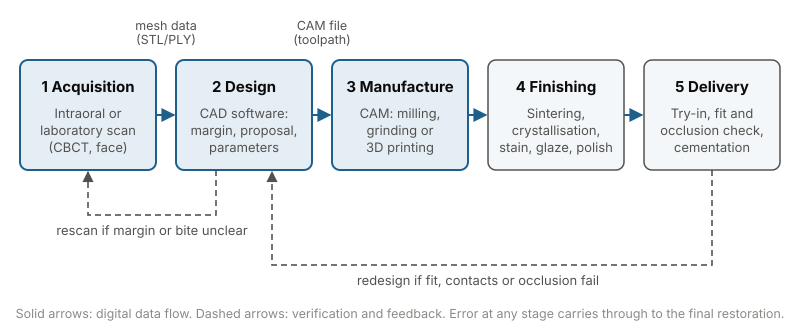

# Figure Style Guide

All figures are original vector diagrams or charts drawn as hand-written SVG. They contain no clinical photographs and no copied images. They live in `figures/` and are referenced from chapters as `../figures/<file>.svg`.

## Kinds of figure
1. **Schematic diagrams.** Workflows, mechanisms, geometry (e.g., the CAD/CAM chain, trueness vs precision targets, milling axes, the emergence angle). Show the real mechanism, labelled; no decorative clip-art.
2. **Data charts.** Only numbers that already appear in the chapter **with their citation**. The caption must cite the same reference number(s) as the text, e.g. "Data from [14]." Never introduce a new number.
3. **Decision flowcharts.** Turning a chapter's guidance into a decision path. They introduce no new claims.

## Canvas and type
- `viewBox` width **800**; height as needed (typically 360–560). No fixed `width`/`height` attributes. Add `role="img"` plus `<title>` and `<desc>` for accessibility.
- Fonts: `font-family="Inter, Carlito, 'DejaVu Sans', sans-serif"`. Sizes: labels 14–15, small notes 12–13, titles inside the figure are **not** used (the caption carries the title).
- Background: white `#ffffff` (print book, light mode only).

## Colour (print, light mode)
- Text: primary `#0b0b0b`, secondary `#52514e`, muted `#8a8984`.
- Lines/strokes for structure: `#52514e` (1.5–2 px); light rules `#cfd6de`.
- Book accent (headings, key arrows): `#1f5f8b`. Light accent fill: `#e6eef5`. Box fill: `#f3f7fa`.
- **Categorical series (fixed order, never cycled):** 1 `#2a78d6` blue, 2 `#eb6834` orange, 3 `#1baf7a` aqua, 4 `#eda100` yellow, 5 `#e87ba4` magenta, 6 `#008300` green, 7 `#6250d6` violet, 8 `#e34948` red. Charts with more than 3 series that need all pairs distinguishable must be faceted or direct-labelled.
- Sequential (magnitude): one hue, blue, light→dark: `#cfe1f7`, `#8fb8ec`, `#2a78d6`, `#1a4f91`.
- Status colours are not used for series.
- Text never takes a series colour. Every coloured mark has a direct text label or legend, so identity is never carried by colour alone.

## Mark specs (charts)
- Bars: thin, 2 px white gap between adjacent bars, 4 px rounded data-end, anchored to the baseline. Value labels selectively (not on every mark if crowded).
- Lines 2 px; markers ≥ 8 px.
- One y-axis only. Recessive gridlines `#e5e7ea`. Axis labels in secondary ink.
- Axes start at zero for bars. If a survival chart zooms (e.g., 80–100%), state it in the axis label ("axis starts at 80%") and in the caption.

## Diagram specs
- Rounded boxes (rx 8), fill `#f3f7fa` or `#e6eef5`, stroke `#52514e` 1.5 px; emphasis boxes stroke `#1f5f8b` 2 px.
- Arrows: `#52514e` 2 px with a marker-end arrowhead; key path in accent `#1f5f8b`.
- Keep ≥ 12 px padding inside boxes. No text below 12 px. Nothing overflows the viewBox.

## In the chapter
```markdown


**Figure 1.1** Caption sentence(s). Data from [n] where applicable.
```
- File names: `fig-NN-M-short-slug.svg` (NN = chapter, M = figure number within the chapter, in order of appearance).
- Place the figure right after the paragraph that first discusses it, and refer to it in the text ("(Figure 3.2)").
- Every figure must be rendered to PNG and visually checked for collisions or overflow before it is accepted.
